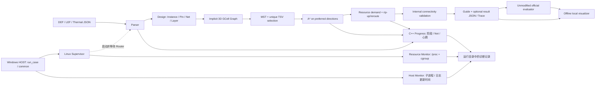

# 设计架构

核心不依赖 UI；Router 不接收 Guide 输入参数。
图节点 `(x,y,layer)` 编码为 `(layer*rows+y)*cols+x`。邻居按需生成，资源表仅保存被访问的节点。
Die 归属与比赛本地规则一致：M1–M10 为 bottom，M11–M20 为 top。
普通 Via 从 LEF VIA/VIARULE 层对提取，仅接受相邻 Routing 层；M10/M11 为单独的 TSV 边。

输入：固定四参数文件与可选配置。处理：解析、引脚变换、建图、分 Die MST、A*、协商重布、验证。输出：完整 Guide；可选真实路径、容量、温度、迭代与 Trace。

Python 工具通过 subprocess 参数数组调用，WSL shell 参数经 `shlex.quote` 引用。输入哈希写入运行记录，评估前复核。评分器会在 DEF 旁生成缓存；现将三份原始输入做字节相同的副本放在评估运行目录，评分工作目录与 FLUTE 表也位于 outputs，避免旁路写入官方目录。
UI 仅绑定 `127.0.0.1`，只提供已发现运行的只读数据接口，不接受任意文件路径或执行请求。

`include/progress.hpp` 的对象由 main 持有，作用域记录开始/结束及异常阶段；Router 只接收可选指针。初始轮按首尾/每 1000 个位置记录细节，优化轮保留扫描/重布摘要，A* 每 4096 次有效展开通过已有时间检查尝试心跳。它不改变 MST、代价、TSV 或回滚策略，Progress 不是逐节点搜索 Trace。

`scripts/linux_supervisor.py` 管理自己启动的 Linux 进程组，独立采样 Router RSS、系统可用内存/Swap 和可读的 cgroup；设置环境标记避免 C++ 重复采样。`scripts/diagnostics.py` 提供采样、HOST、128 KiB 有界 JSONL 尾部读取及证据分类。Windows HOST 默认每 5 秒记状态与租约，Supervisor 处理取消和租约过期；这些模块不属于独立四参数比赛运行的 Python 依赖。

`run_case.py` 在启动前写 RUNNING，返回后按真实退出证据和产物更新 ROUTED/FAIL，并增补 failure_category、failure_evidence 和最后阶段/Net。共享 cgroup 的 OOM 计数不是 Router 受害证明；信号、预算、WSL 错误与 UNKNOWN 分开保留。监控器或 WSL 本身突然中断时，清单和末条日志不保证完成写出。

前端 `buildIndex/queryPins` 将全量 Pin 索引与总览网络几何上限分离；密集点在屏幕空间聚合，同 Net 用稳定颜色。`learning/applyEvent` 关联真实 MST 拓扑、临时 A* 路径和已接受 Route，参考 Guide 不产生这些过程数据。`officialTotalScore` 优先读报告总分，缺失时仅在调用/报告均 PASS 且三项得分齐全时按既有单用例权重合成；无数据为 N/A，不是正式平台最终排名分。
