# 设计架构

```mermaid
flowchart LR
  I[DEF / LEF / Thermal JSON] --> P[Parser]
  P --> D[Design: Instance / Pin / Net / Layer]
  D --> G[Implicit 3D GCell Graph]
  G --> T[MST + unique TSV selection]
  T --> A[A* on preferred directions]
  A --> R[Resource demand + rip-up/reroute]
  R --> V[Internal connectivity validation]
  V --> O[Guide + optional result JSON / Trace]
  O --> E[Unmodified official evaluator]
  O --> U[Offline local visualizer]
  E --> U
```

核心不依赖 UI；Router 不接收 Guide 输入参数。
图节点 `(x,y,layer)` 编码为 `(layer*rows+y)*cols+x`。邻居按需生成，资源表仅保存被访问的节点。
Die 归属与比赛本地规则一致：M1–M10 为 bottom，M11–M20 为 top。
普通 Via 从 LEF VIA/VIARULE 层对提取，仅接受相邻 Routing 层；M10/M11 为单独的 TSV 边。

输入：固定四参数文件与可选配置。处理：解析、引脚变换、建图、分 Die MST、A*、协商重布、验证。输出：完整 Guide；可选真实路径、容量、温度、迭代与 Trace。

Python 工具通过 subprocess 参数数组调用，WSL shell 参数经 `shlex.quote` 引用。输入哈希写入运行记录，评估前复核。评分器会在 DEF 旁生成缓存；现将三份原始输入做字节相同的副本放在评估运行目录，评分工作目录与 FLUTE 表也位于 outputs，避免旁路写入官方目录。
UI 仅绑定 `127.0.0.1`，只提供已发现运行的只读数据接口，不接受任意文件路径或执行请求。
