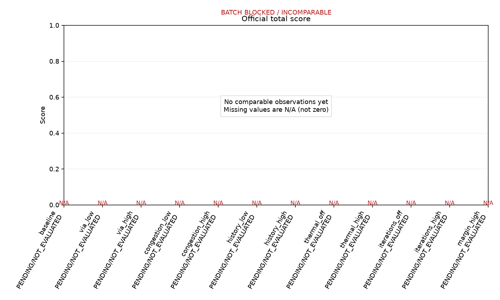
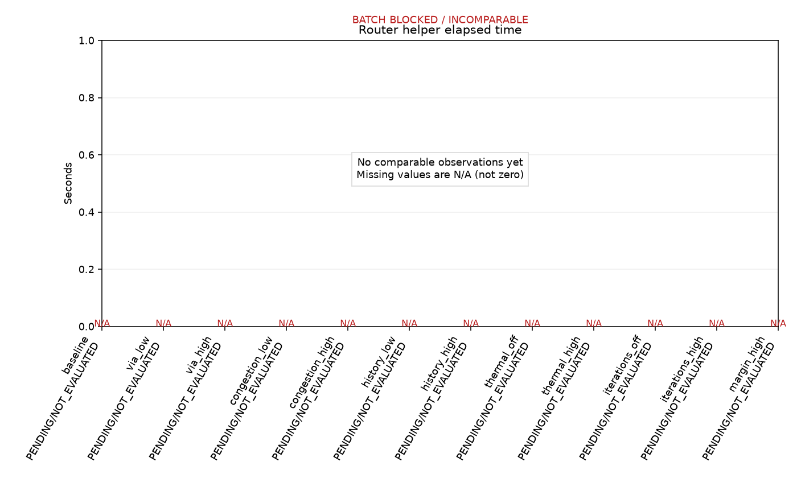
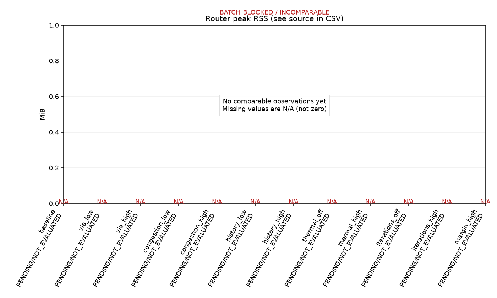
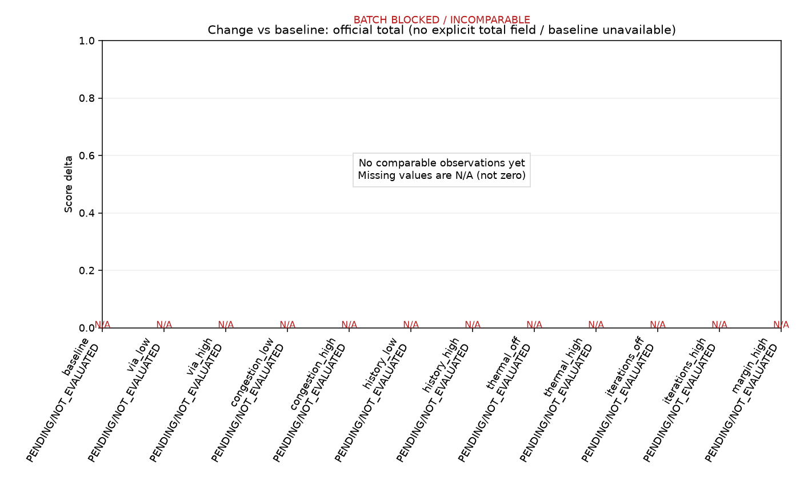
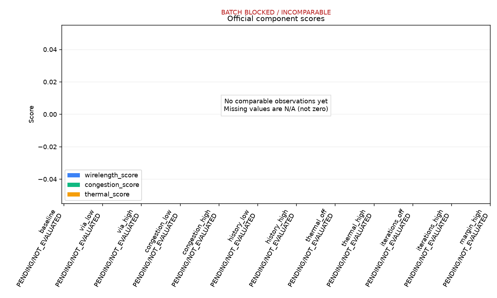
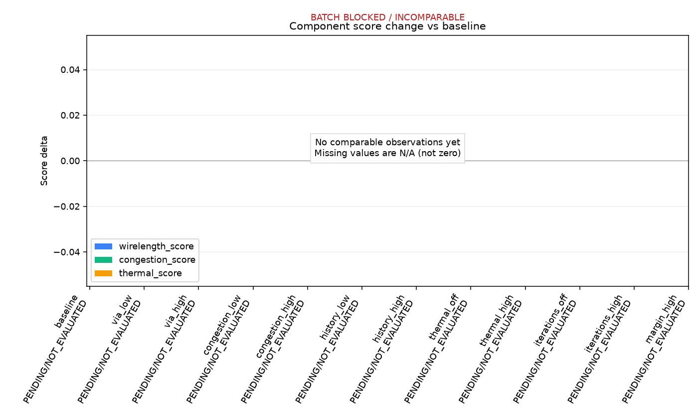

# 阶段一参数实验分析

## 1. 实验概览

- 实验：`phase1_case001`；Case：`open_3d_case001`；状态：`BLOCKED`。
- Router SHA256：`70ddc978c6f427ef79d6601e0a3bf099108e945cbbac249b2c2aa234d3c00423`。
- Evaluator：`latest`；SHA256：`4104d0b2869ef7376d716ce9c33b56668e659575ab84615f5c0a5f282e108a8a`。
- JSON time_limit：600 秒；生效 CLI Router 预算：600 秒；评分预算：600 秒。
- 后端：wsl；监控：`{"heartbeat_interval": 10, "monitor_interval": 5, "progress_every": 1000, "stall_after": 30}`；可比较性：False。
- 输入与工具/源码/环境详见 experiment_plan.json；完整配置、命令、状态和运行记录均保留。
- 官方总分只读取报告中的明确字段；当前评分器报告没有总分时显示 N/A，不使用 weights 合成。

## 2. 参数配置

| ID | 相对 Baseline 的变化 | 配置 SHA256 |
| --- | --- | --- |
| baseline | 无 | `35f2b88dab1d5fae491c3aa82211771f795e5002e77f11f496861b03d8e65336` |
| via_low | {"via": 0.25} | `18f8c80ed1e5a7d528104421b67750197b5e46ad4b1b7f97e41835589467035f` |
| via_high | {"via": 1} | `6e2197ddfcd04e7dc0e66ecd63b9bd0a6f6a1dc9ea5bc55148b805676ffba9a0` |
| congestion_low | {"congestion": 2} | `956d68aa9dee9aecbb73cbd95670ffd3ba0c8c41d8b10c488e951ac5bd3f04ac` |
| congestion_high | {"congestion": 8} | `7cfddd80f963c424fb420006db9850d888eb3532cb6e80cdc9b0f7b541304a59` |
| history_low | {"history": 0.5} | `4ba844ae679e8230c3ee3eb52354f9c384eed450ddade4d047887dac9a79a8cc` |
| history_high | {"history": 2} | `a10b366fde0711dafaac6160ded03bcaeb5e60834e71b320192be8cba2bdee4c` |
| thermal_off | {"thermal": 0} | `6499147b6decddb7a409e1831062ff5dbac26b26c4317836293ade6e006c0edf` |
| thermal_high | {"thermal": 3} | `54277b4a3a89d431c958fd286e5f825ff2a3e26ce417634414f87c229f424137` |
| iterations_off | {"iterations": 0} | `787f813c82c1771fc17906057b31cf6fe444c573a891a517e3359fc3c0ca4fe1` |
| iterations_high | {"iterations": 4} | `83513f84027a57c43a317757070b4ba95128f74b6693f2e334b1f9e39cc34192` |
| margin_high | {"margin": 16} | `eb02450caa85f8b1af40c1b031279f9c69198d35531ad70fed1544cf232b2e9b` |

## 3. 实验完成情况

| 状态 | 数量 |
| --- | ---: |
| PENDING | 12 |
| ROUTING | 0 |
| ROUTED | 0 |
| EVALUATING | 0 |
| COMPLETED | 0 |
| ROUTER_FAILED | 0 |
| EVALUATION_FAILED | 0 |
| INTERRUPTED | 0 |
| BLOCKED | 0 |

可比较官方 PASS：0；Router TIMEOUT：0；评分 TIMEOUT：0。

## 4. 官方评分对比

| ID | Router | 官方 | 总分 | WL Score | Congestion Score | Thermal Score |
| --- | --- | --- | ---: | ---: | ---: | ---: |
| baseline | NOT_RUN | NOT_EVALUATED | N/A | N/A | N/A | N/A |
| via_low | NOT_RUN | NOT_EVALUATED | N/A | N/A | N/A | N/A |
| via_high | NOT_RUN | NOT_EVALUATED | N/A | N/A | N/A | N/A |
| congestion_low | NOT_RUN | NOT_EVALUATED | N/A | N/A | N/A | N/A |
| congestion_high | NOT_RUN | NOT_EVALUATED | N/A | N/A | N/A | N/A |
| history_low | NOT_RUN | NOT_EVALUATED | N/A | N/A | N/A | N/A |
| history_high | NOT_RUN | NOT_EVALUATED | N/A | N/A | N/A | N/A |
| thermal_off | NOT_RUN | NOT_EVALUATED | N/A | N/A | N/A | N/A |
| thermal_high | NOT_RUN | NOT_EVALUATED | N/A | N/A | N/A | N/A |
| iterations_off | NOT_RUN | NOT_EVALUATED | N/A | N/A | N/A | N/A |
| iterations_high | NOT_RUN | NOT_EVALUATED | N/A | N/A | N/A | N/A |
| margin_high | NOT_RUN | NOT_EVALUATED | N/A | N/A | N/A | N/A |

ROUTED 不等于 PASS；FAIL/TIMEOUT/未评分均不进入合法候选。子分数、线长 DBU/μm、总/最大 Overflow、Pearson、TSV 及失败原因详见 results.csv。

## 5. 运行效率对比

| ID | Router wall 秒 | C++ 秒 | Peak RSS MiB | RSS 来源 | Evaluator 秒 | Evaluator MiB | 实际/接受优化轮数 |
| --- | ---: | ---: | ---: | --- | ---: | ---: | --- |
| baseline | N/A | N/A | N/A | N/A | N/A | N/A | N/A/N/A |
| via_low | N/A | N/A | N/A | N/A | N/A | N/A | N/A/N/A |
| via_high | N/A | N/A | N/A | N/A | N/A | N/A | N/A/N/A |
| congestion_low | N/A | N/A | N/A | N/A | N/A | N/A | N/A/N/A |
| congestion_high | N/A | N/A | N/A | N/A | N/A | N/A | N/A/N/A |
| history_low | N/A | N/A | N/A | N/A | N/A | N/A | N/A/N/A |
| history_high | N/A | N/A | N/A | N/A | N/A | N/A | N/A/N/A |
| thermal_off | N/A | N/A | N/A | N/A | N/A | N/A | N/A/N/A |
| thermal_high | N/A | N/A | N/A | N/A | N/A | N/A | N/A/N/A |
| iterations_off | N/A | N/A | N/A | N/A | N/A | N/A | N/A/N/A |
| iterations_high | N/A | N/A | N/A | N/A | N/A | N/A | N/A/N/A |
| margin_high | N/A | N/A | N/A | N/A | N/A | N/A | N/A/N/A |

Router wall 包括 WSL/监督与输出开销；C++ runtime 来自本地结果，二者不混用。GNU time 命令树峰值与按 Router PID 采样峰值分别标明来源，不能当成完全相同的测量。

## 6. 参数敏感性分析

| 指标 | 最大绝对变化 | 对应实验 | 对应参数 |
| --- | ---: | --- | --- |
| total_score | N/A | N/A | N/A |
| wirelength_score | N/A | N/A | N/A |
| congestion_score | N/A | N/A | N/A |
| thermal_score | N/A | N/A | N/A |
| wirelength_dbu | N/A | N/A | N/A |
| official_overflow | N/A | N/A | N/A |
| pearson | N/A | N/A | N/A |
| router_runtime_seconds | N/A | N/A | N/A |
| router_peak_rss_bytes | N/A | N/A | N/A |

**本批 Baseline 尚未取得完整、可比较的官方 PASS，无法形成正常改善基准。**

绝对差异及适用百分比逐字段写入 results.csv（percent_* 单位为 %；基准为零或缺失时为 N/A）。表中最大变化是观测幅度，不等于改善；各参数量纲与步长不同，不能当作导数或泛化敏感性。

| ID | Guide 相同 | TSV Net→Node 相同 | TSV 密度相同 |
| --- | --- | --- | --- |
| baseline | N/A | N/A | N/A |
| via_low | N/A | N/A | N/A |
| via_high | N/A | N/A | N/A |
| congestion_low | N/A | N/A | N/A |
| congestion_high | N/A | N/A | N/A |
| history_low | N/A | N/A | N/A |
| history_high | N/A | N/A | N/A |
| thermal_off | N/A | N/A | N/A |
| thermal_high | N/A | N/A | N/A |
| iterations_off | N/A | N/A | N/A |
| iterations_high | N/A | N/A | N/A |
| margin_high | N/A | N/A | N/A |

Guide 与 Baseline 字节相同：尚无该项观测。SHA256 见 CSV；相同输出不宣称质量改善。

迭代实验观测：尚无完整比较，不得推断收益。

Thermal实验观测：尚无完整比较，不得推断收益。

分项评分方向冲突：尚未观察到或数据不足。

## 7. 最优参数

最高总分、最佳三项子分数、最快合法配置（允许并列）：

| 指标 | 候选 | 值 |
| --- | --- | ---: |
| total_score | N/A | N/A |
| wirelength_score | N/A | N/A |
| congestion_score | N/A | N/A |
| thermal_score | N/A | N/A |
| router_runtime_seconds | N/A | N/A |
| router_peak_rss_bytes | N/A | N/A |

Pareto 候选：N/A；共同完整的目标：无。

已保存 best_config.json：False。缺少可靠总分、有效 Baseline 或足够完整的可比较 PASS；不能唯一确定综合最优。

## 8. 结果的限制

- 单 Case、单次观测不足以保证泛化；时间/内存受同机负载与采样影响，建议后续使用重复批次核验。
- 本地指标与官方指标严格分开；PASS 是本地官方工具通过，不保证正式隐藏用例。Proxy / mock-DRT 不是实际详细布线 sign-off。
- 总分缺失不设为零；排名不混用引擎或版本；搜索上限/超时失败属于不可完成配置，不是合法低分。
- 所有未执行候选为 PENDING；不借用其他批次旧运行作为本批实测。
- 可比较性问题：Changed SHA256: D:\我\大学\program\3DIC EDA\EDA\code_3DIC EDA\include\router.hpp
- 可比较性问题：Changed SHA256: D:\我\大学\program\3DIC EDA\EDA\code_3DIC EDA\src\router.cpp

## 9. 下一阶段建议

以下组合仅为待验证假设，不自动执行；建议来源于本轮有实际指标/Guide 差异的参数：
- 当前不足以推荐有依据的参数组合；至少需要两个不同参数的完整比较，再生成最多五组推荐。

基于本批记录的算法研究优先项：
- 尚无足够的真实比较或故障证据，不能指定主要算法瓶颈；先完成第一轮并核对阶段耗时。

阶段二应结合 stage_seconds 与采样边界确定：若实际优化轮数增加但质量不变，检查仅按局部 Overflow 接受与回滚；若 Thermal 改动却 TSV 映射不变，检查固定锚点与候选成本；A* 扩展上限失败需分析搜索区域/可达性；没有测量不得断定 MST、A* 或 TSV 是主要瓶颈。

源码已知作用（非本次实测）：via 同时影响 MST 拓扑、A* 的层间边与启发式；congestion 作用于 A* 和 TSV 选点；history 仅在拥塞历史非零时生效；thermal 仅参与非固定 TSV 候选比较；iterations 受 Overflow/停滞提前终止；margin 初始搜索框只在失败后扩大。cfg.tsv 对同一 Net 的各 TSV 候选为相同加数，通常不改变其排序。

图表：

