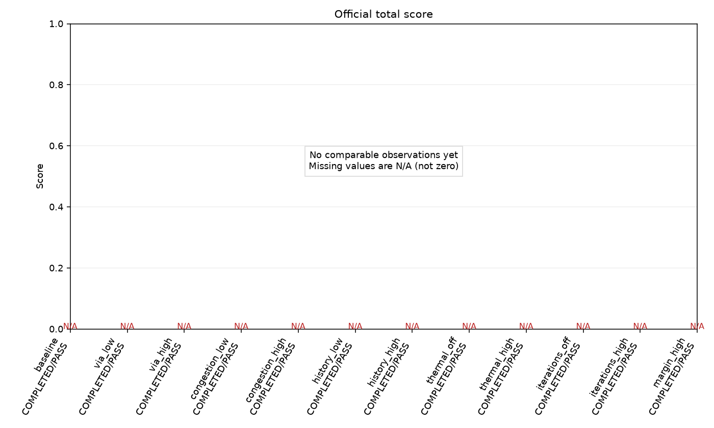
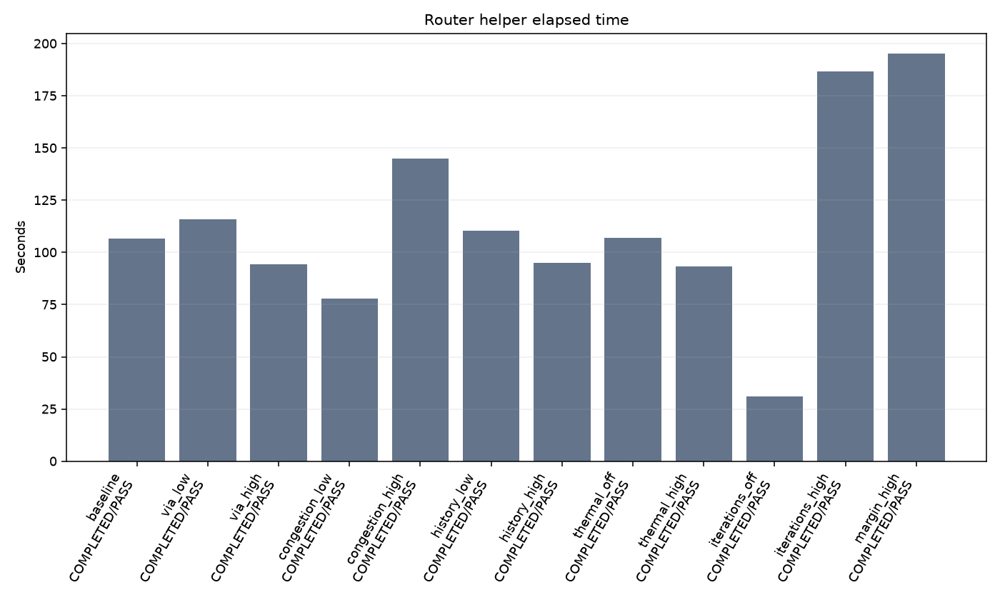
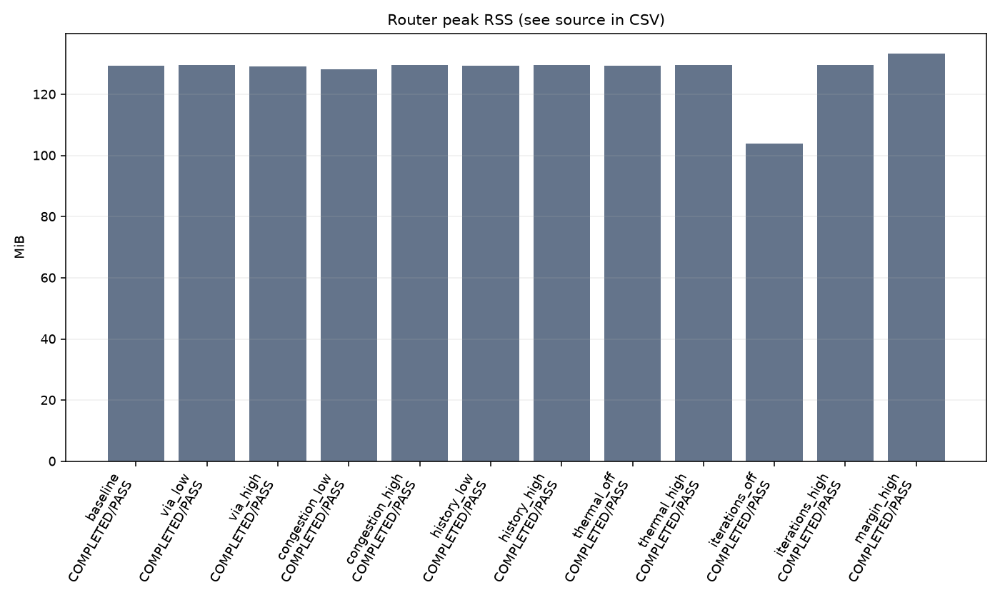
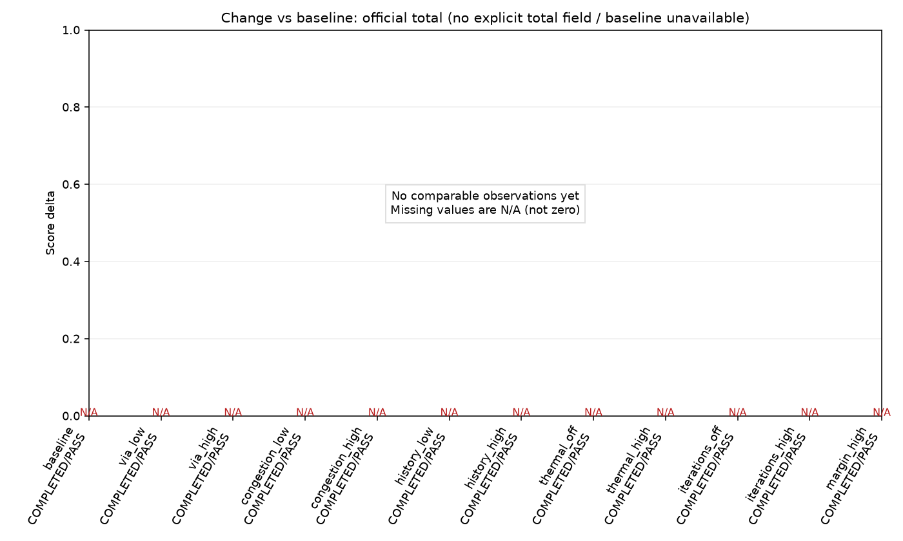
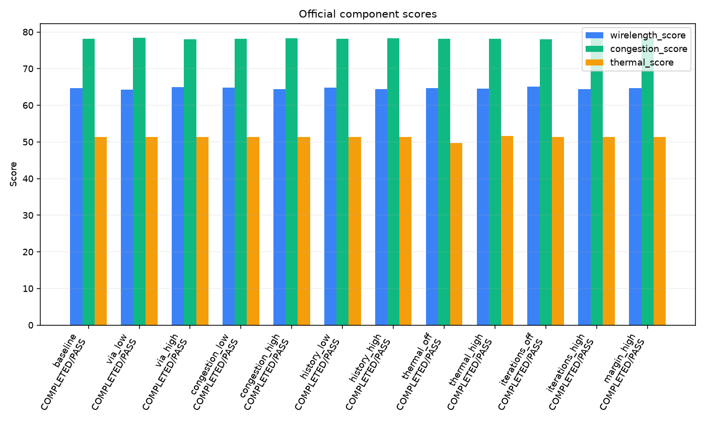
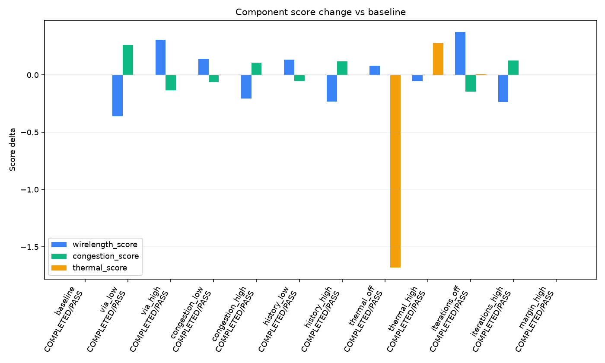

# 阶段一参数实验分析

## 1. 实验概览

- 实验：`phase1_case001_v2_1`；Case：`open_3d_case001`；状态：`FINISHED`。
- Router SHA256：`70ddc978c6f427ef79d6601e0a3bf099108e945cbbac249b2c2aa234d3c00423`。
- Evaluator：`latest`；SHA256：`4104d0b2869ef7376d716ce9c33b56668e659575ab84615f5c0a5f282e108a8a`。
- JSON time_limit：600 秒；生效 CLI Router 预算：600 秒；评分预算：600 秒。
- 后端：wsl；监控：`{"heartbeat_interval": 10, "monitor_interval": 5, "progress_every": 1000, "stall_after": 30}`；可比较性：True。
- 输入与工具/源码/环境详见 experiment_plan.json；完整配置、命令、状态和运行记录均保留。
- 官方总分只读取报告中的明确字段；当前评分器报告没有总分时显示 N/A，不使用 weights 合成。

## 2. 参数配置

| ID | 相对 Baseline 的变化 | 配置 SHA256 |
| --- | --- | --- |
| baseline | 无 | `35f2b88dab1d5fae491c3aa82211771f795e5002e77f11f496861b03d8e65336` |
| via_low | {"via": 0.25} | `18f8c80ed1e5a7d528104421b67750197b5e46ad4b1b7f97e41835589467035f` |
| via_high | {"via": 1} | `6e2197ddfcd04e7dc0e66ecd63b9bd0a6f6a1dc9ea5bc55148b805676ffba9a0` |
| congestion_low | {"congestion": 2} | `956d68aa9dee9aecbb73cbd95670ffd3ba0c8c41d8b10c488e951ac5bd3f04ac` |
| congestion_high | {"congestion": 8} | `7cfddd80f963c424fb420006db9850d888eb3532cb6e80cdc9b0f7b541304a59` |
| history_low | {"history": 0.5} | `4ba844ae679e8230c3ee3eb52354f9c384eed450ddade4d047887dac9a79a8cc` |
| history_high | {"history": 2} | `a10b366fde0711dafaac6160ded03bcaeb5e60834e71b320192be8cba2bdee4c` |
| thermal_off | {"thermal": 0} | `6499147b6decddb7a409e1831062ff5dbac26b26c4317836293ade6e006c0edf` |
| thermal_high | {"thermal": 3} | `54277b4a3a89d431c958fd286e5f825ff2a3e26ce417634414f87c229f424137` |
| iterations_off | {"iterations": 0} | `787f813c82c1771fc17906057b31cf6fe444c573a891a517e3359fc3c0ca4fe1` |
| iterations_high | {"iterations": 4} | `83513f84027a57c43a317757070b4ba95128f74b6693f2e334b1f9e39cc34192` |
| margin_high | {"margin": 16} | `eb02450caa85f8b1af40c1b031279f9c69198d35531ad70fed1544cf232b2e9b` |

## 3. 实验完成情况

| 状态 | 数量 |
| --- | ---: |
| PENDING | 0 |
| ROUTING | 0 |
| ROUTED | 0 |
| EVALUATING | 0 |
| COMPLETED | 12 |
| ROUTER_FAILED | 0 |
| EVALUATION_FAILED | 0 |
| INTERRUPTED | 0 |
| BLOCKED | 0 |

可比较官方 PASS：12；Router TIMEOUT：0；评分 TIMEOUT：0。

## 4. 官方评分对比

| ID | Router | 官方 | 总分 | WL Score | Congestion Score | Thermal Score |
| --- | --- | --- | ---: | ---: | ---: | ---: |
| baseline | ROUTED | PASS | N/A | 64.6681 | 78.1706 | 51.3493 |
| via_low | ROUTED | PASS | N/A | 64.3064 | 78.4341 | 51.3493 |
| via_high | ROUTED | PASS | N/A | 64.9761 | 78.0372 | 51.3493 |
| congestion_low | ROUTED | PASS | N/A | 64.8087 | 78.1081 | 51.3493 |
| congestion_high | ROUTED | PASS | N/A | 64.4635 | 78.277 | 51.3493 |
| history_low | ROUTED | PASS | N/A | 64.8027 | 78.1208 | 51.3493 |
| history_high | ROUTED | PASS | N/A | 64.4377 | 78.2908 | 51.3493 |
| thermal_off | ROUTED | PASS | N/A | 64.7496 | 78.1706 | 49.6718 |
| thermal_high | ROUTED | PASS | N/A | 64.6137 | 78.1706 | 51.6306 |
| iterations_off | ROUTED | PASS | N/A | 65.0439 | 78.0256 | 51.3556 |
| iterations_high | ROUTED | PASS | N/A | 64.4342 | 78.2951 | 51.3493 |
| margin_high | ROUTED | PASS | N/A | 64.6681 | 78.1706 | 51.3493 |

ROUTED 不等于 PASS；FAIL/TIMEOUT/未评分均不进入合法候选。子分数、线长 DBU/μm、总/最大 Overflow、Pearson、TSV 及失败原因详见 results.csv。

## 5. 运行效率对比

| ID | Router wall 秒 | C++ 秒 | Peak RSS MiB | RSS 来源 | Evaluator 秒 | Evaluator MiB | 实际/接受优化轮数 |
| --- | ---: | ---: | ---: | --- | ---: | ---: | --- |
| baseline | 106.666 | 104.884 | 129.344 | observed_router_pid | 63.5151 | 695.23 | 2/2 |
| via_low | 115.988 | 114.017 | 129.652 | observed_router_pid | 76.3809 | 693.414 | 2/2 |
| via_high | 94.4433 | 92.7625 | 129.215 | observed_router_pid | 70.7146 | 692.723 | 2/2 |
| congestion_low | 77.8694 | 75.7769 | 128.219 | observed_router_pid | 66.5047 | 692.938 | 2/2 |
| congestion_high | 145.058 | 142.982 | 129.594 | observed_router_pid | 65.4232 | 692.957 | 2/2 |
| history_low | 110.326 | 108.404 | 129.336 | observed_router_pid | 68.1549 | 693.258 | 2/2 |
| history_high | 94.9585 | 93.3889 | 129.562 | observed_router_pid | 58.9743 | 693.59 | 2/2 |
| thermal_off | 106.871 | 105.244 | 129.305 | observed_router_pid | 66.8898 | 693.227 | 2/2 |
| thermal_high | 93.123 | 91.0846 | 129.473 | observed_router_pid | 64.0296 | 693.352 | 2/2 |
| iterations_off | 31.0025 | 29.4221 | 103.996 | observed_router_pid | 58.7275 | 692.957 | 0/0 |
| iterations_high | 186.646 | 184.631 | 129.648 | observed_router_pid | 58.839 | 692.992 | 4/4 |
| margin_high | 195.191 | 193.414 | 133.297 | observed_router_pid | 59.5132 | 693.395 | 2/2 |

Router wall 包括 WSL/监督与输出开销；C++ runtime 来自本地结果，二者不混用。GNU time 命令树峰值与按 Router PID 采样峰值分别标明来源，不能当成完全相同的测量。

## 6. 参数敏感性分析

| 指标 | 最大绝对变化 | 对应实验 | 对应参数 |
| --- | ---: | --- | --- |
| total_score | N/A | N/A | N/A |
| wirelength_score | 0.375778 | iterations_off | iterations |
| congestion_score | 0.263516 | via_low | via |
| thermal_score | 1.67753 | thermal_off | thermal |
| wirelength_dbu | 4.875e+06 | iterations_off | iterations |
| official_overflow | 91 | via_low | via |
| pearson | 0.00287207 | thermal_off | thermal |
| router_runtime_seconds | 88.5248 | margin_high | margin |
| router_peak_rss_bytes | 26578944 | iterations_off | iterations |

绝对差异及适用百分比逐字段写入 results.csv（percent_* 单位为 %；基准为零或缺失时为 N/A）。表中最大变化是观测幅度，不等于改善；各参数量纲与步长不同，不能当作导数或泛化敏感性。

| ID | Guide 相同 | TSV Net→Node 相同 | TSV 密度相同 |
| --- | --- | --- | --- |
| baseline | True | True | True |
| via_low | False | True | True |
| via_high | False | True | True |
| congestion_low | False | True | True |
| congestion_high | False | True | True |
| history_low | False | True | True |
| history_high | False | True | True |
| thermal_off | False | False | False |
| thermal_high | False | False | False |
| iterations_off | False | False | False |
| iterations_high | False | True | True |
| margin_high | True | True | True |

Guide 与 Baseline 字节相同：margin_high。SHA256 见 CSV；相同输出不宣称质量改善。

迭代实验观测：iterations_off: 实际轮次=0, 接受=0, Δ拥塞分=-0.14502, Δ热分=0.00632179, TSV密度相同=False; iterations_high: 实际轮次=4, 接受=4, Δ拥塞分=0.124492, Δ热分=0, TSV密度相同=True

Thermal实验观测：thermal_off: 实际轮次=2, 接受=2, Δ拥塞分=0, Δ热分=-1.67753, TSV密度相同=False; thermal_high: 实际轮次=2, 接受=2, Δ拥塞分=0, Δ热分=0.281337, TSV密度相同=False

分项评分方向冲突：via_low, via_high, congestion_low, congestion_high, history_low, history_high, thermal_off, thermal_high, iterations_off, iterations_high。

## 7. 最优参数

最高总分、最佳三项子分数、最快合法配置（允许并列）：

| 指标 | 候选 | 值 |
| --- | --- | ---: |
| total_score | N/A | N/A |
| wirelength_score | iterations_off | 65.0439 |
| congestion_score | via_low | 78.4341 |
| thermal_score | thermal_high | 51.6306 |
| router_runtime_seconds | iterations_off | 31.0025 |
| router_peak_rss_bytes | iterations_off | 109047808 |

Pareto 候选：baseline, via_low, via_high, congestion_low, congestion_high, history_low, history_high, thermal_off, thermal_high, iterations_off, iterations_high；共同完整的目标：wirelength_score, congestion_score, thermal_score, router_runtime_seconds, router_peak_rss_bytes。

已保存 best_config.json：False。缺少可靠总分、有效 Baseline 或足够完整的可比较 PASS；不能唯一确定综合最优。

## 8. 结果的限制

- 单 Case、单次观测不足以保证泛化；时间/内存受同机负载与采样影响，建议后续使用重复批次核验。
- 本地指标与官方指标严格分开；PASS 是本地官方工具通过，不保证正式隐藏用例。Proxy / mock-DRT 不是实际详细布线 sign-off。
- 总分缺失不设为零；排名不混用引擎或版本；搜索上限/超时失败属于不可完成配置，不是合法低分。
- 所有未执行候选为 PENDING；不借用其他批次旧运行作为本批实测。

## 9. 下一阶段建议

以下组合仅为待验证假设，不自动执行；建议来源于本轮有实际指标/Guide 差异的参数：
- `{"margin": 16, "iterations": 4}`；证据：margin_high, iterations_high；需验证交互。
- `{"margin": 16, "congestion": 8}`；证据：margin_high, congestion_high；需验证交互。
- `{"margin": 16, "thermal": 3}`；证据：margin_high, thermal_high；需验证交互。
- `{"margin": 16, "via": 1}`；证据：margin_high, via_high；需验证交互。
- `{"margin": 16, "history": 2}`；证据：margin_high, history_high；需验证交互。

基于本批记录的算法研究优先项：
- via_low：via 调整改变 Guide；该参数同时作用 MST 与 A*，下一阶段先分别记录拓扑/路径变化，不能用本实验独自归因给其中一个算法。
- via_high：via 调整改变 Guide；该参数同时作用 MST 与 A*，下一阶段先分别记录拓扑/路径变化，不能用本实验独自归因给其中一个算法。
- thermal_off：TSV 映射变化，官方热分差为 -1.67753；建议复验热候选选点与拥塞之间的取舍，不把位置变化本身视作改善。
- thermal_high：TSV 映射变化，官方热分差为 0.281337；建议复验热候选选点与拥塞之间的取舍，不把位置变化本身视作改善。
- iterations_off：实际优化 0 轮、接受 0 轮；优先核查重布接受/回滚准则及不可消除固定需求，尚不能断言增加轮数有效。
- margin_high：Guide 未变、Router wall 增加 88.5248 秒；优先剖析 A* 搜索区域与扩展开销，并重复测量排除负载噪声。
- 可比较已观测变体中，已记录的独立主要阶段平均耗时最大为 ROUTING（107.939 秒）；先剖析该阶段。嵌套/抽样 MST、A* 阶段不用于相加或推断完整占比。

阶段二应结合 stage_seconds 与采样边界确定：若实际优化轮数增加但质量不变，检查仅按局部 Overflow 接受与回滚；若 Thermal 改动却 TSV 映射不变，检查固定锚点与候选成本；A* 扩展上限失败需分析搜索区域/可达性；没有测量不得断定 MST、A* 或 TSV 是主要瓶颈。

源码已知作用（非本次实测）：via 同时影响 MST 拓扑、A* 的层间边与启发式；congestion 作用于 A* 和 TSV 选点；history 仅在拥塞历史非零时生效；thermal 仅参与非固定 TSV 候选比较；iterations 受 Overflow/停滞提前终止；margin 初始搜索框只在失败后扩大。cfg.tsv 对同一 Net 的各 TSV 候选为相同加数，通常不改变其排序。

图表：

