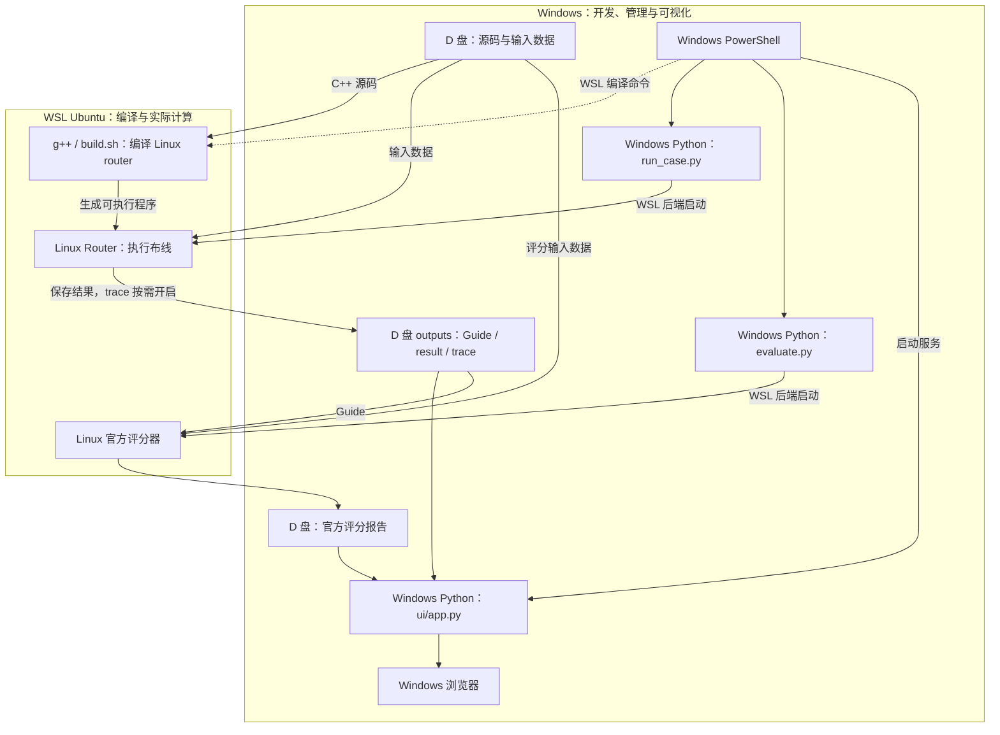

# 3DIC 比赛代码使用说明

本文件集中说明怎样进入工程、编译、运行、看 UI、评分、调参、排错、测试和打包。算法、数据结构、搜索公式及评分原理见 [比赛代码逻辑](比赛代码逻辑.md)；项目导航见 [目录结构](目录结构.md)。原工程 README 的操作信息已迁移到本文件，提交所需的五份 `docs/` 文档继续保留。

**命令验证标记：** 本文命令按当前脚本和路径核对。实际验证按第十四章的日期分别记录，未列出的示例命令不代表已执行；历史测试报告只作为历史证据，不冒充本次新测试。`study01`、`base01` 等是示例新标签，存在时请换名，不要覆盖历史结果。

## 章节目录

1. [环境要求](#use-01)
2. [进入工程目录](#use-02)
3. [编译比赛代码](#use-03)
4. [运行第一个测试用例](#use-04)
5. [运行其他公开用例](#use-05)
6. [官方评分操作](#use-06)
7. [可视化 UI 使用教程](#use-07)
8. [理解输出文件](#use-08)
9. [修改算法配置](#use-09)
10. [算法调试](#use-10)
11. [自动化测试](#use-11)
12. [比赛提交打包](#use-12)
13. [常见问题 FAQ](#use-13)
14. [完整操作速查表与验证记录](#use-14)

<a id="use-01"></a>
## 第一章：环境要求

### 1.1 推荐工作方式与环境分工

当前项目采用 **Windows 负责开发、运行管理和可视化；WSL Ubuntu 负责 Linux C++ Router 的编译、执行与官方评分** 的混合架构。

| 工具或程序 | 实际运行环境 | 作用与要求 |
|---|---|---|
| VS Code | Windows | 编辑源码和文档 |
| PowerShell | Windows | 执行管理命令；本文的 `powershell` 代码块在这里运行 |
| Windows Python 3.13 | Windows | 运行辅助脚本；当前脚本要求 Python 3.10 以上，仅依赖标准库，无需安装 pip requirements |
| WSL 2 Ubuntu | Linux | 提供比赛运行环境；原有目标环境为 Ubuntu 22.04，脚本固定调用 `wsl -d Ubuntu`，发行版名称需匹配 |
| g++ 11.4 | Ubuntu | 目标编译器版本，编译 C++17 Router；Linux 核心只依赖 C++17 标准库 |
| `build.sh` | Ubuntu | 调用 g++，在工程目录生成 Linux `router` |
| `router` | Ubuntu | 执行实际 3D IC 布线算法，生成 Guide 和运行结果 |
| `scripts/run_case.py` | Windows Python | 通过 `--backend wsl` 管理并启动 Router，保存日志和运行记录；不会自动编译 |
| `scripts/evaluate.py` | Windows Python + WSL | Windows Python 管理评分任务，WSL 执行 Linux 官方评分程序 |
| `ui/app.py` | Windows Python | 启动本地 Web UI，读取已保存的运行和评分结果 |
| Edge/Chrome 等浏览器 | Windows | 查看布线结果；本地离线页面，无 npm、CDN 或额外字体依赖 |
| CMake 3.16 以上、CTest | Ubuntu；可选原生开发时也可在 Windows | 可选的开发构建和核心测试；`build.sh` 不依赖 CMake |
| Windows MinGW g++ | Windows（可选） | 编译 Windows 原生 Router、进行 Python 集成测试；需链接 `shell32`，正式比赛仍使用 Linux Router |
| GNU `time` 与 `timeout` | Ubuntu | 记录资源和限制运行时间；脚本使用 `/usr/bin/time -v`、`timeout`，缺失时查日志，不把缺值当零内存 |
| 官方 ELF `EDA/评估程序/score` | Ubuntu | `--engine latest` 使用的较新本地评分器，需配套 `POST9.dat`、`POWV9.dat` |
| 旧 Python 评分器 | Ubuntu | `--engine legacy` 用于版本对照；依赖 Linux CPython 3.10、两份 `.so` 和 `libfmt.so.10` |

源代码存放在 Windows D 盘，**不代表 Router 在 Windows 中执行**。`build.sh` 生成的是 Linux ELF，不能直接作为 Windows 程序由 PowerShell 执行；Linux `.so` 也不能由 Windows Python 加载。

本方案只需 WSL 的命令行环境，无需安装 Ubuntu 桌面环境，也不需要为此重新安装 TigerVNC 或修改 Windows 系统配置。

### 1.2 先确认工具在哪里

PowerShell：

```powershell
python --version
Get-Command python, g++, cmake -ErrorAction SilentlyContinue
wsl --list --verbose
wsl -d Ubuntu -- bash -lc 'g++ --version; python3 --version; command -v cmake; command -v timeout; test -x /usr/bin/time'
```

后续出现 `bash` 代码块时，应在 Ubuntu/WSL 终端执行；不要把 `./router` 这个 Linux ELF 直接交给 PowerShell。`--backend native` 表示“当前 Python 所在操作系统”，并不自动表示 Linux。

运行、评分与 UI 建议由同一侧 Python 管理同一批记录。`run.json` 存绝对路径，Windows `D:\...` 和 Linux `/mnt/d/...` 清单不能随意跨主机混用；若换环境，按新标签重新生成记录，不手改原始输入文件。

### 1.3 Windows 与 WSL 的项目路径映射

| 使用位置 | 实际代码目录 |
|---|---|
| Windows | `D:\我\大学\program\3DIC EDA\EDA\code_3DIC EDA` |
| WSL Ubuntu | `/mnt/d/我/大学/program/3DIC EDA/EDA/code_3DIC EDA` |

Windows 的 `D:` 在 WSL 中对应 `/mnt/d`，这两个路径访问的是**同一批文件**。在 Windows 修改 C++ 源码后，可直接通过 WSL 重新编译；Guide、result 和 trace 写回同一工程的 `outputs/`，无需维护两份源码。

路径含中文和空格时须整体加引号。PowerShell 使用 `Set-Location -LiteralPath 'Windows 路径'`；Ubuntu 使用 `cd 'Linux 路径'`。完整目录说明见[第二章](#use-02)。

### 1.4 混合开发运行流程



`run_case.py`、`evaluate.py` 是管理程序，负责准备参数、启动进程并记录状态；实际布线和官方评分由 WSL 中的 Linux 程序计算。`ui/app.py` 读取已有结果供浏览器显示。图中的编译需要先手动执行，`trace` 仅在使用 `--trace` 时生成。

### 1.5 PowerShell 最简命令速查

以下命令均在 **Windows PowerShell** 执行。这里只列最短流程，完整说明见[第三章：编译](#use-03)、[第四章：首个用例](#use-04)、[第七章：UI](#use-07)和[第六章：官方评分](#use-06)。原文档整理时只核对了这些速查命令；新增监控的实际构建、布线与评分验证另见第十四章按日期记录。

**① 进入代码目录：**

```powershell
Set-Location -LiteralPath 'D:\我\大学\program\3DIC EDA\EDA\code_3DIC EDA'
```

**② 调用 WSL 编译，并立即检查退出码：**

```powershell
wsl -d Ubuntu -- bash -lc "cd '/mnt/d/我/大学/program/3DIC EDA/EDA/code_3DIC EDA' && bash build.sh"
$LASTEXITCODE
```

退出码 `0` 表示编译脚本成功；非零时先检查错误输出。`build.sh` 没有单独的成功提示。

**③ 验证 Linux Router：**

```powershell
wsl -d Ubuntu -- bash -lc "cd '/mnt/d/我/大学/program/3DIC EDA/EDA/code_3DIC EDA' && ./router --help"
```

**④ 运行 toy 用例并保存 trace：**

```powershell
python scripts/run_case.py --case toy --backend wsl --label study01 --trace
```

若 `study01` 已存在，必须换新标签；后续评分使用同一个新标签。确认运行成功、`run.json` 的 `status` 为 `ROUTED` 后再评分。

**⑤ 打开 UI：**

```powershell
python ui/app.py --port 8501
```

保持该终端运行，在浏览器访问 [http://127.0.0.1:8501](http://127.0.0.1:8501)。继续执行评分时，另开 PowerShell 并进入相同代码目录。

**⑥ 调用官方评分：**

```powershell
python scripts/evaluate.py --case toy --label study01 --backend wsl --engine latest
```

评分器需要对应运行已成功且 Guide 完整；已有评分目录也不会覆盖。首次布线完成不代表已经通过官方评分，具体状态判读见[第六章](#use-06)。

### 1.6 常见环境问题

| 问题 | 原因与处理 |
|---|---|
| 为什么 PowerShell 中 `./router --help` 无法正常运行？ | 当前 `router` 是 Linux ELF，需要在 Ubuntu 中执行，或使用上面的 `wsl ...` 命令。Windows 原生开发生成的是另一种可执行文件。 |
| 为什么 PowerShell 中 `file ./router` 提示命令不存在？ | `file` 是 Linux 常用命令，并非 PowerShell 内置命令；请通过 WSL，在 Ubuntu 工程目录执行 `file ./router`，见[第三章](#use-03)。 |
| 为什么 `bash build.sh` 没有显示“编译成功”？ | 脚本没有成功提示；从 PowerShell 调用 WSL 后立即检查 `$LASTEXITCODE`，在 Ubuntu 直接执行时检查 `$?`。以退出码和错误输出判断。 |
| 为什么出现 WSL localhost proxy warning？ | 常见于 NAT 模式下 Windows 的本地代理未映射到 WSL；这通常不影响本地 C++ 编译。提示本身不代表编译失败，应检查编译输出和退出码。 |
| 为什么 Windows Python 3.13 和 Ubuntu Python 3.10 可以共存？ | 它们属于两个独立环境。本方案辅助脚本使用 Windows Python，Linux 工具在 WSL 执行；旧评分器所需 CPython 3.10 仍须在 Linux 一侧满足。 |
| 为什么不需要两份源码？ | WSL 可通过 `/mnt/d` 直接访问 D 盘，同一份源码可在 Windows 编辑、在 Ubuntu 编译；两种路径写法不表示两份工程。 |

运行、评分、UI 和打包的其他排错说明见[第十三章 FAQ](#use-13)。

<a id="use-02"></a>
## 第二章：进入工程目录

项目根目录包含三份中文说明；真正执行 `scripts/`、`ui/`、构建命令的位置是其下的正式工程。

### 2.1 Windows PowerShell

```powershell
Set-Location -LiteralPath 'D:\我\大学\program\3DIC EDA\EDA\code_3DIC EDA'
Get-Location
Get-ChildItem
```

应能看到 `src`、`include`、`scripts`、`configs`、`ui`、`tests`、`docs`、`outputs`、`build.sh`、`run.sh`、`CMakeLists.txt`。此目录现在不再有 README；使用说明就在当前根目录上两级的 [比赛代码使用说明.md](比赛代码使用说明.md)。

### 2.2 Ubuntu / WSL 终端

```bash
cd '/mnt/d/我/大学/program/3DIC EDA/EDA/code_3DIC EDA'
pwd
ls
```

独立 Linux 电脑没有 Windows D 盘挂载点时，把上面的绝对路径替换为实际检出的工程路径，再执行本说明的相对命令。

### 2.3 路径使用规则

所有命令均以本章工程目录为默认当前目录。Python 脚本内部用自身路径定位项目，但用户提供的相对 `--config`、`--router`、显式输入/输出仍按调用时的工作目录解析。长路径必须整体加引号，不要只引用其中带空格的一段。

<a id="use-03"></a>
## 第三章：编译比赛代码

### 3.1 最简 Linux 构建：build.sh

Ubuntu/WSL 终端：

```bash
bash build.sh
./router --help
file './router'
```

成功时项目根目录生成 Linux `router`。`--help` 应显示四参数接口；`file` 应识别为 ELF，而不是 Windows PE。

若从 PowerShell 发起同一个构建：

```powershell
wsl -d Ubuntu -- bash -lc "cd '/mnt/d/我/大学/program/3DIC EDA/EDA/code_3DIC EDA' && bash build.sh && ./router --help"
```

`build.sh` 等价的直接 g++ 命令在 Ubuntu/WSL 中为：

```bash
g++ -std=c++17 -O3 -DNDEBUG -Wall -Wextra -I include src/main.cpp src/parser.cpp src/router.cpp -o router
```

只修改源码但没有重新构建时，`run.sh` 不会按时间戳自动判断源码更新；只要根目录旧 `router` 仍可执行，它就会使用旧二进制。因此实验前应明确执行构建。

### 3.2 可选：CMake 与 CTest

Ubuntu/WSL 终端：

```bash
cmake -S . -B build -DCMAKE_BUILD_TYPE=Release
cmake --build build -j2
ctest --test-dir build --output-on-failure
./build/router --help
```

开发版 CMake 默认包含测试目标；成功后有 `build/router` 与 `build/core_tests`。CMake 生成器只生成工程文件，看到 configure 成功不代表编译和测试已经成功。

**根目录 `router` 与 `build/router` 是两个不同文件。** 辅助运行脚本和打包脚本默认使用根目录 `router`。只构建了 CMake 版本时，可以给运行脚本 `--router 'build/router'`；正式打包前仍建议执行 `bash build.sh`，保证包内 ELF 是当前源码版本。

### 3.3 可选：Windows 原生构建

PowerShell，使用已安装的 MinGW：

```powershell
New-Item -ItemType Directory -Path 'outputs' -Force | Out-Null
g++ -std=c++17 -O2 -I include src/main.cpp src/parser.cpp src/router.cpp -lshell32 -o 'outputs/router.exe'
& '.\outputs\router.exe' --help
```

随后用 `--backend native` 运行，默认查找 `outputs/router.exe`。这个 PE 可执行文件用于本机开发，不能把它改名为 `router` 就当 Linux 提交程序。

### 3.4 编译失败怎样判断

先确认所处终端和路径，再检查 `g++ --version`、编译退出码和第一个错误。`-std=c++17` 不可漏；Windows 直接构建不可漏 `-lshell32`。找不到头文件先检查 `-I include` 和当前目录，而不是修改官方 LEF/DEF。CMake 换编译器时使用新的构建目录，避免复用不兼容缓存。

### 3.5 第二阶段：独立选择原版与优化版

本次保留根目录 `router` 和 `build/router_baseline`（原版），优化版为 `build/router_optimized`；两者均使用 C++17、`-O3 -DNDEBUG -Wall -Wextra`。不要用 `build.sh` 覆盖原版后再进行新旧对照。需要重建优化版时，在 PowerShell 使用一个**尚不存在**的输出名称，例如：

```powershell
wsl -d Ubuntu -- bash -lc "cd '/mnt/d/我/大学/program/3DIC EDA/EDA/code_3DIC EDA' && test ! -e build/router_optimized_next && g++ -std=c++17 -O3 -DNDEBUG -Wall -Wextra -I include src/main.cpp src/parser.cpp src/router.cpp -o build/router_optimized_next"
$LASTEXITCODE
```

对照时显式指定二进制，相同 Case 使用相同配置和预算，并换未占用的 Label：

```powershell
python scripts/run_case.py --case open_3d_case001 --backend wsl --label phase2_baseline_01 --router build/router_baseline --config configs/default.json --time-limit 900
python scripts/run_case.py --case open_3d_case001 --backend wsl --label phase2_optimized_01 --router build/router_optimized --config configs/default.json --time-limit 900
```

只有对应记录为 ROUTED 才按[第六章](#use-06)评分。恢复原版只需将 `--router` 改回 `build/router_baseline`，无需覆盖文件。旧批次同时冻结源码、工具和环境指纹，因此当前源码改变后不能仅切回旧二进制就继续旧批次；需要续跑时应使用原版源码环境，不修改旧计划绕过校验。新版调参必须使用新 Experiment ID，例如先运行 `python parameter_tuning/tune_parameters.py --case open_3d_case001 --experiment phase2_case001 --router build/router_optimized --backend wsl --dry-run` 创建新计划，不复用 `phase1_case001`。真实测量、局限和 case003/case005 的待执行命令见 [第二阶段报告](<EDA/code_3DIC EDA/outputs/reports/algorithm_optimization/optimization_summary.md>)；本次未自动运行这两个大型 Case。

可选小型基准：`python scripts/benchmark_router.py --stage my_check --repeats 3`，会独立构建带 `GR_PROFILE` 的二进制，运行现有 C++ 测试和受控合成网格，并在报告目录保存原始日志、峰值 RSS 与规范化 JSON/Guide 哈希；stage 名不可重复。该基准不是官方成绩，不启动公开大型 Case，也不改写历史 Run。

### 3.6 正式 Router 版本与自动识别

已核实登记的正式文件为 `build/router_v1` 和 `build/router_v2`；V3 日常入口统一为 `build/router_v3_final + configs/v3_final.json`，其本地发布判定与同参数评分见[算法版本迭代说明第 13 章](./算法版本迭代说明.md#version-13)。本地验证发布不等于已完成源码提交和正式登记。旧的 baseline/optimized、历史候选和测试程序保留原位，逐文件清单、来源、编译/注册方法见 [Router 版本管理](<EDA/code_3DIC EDA/docs/Router版本管理.md>)。代码目录内可执行 `python scripts/manage_router_versions.py --list` 查看，`--verify` 核对哈希、Git 证据和 `--help`，不运行布线。

`run_case.py` 按实际二进制 SHA256 自动识别，启动前显示版本、文件、配置、CLI 覆盖预算及结果位置，并在新 `run.json` 中保存 `router_version/router_binary/config_path/config_overrides/effective_time_limit_seconds` 等字段。原 `config` 保留文件参数，`--time-limit` 的实际覆盖值单列；历史清单不回填。当前根目录 `router` 是 V1，因此不提供 `--router` 的 WSL 命令仍为 V1；选择 V2 时显式加 `--router build/router_v2`。登记缺失/损坏、哈希未登记或多标签歧义时显示 UNKNOWN，不阻断原有运行，也不自动换成最新版。

### 3.7 V3 Final 与安全回退

Final 采用源码固定策略，配置只包含与 V2 共有的基础参数，不再由日常用户组合消融开关。旧 V3 配置原样保存在 `configs/archive/`，Python 脚本兼容缺失的旧配置路径；历史运行记录不改写。不替换根目录 `router` 或 `build/router_v2`；Final 未正式登记时显示 UNKNOWN 是预期行为。先确认第 13 章的发布检查通过，再使用下面入口：

```powershell
python scripts/run_case.py --case toy --backend wsl --router build/router_v3_final --config configs/v3_final.json --label v3_final_study01 --time-limit 180 --trace
python scripts/evaluate.py --case toy --label v3_final_study01 --backend wsl --engine latest --timeout 180
# 回退或公平对照：新 Label，V2 使用同一份共有参数配置。
python scripts/run_case.py --case toy --backend wsl --router build/router_v2 --config configs/v3_final.json --label v2_return_study01 --time-limit 180
```

以上为使用示例，标签存在时必须更换。V3 不保证每个 Case 的全部分项均优于 V2；`default.json`、`default2.json` 原样保留，不把参数差异当算法收益。

<a id="use-04"></a>
## 第四章：运行第一个测试用例

本章推荐 PowerShell + Windows Python + WSL 后端，开始前按第三章生成根目录 Linux `router`。

### 4.1 查看 Case 和脚本帮助

```powershell
python scripts/run_case.py --help
python scripts/run_case.py --list
```

`--list` 输出 JSON，包括 Case id、数据集、DEF/LEF/Thermal 路径、参考 Guide 是否存在、文件名异常警告。列表中存在某个 Case 只证明找到必要文件，不证明 Router 已经支持或通过它。

### 4.2 第一次路由并记录 Trace

```powershell
python scripts/run_case.py --case toy --backend wsl --label study01 --trace
```

该命令实际选择三份官方输入，调用独立 C++ Router，保存 Guide、完整结果、可选 Trace、日志和运行清单。没有给 Router 传入参考 Guide。

运行期间终端周期性显示 `[HOST]` 状态，结束时输出运行 JSON；Router 的阶段与 Net 进度写入独立日志，见下节。关键字段应为 `status: ROUTED`、`returncode: 0`；这时 `official_status: NOT_EVALUATED` 是正常状态，表示还没有执行官方评分。

若出现标签存在提示，使用新名称，如 `study02`。不要寻找不存在的 `--overwrite` 参数，也不要清空原始数据目录。

### 4.3 找到文件并核对结果

默认目录是 `outputs/runs/toy/study01/`：

```powershell
Get-ChildItem -LiteralPath 'outputs/runs/toy/study01'
Get-Content -LiteralPath 'outputs/runs/toy/study01/route.guide' -TotalCount 12
$run = Get-Content -LiteralPath 'outputs/runs/toy/study01/run.json' -Encoding UTF8 -Raw | ConvertFrom-Json
$result = Get-Content -LiteralPath 'outputs/runs/toy/study01/result.json' -Encoding UTF8 -Raw | ConvertFrom-Json
$run | Select-Object case, label, status, returncode, official_status, runtime_seconds, peak_memory_bytes
$result.metrics
Get-Content -LiteralPath 'outputs/runs/toy/study01/router.log' -Encoding UTF8 -Tail 30
```

判断顺序：先看清单状态和退出码，再看 Guide/result 是否存在、网络总数与已布线数是否相符，最后查看错误/警告。`wirelength_dbu_local`、`overflow_local`、`thermal_correlation_local` 是局部估计，不能当官方分数。

可在 VS Code 中分别打开 run/result/Trace。大型 result 不建议在 PowerShell 整份展开打印，先读 `metrics` 或使用 UI 单 Net 筛选。`--output` 如指定了其他输出位置，真实 Guide 路径以 `run.json.guide` 为准。

### 4.4 直接比赛 CLI 与本地工作流的区别

Ubuntu/WSL 终端可直接执行标准四参数，不依赖 Python、UI 或配置文件：

```bash
mkdir -p 'outputs'
./router \
  --def '../公开测试用例/toy/toy.input.def' \
  --lef '../公开测试用例/toy/toy.input.lef' \
  --thermal-report '../公开测试用例/toy/toy.thermal.input.json' \
  --output 'outputs/manual_toy.guide'
```

`run.sh` 也转发同样的四参数。额外 `--metrics`、`--trace` 是文件路径选项；这与 `run_case.py` 中作为开关的 `--trace` 不同。

直接 CLI 默认只生成 Guide，不会自动创建 UI 可发现的 `run.json` 目录。若要使用完整 UI/评估工作流，优先使用 `run_case.py`，不要把单个 Guide 的存在误认为已经登记了一次完整运行。

<a id="use-progress"></a>
### 4.5 运行进度与内存监控

重新编译当前源码后，原有 `run_case.py` 命令默认启用监控，**不加 `--trace` 也会生成进度和资源日志**。所有文件保存在 `outputs/runs/<case>/<label>/`；标签目录一旦存在，即使只留下半份日志，也必须换新标签。

| 观察内容 | 默认频率与含义 |
|---|---|
| C++ 阶段 | 启动/参数、LEF、DEF、网格、Thermal、固定需求、初始布线、Overflow、优化、结果与 Guide 写入均记录开始、结束及耗时；异常保留最内层失败阶段 |
| Net 进度 | 每 1000 个位置、每轮首尾；含名称、编号、总数、完成比例、累计时间和迭代。优化轮的比例表示扫描进度，跳过非拥塞 Net 也计入，不能当重布成功率 |
| `WRITE_RESULT` 输出进度 | 每写出 1000 个 Net 及最后一个 Net 后 flush；记录 Instances、Resources、JSON flushed 和发布完成。JSONL 使用 `event=output_progress`、`progress_kind=output`，独立记录 `output_section/output_completed/output_total/output_bytes/output_elapsed_seconds`；不是新一轮布线进度，不重置原来的 Net 计数 |
| MST / A* / TSV 细节 | 初始轮首尾及每 1000 个位置记录；后续轮保留首尾重布摘要，嵌套细节仅在每 1000 个位置记录。其余位置仍更新当前上下文，供心跳或异常使用 |
| C++ 心跳 | 默认 10 秒，在已有检查点触发；A* 每 4096 次展开检查，MST/TSV 有低频检查。心跳说明执行经过检查点，不说明 Net 已完成，也不保证每 10 秒必有一条 |
| Linux 资源 | WSL 内标准库 Python 监控器默认每 5 秒读取 Router PID 的 `/proc`；即使 C++ 正忙于解析，也可独立采样，不在 A* 节点循环中采样 |
| Windows 宿主 | Windows Python 默认每 5 秒记录自己的子进程状态及进度文件更新时间，不反复启动 WSL；默认 30 秒无更新标为 `NO_PROGRESS`，不据此宣布死锁 |

在另一个 **PowerShell** 终端进入代码目录，先把下面标签改为正在运行的实际标签。`-Wait` 持续查看，按 Ctrl+C 停止查看，不会停止另一个终端里的 Router：

```powershell
$label = 'study01'
$runDir = Join-Path 'outputs/runs/toy' $label
Get-Content -LiteralPath "$runDir/progress.log" -Encoding UTF8 -Wait -Tail 20
```

查看宿主记录、最近资源采样和最后的 Net / 退出原因：

```powershell
Get-Content -LiteralPath "$runDir/host_monitor.jsonl" -Encoding UTF8 -Tail 5
Import-Csv -LiteralPath "$runDir/resource_monitor.csv" | Select-Object -Last 10
$run = Get-Content -LiteralPath "$runDir/run.json" -Encoding UTF8 -Raw | ConvertFrom-Json
$run | Select-Object status, process_status, returncode, failure_category, last_phase, last_net_index, last_net, last_progress_seconds, peak_memory_bytes, router_peak_rss_bytes
$run.failure_evidence | ConvertTo-Json -Depth 8
Get-Content -LiteralPath "$runDir/router_exit.json" -Encoding UTF8 -Raw
```

运行中的 `run.json` 为 `RUNNING`，最后阶段字段在结束后汇总；实时阶段以 `progress.log/jsonl` 为准。`router_exit.json` 只由 Linux 监控器写入，启动失败或 WSL 突然消失时可能没有该文件；Windows native 没有此文件。CSV 为逐行追加，上面命令不会长期缓存整个 CSV；大型文件也可用 `Get-Content -Tail 10` 只查看原始尾行。

| 指标 | 来源与边界 |
|---|---|
| `rss_bytes` / `router_peak_rss_bytes`（CSV） | `/proc/<router_pid>/status` 的 VmRSS / VmHWM，单位 byte；运行清单的 `router_peak_rss_bytes` 为周期采样观察到的最大 VmHWM，可能错过短进程结束前的峰值 |
| `mem_available_bytes` / `swap_free_bytes` | `/proc/meminfo`，是 Linux / WSL 系统范围数据，不是 Router 的配额 |
| `cgroup_current_bytes` / `cgroup_limit_bytes` / `cgroup_oom_kill` | 可用时读取 cgroup v2；可能是共享组。上限为 `max` 时另记 unlimited，数字留空；共享组计数增加不能单独证明此 Router 被 OOM 杀死 |
| `peak_memory_bytes`（run 清单） | 原有 GNU time 最终 Maximum resident set size；现在计时命令包含 Linux 监控器及其子进程，不能等同于 Router 单独峰值，也不能与 CSV 峰值相加 |
| `N/A` / `null` | 未获取、不支持或进程已退出。Windows native 的 Linux 指标为不支持，不能理解成使用了 0 内存 |

周期 CSV 仍由单个监控器负责写入。外部监控开启时，C++ 事件中的资源字段通常为空；进入 `WRITE_RESULT` 和输出检查点时额外读取 `/proc/self/status`，在 JSONL 中保留即时 RSS/VmHWM 与 `resource_sample_elapsed_seconds`，不重复写 CSV，也不代表连续峰值。直接运行 C++ 可另加 `--progress-dir <新目录>`，自行读取 `/proc/self/status`；这是协作式采样，只在事件/检查点更新，不强制依赖 Python。四个比赛必需参数和 Guide 格式保持不变。

可选本地参数：`--progress-every 1000`、`--monitor-interval 5`、`--heartbeat-interval 10`、`--stall-after 30`；前三个也支持直接 C++ CLI，最后一个仅属于 Python 宿主。`--no-monitor` 仅供显式开销对比，不建议用于排查大 Case；它不关闭单独指定的 Trace。过短采样/心跳间隔会增加 D 盘 I/O，阶段耗时与 Router 预算也包含这些开销。

`--progress-dir <新目录>` 只由 C++ Router 接受，`run_case.py` 会自动传入本次运行目录，Python 命令不接受这个参数。脚本的 `--monitor-interval` 同时用于 HOST 与 Linux Supervisor；直接 C++ 的同名参数用于协作式资源采样。`--no-monitor` 仅属于 Python，不能传给 Router。宿主租约由脚本取 `max(60, 2×stall-after, 3×monitor-interval)` 秒，增大采样间隔时不会仍固定为 60 秒。

关键阶段、异常、心跳及每行资源记录均立即 flush；JSONL 末行被截断时，诊断读取器只读取末尾最多 128 KiB 并跳过不完整行。flush 不等于断电时的持久化保证。Windows Python 还活着、`wsl.exe` 未退出或文件刚有更新，都不能独立证明 Router 正在推进。具体分类和失联边界见[10.4](#use-failure-diagnosis)。

输出阶段逐 Net 写入 `result.json.tmp`，不在内存中累积全部 Net JSON；实例、资源和网格数值也逐项写出。大数组循环有预算/心跳检查，资源仍按原有 ID 顺序排序。查看最后成功输出的位置时，以 `output_*` 字段为准；`output_bytes` 是最近一次 flush 的字节位置，异常可能留下更长的临时前缀。排查瞬时峰值可在下一次独立诊断中加 `--monitor-interval 1`，默认仍为 5 秒，不需要重跑全部用例。

Supervisor 清理异常后会尽力保留实际回收的 Router 返回码和信号，并记录自身错误；Windows HOST 的原始 WSL 返回码继续保留。整个 WSL 或 Supervisor 突然消失仍可能没有 `router_exit.json`，不能因此认定 OOM，也不能只凭 `WRITE_RESULT Started` 推断输出已完成。

LEF/DEF 解析、Thermal 大 JSON 处理等阶段没有逐条输入心跳，可能出现 `NO_PROGRESS`；此时结合资源 CSV 和阶段开始记录判断，不自动中止。默认 5/10 秒间隔用于控制额外 I/O，不建议为了“更实时”缩短到毫秒级。

<a id="use-05"></a>
## 第五章：运行其他公开用例

下表路径相对于项目根目录 `D:\我\大学\program\3DIC EDA`，不是当前正式工程目录；正式输入文件通常为 `<name>.input.def/.lef` 和 `<name>.thermal.input.json`。

| Case id | 实际输入目录 | 规模/版本差异与注意事项 |
|---|---|---|
| `toy` | `EDA/公开测试用例/toy/` | 218 实例、203 Net、无顶层 PINS；含参考 Guide；GCell 与 sample001 不同 |
| `sample001` | `EDA/赛题八公开数据集/赛题八公开数据集/cases/sample001/` | 218 实例、203 Net、12 顶层 PINS；运行目录中的“公开数据集”指这一版；官方热输入标为 synthetic |
| `sample001_legacy` | `EDA/eda-elite-challenge/eda-elite-challenge2026/cases/sample001/` | 底层文件名仍叫 sample001；与上项 DEF 相同，但 LEF、热图、参考 Guide 和历史报告不同 |
| `open_3d_case001` | `EDA/公开测试用例/open_3d_case001/` | 9668 实例、3152 Net、657 跨 Die Net；已有历史本地官方 PASS |
| `open_3d_case003` | `EDA/公开测试用例/open_3d_case003/` | 179295 实例、151611 Net、4801 顶层 PINS；大规模数据，不能承诺已通过 |
| `open_3d_case005` | `EDA/公开测试用例/open_3d_case005/` | 228654 实例、179700 Net、892 顶层 PINS；热文件名称异常，见下文 |

规模依据本地公开用例说明及现有设计记录。历史 toy、较新 sample001、case001 的成绩见 [测试汇总](<EDA/code_3DIC EDA/outputs/reports/测试汇总.md>)；不把 sample001 历史成绩自动转移给 legacy，也不把“Case 被发现”当作 case003/005 已通过。

### 5.1 常用运行示例

PowerShell，每行是一项独立实验，须使用未占用的标签：

```powershell
python scripts/run_case.py --case sample001 --backend wsl --label sample_study01 --trace
python scripts/run_case.py --case sample001_legacy --backend wsl --label legacy_study01 --trace
python scripts/run_case.py --case open_3d_case001 --backend wsl --label case001_study01 --trace --time-limit 600
```

若要尝试大规模 case003，先确认内存和时间预算，再执行以下**本次未测试的大用例示例**，可先不记录 Trace：

```powershell
python scripts/run_case.py --case open_3d_case003 --backend wsl --label case003_try01 --time-limit 1800
```

预算增大只表示允许尝试更久，不保证支持其所有格式、完成路由或通过官方评分。

### 5.2 case005 热文件异常怎样核对

实际文件是 `open_3d_case005/open_3d_case003.thermal.input.json`。发现脚本在同目录只有一份热 JSON 时会采用它，并给 warning；它不会证明这份文件内容就一定属于 case005。

PowerShell 可先核对自动选择的路径、大小与哈希：

```powershell
$cases = python scripts/run_case.py --list | ConvertFrom-Json
$cases.open_3d_case005 | Format-List
Get-Item -LiteralPath $cases.open_3d_case005.thermal | Select-Object FullName, Length
Get-FileHash -LiteralPath $cases.open_3d_case005.thermal -Algorithm SHA256
```

再对照发布说明、原下载包、布局尺寸、热节点坐标范围和来源记录。若来源未确认，应停止把它当正式有效实验；不要为了让名称一致而重命名或改写官方 JSON。已确认另一份正确热图时，可用显式输入选项指向那一份。

### 5.3 使用显式输入或 Linux 原生工作流

PowerShell 指定输入的示例（路径是已经存在的 toy，标签需新建）：

```powershell
python scripts/run_case.py --case toy --backend wsl --label explicit01 --def '../公开测试用例/toy/toy.input.def' --lef '../公开测试用例/toy/toy.input.lef' --thermal-report '../公开测试用例/toy/toy.thermal.input.json' --trace
```

不提供 `--case` 但提供全部输入时，运行归到 `custom` Case 目录；这不会把新自定义数据永久注册到 UI 的 Case 下拉目录。当前 `catalog()` 扫描固定的三个数据集位置。

Ubuntu/WSL 内使用 Linux Python 则应选择 native 后端，且之后评分/UI 也建议在同侧运行：

```bash
python3 scripts/run_case.py --case toy --backend native --label linux_study01 --trace
python3 scripts/evaluate.py --case toy --label linux_study01 --backend native --engine latest
```

### 5.4 所有公开测试用例运行命令汇总

以下命令统一在 **Windows PowerShell** 中执行，当前目录必须是 `EDA\code_3DIC EDA`，通过 `--backend wsl` 调用 Ubuntu 中的 Linux Router。

本节以 V3.2 为例，三者固定对应：`build/router_v3_2`、`configs/v3_2.json`、Label `v3_2`。必须先确认该二进制已构建、SHA256 与构建记录一致，并查看其发布状态；**存在文件不等于已发布或评分优于基准**。V3.2 仍为未发布候选，V3.1 是可追溯研究基线，不是旧 `router_v3_final` 的改名。省略 `--router` 仍可能选中根目录旧 V1，故以下命令全部显式指定。

| Router | 正式 Config | 新运行 Label |
|---|---|---|
| `build/router_v1` | `configs/v1.json` | `v1` |
| `build/router_v2` | `configs/v2.json` | `v2` |
| `build/router_v3_1` | `configs/v3_1.json` | `v3_1` |
| `build/router_v3_2` | `configs/v3_2.json` | `v3_2` |

V1 配置原样来自历史 `default.json`；V2 配置原样来自 `default2.json`，与保留的 V2 同参数对照一致。两者参数不同，不能将配置收益当作算法收益。旧配置均位于 `configs/archive/`，历史脚本通过 SHA256 校验的别名查找原文件，绝不替换成另一套参数。其他章节中的旧默认配置示例保留此兼容含义。配置来源及哈希见 [config_aliases.json](<EDA/code_3DIC EDA/docs/config_aliases.json>)。

切换 V3.1 时三者一起替换，命令示例（本次整理未执行）：

```powershell
python scripts/run_case.py --case open_3d_case001 --backend wsl --router build/router_v3_1 --config configs/v3_1.json --label v3_1 --time-limit 600
```

历史代表结果保留原 Label，以免改写实验身份：V2 为 `gen_20261030_stage_a_linux_v2`，V3.1 为 `gen_20261030_guarded_linux_new_v3`，V3.2 为 `v3_2`。没有非调参 V1 case001 代表记录。新建 Label 不用于复制已有代表结果；已存在时停止，不能覆盖或自动换名重跑。历史消融指标读取 [统一摘要](<EDA/code_3DIC EDA/outputs/reports/case001_history.json>)，不再要求重复旧目录存在。

先进入代码目录，再列出当前可用 Case：

```powershell
Set-Location -LiteralPath 'D:\我\大学\program\3DIC EDA\EDA\code_3DIC EDA'
python scripts/run_case.py --list
```

当前 `catalog()` 从三个固定数据集目录发现 **6 个 Case**，所需 DEF、LEF 和热 JSON 均存在。以下命令覆盖当前列表；被发现仅表示输入文件可定位，不保证 Router 已支持全部格式、能够完成或通过评分。

| Case | 规模 | 是否跨 Die | 建议用途 | 注意事项 |
|---|---|---|---|---|
| `toy` | 小型：218 实例、203 Net | 是；历史结果记录 3 条跨 Die Net | 第一次测试、学习 Trace 与 UI | 无顶层 PINS；GCell 与 sample001 不同，不能混用结果 |
| `sample001` | 小型：218 实例、203 Net | 是；历史结果记录 3 条跨 Die Net | 公开数据集版本的运行与评分对照 | 12 个顶层 PINS，热输入标为 synthetic；与 legacy 是不同数据版本 |
| `sample001_legacy` | 小型：218 实例、203 Net | 是；已核对输入中的跨 Die 连接 | 旧版工具样例对照 | DEF 与 sample001 相同，但 LEF、热图和参考 Guide 不同，成绩不可互相套用 |
| `open_3d_case001` | 中型：9668 实例、3152 Net | 是；历史结果记录 657 条跨 Die Net | 进一步测试 3D 布线 | 历史本地官方 PASS 不代表本次命令已运行或通过 |
| `open_3d_case003` | 大型：179295 实例、151611 Net | 是；已核对输入中的跨 Die 连接 | 大规模运行与资源预算测试 | 4801 个顶层 PINS；可能需要更多时间和内存，建议先省略 Trace |
| `open_3d_case005` | 大型：228654 实例、179700 Net | 是；已核对输入中的跨 Die 连接 | 热文件来源确认后的大规模测试 | 892 个顶层 PINS；热文件名称异常，须先按 5.2 节核验来源，不能直接将运行结果视为有效正式评估 |

规模按当前 DEF 的 `COMPONENTS`、`NETS`、`PINS` 声明核对；跨 Die 信息依据已有 `result.json` 和实际 DEF 连接、LEF 引脚层核验。这里的小型/中型/大型仅作本仓库用例的相对规模提示。版本差异和热文件注意事项沿用本章已有记录；命令是操作速查，不代表六个用例均已运行或通过。

一个版本在每个 Case 下只保留一个正式 Label，同一个 `v3_2` 可用于不同 Case；目标已存在时停止，不覆盖，也不自动生成 retry/stage 等额外记录。以下大规模命令仅供用户按需执行，自动验证不运行 case003/005。**case005 必须先完成 5.2 节的热文件来源核验**；当前自动匹配的是 `open_3d_case003.thermal.input.json`。

```powershell
# 1. toy
python scripts/run_case.py --case toy --backend wsl --router build/router_v3_2 --config configs/v3_2.json --label v3_2 --time-limit 600 --trace

# 2. sample001
python scripts/run_case.py --case sample001 --backend wsl --router build/router_v3_2 --config configs/v3_2.json --label v3_2 --time-limit 600 --trace

# 3. sample001_legacy
python scripts/run_case.py --case sample001_legacy --backend wsl --router build/router_v3_2 --config configs/v3_2.json --label v3_2 --time-limit 600 --trace

# 4. open_3d_case001
python scripts/run_case.py --case open_3d_case001 --backend wsl --router build/router_v3_2 --config configs/v3_2.json --label v3_2 --time-limit 600

# 5. open_3d_case003
python scripts/run_case.py --case open_3d_case003 --backend wsl --router build/router_v3_2 --config configs/v3_2.json --label v3_2 --time-limit 3600

# 6. open_3d_case005（先核验热文件来源）
python scripts/run_case.py --case open_3d_case005 --backend wsl --router build/router_v3_2 --config configs/v3_2.json --label v3_2 --time-limit 10800
```

使用注意事项：

1. Router、Config 和正式 Label 必须对应；脚本按实际二进制 SHA256 识别版本。不同配置的研究对照须显式 `--comparison`，不能当作该版本正式成绩。
2. `--trace` 记录真实布线过程；仅三个小用例默认开启，case001/003/005 默认省略。
3. 预算不是完成保证：case003 既有运行约 1059～1190 秒，case005 V2 既有运行约 5920 秒，故这里分别给出 3600/10800 秒示例；新算法尚未在这两个大用例验证，1800 秒尤其不能保证 case005 完成。
4. 运行成功应检查 `run.json` 中的 `status` 为 `ROUTED`、`returncode` 为 `0`。
5. `ROUTED` 不等于官方评分 `PASS`；评分操作见[第六章](#use-06)。
6. 上述命令生成的文件保存在 `outputs/runs/<case>/<label>/`。
7. 环境、数据或执行出错时，先检查该运行目录的 `router.log`；若尚未启动 Router，再查看 PowerShell 中的脚本报错。

评分读取同一个 Case、同一个 Label 的已有 Guide，不需要再生成一个 Router 版本。确认 `run.json` 为 `ROUTED` 且退出码为 0 后，例如：

```powershell
python scripts/evaluate.py --case open_3d_case001 --label v3_2 --backend wsl --engine latest --timeout 600
```

已有评分目录不覆盖，预算不足不自动延长重试；详细评分说明仍见[第六章](#use-06)。

<a id="use-06"></a>
## 第六章：官方评分操作

### 6.1 推荐的 latest 调用

PowerShell，必须使用上一章已经成功的同一 Case/标签：

```powershell
python scripts/evaluate.py --help
python scripts/evaluate.py --case toy --label study01 --backend wsl --engine latest
```

脚本检查 Router 成功和输入哈希，再复制输入与 FLUTE 查找表到这次输出目录，调用原始 Linux ELF。复制是为了隔离评分器写缓存/日志的副作用，不改变输入内容或官方程序。

评分目录也不可复用；已经存在 `official_latest/` 时不会覆盖。失败后保留证据，使用新的路由标签重新运行再评分，而不是编造一次成功退出。

### 6.2 读 PASS/FAIL 与指标

```powershell
$report = Get-Content -LiteralPath 'outputs/runs/toy/study01/official_latest/evaluation_report.json' -Encoding UTF8 -Raw | ConvertFrom-Json
$invoke = Get-Content -LiteralPath 'outputs/runs/toy/study01/official_latest/invocation.json' -Encoding UTF8 -Raw | ConvertFrom-Json
$invoke | Select-Object status, returncode, process_status, runtime_seconds, peak_memory_bytes
$report.status
$report.wirelength
$report.congestion
$report.thermal_tsv
$report.score
$report.fidelity
$report.warnings
```

常看字段：`wirelength.total_dbu/total_um`、`congestion.total_overflow/max_overflow`、`thermal_tsv.correlation_above_ambient`、TSV 数量和 `score.*_score`。实际对象以原始报告为准，不为缺字段补造分数。

完整调用 PASS 要求退出码 0 且官方报告 status=PASS。失败先看：

```powershell
Get-Content -LiteralPath 'outputs/runs/toy/study01/official_latest/evaluator.log' -Encoding UTF8 -Tail 60
Get-Content -LiteralPath 'outputs/runs/toy/study01/official_latest/invocation.json' -Encoding UTF8 -Raw
```

脚本 `--timeout` 默认 600 秒，是开发调用预算，不是赛题最终评分时间规定。较大用例需要时可在了解资源消耗后指定更长预算；Q&A 没有把提问中的 score 2h 确认为统一固定限制。

### 6.3 latest 与 legacy

| 选择 | 真实工具 | 使用建议 |
|---|---|---|
| `--engine latest` | `EDA/评估程序/score` | 当前推荐的本地 ELF，配套 POST9/POWV9 |
| `--engine legacy` | 旧 `evaluator/score.py` 与 Linux 3.10 扩展 | 用于对照旧算法口径；不等于给最新版 Case 自动选了另一版输入 |

PowerShell 的旧工具调用示例：

```powershell
python scripts/evaluate.py --case sample001_legacy --label legacy_study01 --backend wsl --engine legacy
```

`sample001_legacy` 是数据版本，`--engine legacy` 是工具版本，两者是不同选项。旧工具可能因热网格空格、缺少 TSV 或自身口径失败，应保留原因，不能为通过而改输入/评分代码。

### 6.4 proxy/mock 与效率指标

官方报告若写 Guide/MST proxy、mock-DRT，表示它给出 Guide 代理线长、资源风险或近似评价，不是详细布线 DRC。sample001 若有 synthetic 热图警告也应原样保留。

12 小时/128 GB 是正式资料的 Router 约束；本地脚本记录资源并设置超时，但没有强制 128 GB 内存配额，单靠一份 Guide 的 PASS 也不能证明正式 S4 或隐藏用例已经验收。公式冲突与来源解释见原理篇第十一章。

### 6.5 所有公开测试用例评分命令汇总

以下命令统一在 **Windows PowerShell** 中执行，当前目录为 `EDA\code_3DIC EDA`。Windows Python 使用 `--backend wsl` 管理评分任务，实际 Linux 官方评分器在 Ubuntu WSL 中执行；`--engine latest` 是当前推荐的本地官方评分器。

**先完成对应 Case 的布线，确认 `run.json` 的 `status` 为 `ROUTED`，再评分。** 评分命令的 `--case` 和 `--label` 必须与布线记录完全一致。下面的 Label 与第五章 5.4 对应，只是示例，不表示这些记录已经存在或成功；若布线时用了其他 Label，评分时必须同步改为实际名称。本次未执行这些布线或评分示例。

先进入代码目录：

```powershell
Set-Location -LiteralPath 'D:\我\大学\program\3DIC EDA\EDA\code_3DIC EDA'
```

六个公开 Case 的 latest 评分命令如下，每行对应已有的一次成功布线记录；没有成功完成布线的用例不能直接评分：

```powershell
# 1. toy
python scripts/evaluate.py --case toy --label toy_study01 --backend wsl --engine latest

# 2. sample001
python scripts/evaluate.py --case sample001 --label sample_study01 --backend wsl --engine latest

# 3. sample001_legacy
python scripts/evaluate.py --case sample001_legacy --label legacy_study01 --backend wsl --engine latest

# 4. open_3d_case001
python scripts/evaluate.py --case open_3d_case001 --label case001_study01 --backend wsl --engine latest

# 5. open_3d_case003
python scripts/evaluate.py --case open_3d_case003 --label case003_study01 --backend wsl --engine latest --timeout 1800

# 6. open_3d_case005（先核验热文件来源）
python scripts/evaluate.py --case open_3d_case005 --label case005_study01 --backend wsl --engine latest --timeout 1800
```

case003、case005 的 `--timeout 1800` 只是示例评分预算，不保证能在此时间内完成或通过，也不改变 Router 的布线预算。**case005 必须先按 5.2 节核验热文件来源；确认输入有效性之前，不应将评分结果作为可信的正式成绩。**

| 参数 | 作用 |
|---|---|
| `--case` | 选择需要评分的测试用例 |
| `--label` | 选择已生成的布线运行记录 |
| `--backend wsl` | 在 WSL Ubuntu 中执行 Linux 评分器 |
| `--engine latest` | 使用较新的本地官方评分器 |
| `--engine legacy` | 使用旧版评分器进行对照 |
| `--timeout` | 设置本次评分的超时预算，单位为秒，默认 600 |

| 状态 | 含义 |
|---|---|
| `ROUTED` | 本地 Router 已成功生成完整布线结果，不等于官方评分通过 |
| `NOT_EVALUATED` | 尚未记录相应的官方评分结果；需核对评分版本和记录文件 |
| `PASS` | 对应官方评分调用退出码为 0，且报告状态为 PASS |
| `FAIL` | 对应评分失败，需要查看 `invocation.json`、报告和 `evaluator.log` |

`ROUTED` 属于布线状态；官方状态按对应 `official_latest/` 或 `official_legacy/` 的记录解读。`run.json.official_status` 仅由 latest 评分更新，不能代替 legacy 的调用记录；报告字段及失败排查见本章 6.2。**本地评分 PASS 不等于正式平台隐藏用例全部通过。**

**Label 对应示例：** 先用一个未占用的实验标签布线，再针对同一条记录评分：

```powershell
python scripts/run_case.py --case toy --backend wsl --label test01 --trace
python scripts/evaluate.py --case toy --label test01 --backend wsl --engine latest
```

`--case toy` 指定用例，`--label test01` 指定这次实验。评分读取该 Label 已生成的 Guide，不会重新运行布线，也不能把另一 Label 的 Guide 当作本次结果。若此记录已有 `official_latest/`，当前脚本不允许直接覆盖；保留历史结果，必要时用新的运行 Label 重新实验。

**legacy 对照示例：**

```powershell
python scripts/evaluate.py --case sample001_legacy --label legacy_study01 --backend wsl --engine legacy
```

`sample001_legacy` 是输入数据版本，`--engine legacy` 是评分器版本，两者不是同一概念。legacy 结果保存在 `official_legacy/`，不能直接当作 latest 评分结果；两版工具与依赖说明见本章 6.3。

<a id="use-07"></a>
## 第七章：可视化 UI 使用教程

### 7.1 启动和打开页面

PowerShell，先进入正式工程：

```powershell
python ui/app.py --port 8501
```

保持该终端运行，在浏览器打开 <http://127.0.0.1:8501>。终端按 Ctrl+C 停止服务器。它只监听本机，不是已发布的公网服务。

页面不能替你编译、运行 Router 或评分；先在另一个终端完成相应脚本操作，再点击“刷新运行记录”。没有完整成功记录的 Case 不会凭空出现路径。

### 7.2 从数据集到一个 Net

1. 左侧“数据集 Dataset”选择“公开测试用例”“公开数据集”或“旧版工具样例”。
2. “测试用例 Case”选择 toy 等具体 id。不要把两版 sample001 混成同一个输入。
3. “结果来源 Source”选择“自主算法 · 真实运行”。
4. “运行记录 Run”选择刚产生的标签，如 `study01`。下拉项还显示官方状态。
5. 在“查找网络 Net”搜索任意名称，再在“选中网络”下拉框选一个 Net；列表每页 500 项，可翻页。也可点击 Pin、实际路径或已开启的 Guide 选中。
6. 查看下方“当前网络”表：Pin 数、跨 Die 类型、矩形数、真实边数、Via/TSV 计数和局部长度。

初始为“总览”：白色背景、浅灰 GCell 网格、全量 Pin，默认关闭 Guide 区域和总览路径。Pin 独立读取所有 Net 的 `pins[]`，不受 150 个 Net 的路径限制；它们是 Router 记录的端子访问点，不代表 LEF 中全部端口形状。

选中单个 Net 后进入“聚焦”：其 Pin 放大、同色实线路径突出，其他 Net 的 Pin 弱化；从下拉框选中时自动适配范围，也可点击“适配当前 Net”。颜色由 Net 名称稳定计算，不表示输入/输出方向。“仅跨 Die 网络”和名称搜索筛选整个 Pin 集合，不会重新运行算法。

画布上方显示总 Pin、当前筛选 Pin、视口 Pin，以及实际绘制的单 Pin 点数、聚合点数与覆盖 Pin 数。密集点在屏幕空间聚合，缩放后重新计算；所有原始 Pin 仍可查询，点击聚合位置可分页选择具体端子。总览路径默认隐藏，开启后最多绘制 150 个 Net；总览的 Guide/TSV 网络几何也共享这个上限，全量 Pin 和网络列表分页不受此限制。

### 7.3 Die、Layer 与显示设置

| 点击的控件 | 应看到什么 | 解释与限制 |
|---|---|---|
| “Die / Tier → 双 Die 并排” | Bottom M1–M10、Top M11–M20 两个面板 | 同一个选中 Net 在两侧同步筛选；某侧为空也可能因为该 Net 是 Die 内网络 |
| “Die / Tier → Die 1 / Die 2” | 只保留相应一侧 | 不改变原始层映射 |
| “金属层 Metal Layer” | 全部层或单个实际层 | 当前不是任意多层集合的多选控件 |
| “Guide 区域（浅色）” | 低透明度矩形与轮廓，默认关闭 | 是布线区域，不是 GCell 填色，也不是详细布线中心线 |
| “A* / Route 真实路径” | Net 同色实线与普通 Via 方形标记 | 来自最终 Route 或真实 `path_found`；总览默认隐藏完整路径，参考 Guide 禁用 |
| “总览路径” | 最多 150 个 Net 的路径 | 仅限制路径总览，不限制全量 Pin、搜索或单 Net 路径 |
| “MST 拓扑” | 紫色虚线与拓扑端点 | 只使用能对应当前 Route / 回放的 `topology` 事件；不是物理导线，无过程数据时禁用 |
| “引脚 Pin” | 同 Net 同色的带边框圆点 | 默认显示全量结果端子；聚焦时其他网络弱化，密集点可聚合 |
| “跨 Die 连接 TSV” | 相同 XY 的 TSV 圆形/十字标记 | 自主结果来自实际显式跨 Die 边；单层过滤到非 M10/M11 时标记会隐藏 |
| “GCell 网格” | 浅灰边界线、无填色，默认开启 | 缩小时省略过密网格线；实际边界仍来自 `x_lines/y_lines`，边缘格可能被 DIEAREA 裁剪 |
| “实例 Instance” | 极浅灰包围盒轮廓 | 最多绘制 12000 个实例，属于视图限制 |
| “适配整个 Die” | 重置平移与缩放 | 返回完整 Die 范围，不会重新生成结果 |
| “适配当前 Net” | 按当前 Net 的端子和实际路径取观察范围 | 两侧共享缩放和平移；当前 Die / 层没有该 Net 数据时显示提示 |

2D 视图保留滚轮缩放、拖动平移和双 Die 同步筛选。点击路径可查看 Net、Metal Layer 和真实图边 Node IDs，不必开启 Guide。图例随已开启图层更新；普通 Via 随真实路径显示，TSV 使用独立橙色圆形/十字标记。新增的 3D 示意分层见 [7.9](#use-07-3d)，不提供工艺实体、TSV 材料或层结构编辑。

### 7.4 官方参考 Guide

将 Source 改为“官方参考 · 仅供对比”。只有该 Case 有参考文件、且已有完整自主运行提供网格/Pin/实例元数据时才能加载。

页面会标记 REFERENCE；勾选“Guide 区域”后显示原始参考矩形，Pin 使用已有自主运行的元数据。参考文件没有内部搜索边、MST 或 A* 过程，相应图层与播放控件禁用，未知指标保留 N/A。这不证明参考 Guide 已由本次评分器检查，也不代表 Router 以它为输入。

### 7.5 热图、TSV 密度与拥塞

- 点击“热分布 Thermal”：显示投影到 GCell 的本地温度图；不同 z 已按 XY 合并，缺格有本地填充，不能把两侧面板理解成两个独立物理热仿真结果。
- 点击“原始温度节点”：显示原 JSON 的 XY 投影，保留原始温度，不按 z 正负猜 Die；大数据会抽样，当前没有 z 筛选控件。
- 点击“TSV 密度”：显示自主实际 TSV 落格数量；可以与热图来回切换，普通 Via 不计作 TSV。
- 点击“拥塞 Congestion”：蓝色为较低压力、红色为较高压力；悬停查看 Capacity、Usage、Fixed、Overflow 和代表层。多层时每格取有记录层中的最大压力，不是所有层求和；无记录格保留浅色并标为 N/A，不当作容量零。

上方 Pearson 是本地温升/TSV 密度相关性；官方数值在下方“官方评估报告”。统计视图和 GCell 资源表展示最终快照，回放不会重算历史资源。这些切换不会改变结果文件，也不自动把官方 overflow CSV 画成本地资源图。

### 7.6 回放真实布线过程

需要运行时有 `--trace`。页面先显示最终结果；建议先选一个 Net，再点击“播放”观察该 Net 与全局事件。可暂停、单步、拖动时间轴、选择 1×/2×/6×，再点“最终结果”回到完整接受结果。Pin 使用静态全量集合，路径随真实事件更新。

新增边绿色、拆除边红色。当前阶段标题和“本步事件数据”可帮助识别 `path_found`、`net_added`、`net_removed`、`iteration_done`。播放速度是事件推进速度，不是实际 CPU 时间的同比缩放。

大 Trace 超过 4 MiB 时，先选择一个 Net 才按需加载其事件；小 Trace 也在选中后筛选该 Net 与全局事件，原始 seq 可不连续。默认 Trace 预算为 32 MiB；截断后，部分 Net 可能没有过程记录，不能据此判断它未布线。若无法将拓扑对应到当前最终 Route，MST 图层保持不可用，不用其他轮次的拓扑冒充最终结果。

没有 Trace 文件时只能看最终结果；参考 Guide 也不能回放。当前 UI 不展示每一次 A* Open Set 扩展，不能按逐格扩张动画理解它。

### 7.7 比较实验与评分结果

将 A 设为当前运行，在下方“真实运行对比”选择另一条同 Case 的 Run 作为 B。比较局部长度、局部 Overflow、TSV、Pearson、时间、内存、官方合法性、官方总分及三项官方分数。缺值 N/A，不能自行补成零。

“官方总分”优先取报告根节点或 `score` 对象中的数值型 `total_score/overall_score/final_score`，也接受数值型 `score`；已有总分不因非 PASS 而隐藏。没有现成总分时，只有调用状态与报告状态均为 PASS、三项得分都是有限数值，才按项目已有的 45% 线长、30% 拥塞、25% 热得分计算单用例质量分。其余情况及未选择的 B 均显示 N/A，已有的 0 分正常显示；沿用其他得分最多四位小数的格式。此值由 UI 显示时读取或计算，不反写官方报告，也不是正式平台跨公开/隐藏用例的最终排名总分。

“优化轮次”表展示候选轮次是否接受，未改善的轮次可能已回滚。若要比较两组配置，需要先生成两条实际运行；这里没有一键切换算法并立刻产生新成绩的功能。

执行评分后点击“刷新运行记录”，展开“官方评估报告”“Router 日志”“数据来源与限制”。若看到 `REPORT_PASS / invocation incomplete`，表示原报告存在但调用元数据不完整，不能视为完整的进程/资源验证。

### 7.8 学习 Pin → GCell Node → MST → A* 的连接关系

1. 在总览中点击 Pin，其 Net 与实际路径同步高亮。“当前对象”显示 Pin 名称、Net、Die、层、DBU 坐标、GCell 索引及边界、真实 Node ID 和中心坐标。
2. 画布用浅灰边框标出该 GCell、标记中心 Node，并绘制标为“抽象映射辅助线”的虚线。映射使用 `pins[].node` 解码，不以 Pin 到中心的辅助线伪装物理导线。
3. 多个 Pin 重合或聚合时，在“当前对象”下方分页选择具体 Pin / Net，每页最多 20 项；悬停也提示端子信息。
4. 开启可用的“MST 拓扑”，对比抽象虚线与 Net 同色的 A* / Route 实线。MST 端点和边来自真实 `terminal_nodes/mst_edges`；实际路径来自 `path_found` 或最终 Route，同层边、普通 Via 与跨 Die TSV 使用不同标记。
5. “连接如何形成”面板按真实数据解释 Net Selected、TSV Selection、MST Topology、A* Search、Route Accepted 和 Guide Generated。跨 Die 时两侧分别建 MST、搜索；TSV 选址与 Guide 生成没有独立 Trace 事件，会明确注明，不补画过程。`net_added` 代表提交路径，优化轮次仍可能回滚。
6. 点击空白 GCell 可查看当前层或该 Die 各层的 Node、Capacity、Usage、Fixed、Overflow；缺失项为 N/A，不自行推算容量。没有 Trace 时仍可看最终路径和 Pin 映射，但不能重建 MST 或 A* Open Set 动画。

<a id="use-07-3d"></a>
### 7.9 3D 分层查看

点击画布上方“3D 分层”，先选一个跨 Die Net，再点“单 Net 聚焦”或“适配当前 Net”。M1–M10 为蓝色 Die 1 层板，M11–M20 为棕色 Die 2 层板，两组之间放大间隔。Pin 沿用 Net 颜色，同层真实路径为同色线，普通 Via 为灰色短连接，TSV 为橙色粗连接；Guide 为可选半透明区域。

| 操作 | 效果 |
|---|---|
| 鼠标拖动 / 滚轮 | 旋转 / 缩放 |
| Shift + 拖动或右键拖动 | 平移 |
| “恢复默认视角”、正视 / 侧视 / 俯视 | 恢复完整层堆叠或切换观察方向 |
| “示意层间距”、“层标签” | 调整爆炸间距或隐藏标签 |
| “仅当前 Net 的 Pin” | 聚焦时隐藏其他 Net 的 Pin；总览仍显示全部符合筛选的 Pin |

Case、Run、Net 搜索、仅跨 Die、Die/Metal Layer 筛选及 Pin/路径/TSV/Guide 开关与 2D 共用；返回“2D 平面”会保留选择和原 2D 缩放、平移。层筛选隐藏连接的另一端时，仅标出可见端点，不补画跨越隐藏层的完整连接。回放使用已有真实事件；参考 Guide 不推断路径、Via 或 TSV。

Z 高度是示意层距，不是实际工艺厚度；XY 与层号来自已有结果。原生 Canvas 模块在首次进入 3D 时离线加载，无新增依赖。总览 Pin 按屏幕密度聚合，完整路径默认隐藏，路径/Guide 总览沿用 150 Net 上限；3D 的真实 TSV 独立显示，单 Net 不受路径数量限制。3D 不绘制 MST、Pin→Node 辅助线、实例及热/拥塞填色，这些功能继续在原 2D 页签使用。

<a id="use-08"></a>
## 第八章：理解输出文件

默认结构如下，单独指定 `--output` 时 Guide 以清单中的路径为准：

```text
outputs/runs/<case>/<label>/
├── run.json
├── route.guide
├── result.json
├── result.json.tmp              仅在写入中或输出失败后可能存在
├── trace.jsonl                  可选
├── router.log
├── progress.log                 人可读阶段/Net 进度
├── progress.jsonl               UTF-8 结构化事件
├── resource_monitor.csv         周期资源采样
├── host_monitor.jsonl           Windows / 启动端独立状态
├── host_heartbeat.json          宿主租约；取消时另有 host_cancel.json
├── router_process.json          Linux Router PID 记录
├── router_exit.json             Linux waitpid / 信号与资源摘要
├── resource_usage.txt           Linux/WSL 时
└── official_latest/             执行较新官方评分后
    ├── inputs/                 原输入的字节相同副本及评分器缓存
    ├── POST9.dat、POWV9.dat     查找表副本
    ├── evaluator.log
    ├── resource_usage.txt
    ├── invocation.json
    ├── evaluation_report.json
    └── heat_gcell.csv、tsv_gcell.csv、tsv_points.csv 等
```

| 文件 | 谁生成、保存什么 | 什么时候打开与怎样判断 |
|---|---|---|
| `run.json` | `run_case.py`：输入/源码/二进制哈希、原始配置、命令、退出码、墙钟时间、峰值 RSS、状态 | 先看 `status/returncode/official_status`；原始配置不一定反映 CLI 覆盖后的全部有效参数，以 `command` 为准。启动前先写 RUNNING，结束后汇总 ROUTED/FAIL、`failure_category/failure_evidence`、`last_phase/last_net/last_net_index/last_progress_seconds` |
| `route.guide` | C++ Router：Net 名、整数 DBU 矩形、原始层名 | 看输出格式或交官方工具；它不是节点边调试文件 |
| `result.json` | C++ Router：最终网格、实例、Pin、节点、边、Guide、资源、温度、局部指标、轮次 | UI 主数据；先看 `metrics` 与 `warnings`，不要把 `_local` 当官方字段 |
| `result.json.tmp` | C++ 流式输出的临时文件 | 可能是不完整 JSON；UI 不加载，不得作为正式结果或评分输入。通过文件大小和 `WRITE_RESULT` 的输出计数诊断，不要将大文件整体读回验证 |
| `trace.jsonl` | C++ Trace：一行一个真实 JSON 事件，带 event/seq | 调试某 Net 的拓扑、路径与拆除；最后有 trace_truncated 表示记录不完整 |
| `router.log` | 运行适配器保留 Router/WSL 原始 stdout/stderr 字节 | 可能混有 UTF-16LE 的 WSL 提示和 UTF-8 Router 输出；保留原件，不依赖混合解码文本自动判错 |
| `progress.log` / `progress.jsonl` | 可选 C++ 日志器 | 阶段、耗时、当前 Net、迭代、心跳及错误；JSONL 可容忍被杀时最后一行截断 |
| `resource_monitor.csv` | Linux 独立监控器；Windows native 标为不支持 | 启动采样器时创建并写表头，此后追加；Linux Router 启动失败时可能不生成。查 Router RSS/VmHWM、系统可用内存、Swap 和 cgroup，单位 byte；见[4.5](#use-progress) |
| `host_monitor.jsonl` | 启动端 Python | 启动 WSL/Router 前即记录 LAUNCHING，随后追加子进程状态、进度文件更新时间；`NO_PROGRESS` 是观察，不是死锁证明 |
| `router_process.json` / `router_exit.json` | WSL/Linux 本地监控器 | 前者在 Router 子进程启动后写 PID；后者在观测到退出或进入清理时写返回值、信号、资源摘要或 launch_error。只有对应 run_id 的证据用于分类，二者不保证同时存在 |
| `host_heartbeat.json` / `host_cancel.json` | 宿主租约/取消控制 | heartbeat 在宿主初始化及每次采样更新；cancel 仅在超时、Ctrl+C 或宿主清理请求时生成，正常结束通常没有。不是正式 Router 或评分器输入，不要手工重写 |
| 运行层 `resource_usage.txt` | Linux `/usr/bin/time -v` | 看 Maximum resident set size，单位 kbytes；Windows native 没有此文件/峰值时显示 N/A，不是 0 |
| `official_latest/` | `evaluate.py` 建目录，官方工具写评测产物 | 这里不应覆盖官方输入文件；不要反过来把副本当新原始数据版本 |
| `evaluation_report.json` | 未修改官方评分程序 | 查 status、wirelength、congestion、thermal_tsv、score、fidelity、warnings |
| `invocation.json` | `evaluate.py`：调用状态、返回码、工具哈希、资源、报告快照、失败原因 | 确认报告对应一次完整成功调用；仅目录存在不足以说明 PASS |
| `evaluator.log` | 适配器重定向官方程序输出 | 原报告未生成、输入/库错误、合法性失败时查看 |
| 官方 CSV | 官方工具 | 看逐格温度、密度、TSV 坐标、溢出；可用 VS Code/CSV 查看器，明确列单位与网格索引 |

三种状态不要混：`ROUTED` 是本地 Router 完整成功；官方 `PASS` 是相应评估工具通过；正式平台隐藏用例与资源验收是另一层验证。C++ result 中 `official_status` 初始固定为 NOT_EVALUATED，评分脚本更新的是 run 清单，不能只盯着旧 result 状态。

上面的树是可能产物的集合：`--no-monitor` 不创建新增 Progress、HOST、Supervisor 与周期采样文件，原有 run、原始日志及 Linux GNU time 流程仍保留；直接四参数 CLI 也不自动生成这些辅助清单。监控关闭、未能启动、写入失败或 WSL 突然中断都可能使文件缺失，不能仅凭目录不齐判断具体失败原因。

`result.json` 保留原字段、数据类型、DBU 坐标及完整 Pin/路径/资源数据。流式输出先检查写入与 flush/close，再将同目录 `.tmp` 重命名为正式文件，不在完成后整体读回；发布失败会保留临时文件和异常路径，不先删除已有完整结果。遇到旧 `.tmp` 会拒绝覆盖，请保留诊断并换新运行标签。Guide 内容和官方评分格式不变；即使完整 JSON 已发布，后续 Guide 写入失败时整次运行仍不能标为 `ROUTED`。`runtime_seconds` 仍是实时测量值，新旧结果做等价性比较时应单独处理该非确定性字段。

<a id="use-09"></a>
## 第九章：修改算法配置

### 9.1 当前可用参数

配置位于 `configs/default.json` 与 `configs/baseline.json`。只在自己的配置副本中做实验，不改原始比赛输入。所有数值是内部搜索/开发参数，不能作为官方 45/30/25 评分权重使用。

| 参数 | C++ 默认值 | 实际作用与调节注意事项 |
|---|---:|---|
| `wire` | 1 | 正数；MST、A* 几何距离和 TSV 端子距离权重，增大倾向减少绕路 |
| `via` | 0.5 | 正数；普通换层成本及启发层差项，增大可能减少 Via 但增加平面绕行 |
| `tsv` | 4 | 非负；TSV 候选的常数项；当前每跨 Die Net 固定一个 TSV，单独调它通常不改变候选排序/总数 |
| `congestion` | 4 | 非负；A* 压力项与 TSV 两界面资源压力，过大可能用长路径避开近似拥塞 |
| `history` | 1 | 非负；历史拥塞惩罚权重，配合迭代发挥作用 |
| `thermal` | 1 | 非负；自由 TSV 候选的冷区惩罚；固定共同锚点会跳过候选比较，不对普通 A* 每条边加温度罚 |
| `iterations` | 2 | 0–100；额外重布轮数；0 仍做完整初始路由，不代表不布线 |
| `stagnation` | 2 | 正整数；连续无改善轮数上限 |
| `margin` | 8 | 正整数；初始搜索包围盒外扩格数，不可达时逐步扩大 |
| `search_limit` | 1500000 | 正整数；每个包围盒尝试的 A* 扩展上限；不是整设计节点总数 |
| `time_limit` | 600 | 正秒数；直接 Router 配置预算，脚本覆盖规则见下文 |
| `trace_mb` | 32 | 正整数；Trace 近似 MiB 预算；超限写截断标志，最终 result 独立保存 |
| `net_order_mode` | 0 | V3 专用整数 0/1/2：原顺序 / HPWL 降序 / 跨 Die、Pin 数、HPWL 降序；平局按原 Index |
| `tree_route_mode` | 0 | V3 专用整数 0/1：MST + A* / 同 Die Tree-Aware A* |
| `reroute_priority_mode` | 0 | V3 专用整数 0/1：原顺序 / 按局部拥塞贡献排序；仍以整体 Overflow 严格改善接受 |

后三项只能交给支持 V3 的候选源码，V2 二进制会拒绝未知键。`v3_legacy/net_order/tree_aware/congestion/combined.json` 共享 `default.json` 的全部原参数，仅三个新模式不同；详见 [模式与实验](./算法版本迭代说明.md#version-5)。

baseline JSON 关闭 congestion/history/thermal 并把 iterations 置零；其他未写字段仍继承 C++ 默认值。不要通过负数、非整数计数或未知键来尝试绕过限制；当前代码只做基本数值校验，不是配置编辑器。

### 9.2 预算覆盖是常见误区

直接执行 Router 时，顺序为 C++ 默认值 → 配置 JSON → 明确的 CLI 覆盖。

**当前 `run_case.py` 总会传入 `--time-limit`，其默认值是 600。** 因而只把配置中的 `time_limit` 改成 1800，仍会被脚本默认 600 覆盖。通过该脚本改预算时，请同时写 `--time-limit 1800`。run 清单里的 `config` 是读取的原配置，最终实际调用以 `command` 为准。

脚本没有 `--iterations`、`--search-limit` 或 `--trace-limit-mb` 参数；这些通过配置 JSON 设置。直接 Router 则有 `--iterations`、`--trace-limit-mb` 两个覆盖参数，不能把两层 CLI 混用。

### 9.3 保存无 BOM 的实验配置

PowerShell 示例，创建自己的新文件，**本次未执行**：

```powershell
$cfg = Get-Content -LiteralPath 'configs/default.json' -Encoding UTF8 -Raw | ConvertFrom-Json
$cfg.thermal = 3
$cfg.iterations = 4
$cfg.time_limit = 900
$cfgPath = Join-Path (Get-Location).Path 'configs/study_thermal.json'
[System.IO.File]::WriteAllText($cfgPath, ($cfg | ConvertTo-Json), [System.Text.UTF8Encoding]::new($false))
```

使用 UTF-8 无 BOM。Windows PowerShell 5.1 的某些 `-Encoding UTF8` 写法会附加 BOM，当前 C++ JSON 解析器不接受文件前的 BOM，不宜直接用它写实验配置。

### 9.4 生成两条实际实验并比较

PowerShell：

```powershell
python scripts/run_case.py --case toy --backend wsl --label base01 --config 'configs/baseline.json' --trace
python scripts/run_case.py --case toy --backend wsl --label thermal01 --config 'configs/study_thermal.json' --time-limit 900 --trace
python scripts/evaluate.py --case toy --label base01 --backend wsl --engine latest
python scripts/evaluate.py --case toy --label thermal01 --backend wsl --engine latest
```

然后在 UI 选择同一 Case 的两条记录作 A/B。初学时每次只改一项，分别看局部指标和官方报告；不能保证一次增大热权重就提升总分，也不能把未接受的重布候选当作最终改进。

<a id="use-10"></a>
## 第十章：算法调试

### 10.1 推荐排查顺序

1. 确认使用的是哪个数据版本、哪份配置、哪个二进制，查 `run.json.inputs/command/*_sha256`。
2. 确认 `returncode`、`status`，读 `router.log` 最后的 ERROR；日志缺失时看辅助脚本自身异常。
3. 解析阶段失败先检查必需字段和当前支持子集，不先调拥塞权重。
4. 定位报错 Net/Pin，确认实际端子层、位置与实例方向，再看路径/拓扑。
5. 检查 Via 层对与 TSV 唯一性，而不是把所有金属层设为任意相连。
6. 只有完整路由成功后才分析 Overflow、线长/热的质量，并执行官方评估。

### 10.2 通过 Trace 定位一个 Net

小文件可以在 VS Code 搜索 Net 名；PowerShell 看阶段名示例：

```powershell
Select-String -LiteralPath 'outputs/runs/toy/study01/trace.jsonl' -Pattern 'net_selected|path_found|net_removed|iteration_done|trace_truncated'
```

这会打印匹配行；大 Trace 不建议整份输出到终端，优先 UI 选单 Net。`path_found` 后没有 `net_added`，说明该条 Net 后续处理尚未正常提交，结合异常判断；缺少后续事件也可能是文件达到大小上限。

### 10.3 按错误类型处理

| 现象/错误 | 首先检查 | 正确下一步 |
|---|---|---|
| `Undefined macro pin` / `Unknown macro` | DEF 引用与 LEF 库是否配套 | 选正确版本输入；记录不支持项，不给缺失 Pin 随机坐标 |
| `Unsupported nonempty DEF section` / `Unsupported LEF geometry` | 是否为非空 VIAS/BLOCKAGES 等节或非矩形几何 | 这是当前能力边界，不是增大迭代能修好的问题；增加监控不扩展解析能力 |
| `No legal path between GCells` | 端子所在 Die、层、合法相邻 Via、首选方向 | 用 Trace/UI 查看端点；不能靠非法跨 Die 绕路解决 |
| `A* expansion limit` | Net 跨度、阻塞和配置 search_limit | 合理增大扩展预算或先用小 Case 定位；关注内存增长 |
| `Router time budget exceeded` | 实际 CLI 时间预算与复杂度 | 用新标签调整脚本 `--time-limit`，不要只改 JSON 同名字段 |
| `Multiple fixed TSV pin GCells` / `Nonunique TSV overlap` | M10/M11 端子格、共同格数 | 当前仅支持唯一格锚点，保留具体 Net 诊断 |
| `Pin outside DIEAREA` / 官方 Pin 未覆盖 | 单位、方向、宏端子、是否错配 LEF | 先核对输入来源与实现支持，不改原始 Pin 坐标骗过检查 |
| 本地 Overflow 较高 | `resources` 的 usage/fixed/capacity，是否固定需求自身已拥塞 | 分清模型近似与实际新增路由；对照官方 overflow CSV |
| 官方 PASS 但局部数值差很多 | 两者网格裁剪、固定需求、计费口径、report.fidelity | 不直接相减宣称评分器错误，先按原理篇版本表定位 |

<a id="use-failure-diagnosis"></a>
### 10.4 按证据判断退出原因

先读 `run.json.failure_category/failure_evidence` 和最后的阶段、Net，再结合 `progress.jsonl`、`router_exit.json`、宿主记录与原始日志。`process_status: FINISHED` 只表示启动端子进程结束，仍须检查 `status: ROUTED`、退出码和输出完整性。普通错误不会改变原有 `status: FAIL`，新增分类放在独立字段。

| 分类 | 需要的证据与处理 |
|---|---|
| `SUCCESS` | 本地调用完成、退出码 0 且 Guide/result 存在；不等于官方 PASS |
| `ROUTER_ERROR` | C++ 结构化异常记录，或监控器确认实际 Router 非零退出；先查最后 phase/Net/message |
| `ROUTER_SIGNAL` | Linux 监控器 waitpid 直接观察到负返回值及信号，保留信号编号；不凭宿主的 137 推断 |
| `TIMEOUT` | C++ 明确预算异常、Python 截止时间，或 GNU timeout 的 124 配合监控器收到终止信号的记录；单独 124 不够 |
| `OOM_SUSPECTED` | C++ `bad_alloc`，或实际 SIGKILL 配合共享 cgroup 的 oom_kill 增量；仍不足以确定 OOM killer 的受害进程 |
| `OOM_CONFIRMED` | 可读取的内核记录同时匹配本次启动时间和 Router 受害 PID；测试用固定证据验证分类，不在真实系统制造 OOM |
| `WSL_EXIT_ERROR` | 明确的 WSL/Windows 错误码，或 Router 成功退出而 WSL 调用异常结束；不能据此断定实例崩溃原因 |
| `LAUNCH_ERROR` | 宿主无法创建进程，或 Linux 监控器明确记录 Router 启动失败 |
| `UNKNOWN` | 缺少足够证据；包括仅有返回码 1/124/137、代理警告或空 GNU time 文件。当前不凭猜测标记 `WSL_DISCONNECTED` |

宿主异常停止后，Linux 监控器默认在至少 60 秒未见宿主租约更新时请求终止自己启动的 Router；外层取消/超时会先请求 SIGTERM，再在约 2 秒后清理仍未结束的进程组。不会调用整机 `wsl --shutdown`。若监控器本身被 SIGKILL、整个 WSL 停止或冻结，就不能保证最后一次采样、退出记录和清理动作完成；`run.json` 也可能停留在 `RUNNING`。宿主文件和已 flush 到 D 盘的阶段/CSV 行仍可能保留，但不保证最后一条完整。

没有错误日志不等于没有错误：SIGKILL、断电、磁盘写入失败和 WSL 中断可能绕过 C++ catch。日志/资源读取失败尽量降级为 unavailable，不应成为路由算法的依赖；缺少可读内核日志也不能据此排除或确认 OOM。

历史 `case003_study01` 只有返回码 1、空 time 文件和代理警告，仍只能归为原因未明，不能用新增功能补造历史证据。后续需要另行决定是否重新运行；以下**只是建议命令，本次没有执行**，标签如已存在须再换新值：

```powershell
python scripts/run_case.py --case open_3d_case003 --backend wsl --label case003_diag01 --time-limit 1800
```

2026-10-28 文档同步时，`case003_diag01` 已是占用标签，读取其 `run.json` 仍为 RUNNING / NOT_EVALUATED；这也可能是未完成收尾的清单，不能据此证明 Router 此刻存活或已经成功。以上命令保留为历史建议示例，重新实验须另选如 `case003_diag02` 的未占用标签。本轮只读核对这些记录，没有启动、终止或重跑该用例。

<a id="use-11"></a>
## 第十一章：自动化测试

### 11.1 CTest 核心测试

Ubuntu/WSL 终端：

```bash
cmake -S . -B build -DCMAKE_BUILD_TYPE=Release
cmake --build build -j2
ctest --test-dir build --output-on-failure
```

测试目标 `core_tests` 来自 `tests/core_tests.cpp`。它覆盖严格 JSON、八方向、GCell 边界、多 Pin、首选方向、普通 Via、TSV、占用拆除可逆、Overflow、不可达、解析式 Pearson 和零方差。

看到 `100% tests passed` 表示这些核心断言通过，不表示官方 Case 已评分，也不表示完整 LEF/DEF 标准兼容。

### 11.2 Python 工作流测试

PowerShell，先有第三章生成的 `outputs/router.exe`：

```powershell
python -m unittest discover -s tests -v
```

若想指定另一份 Windows 本机可执行文件：

```powershell
$env:ROUTER_EXE = (Resolve-Path -LiteralPath 'outputs/router.exe').Path
python -m unittest discover -s tests -v
```

Ubuntu/WSL 终端可指定本机 Linux Router：

```bash
ROUTER_EXE="$PWD/router" python3 -m unittest discover -s tests -v
```

当前 `tests/test_workflow.py` 有 6 项测试：数据版本、标签/路径、单位与 FS/IO/热映射/Trace、缺 Pin、非法几何、负配置。测试生成的小输入位于 `outputs/tests/` 的临时子目录，不改官方输入。

新增 `tests/test_diagnostics.py` 有 8 项跨平台测试、5 项 Linux 专用测试及 4 项需要本机 Router 的进度集成测试，覆盖保守分类、截断 JSONL、混合编码原始日志、宿主超时、启动失败、历史标签保护、真实 SIGKILL/GNU timeout、`/proc` 资源、进程清理，以及无 Trace 阶段记录、具体 Net 错误、预算异常和回滚进度。Windows 上应明确显示跳过 5 项 Linux 测试；需要在 WSL 再执行才能验证它们。OOM 确认只使用固定证据测试，不制造真实内存耗尽。

如果出现 `Build native router first or set ROUTER_EXE` 的 skipped，表示本机解析工作流测试被跳过，不能把 `OK (skipped=...)` 说成全部 6 项都执行了。Windows Python 不能把 Linux ELF 当 native 测试程序。

### 11.3 官方 Case 与 UI 验证

官方 Case 应走“新标签运行 → 检查完整性 → 官方评分”，不是仅 CTest。先 toy，再 sample001，再 case001；case003/005 单独作为大规模尝试。命令见第四、五、六章。

当前公开工程没有一个可直接运行的 `scripts/test_ui.py` 或 `npm test` 浏览器套件。页面检查按第七章手动完成；历史浏览器检查报告若存在，位于 `outputs/reports/ui_browser_test.json`，不把它当本次新运行。

### 11.4 汇总工具的副作用

```powershell
python scripts/summarize.py
```

这条命令会汇总真实运行，同时重写 `outputs/reports/测试汇总.md`、`test_summary.json` 和提交用 `docs/优化结果对比.md`。它不是只读查看命令；想保留当前文档快照时先阅读现有报告，不要无意重生成。当前文档整理不会为了更新目录而重跑它。

<a id="use-12"></a>
## 第十二章：比赛提交打包

### 12.1 生成源码包或带 Linux ELF 的包

PowerShell：

```powershell
python scripts/package_submission.py --help
python scripts/package_submission.py --output 'outputs/submission_study01.zip'
python scripts/package_submission.py --with-linux-binary --output 'outputs/submission_study01_elf.zip'
```

不传 `--output` 时默认 `outputs/submission_v1.zip`。打包脚本会写所给目标，并未像运行标签那样阻止覆盖，所以推荐自选新名称。输出必须位于项目 `outputs/` 下。

带 ELF 时先按第三章执行根目录 `build.sh`。脚本会检查根目录 `router` 的 ELF 文件头；它不会把 `outputs/router.exe` 装成 Linux 程序，也不会自动把 `build/router` 当根目录文件。

### 12.2 ZIP 实际包含什么

```text
submission_study01_elf.zip
├── run.sh                         根目录入口
├── build.sh                       可重新构建
├── router                         可选 Linux ELF
├── CMakeLists.txt                 包内默认关闭开发测试目标
├── src/                           三个正式 C++ 源文件
├── include/                       四个头文件，含可选 progress.hpp
└── docs/
    ├── 编译与运行说明.md
    ├── 设计架构.md
    ├── 算法原理.md
    ├── 第三方库说明.md
    └── 优化结果对比.md
```

工程 README 已迁移并删除，不再是打包前提。比赛规范中 README 为可选，五份 docs 继续保留；源代码包可由根目录入口构建和运行。三份根目录中文学习文档不作为比赛运行依赖。

不包含 UI、辅助实验脚本、配置目录、tests、官方 DEF/LEF/Thermal、参考 Guide、运行输出、Trace、浏览器缓存或 Windows PE。包内未带配置时，Router 使用 C++ 默认参数；不能假设本机某次实验配置会自动成为提交默认值。

包旁还有 `.manifest.json`，记录 ZIP 哈希、文件清单与历史本地验证状态。生成 ZIP 本身不等于已通过正式提交验证。

### 12.3 检查结构与成员

PowerShell：

```powershell
python -m zipfile -l 'outputs/submission_study01_elf.zip'
Get-Content -LiteralPath 'outputs/submission_study01_elf.manifest.json' -Encoding UTF8 -Raw
```

确认 `run.sh` 直接位于 ZIP 根目录，没有多套一层 `my_project/`；五份 docs 都在；没有 `.guide`、`.def`、`.lef`、`.jsonl`、UI 或输入数据。脚本写入 Shell/ELF 的 Unix 执行权限标记，但仍要按实际解压工具验证。

### 12.4 在隔离目录/干净 Ubuntu 验证

以下是在工程目录开始执行的 Ubuntu/WSL 示例，**本次未对新包重新编译执行**。验证目录和输出名称应使用未占用的新名字：

```bash
gr_project_dir="$(pwd)"
gr_eda_dir="$(cd .. && pwd)"
gr_check_dir="$gr_project_dir/outputs/submission_clean_01"
mkdir -p "$gr_check_dir"
unzip "$gr_project_dir/outputs/submission_study01_elf.zip" -d "$gr_check_dir"
cd "$gr_check_dir"
bash build.sh
bash run.sh \
  --def "$gr_eda_dir/公开测试用例/toy/toy.input.def" \
  --lef "$gr_eda_dir/公开测试用例/toy/toy.input.lef" \
  --thermal-report "$gr_eda_dir/公开测试用例/toy/toy.thermal.input.json" \
  --output "$gr_project_dir/outputs/submission_clean_toy.guide"
```

验证重点是包内文件足够构建、入口不依赖调用者当前目录、仅四个规定参数即可运行。测试数据在包外按参数提供，参考 Guide 没有传入。真正的干净 Ubuntu 机器还需准备 g++ 11.4/C++17 运行库；本机 WSL 已有依赖不等于另一台机器必然具备。

下一步应对这份实际输出调用未修改官方工具，并核查全部公开/隐藏与资源限制。不要仅凭解压或编译成功写“提交包合格”。

<a id="use-13"></a>
## 第十三章：常见问题 FAQ

| 问题 | 排查与处理 |
|---|---|
| 找不到 g++ | 确认在 Ubuntu 还是 PowerShell；Linux 构建应在已配置的 WSL 内检查 `g++ --version`，Windows 原生需要 MinGW PATH，两个环境的 PATH 不相同 |
| WSL 无法启动/找不到 Ubuntu | 用 `wsl --list --verbose` 确认名称与状态；当前脚本固定发行版名 Ubuntu；先解决本机 WSL 问题，不重新安装 TigerVNC 或改评分源码 |
| 看到了 localhost proxy 提示 | 先看后续退出码和 ERROR；WSL 的代理提示本身不证明 Router 失败，也不需要为离线 UI 修改系统代理 |
| 找不到 Case | 在正式工程执行 `--list`；检查固定数据集位置、DEF/LEF/热文件是否都存在，以及是否误用文件名 sample001 而非 id sample001_legacy |
| 中文/空格路径失败 | 整体加引号；区分 `D:\...` 与 `/mnt/d/...`；不要在 WSL 把 Windows 清单绝对路径直接当 Linux 文件路径 |
| Router 失败/没有 Guide | 先看脚本异常、run 状态与 router.log；`--output` 可能不是默认文件名；文件存在也可能是直接 CLI 复用路径的旧结果 |
| JSON 配置报错 | 检查合法 JSON、无 BOM UTF-8、数字值与已支持字段；不要把脚本参数名 search-limit 当配置键 search_limit |
| 只改配置 time_limit 没延长 | 当前 run_case.py 默认传入 600 秒覆盖 JSON；显式加 `--time-limit`，并查看 run.command |
| UI 无法访问 | 保持服务器终端运行、查看启动错误；8501 被占用时换如 `--port 8502`，浏览器也改对应端口；不要把 WSL/远程服务器的 localhost 与 Windows 本机混同 |
| UI 找不到刚运行的数据 | 点击“刷新运行记录”；确认数据集/Case/标签与 status=ROUTED；直接 CLI 只出 Guide 不自动登记 UI，缺 result/run 也不能凭空展示 |
| 同一 Net 另一 Die 空白 | 可能是 Die 内 Net、选错层、过滤条件或未到该回放阶段；先看 cross_die/Pin 层；不要因此伪造跨 Die 连接 |
| 没有 Trace 或过程不完整 | 是否运行时加 `--trace`；是否为参考 Guide；是否大于 4 MiB 需选单 Net；是否达到 trace_mb 上限；历史文件未记录的步骤不能补造 |
| 评分器运行失败 | 看 evaluator.log 与 invocation；检查 Linux ELF/3.10 `.so` 环境、原输入哈希、POST9/POWV9；缺报告绝不能默认 PASS |
| Ubuntu 动态库缺失 | 在 Ubuntu 对实际 ELF 使用 `ldd` 定位缺库；legacy 需匹配 CPython 3.10 和原配 libfmt；在正确环境准备依赖，不修改原 `.so`、评分源码或系统配置来伪造通过 |
| 运行太久 | 先小 Case；适度调整 margin/search_limit/iterations 与显式时间预算，保存新标签；记录实际耗时，不保证增大预算就可完成大设计 |
| 内存不足 | 先单 Net/单层可视化；不要整份打印大 JSON/Trace；可关闭 Trace 或降低 trace_mb；大原始热 JSON 仍可能需要较多解析内存；包中不带这些大输出 |
| 标签已经存在 | 选择新的 ASCII 字母/数字/`_.-` 标签，最多 80 字符且不能为 `.`/`..`；没有覆盖开关，不删除历史报告来让同标签看似首次成功 |
| 打包提示缺少 README | 确认使用的是这次迁移后的打包脚本；README 已不是必需项，但五份 docs 仍须存在，不要删除它们来绕过检查 |
| Windows unittest 显示 skipped | 还没有 Windows native Router 或 ROUTER_EXE 指向 ELF；先构建匹配当前 Python 主机的程序，不能把跳过测试算作已执行通过 |
| 本地 PASS 能否直接视为最终参赛合格 | 不能；保留原报告与 fidelity，另验正式平台、隐藏用例和 S4。当前大 Case/格式边界与原理篇保持一致 |

`ldd` 诊断示例（Ubuntu/WSL，**本次未测试**）：

```bash
ldd '../评估程序/score'
ldd './router'
```

<a id="use-14"></a>
## 第十四章：完整操作速查表与验证记录

### 14.1 常用速查

除“进入项目”外，均先在正式工程目录。标签和 ZIP 名称需按实际历史换成新值。

| 目标 | 执行环境 | 命令或操作 |
|---|---|---|
| 进入项目 | PowerShell | `Set-Location -LiteralPath 'D:\我\大学\program\3DIC EDA\EDA\code_3DIC EDA'` |
| 进入项目 | Ubuntu/WSL | `cd '/mnt/d/我/大学/program/3DIC EDA/EDA/code_3DIC EDA'` |
| 编译 Router | Ubuntu/WSL | `bash build.sh` |
| 查看核心接口 | Ubuntu/WSL | `./router --help` |
| 查看 Case | PowerShell | `python scripts/run_case.py --list` |
| 运行 toy | PowerShell | `python scripts/run_case.py --case toy --backend wsl --label study01 --trace` |
| [打开 UI](#use-07) | PowerShell | `python ui/app.py --port 8501`，浏览器打开 `http://127.0.0.1:8501` |
| [官方评分](#use-06) | PowerShell | `python scripts/evaluate.py --case toy --label study01 --backend wsl --engine latest` |
| 核心测试 | Ubuntu/WSL | `cmake -S . -B build -DCMAKE_BUILD_TYPE=Release` → `cmake --build build -j2` → `ctest --test-dir build --output-on-failure` |
| 工作流测试 | PowerShell | 有 Windows native Router 后：`python -m unittest discover -s tests -v` |
| 比较结果 | UI + 已保存运行 | 先产生两条不同配置 Run，页面“真实运行对比”选择 B；无单独 compare.py |
| 汇总已有结果 | PowerShell | `python scripts/summarize.py`，注意它会重写提交用对比文档 |
| 打包提交 | PowerShell | `python scripts/package_submission.py --with-linux-binary --output 'outputs/submission_study01_elf.zip'` |
| 检查 ZIP | PowerShell | `python -m zipfile -l 'outputs/submission_study01_elf.zip'` |

### 14.2 从零开始的一次完整流程

1. **进入工程、检查工具**：使用第二章 PowerShell 命令，确认 Ubuntu 发行版和 g++。
2. **编译**：在 WSL 执行第三章 `bash build.sh`；确认根目录 ELF 与 `--help`。
3. **运行 toy**：在 PowerShell 按第四章使用新 `study01` 标签和 `--trace`；检查 ROUTED、Guide/result/run。
4. **打开 UI**：按[第七章](#use-07)另开终端启动 `python ui/app.py --port 8501`，浏览器选 Case/Run。
5. **查看 Net 和过程**：选单 Net、双 Die、层与显示开关，用时间轴检查实际路径和重布；不把最终 Guide 当详细布线线段。
6. **执行官方评分**：保持 UI 可用，另一终端运行第六章 latest 命令；确认调用和原报告双重 PASS，再刷新 UI。
7. **阅读结果**：看官方线长/Overflow/Pearson 与本地指标的差异，保存警告和失败证据；需要对比时新配置新标签运行。
8. **打包提交**：确认根目录 ELF 对应当前源码和默认参数，生成新 ZIP，检查根目录入口及五份 docs，再按第十二章隔离验证。正式平台验证另行完成。

### 14.3 本次实际验证记录

本次文档整理的命令日志、文件哈希和检查报告统一放在 `EDA/code_3DIC EDA/outputs/doc_reorganization/`。这里只记录实际执行结果；未执行的构建、大 Case、干净机器验证和 UI 点击重验不记为通过。

2026-10-23 在正式工程目录实际执行了下表项目。使用既有二进制，新运行标签为 `docs_check_20261023_191122`，未覆盖旧标签；下表与示例中的 `study01` 不是同一次运行。

| 本次实际执行的命令/检查 | 结果 |
|---|---|
| `python scripts/run_case.py --help` 与 `--list` | 退出码 0，发现 6 个 Case |
| `python scripts/evaluate.py --help`、`python scripts/package_submission.py --help`、`python ui/app.py --help` | 均退出码 0；UI 此项只验帮助参数 |
| WSL 工程目录内 `bash -n build.sh run.sh` 与 `./router --help` | 均成功；这是语法与既有 ELF 接口检查，不是重新编译 |
| `python -m unittest discover -s tests -v` | 6 项测试全部实际执行通过，无 skipped |
| `python scripts/run_case.py --case toy --backend wsl --label docs_check_20261023_191122 --trace` | 退出码 0，`status=ROUTED` |
| `python scripts/evaluate.py --case toy --label docs_check_20261023_191122 --backend wsl --engine latest` | 退出码 0，调用及原始报告 PASS；保留原始 fidelity/proxy 提示 |
| `python scripts/package_submission.py --with-linux-binary --output 'outputs/doc_reorganization/submission_docs_check_20261023_191122.zip'` | 成功；核对根目录入口、ELF、源码和五份 docs，无 README、UI、配置、测试或参考输入 |
| 三份根文档的本地链接、章节锚点、代码围栏、LaTeX 展示公式边界 | 检查通过 |
| 本机 Mermaid 引擎 + 独立无头 Edge 实际渲染 | 原理篇 5 张图全部生成 SVG，无语法错误或浏览器异常 |
| 与修改前 SHA-256 基线比较 | Router、UI、配置、官方输入/工具、其他 README 和五份必需 docs 均未改动；仅打包脚本删除了 README 必需项 |

完整命令、退出码、耗时和日志见 [verification.json](<EDA/code_3DIC EDA/outputs/doc_reorganization/verification.json>) 与 [文档检查报告](<EDA/code_3DIC EDA/outputs/doc_reorganization/文档检查报告.md>)。README 迁移对照、原文件备份和 Mermaid SVG 也保存在该目录。

**本次未测试/未重新执行：** `bash build.sh`、直接 g++ 编译、CMake configure/build/CTest、新包解压后的干净 Ubuntu 构建、UI 服务启动及逐项点击、legacy 评分、其他 Case 路由、不同配置的对比实验、`ldd`、正式平台验证。`summarize.py` 也没有执行，以保留原有提交用对比文档。其他未列入上表的示例命令仍按本文开头的未测试标记处理。

历史算法测试和本次命令检查应分开阅读：本次不重新开发 Router，不以文档修改宣称提高任何官方成绩。

### 14.4 2026-10-28 运行监控新增验证

本节记录新增可观测性后的实际结果，前节 2026-10-23 的记录仍按历史日期阅读。本轮没有执行 case003 / case005，没有覆盖历史 Guide、运行清单或评分报告，也没有修改官方输入和评分器。

| 实际检查 | 结果与范围 |
|---|---|
| Ubuntu `bash build.sh`、Release CMake 构建、CTest | 构建成功，核心测试 1/1 通过；保留四参数 Linux CLI |
| Windows MinGW C++17 构建 | 成功生成默认 `outputs/router.exe`，Linux `/proc` 头文件没有进入 Windows 编译分支 |
| Windows `python -B -m unittest discover -s tests -v` | 18 项实际通过，5 项 Linux 专用测试跳过；共列出 23 项 |
| Ubuntu `python3 -B -m unittest discover -s tests -v` | 23 项全部实际执行通过，无跳过；含真实信号、GNU timeout、宿主租约与进程清理 |
| 新标签 toy，Windows Python + WSL / Windows native | 两种后端均 ROUTED / 返回码 0 / SUCCESS；不加 Trace，仍生成 71 条阶段/进度事件，最终 100% |
| 临时错误/预算/回滚配置 | 解析失败定位 PARSE_DEF；搜索预算错误保存 A_STAR 和具体 Net；Router 时间预算识别为 TIMEOUT；回滚完成比例为 100% |
| 直接 C++ `--progress-dir` | 实测 `/proc/self/status` RSS、VmHWM、MemAvailable 和 SwapFree；不经 Python 也可记录，Windows 不支持字段为 N/A |
| 新 toy 的 latest 评分 | 调用返回码 0，调用状态与原始 `evaluation_report.json` 均 PASS；只评分新标签，不代表其他 Case 或正式平台通过 |
| UI 后端读取 / Guide 解析 | 可读新增清单、最终数据和新评分记录；未宣称本轮重新逐项点击验证浏览器页面 |
| 原始 SHA-256 基线比较 | 检查 1552 份原有文件；243 份受保护的历史结果、官方数据/工具未改变，无文件丢失；case003_study01 保留 |
| 文档检查 | 14 章及 use-01～use-14 保留；内部链接、围栏与本地路径有效；原有 Mermaid 未改；第五、六、七章完整保留 |

最终默认二进制的运行与评分摘要见 [最终验证记录](<EDA/code_3DIC EDA/outputs/obs_final_0c3f882a/summary.json>)，WSL 标签为 `obs_final_0c3f882a_wsl`，Windows 标签为 `obs_final_0c3f882a_native`。更详细的正常/Trace/错误/超时对照见 [toy 验收记录](<EDA/code_3DIC EDA/outputs/observability_validation_5e1f7eb0/summary.json>)。早期补充检查的 `obs_extra_84efc8f9/summary.json` 在本次整理前已不存在，因此不再提供失效链接，也不补造其采样结论。

**开销实测：** 最终版本在一次 WSL 会话中交替执行五组 toy，关闭 Trace、使用默认监控间隔。C++ `result.metrics.runtime_seconds` 中位数为关闭监控 **0.216 秒**、开启 **0.384 秒**，增加约 **0.168 秒（78%）**；十份 Guide 字节一致。这里包含日志开销，不包含 WSL 启动和监控器启动/退出时间；完整实验还会有额外管理开销。短用例的实时 D 盘刷盘代价明显，已减少优化轮重复细节及未采样作用域计时，但不能据此声称大 Case 无明显开销。原始数据见 [五组开销对比](<EDA/code_3DIC EDA/outputs/observability_benchmark_d14218d7/summary.json>)。

**未验证的边界：** 未制造真实系统 OOM、WSL 崩溃/整机断电或正式平台隐藏用例；OOM_CONFIRMED 的分类用固定证据验证。WSL/监控器突然消失时可能只留下先前采样，不能保证最后 Net、峰值和退出原因可确定。历史 case003 的失败原因仍未查明，大 Case 性能与内存上限需后续另行验证。
