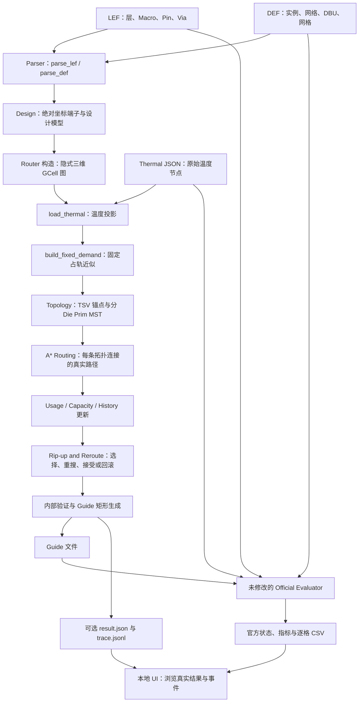
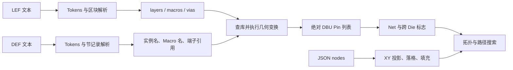
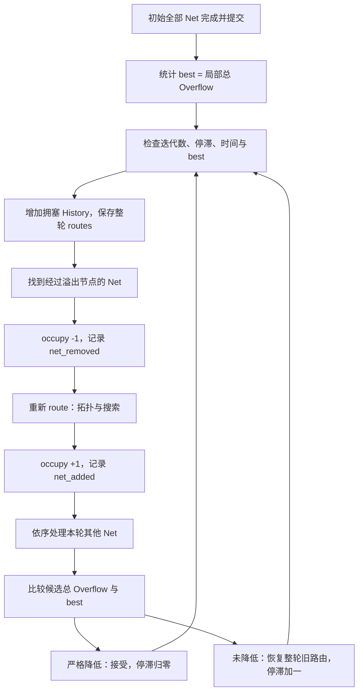
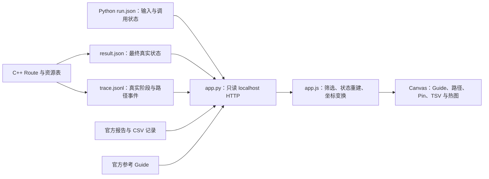

# 3DIC 比赛代码逻辑：原理与架构

本文是当前第一版代码的学习文档，回答“输入如何变成一份可评估的 Guide，以及代码为什么这样实现”。读者已了解 Die、Tier、Metal、Via、TSV 等基础概念。

编译、运行命令、UI 点击教程、排错和打包统一放在 [比赛代码使用说明](比赛代码使用说明.md)。文件位置总览见 [目录结构](目录结构.md)。本文以下 `src/`、`include/`、`scripts/`、`ui/` 均相对于 `EDA/code_3DIC EDA/`，链接则从本文件所在的项目根目录解析。

## 章节目录

1. [比赛代码总体架构](#logic-01)
2. [程序入口与执行流程](#logic-02)
3. [核心数据结构](#logic-03)
4. [DEF、LEF 和 Thermal Parser](#logic-04)
5. [3D Routing Graph](#logic-05)
6. [MST 与网络拓扑](#logic-06)
7. [A* 布线算法](#logic-07)
8. [拥塞优化](#logic-08)
9. [热感知与 TSV 优化](#logic-09)
10. [Guide 输出与合法性检查](#logic-10)
11. [评分原理与版本差异](#logic-11)
12. [UI 的内部逻辑](#logic-12)
13. [第一版实现总结与后续优化](#logic-13)

<a id="logic-01"></a>
## 第一章：比赛代码总体架构

### 1.1 主流程与数据边界

核心问题不是画出若干矩形，而是把 DEF 中每个 Net 的真实端子映射到合法三维资源上，再把连通结果表达为 Guide。算法要能解释每个矩形来自哪些路径节点，并能把失败与成功区分开。



实际时序中，热图和固定需求在初始布线前就准备好，拥塞与热信息并非等所有网络路由完成后才出现。图中的优化阶段表示再次利用这些信息重布。

输入输出有三条边界：Router 不接收参考 Guide；官方评分器不替 Router 求路；UI 不重新计算路由，也不把参考矩形中心的连线冒充真实搜索路径。

### 1.2 模块与源码对应

| 模块 | 实际位置与关键函数 | 输入、处理和输出 |
|---|---|---|
| 程序组织 | [src/main.cpp](<EDA/code_3DIC EDA/src/main.cpp>)：`main` | 参数、配置、文件路径 → 按顺序调用 → 退出码与完整输出 |
| 数据解析 | [src/parser.cpp](<EDA/code_3DIC EDA/src/parser.cpp>)：`Tokens`、`parse_lef`、`parse_def`、`placed_rect` | LEF/DEF → 词法、引用解析、几何转换 → `Design` |
| JSON 基础设施 | [include/json.hpp](<EDA/code_3DIC EDA/include/json.hpp>)：`Json::parse`、`Json::write` | JSON 文本 ↔ 值、数组、对象；供配置、热图和调试输出使用 |
| 图与资源 | [src/router.cpp](<EDA/code_3DIC EDA/src/router.cpp>)：`Router::Router`、`resource`、`capacity` | `Design` → GCell 边界和按需资源表 |
| 拓扑与搜索 | 同上：`select_tsv`、`mst`、`route`、`search` | Net 端子与当前资源 → 各 Die 拓扑 → `Route.nodes/edges` |
| 优化 | 同上：`run`、`occupy`、`overflow` | 全部路由与历史压力 → 重布/回滚 → 保留的路由及轮次记录 |
| 验证与输出 | 同上：`make_guides`、`validate`、`write_guide`、`result_json` | 真实图路径 → 内部验证、合并矩形 → Guide 与可选可视化数据 |
| 本地评估适配 | [scripts/evaluate.py](<EDA/code_3DIC EDA/scripts/evaluate.py>)：`main` | 成功的运行记录 → 隔离输入副本、调用官方程序 → 原始报告和 `invocation.json` |
| 可视化 | [ui/app.py](<EDA/code_3DIC EDA/ui/app.py>)、[ui/static/app.js](<EDA/code_3DIC EDA/ui/static/app.js>) | 已保存文件 → 只读 HTTP → Canvas 与事件状态重建 |

<a id="logic-02"></a>
## 第二章：程序入口与执行流程

代码入口：`src/main.cpp::main`。这一层负责组织，不负责选择某条 Net 的几何路径。

### 2.1 参数与配置怎样建立

比赛接口包含 `--def`、`--lef`、`--thermal-report`、`--output` 四个必需参数。其余为可选调试参数：`--metrics`、`--trace`、`--config`、`--time-limit`、`--iterations`、`--trace-limit-mb`。参数以键值对存入 `std::map`，未知键、缺值和重复键都会抛异常。

Windows 分支用 `CommandLineToArgvW` 取 Unicode 命令行，再转 UTF-8；真正读写文件时使用 `std::filesystem::u8path`。这是核心程序支持中文与空格路径的实现机制，不要求 UI 参与路径转换。

配置顺序是：构造 `Config` 默认值 → 从可选 JSON 覆盖已给出的字段 → 用直接 CLI 的时间、迭代和 Trace 大小选项再次覆盖。最后检查正负值、迭代上限等基本条件。未提供的字段保留 C++ 默认值，不能把精简的 baseline JSON 理解成删除了其他字段。

文件路径检查会比较规范化路径：输出不得与输入别名重合，所有输入、输出、配置、Trace、metrics 路径必须相互独立，输出扩展名必须是 `.guide`。文件存在和可读性最终由 `read_file` 的打开结果确认；它并没有在入口完整预扫描所有文件内容。

### 2.2 实际调用顺序

下列片段来自 `main`，仅调整排版以便阅读：

```cpp
Trace trace(opt.count("--trace") ? opt["--trace"] : "", c.trace_mb);
trace.event("parse_started");
Design d;
parse_lef(std::filesystem::u8path(opt["--lef"]), d);
parse_def(std::filesystem::u8path(opt["--def"]), d);
trace.event("parse_complete");

Router router(d, c, trace);
router.started = program_started;
router.check_time();
router.load_thermal(std::filesystem::u8path(opt["--thermal-report"]));
router.build_fixed_demand();
router.run();
```

先 LEF、后 DEF 有实际依赖：DEF 的组件名指向 Macro，端子名又指向 Macro 的 PIN，解析 DEF 时必须已经有库定义。热数据虽然也是输入，却在 Router 建立 GCell 后才投影，所以 `load_thermal` 位于 `src/router.cpp`，不是 `parser.cpp`。

`run()` 成功后，若要求 metrics，就先调用 `result_json()` 写出；随后调用 `write_guide()`。最后输出网络数、局部 Overflow、运行计时并返回 0。`Trace` 随作用域退出关闭文件。

### 2.3 失败与时间预算

最外层捕获 `std::exception`，打印 `ERROR: ...` 并返回 1。初始逐 Net 路由还会给异常补上网络名；重布异常会恢复正在处理的那条旧路由并继续向外抛出，不会把预算用尽或不可达当成“优化完成”。

当前 `started` 被设置为进入 `main` 的时刻，内部预算和计时因此包含此前的解析时间。但预算检查位于若干阶段及搜索循环中，并非异步中断每一个解析步骤；metrics 的计时快照也早于最终文件完全写完。辅助脚本记录的墙钟时间还包含进程组织/WSL 开销，两者不能直接混比。

失败时可能已经有 Trace、日志或 metrics，甚至有写出中断留下的 `.tmp`；不能只看某个文件存在就宣称成功。`run_case.py` 同时要求进程返回 0、Guide 存在、result 存在，才标记 `ROUTED`。若直接 CLI 复用了旧输出路径，早期失败也不会自动清除旧文件，这正是本地脚本禁止覆盖运行标签的原因。

<a id="logic-03"></a>
## 第三章：核心数据结构

定义位置：[include/model.hpp](<EDA/code_3DIC EDA/include/model.hpp>) 与 [include/router.hpp](<EDA/code_3DIC EDA/include/router.hpp>)。以下片段保留实际类型和成员名，省略部分默认初始化与方法体。

### 3.1 几何、工艺与库定义

```cpp
using Id = std::uint64_t;
struct Rect { double x1, y1, x2, y2; int layer; };
struct Layer {
    std::string name, type, direction;
    double width, spacing, pitch;
};
struct Macro {
    double width, height, ox, oy;
    std::map<std::string, std::vector<Rect>> pins;
    std::vector<Rect> obs;
};
struct Instance { std::string name, macro, orient; double x, y; };
```

`Rect` 被两种阶段共用：Macro 内 RECT 使用 LEF 微米；经变换后的矩形和最终 Guide 使用 DEF DBU。结构本身不携带单位标签，因此调用边界必须明确，不能把 `Macro.pins` 中的数值直接写进 Guide。

`Layer` 保留原始层名，用于输出；整数层号是 `Design.layers` 的键，用于图和 Die 判断。`width/spacing/pitch` 被解析，但当前搜索没有据此执行完整线宽、间距或 Via 包围规则检查。CUT 层没有完整保存在 `layers` 中；后者主要保存 Routing 层，TSV CUT 的识别结果另存布尔值。

一个 Macro 可被许多 Instance 共用。`Instance.macro` 是库名引用，`name` 是 DEF 实例标识；`orient` 决定局部几何怎样放到绝对坐标。OBS 属库几何，不等于一个全局禁止进入的布尔节点集合。

### 3.2 端子、网络与 Design

```cpp
struct Pin { std::string name; double x, y; int layer; };
struct Net { std::string name; std::vector<Pin> pins; bool cross; };
struct Track { char axis; double start, step; int count, layer; };
struct Design {
    std::string version, name;
    double dbu;
    Rect die;
    std::map<int, Layer> layers;
    std::map<std::string, Macro> macros;
    std::map<std::string, Instance> instances;
    std::vector<Net> nets;
    std::vector<Track> tracks;
    std::map<char, std::vector<double>> grid;
    std::set<std::pair<int,int>> vias;
    bool tsv_cut;
};
```

`Pin` 是一个已选定访问点，坐标为绝对 DBU，不再是完整端口多边形。组件端子名形如 `instance.pin`，顶层端口形如 `PIN.name`。`Net.pins` 保存 DEF 的全部连接项；多 Pin 不会被截成前两个。

`cross` 由端子层归属计算，不能仅根据 Net 名称前缀猜测。`Design.vias` 是合法相邻 Routing 层对的集合，既不是 Via 实例坐标表，也不是具体 Via 版图。

`Design.grid['X'/'Y']` 是 DEF 语句展开的原始边界线；Router 中的 `xs/ys` 才是合并、裁剪后的实际图网格。`Design` 把库定义、布局实例、网络、容量依据汇集起来，供下游查询而无需重复解析文件。

### 3.3 Grid Cell、Node、Edge、Resource 与 Route

当前没有名为 `GCell`、`Node` 或 `Tier` 的独立 C++ 结构。GCell 由 `xs/ys` 的两个相邻边界确定；Node 由整数 `Id` 编码；Tier 由物理层号导出。理解这些概念时不应去寻找不存在的类。

```cpp
struct Edge {
    Id a, b;
    bool operator<(const Edge& e) const;
};
struct Resource {
    int capacity = 0, usage = 0, fixed = 0;
    double history = 0;
};
struct Route {
    std::set<Id> nodes;
    std::set<Edge> edges;
    std::vector<Rect> guides;
    Id tsv = 0;
    bool cross = false;
};
```

Edge 两端是节点编码；普通路径边按较小 Id 在前的顺序存储，从而使集合去重有效。`nodes` 表示该 Net 占用哪些格/层，`edges` 表示实际上怎样连通，二者作用不同：仅有占用点不等于已经找到连接路径。

`Resource` 挂在一个格/层节点上。当前容量模型主要按格层计需求，搜索跨边时对“到达节点”的压力加罚，并不是每条几何边各存一份独立容量。`usage` 随提交/拆除变化，`fixed` 为 Pin/OBS 近似占轨，`history` 保留过去拥塞的记忆。

`Route.tsv` 保存 M10 侧锚点 Id；同一 XY 的 M11 节点可由解码后重新编码得到。它不代表一个具有真实 z 高度、尺寸和材料的 TSV 物理对象。`cross=false` 时该字段不参与 TSV 统计。

### 3.4 Router 与 Config 的职责

`Router` 持有 `Design& d`、配置副本、`Trace&`、`xs/ys`、`nx/ny`、热图、节点资源哈希表、每个 Net 的路由和优化轮次。Design 是引用，路由结果不写回原始 DEF/LEF。

```cpp
struct Config {
    double wire=1, via=0.5, tsv=4, congestion=4;
    double history=1, thermal=1, time_limit=600;
    int iterations=2, stagnation=2, margin=8;
    std::size_t search_limit=1500000, trace_mb=32;
};
```

这些是内部求解参数，不是官方评分权重。`wire/via/congestion/history` 直接参与 A*；`tsv/thermal` 主要参与 TSV 候选选择。具体调参方式放在使用说明，第七至九章解释其数学作用。

<a id="logic-04"></a>
## 第四章：DEF、LEF 和 Thermal Parser

### 4.1 为什么先词法化，再解析引用

代码位置：`src/parser.cpp::Tokens`、`parse_lef`、`parse_def`；JSON 则使用 `include/json.hpp::Json::parse`。

LEF/DEF 的记录可跨多行，一行不必对应一个对象。`Tokens` 按空白、括号、分号、加号分隔，跳过 `#` 注释，保留完整引号字符串；`expect` 约束语法，`record` 收集到分号，`number` 拒绝非法或非有限数字。它是服务当前数据子集的解析器，不是完整 LEF/DEF 标准实现。



### 4.2 LEF 怎样成为库模型

`parse_lef` 读取 Routing 层的 TYPE、DIRECTION、WIDTH、SPACING、PITCH，识别层名中的数字。Routing 层必须位于 1–20，方向必须是 HORIZONTAL 或 VERTICAL。

UNITS 和 PROPERTYDEFINITIONS 区块按其 END 标记跳过，避免把属性声明中的 `LAYER` 当成真实工艺层。LEF 的 DATABASE 数值没有替换 DEF 的 `dbu`：此版以 LEF 几何为微米、DEF UNITS 为最终坐标换算依据。

VIA/VIARULE 内收集 Routing 层号；若恰好涉及两层且层号相差 1，加入 `Design.vias`。CUT 层名 `tsv_layer` 或 `TSV` 会设置 `tsv_cut`。这只证明全局图的层间可达，不等于选定了某种满足全部包围规则的详细 Via。

MACRO 内记录 SIZE、ORIGIN、每个 PIN 的 RECT 数组以及 OBS RECT。非数字金属层名不会凭空映射为有效 Routing 层。关键引脚几何出现 MASK、POLYGON、PATH、ITERATE 等当前不支持形式时明确报错。

输出：可供 DEF 引用的 `macros/layers/vias`，下游不必重新扫描 LEF。

### 4.3 DEF 怎样建立 Instance、Pin 和 Net

`parse_def` 读取 VERSION、DESIGN、UNITS、矩形 DIEAREA、TRACKS、GCELLGRID。COMPONENTS、PINS、NETS 各自按头部声明的条数核对实际记录数。

COMPONENTS 的 `macro` 指向库，`placement()` 从 PLACED/FIXED/COVER 取坐标与方向。NETS 先保留 `(instance,pin)` 对，文件扫描结束后再解析引用，避免把字符串连接项误当成已经有几何位置的 Pin。

- `(u1 A)`：查 `instances[u1]` → 查对应 Macro → 查 `pins[A]` → 取首个矩形 → 变换四角 → 取绝对矩形中心。
- `(PIN io0)`：查 DEF 顶层端口的 RECT/placement，取已建立的第一个访问点。
- 全部连接项都加入 `Net.pins`；发现 bottom 和 top 两类端子时，设置 `Net.cross=true`。

顶层 PINS 和组件 Macro PIN 是两种来源，不能用同一个“实例位置加偏移”公式草率替代。

### 4.4 DBU 与实例方向的数值例子

代码位置：`orient_point`、`placed_rect`、`parse_def` 中的端子解析部分。

设 Macro 为 2 µm × 4 µm、ORIGIN 为零，Pin 矩形为 `(0.1,0.2)-(0.3,0.4)`，中心 `(0.2,0.3)`；实例位于 `(1000,2000)` DBU，DEF 单位为 1000 DBU/µm。

- N：绝对中心为 `(1000+200,2000+300)=(1200,2300)` DBU。
- FS：局部中心变为 `(0.2,4-0.3)=(0.2,3.7)`，绝对中心为 `(1200,5700)` DBU。

这组 FS 坐标也在 `tests/test_workflow.py::test_units_orientation_io_thermal_trace` 中检查。若 DBU 错用 2000，坐标会整体偏移；若忽略 FS，Pin 会落在错误一侧。

`placed_rect` 对矩形四角应用 `(x+ox,y+oy)` 和方向变换，再乘 DBU、加实例位置、重新求包围盒。对当前实现，设输入变换点为 `(x,y)`、Macro 宽高为 W/H，八种方向为：

| 方向 | `orient_point` 输出 |
|---|---|
| N | `(x,y)` |
| S | `(W-x,H-y)` |
| W | `(H-y,x)` |
| E | `(y,W-x)` |
| FN | `(W-x,y)` |
| FS | `(x,H-y)` |
| FW | `(H-y,W-x)` |
| FE | `(y,x)` |

顶层 IO 使用零宽高调用该变换，即绕端口原点旋转/镜像，而不是按 Macro 外框补偿。非零 ORIGIN 与复杂库组合尚未经过完整标准一致性验证，应把这里理解为当前函数的行为，不能扩写为支持所有工业库格式。

### 4.5 热数据的实际解析位置

代码位置：`src/router.cpp::Router::load_thermal`。

输入必须有 `meta.ambientTemp`、非空 `nodes`，节点严格为 `[x_um_local,y_um_local,z,temperature]`。先以 XY 为键合并不同 z 节点、求平均，再按下式换成布局坐标：

$$x_{DBU}=x_{die,min}+x_{local,\mu m}\,DBU_{/\mu m},\qquad
y_{DBU}=y_{die,min}+y_{local,\mu m}\,DBU_{/\mu m}.$$

每个 GCell 对落入其中的不同 XY 样本再求均值，`thermal_count` 因而记录该格收到的投影 XY 样本数，不是必然等于原始 z 节点数量。

缺失格按行扫描：有左侧有限值就复制左侧；否则有前一行就复制上方；首行前部可能暂存 NaN。最后反向扫描用后续有效温度补齐前部缺口，反向初值为 ambient。边界外热节点跳过，若全部无法映射则报错。算法是确定性补齐，不是双线性插值，也不保留逐 Die 的独立热场。

### 4.6 错误与支持边界

未知实例/Macro/Pin、缺失 VERSION/UNITS/DIEAREA/NETS、非法层、网格轴或节记录数错误会抛异常。VIAS、BLOCKAGES、SPECIALNETS、REGIONS、GROUPS 目前只接受空节，非空时明确失败。矩形 DIEAREA 之外的多边形边界不是本版支持对象。

一些非关键语句由当前扫描逻辑略过，因此不能宣称“所有未知语法都严格拒绝”。可保证的是上述实际实现的校验点，以及没有把缺失的关键端子伪造成默认坐标。多端口矩形虽然读取到数组中，访问优化仍只选择第一个形状。

<a id="logic-05"></a>
## 第五章：3D Routing Graph

代码位置：`Router::Router`、`id/decode`、`locate`、`pin_node`、`cell`、`center`、`capacity`、`resource`，以及 `search` 内的 `visit` lambda。

### 5.1 从二维边界线扩展到层

构造函数对每轴收集所有 GCELLGRID 展开值，加入 DIEAREA 两端，只保留内部线，排序去重。`nx=xs.size()-1`、`ny=ys.size()-1`。同一 XY 格在每个已声明物理层拥有一个节点，形成隐式三维格图。

节点编码使用实际物理层号，不减 1：

$$id(x,y,l)=(lN_y+y)N_x+x.$$

源码为：

```cpp
Id id(int x,int y,int l) const { return (Id(l)*ny+y)*nx+x; }
void decode(Id v,int& x,int& y,int& l) const {
    x=int(v%nx); v/=nx;
    y=int(v%ny); l=int(v/ny);
}
```

例如 `nx=4,ny=3,(x,y,l)=(2,1,11)` 编码为 138，解码得到原值。这个例子仅演示公式，不是任何官方 Net 的硬编码。

`locate` 用 `upper_bound` 查区间：内部分界点归右/上格，最外边界归最后一格，边界外坐标拒绝。`cell` 给出 `[xs[x],ys[y],xs[x+1],ys[y+1]]`；`center` 用于几何成本；Pin 本身的真实坐标仍单独保存。

当前把二维格数限制在一千万以内；不预先创建所有层的完整节点/边数组，资源哈希表在访问时才建立。不过热图数组仍覆盖完整二维网格，解析文件也不是流式零内存操作。

### 5.2 Die 与邻居规则

本地正式用例是两 Die 共享同一个 XY DIEAREA：M1–M10 为 bottom，M11–M20 为 top。代码没有任意数量 Tier 的配置化叠层模型。

| 边类型 | 邻居与检查 | 作用 |
|---|---|---|
| 同层水平 | HORIZONTAL 层的 `(x±1,y,l)` | 沿首选方向移动 |
| 同层垂直 | VERTICAL 层的 `(x,y±1,l)` | 沿首选方向移动 |
| 普通 Via | `(x,y,l±1)`，且层对在 `d.vias` 中 | 同 Die 换方向或接入端子层 |
| TSV | `route` 显式插入同格 M10/M11 边 | 连接两个分 Die 子图 |

`search` 的 `lo/hi` 参数限制单侧 Die，不能绕过另一 Die 来解决内部不可达。跨 Die Net 还禁止在 M10/M11 平面移动，界面层只作接入/TSV 格，通常经 M9/M12 完成界面附近的平面连接。

### 5.3 Capacity、Usage、Fixed Demand

水平走线沿 X 延伸，容量来自垂直于线路的 Y tracks；垂直走线容量来自 X tracks。`capacity` 将对应 TRACKS 等差序列落到当前区间并计数，最外边界做特殊包含处理。

`build_fixed_demand` 遍历每个 Instance 的全部 Macro Pin 与 OBS 矩形，先做方向和 DBU 转换，裁到 DIEAREA，再把矩形与各 GCell 的相交部分用于计轨，累加到 `fixed`。同一形状有多个重叠矩形时可能重复累计；这不是完整几何布尔去重。顶层 IO Pin 没有在该函数中作为独立固定形状遍历，也不能声称局部模型包含了所有官方固定需求。

零容量或障碍覆盖节点不被统一删除：当前模型通过压力成本软惩罚，允许有 Overflow 的合法全局 Guide。它没有完成绕开所有 OBS 的详细布线 DRC。此资源模型输出到后续 `occupy`、`overflow` 和 A*，用于一致的局部优化，而不是假装完全复现官方容量计算。

<a id="logic-06"></a>
## 第六章：MST 与网络拓扑

代码位置：`Router::route`、`Router::mst`、`Router::select_tsv`。

### 6.1 为什么先决定连接关系

两 Pin Net 通常只需连接一个端点对；P 个端子的 Net 若对所有点两两求路，会产生大量冗余连接。MST 先挑出 P−1 条拓扑边，使端点集合连通，再把每条抽象边交给 A*。

`route` 先把 Pin 映射成节点，按 Die 分组，然后对每组节点排序去重。不同真实端子可能同层同格：它们仍留在 `Net.pins` 供展示/验证，但拓扑中只有一个节点。若整组只剩一个节点，无需执行 A*，单格 Guide 仍覆盖这些访问点。

### 6.2 当前采用 Prim，而不是 Steiner 求解器

MST 边权取节点中心间的曼哈顿距离和层差：

$$w(i,j)=w_w\frac{|x_i-x_j|+|y_i-y_j|}{p}+w_v|l_i-l_j|,$$

其中 `p=unit`。它不包含当前资源压力，实际绕路交给 A* 处理。

`mst` 用数组 `best/parent/seen` 做朴素 Prim：

```text
best[0] = 0，其余为无穷
重复 P 次：
    从未入树端点中选 best 最小的 u
    标记 seen[u]
    若 parent[u] 存在，输出 parent[u] -> u
    用 w(u,v) 更新各未入树端点的 best[v]、parent[v]
```

复杂度为单组 `O(P²)`，不是使用图搜索优先队列的那个堆。输出的二元组是端点数组索引；`route` 再将它们变成真正的起点/终点 Id。Trace 的 `mst_edges` 则保存转换后的节点 Id 对。

### 6.3 跨 Die 必须先放一个共同锚点

若所有端子直接放进一个允许反复跨 Die 的搜索图，路径容易产生多次界面交叠，导致 TSV 候选不唯一。当前将跨 Die 位置选择与单 Die 搜索分开：


`select_tsv` 先找 M10 端子格和 M11 端子格的交集。恰好一个共同格时直接固定；多个共同格时报错，不实现官方“最多两个候选”的复杂消歧；没有固定共同格时才进入候选成本比较。

`route` 给两组端子分别增加该格的 M10/M11 锚点，插入显式层间边，然后各自求 MST 和 A*。候选采样与热成本在第九章展开。

### 6.4 路径合并与 RSMT/FLUTE 的区别

一条 Net 的各个 A* 结果加入同一 `set<Id>` 和 `set<Edge>`，重复占用不会在最终需求中重复计数。但每个端点对仍独立求路，搜索没有主动把“已构造的本 Net 树”设为多源目标，也没有显式搜索新的 Steiner 点。

MST、RSMT 和 FLUTE 的区别因此很具体：当前 MST 只选现有端点之间的树；RSMT 允许新增直角 Steiner 分支点；FLUTE 是可用于构造此类拓扑的工具之一。本版 Router 不链接 FLUTE。官方评分器使用的 FLUTE 表属于评估依赖，不能据此说自主路由已经实现 FLUTE。

<a id="logic-07"></a>
## 第七章：A* 布线算法

代码位置：`src/router.cpp::Router::search`，由 `route` 中的 `connect` lambda 按 MST 端点对调用。

### 7.1 起点、搜索状态与访问控制

起点/终点是去重后拓扑端点的 Id，不是随机矩形中心。搜索状态就是一个 `(grid_x,grid_y,physical_layer)` 节点；路径方向通过该层的首选方向限制。

实际局部结构如下：

```cpp
struct State { double f, g; Id v; bool operator<(const State& o) const; };
struct Info { double g; Id parent; };
std::priority_queue<State> q;
std::unordered_map<Id, Info> dist;
```

`q` 是 Open Set，比较器让较小 f 优先，同 f 时以 Id 决定顺序。`dist[v]` 保存当前最小到达成本与父节点。这里没有永久封闭的 Closed Set：一个节点若找到更好成本，可以再次入队；弹出的旧条目若 `cur.g > dist[v].g + 1e-10` 就跳过。这是实际的重复访问控制，不能额外描述一个源码中不存在的 visited 数组。

### 7.2 g、h、f 与真实边成本

`f(v)=g(v)+h(v)`。对当前节点 u 和候选邻居 v，源码先求 v 的资源压力：

$$O_v^+=\max(0,Usage_v+Fixed_v+1-Capacity_v).$$

其附加惩罚为：

$$P(v)=w_c\left(\frac{O_v^+}{\max(1,Capacity_v)}\right)^2+w_hHistory_v.$$

基础成本为：

$$B(u,v)=
\begin{cases}
w_w\dfrac{|x_u-x_v|+|y_u-y_v|}{p},&l_u=l_v,\\
w_v,&l_u\ne l_v\text{（合法普通 Via）}.
\end{cases}$$

因此：

$$g_{new}(v)=g(u)+B(u,v)+P(v).$$

平面成本使用实际相邻格中心距离，边缘裁剪格不一定与内部格一样宽。`p` 是构造时第一格 X/Y 长度的较小值，用作成本尺度，不是所有层的 LEF pitch。

当前 Net 在构造完成后才统一 `occupy`，因此这些逐段搜索主要看到其他已提交 Net 的 Usage；本 Net 已加入临时 Route 的节点并未逐段提交成新需求，也没有专门的共享树奖励。

**TSV 与热项并不直接出现在这个 A* 边公式里。** TSV 已在 `select_tsv` 中确定，A* 限制在单 Die；`cfg.tsv` 和 `cfg.thermal` 用于候选位置成本。把它们写成“每次普通平面扩展都计算 TSV/温度惩罚”会与当前源码不符。

### 7.3 启发函数为何是下界

目标节点为 t 时：

$$h(v)=w_w\frac{|x_v-x_t|+|y_v-y_t|}{p}+w_v|l_v-l_t|.$$

因为平面移动至少要补齐曼哈顿位移，换层只能逐相邻层执行，且附加惩罚非负，所以此式是当前可搜索图成本的下界。不存在的 Via 会使实际路线更贵或不可达，不会让这一下界变大。

这不意味着整设计全局最优：拓扑已被 MST 固定、Net 按 DEF 顺序提交、TSV 已预选，且搜索可能只在一个局部包围盒中找到可行路径。

### 7.4 实际执行顺序与包围盒扩张

1. 若起终点相同，直接返回单节点路径。
2. 用起终点包围盒加 `margin` 形成 XY 搜索区；层范围由调用方给定。
3. 初始化 `dist[start]={0,start}`、将 start 入堆。
4. 弹出最小 f，先丢弃过期条目，再判断是否到目标。
5. 检查扩展次数；周期性检查时间预算。
6. 生成首选方向平面邻居及上下相邻层，经 `visit` 检查边界、层存在、Die 范围、Via 关系和界面层限制。
7. 计算新成本；仅在更优时替换 `dist` 并入堆。
8. 堆空且还没覆盖全图时，扩大 margin 后重新初始化这次搜索；全图也不可达则抛异常。

`search_limit` 计数在每次包围盒尝试中重新开始。达到扩展上限时直接异常，不会继续自动扩大；只有本次堆耗尽的“无路径”才触发扩大。

### 7.5 路径回溯与结果交接

到达目标后，沿 `dist[v].parent` 从 goal 回到 start，最后反转序列。`route` 把该序列记录为 `path_found.nodes`，把相邻 Id 对放入 Route 边集合。搜索没有记录每一次扩展，因此 Trace 表示真实阶段与找到的路径，而不是完整的 Open Set 动画。

输出是实际相邻节点路径；资源扣费在外层提交时完成，Guide 转换在这条 Net 的全部拓扑连接结束后进行。

<a id="logic-08"></a>
## 第八章：拥塞优化

代码位置：`Router::occupy`、`overflow`、`run`；资源初值来自 `capacity` 和 `build_fixed_demand`。

### 8.1 三类需求如何相加

局部格层需求和溢出定义为：

$$D_v=Usage_v+Fixed_v,\qquad Overflow_v=\max(0,D_v-Capacity_v).$$

`occupy(route,+1)` 对 `route.nodes` 中每个格层增加 1，因为节点集合已经按 Net 去重；跨 Die Route 还在 TSV 的 M10/M11 两节点各额外加 1。拆除用 `sign=-1` 执行相反操作，普通 Via 不在此函数另加一笔 Via 需求。

例如某格 Capacity=3、Fixed=2、已有两个不同 Net 覆盖，则 Usage=2，总需求 4、Overflow=1。相同 Net 的两段路径共享这个格，不会再成为第三份 Net 需求。

`overflow()` 汇总当前资源表全部格层的正溢出，包含只有固定需求造成的溢出。它既不是只看最大溢出，也不是详细路由 DRC 违规条数。

### 8.2 History Cost 与重布选择

每一轮开始，对存在 Usage 且已溢出的资源累加：

$$History_v\leftarrow History_v+
\frac{Usage_v+Fixed_v-Capacity_v}{\max(1,Capacity_v)}.$$

历史代价随后通过 A* 中的 `cfg.history * res.history` 生效，使反复拥塞的位置越来越不受欢迎。仅固定需求而没有路由使用的格不会在此处不断加历史项。

重布不是按 Net 名或固定比例随机挑选：依次检查每条保留 Route，只要它的某个节点当前存在溢出，就进入重布集合。这个判定随前面的 Net 重布而变化。

### 8.3 接受与回滚的真实粒度



伪代码中的判断是 `accepted = now < best`，不是“每条新路径更短就接受”，也不是线长/热/拥塞的多目标 Pareto 选择。整轮未改善时，所有路由恢复为保存的状态；本轮累加的资源 History 没有同时回滚，这是下一轮保留拥塞记忆的当前实现。

若重搜异常，先恢复正在拆除的那条旧路由，再把异常上抛，整个程序失败，不发布新的 Guide。正常无改善时则不是失败：回滚后仍可输出之前合法的路线。

### 8.4 终止与局限

重布最多 `iterations` 轮；连续无改善达到 `stagnation` 停止；局部总 Overflow 为零就不进入后续轮次；各阶段还受时间预算限制。固定 Pin/OBS 需求本身的溢出可能不可消除。

当前近似固定需求与官方计费不同，只降低本地 Overflow 可能牺牲官方线长，甚至不保证官方拥塞同幅度改善。轮次记录保存了候选值、接受标志、保留值和重布 Net 数，应据这些真实数据分析收益。

<a id="logic-09"></a>
## 第九章：热感知与 TSV 优化

代码位置：`Router::load_thermal`、`select_tsv`、`result_json`。本章承接第四章的热投影结果，解释其在优化和评价中的作用。

### 9.1 温度不是重新仿真的结果

输入热节点由赛题方提供，`heat` 是这些输入投影/填充后的二维场。Router 不运行 HotSpot，不根据新线路重新计算温度，不做增量物理热求解。某份官方输入若自带 synthetic 标记，官方报告中的相应警告也应保留。

### 9.2 候选集合与成本

无固定共同锚点时，`select_tsv` 计算全部端子格的 XY 包围盒。候选包括所有端子格，以及按 stride 采样的包围盒网格。stride 由面积相对 4096 的平方根向上取整决定，控制候选规模，但不能把“约 4096”理解成严格的总候选数量上限，因为还会加入端子格、边缘离散数也可能不同。

对候选格 c，当前代码比较：

$$J(c)=w_w\frac{1}{P}\sum_{p\in net}
\frac{|x_p-x_c|+|y_p-y_c|}{unit}
+w_{tsv}+w_c\bigl(O_{10}^{+2}(c)+O_{11}^{+2}(c)\bigr)
+w_T\,Cold(c),$$

其中：

$$O_l^{+2}(c)=\max(0,Usage_l+Fixed_l+2-Capacity_l),$$

$$Cold(c)=
\begin{cases}
\dfrac{T_{max}-T_c}{T_{max}-T_{min}},&T_{max}>T_{min},\\
0,&T_{max}=T_{min}.
\end{cases}$$

`+2` 近似考虑该 Net 覆盖和 TSV 附加需求。这里的拥塞项没有采用 A* 的容量归一化平方形式；不能为了公式整齐把二者写成相同代价函数。

温度越高，Cold 惩罚越低，所以策略鼓励 TSV 服务热点，而不是无条件避热。固定 M10/M11 共同格会直接返回，跳过整个候选比较。当前每个跨 Die Net 强制一个 TSV，`w_tsv` 对同一 Net 的所有候选只是常数；单独调它通常不会改变候选排序或 TSV 总数。

输出为一个 M10 侧锚点 Id，供第六章的分 Die 拓扑使用；普通 A* 扩展不再直接添加温度项。

### 9.3 TSV 密度与 Pearson

`result_json` 遍历最终接受的 Route，每条跨 Die Route 在对应 XY 格密度加 1，得到 `tsv_density`。这是实际显式跨 Die 边的统计，不是普通 Via 数，也不是从外观猜测的 TSV。

用温升 $H_i=\max(T_i-T_{ambient},0)$ 与密度 $D_i$ 计算：

$$r=\frac{\sum_i(H_i-\bar H)(D_i-\bar D)}
{\sqrt{\sum_i(H_i-\bar H)^2\sum_i(D_i-\bar D)^2}}.$$

对非退化向量，分别按总和做正比例归一化不会改变 Pearson，所以本地直接用温升和计数求相关。没有 TSV 或任一方差为零时输出 JSON `null`，UI 显示 N/A；不是自动赋满分或把无数据视为 r=0。

### 9.4 已实现启发式与未实现目标

本版已实现的是局部合法候选中的冷区惩罚，以及事后全局密度相关性统计。它没有直接对全局 Pearson 做梯度/组合优化，没有跨 Net 联合平衡 TSV 密度，没有在普通走线长度和温度之间建立物理反馈。

官方热评分还使用自己的网格、填充口径与 G_case。即使本地 r 较高，也不能由此编造正式 Thermal Score，更不能说芯片温度已下降。正式公式与版本边界见第十一章。

<a id="logic-10"></a>
## 第十章：Guide 输出与合法性检查

代码位置：`Router::make_guides`、`validate`、`write_guide`，以及 `main` 的输出顺序。

### 10.1 从节点集合转成矩形区域

输入是连通的 Route，`make_guides` 把每个已占用节点还原成 GCell 矩形。在 HORIZONTAL 层只向 +X 合并连续同层格，在 VERTICAL 层只向 +Y 合并；不能用跨多个非首选方向格的大矩形包住端子来冒充路径。

跨 Die Route 的 M10/M11 节点不合并成长条，保留单格矩形。这样显式 TSV 格在两层产生正面积重叠，而不会因长条交叠制造许多候选区域。

以教学网格 X=[0,1000,2000]、Y=[0,1000] 为例，两个相邻 M1 水平节点可合并为：

```text
example_net
(
0 0 2000 1000 metal1
)
```

这是数据转换示例，不是官方 Case 的固定答案。实际输出坐标来自解析后的网格，层名来自 `Design.layers[layer].name`。

### 10.2 Via/TSV 与 Pin 覆盖怎样表达

Guide 不单独写 `VIA` 或 `TSV` 语句。普通换层处在相邻两层出现同格矩形，XY 有正面积重叠；TSV 处则特指 M10/M11 同格重叠。真正的图边还保存在可选 result 中，供可视化分清层间关系。

Pin 覆盖的内部验证由 `pin_node` 是否在 Route 节点集合中完成，再由 `cell` 产生覆盖该访问点的矩形。这证明当前所选端子访问点落在同层 Guide 中，不等于覆盖了一个多端口 Pin 的全部形状，也不是对输出文件重新运行官方几何检查。

### 10.3 内部 validate 的顺序与范围

`validate` 检查非空 Route、同层边格距为 1 且方向正确、普通 Via 同 XY/相邻层/LEF 可达、TSV 只能用于跨 Die Route 且是选定锚点。随后按真实边建邻接关系，用栈遍历确认所有占用节点连通，再检查全部 Pin 节点和每个 Guide 的边界、Die 归属。

跨 Die 还统计 M10 节点中有多少个 XY 同时存在 M11 节点，要求恰好一个共同格。这比正式“最多两个候选并可唯一判定”的规则更保守。

内部校验不含完整间距/线宽 DRC、所有 Pin 几何选项或官方参考线长算法。官方 Checker 仍是独立的后续步骤。

### 10.4 文件写出与完整性声明

每条 Net 在 `route` 完成后先 `make_guides/validate`；全部 Net 成功后，`write_guide` 再逐条验证，把网络名、括号、整数 DBU 矩形写入 `<output>.tmp`。关闭成功后才发布为目标 Guide。

若已有目标，当前实现先删除旧目标再 rename 临时文件，并不是所有平台上都具备严格原子替换语义。失败前可能留下临时或先写出的调试数据；旧目标在早期失败时也可能仍存在。本地运行脚本据退出码和配套文件判定，而不是把“目录里看到了 Guide”当作完整成功。

<a id="logic-11"></a>
## 第十一章：评分原理与版本差异

### 11.1 评价层次与来源

本章依据本地实际资料，不把互相冲突的版本合成一个自创规则：

- [旧版 checker.py](<EDA/eda-elite-challenge/eda-elite-challenge2026/evaluator/checker.py>) 与 [score.py](<EDA/eda-elite-challenge/eda-elite-challenge2026/evaluator/score.py>)，以及同目录 `common.py`。
- [较新的正式评分说明 DOCX](<EDA/评估程序/3DIC全局布线评分程序评价标准说明_20291011.docx>)、`EDA/评估程序/score` ELF 的实测报告。
- [赛题问题与解答汇总](EDA/赛题问题与解答汇总.md)，尤其 Q43–Q47、Q50–Q56、Q60、Q69、Q72、Q87、Q89。编号是本地汇总编号。
- 自主 Router 的 `wirelength`、`overflow`、`result_json`。它们是局部估计，不是另一个官方评分器。

完整来源差异记录保留在 [资料核查与规则差异](<EDA/code_3DIC EDA/docs/资料核查与规则差异.md>)。

### 11.2 S1、S2/S3、S4

正式资料给出的总结构为：

$$Score=S_1(S_2+S_3)S_4.$$

S1 是连接、端子同层覆盖、区域、Routing 层与 Guide 格式等硬性合法性。S2/S3 是公开/隐藏用例的优化质量与排名折算，满分分别 30/70；单用例工具通常只给出三项指标得分，不等于直接算完最终排名分。

单用例质量权重为：

$$Q=0.45S_{wire}+0.30S_{congestion}+0.25S_{thermal}.$$

S4 是时间/内存约束。Q87/Q89 选择单 Case 12 小时、128 GB，而非宣讲截图的 2 小时、16 GB；Q87 也指出只看生成后的 Guide 的评分器无法还原 Router 效率。当前辅助工具记录时间与峰值 RSS、设置开发超时，但没有实现 128 GB 的内存强制配额；不能把评分器 PASS 等同为正式平台 S4 已完全验收。

### 11.3 Wirelength 的三种口径

1. 自主 `Router::wirelength` 累加 Route 中同层真实边中心距离，去重后的边只计一次；普通 Via/TSV 不加入此几何长度，另有计数。
2. 旧 `checker.check/build_mst` 在 Guide 矩形连通图上构造 MST；旧 `score.compute_wire_length` 用该关系与 Guide 中心跨度构造 proxy，跨层代价来自其参数。
3. DOCX 描述的是逐层去重覆盖 GCell 的长度，加普通 Via 和跨 Die 成本，参考值使用 FLUTE 的端子 Steiner 结果及层间换算。较新 ELF 的具体内部源码未提供，原始报告仍带 `guide-rectangle Manhattan MST proxy` 等 fidelity 标签，必须保留，不应擅自改成“精确物理线长”。

DOCX 的成本表述可写为：

$$W=\sum_l\sum_{c\in CoveredCells_l}pitch_{GCell,l}
+N_{via}\,via\_ratio\,p_{max}
+I_{cross}\,tsv\_ratio\,p_{max},$$

其中水平层取格宽、垂直层取格高；真实网格非均匀时不能机械当成处处同一个 pitch。此处是说明文档的数学含义，不是声称已反编译 ELF。

### 11.4 拥塞与热评分

DOCX 需求由固定 Pin/OBS、同 Net 去重的 Guide 覆盖、TSV 上下层附加需求组成；正溢出为 $\max(0,demand-capacity)$。其得分形式为：

$$S_{congestion}=100\left[1+\sum_i
\left(0.1\frac{Overflow_i}{Capacity_i}\right)^2\right]^{-1/2}.$$

零容量有需求时不能直接除零，DOCX 仅说明较大惩罚，实际数值看工具。Q60 明确固定占用造成的不可避免溢出也可能扣分。自主固定需求近似、顶层 IO 与重叠去重范围不同，因此 `_local` 不等于官方 `total_overflow`。

DOCX 热分使用第九章的相关性概念，并加用例增益：

$$S_{thermal}=100\left(0.5+0.5\tanh(G_{case}r)\right).$$

G_case 取工具报告或官方给定值，不能编造。局部 r 的温度填充和裁剪网格与工具可能不同。Q69 说明热分围绕 TSV 分布，不能假定普通走线/Via 自动带来正式热分收益。

### 11.5 必须保留的版本冲突

| 项目 | 旧 Python / 较早记录 | DOCX / 后续 Q&A / ELF 观察 | 本工程解释原则 |
|---|---|---|---|
| 端子方向 | 旧 `checker.get_position` 对组件端子只平移，未用 orientation | 自主解析应用八方向；正式物理位置应与布局对应 | 不改官方代码，实际失败单独诊断 |
| 同层连接 | 旧 `_rectangles_connect` 主要用 XY 接触，含角点容差 | Q44–Q46 禁止非首选方向跨格，边接触与角接触不同 | 图只生成首选方向相邻边，不依赖宽松漏洞 |
| Die 内借层 | 旧脚本部分规则依赖名称前缀 | DOCX 要求按端子所属 Die 限制，跨 Die 才能有 TSV | 自主按端子层判断，严格分 Die |
| TSV 候选 | 旧脚本遍历 M10/M11 正面积交叠并累计 | DOCX 最多两个候选且必须唯一可判定 | 自主仅生成一个共同格，不实现双候选消歧 |
| 参考长度 | 旧脚本 Guide 中心 HPWL proxy；Q51 有按 Guide 的答复 | DOCX 写 FLUTE 端子参考；ELF 报告仍保留 proxy 字样 | 不把不同基准默认为同一公式 |
| 线长得分 | 旧 Python `compute_score` 对低于基准给满分 | DOCX 写 `100*min(L,1/L)`；后续 Q53 又说明低于参考不扣分 | 并列记录，最终平台行为仍需以对应工具/公告确认 |
| 拥塞换算 | 旧脚本线性溢出惩罚，调用处把总 Overflow 传入名为 max_overflow 的参数 | DOCX 为容量归一化平方和；ELF 输出详细 CSV | 不从变量名推断实际计费口径 |
| 热得分 | 旧 `compute_score` 为 `(r+1)/2` | DOCX/较新报告为带 G_case 的 tanh | 不混用两版分数 |
| 边界 | 旧 checker 检查完全包含 | DOCX 表述为与 DIEAREA 有交集 | 自主用更严格的完全包含 |
| 热空格 | 旧 `aggregate_temperature` 遇空格报错 | DOCX 允许前行/列填充，Q&A 未完整说明顺序 | 本地确定性规则单列，不宣称逐位一致 |

以上冲突不通过修改原始评分程序解决。历史参考 `evaluation_report.json` 也不是自主算法的当前结果。

### 11.6 评估适配器怎样确认报告有效

`scripts/evaluate.py::main` 读取 `run.json`，要求 `status=ROUTED`，复核输入哈希，再复制字节相同的 DEF/LEF/热 JSON 到本次评估目录。较新工具需要的 POST9/POWV9 表也复制到该工作目录，避免它在官方数据旁生成缓存 JSON 或日志。

它调用原始 ELF，或以 Linux Python 3.10 与原始 `.so` 调用 legacy 脚本；不改评分源码。进程返回 0 且原始报告 `status=PASS` 才写完整调用 PASS；否则保留退出信息、日志和失败原因。latest 还更新运行记录中的 `official_status`，但 C++ `result.metrics.official_status` 的初始值不会被反写更新。

报告中的 proxy/mock-DRT 表示 Guide/风险代理，无法替代详细布线 DRC。分数来自 synthetic 热图的警告也必须保留。具体字段和操作只在使用说明中展开。

<a id="logic-12"></a>
## 第十二章：UI 的内部逻辑

代码位置：`ui/app.py::Handler.do_GET/run_data/guide`，`ui/static/app.js::load/drawPanel/node/applyEvent/seek/scopedTrace`。本章只解释数据如何工作，不提供启动教程。

### 12.1 C++ 到浏览器的数据通路



`result_json` 输出设计边界、DBU、实际网格线、层与 Die 映射、实例包围盒、每 Net 的真实 Pin/节点/边/Guide、资源表、热图、TSV 密度、轮次和局部指标。

`route_json` 的 `guides` 是 `[x1,y1,x2,y2,layer_number]`，`edges` 是两个节点 Id；`resources` 每行是 `[id,capacity,usage,fixed,overflow]`。JS 的 `node` 用同一编码逆变换获得格中心。它画出的真实路径来自这些边，而非任意串联矩形中心。

### 12.2 服务端提供什么

| 接口 | 对应处理 | 输出 |
|---|---|---|
| `/api/catalog` | `catalog()`、`runs()` | 本地可发现 Case 与完整运行标签 |
| `/api/run?id=...` | `selected`、`run_data` | result、run、官方调用记录、日志尾部 |
| `/api/trace?id=...` | 逐行读取 Trace | 原始事件；大文件提示需选择 Net |
| `/api/trace?...&net=...` | 逐行过滤该 Net 及全局事件 | 保留原 seq 的局部过程 |
| `/api/thermal?id=...` | 按运行清单读取原热输入 | 原始节点的受限抽样与总节点数 |
| `/api/reference?case=...` | `guide` 解析参考矩形 | 来源显式标记的 Guide，无内部路径 |

服务只绑定 `127.0.0.1`，没有触发布线/评分的 POST 接口。参考视图用同一 Case 已成功运行的数据提供真实 Pin、实例和网格背景；没有这样的运行时先报缺少元数据，不能凭参考矩形猜出端子。

### 12.3 筛选与绘图

`load` 建立最终 Net 状态；`visibleNets` 根据名称、跨 Die 条件、选择的 Net 筛选，最多绘制 150 条符合条件的网络。`layerVisible` 按物理层和当前 Die 过滤；一个 Net 选择状态同时用于两个 Canvas，实现联动。

`drawPanel` 把 DBU 世界坐标转换到像素，Y 轴反向；缩放、平移改变的是视口，不改输入几何。Guide 用半透明矩形，真实同层边用线，普通 Via 在对应层变化处画小方块，实际 TSV 锚点画圆形/十字标记。

`instances` 最多绘制 12000 个实例；原始温度节点按 `stride=max(1,len(nodes)//10000)` 抽样，因此是“约一万”的目标而非严格上限。原始温度以 XY 投影显示，不按 z 正负猜 Die。当前没有真正的三维物理堆叠视图或专门的 z 筛选控件。

### 12.4 Trace 回放是状态重建

`src/parser.cpp::Trace::event` 为每行加 `event` 与递增 `seq`，不记录每个 A* 扩展，也没有每事件的真实墙钟时间戳。UI 的播放速度是事件推进速度，不是重演当时 CPU 耗时。

| 事件 | 真实来源与回放作用 |
|---|---|
| `parse_started/parse_complete/graph_built/thermal_mapped` | 阶段说明与统计 |
| `net_selected/topology/search_started` | 当前 Net、实际 MST 或端点对 |
| `path_found` | 回溯得到的真实节点序列；当前路径以绿色叠加 |
| `net_added` | 完整 Route 快照，加入 `S.active` |
| `net_removed` | 从 `S.active` 移除，旧边暂以红色显示 |
| `iteration_done` | 候选/保留 Overflow、接受标记及重布数 |
| `routing_complete` | 路由完成阶段，不等于官方评估完成 |
| `trace_truncated` | 超过大小上限停止后续记录，提示过程不完整 |

`seek` 从空 Map 顺序应用事件；向后拖动则清空再重放，向前则接着应用。整轮回滚也有对应移除/加入事件，所以重建状态不应把未接受候选留成最终结果。

超过 4 MiB 的 Trace 默认不整份解码返回，`scopedTrace` 要求选择单 Net，服务端逐行过滤。Trace 达 32 MiB 默认上限后可能缺少后续网络；独立最终 result 仍可显示完整接受结果。只有参考 Guide 时事件为空，界面禁用播放而非伪造动画。

### 12.5 热图、拥塞图与结果对比

热图直接使用 C++ 的 `heat`；TSV 密度来自 `tsv_density`。拥塞视图用 `(usage+fixed)/max(1,capacity)` 着色；多层显示时在每个 XY 格选压力最大的一层作代表，悬停返回该层的容量、使用、固定需求和 Overflow，不是把所有层简单求和。

这些图主要反映本地结果，不能自动当成官方 CSV 的逐格渲染。官方报告通过 `run_data` 单独加载；只有报告但调用元数据不完整时，UI 明示 `REPORT_... / invocation incomplete`。对比表来自两条真实运行，缺字段显示 N/A；不支持捏造一个未运行算法的分数。

<a id="logic-13"></a>
## 第十三章：第一版实现总结与后续优化

### 13.1 已实现、部分实现与未支持

| 状态 | 与实际代码对应的能力 |
|---|---|
| 已实现 | C++17 独立四参数 CLI；当前子集的 DEF/LEF/JSON；八方向、绝对 Pin；两 Die 层映射 |
| 已实现 | 每 Net 多端子去重、分 Die Prim MST、A*、LEF 相邻普通 Via、唯一显式 TSV、Guide 生成与内部图验证 |
| 已实现 | 当前容量与矩形固定需求近似、Net 去重 Usage、历史代价、相关 Net 重布、整轮无改善回滚 |
| 已实现 | 输入热投影、局部 TSV 冷区惩罚、TSV 密度与 Pearson、真实阶段 Trace、最终数据 JSON、只读离线 UI |
| 部分实现 | 只选首个矩形访问点；固定需求存在重复累计且未独立遍历顶层 IO；热场按 XY 合并；预算并非处处即时检查 |
| 部分实现 | 局部搜索框和固定 MST/Net 顺序限制了全局质量；TSV 参数有常数项；接受准则只看局部 Overflow |
| 未支持 | 完整 LEF/DEF 标准、非矩形引脚/边界、非空 DEF VIAS/BLOCKAGES 等节、任意多 Tier 叠层 |
| 未实现 | 自主 FLUTE/RSMT、全局 Pearson 联合优化、详细布线 DRC、RC/时序/噪声分析、并行布线、热重新仿真 |

### 13.2 如何理解已有实测

已有历史运行记录中，toy、较新 sample001、open_3d_case001 得到本地较新官方工具 PASS；case003/case005 未据此宣称通过。参考 [真实测试汇总](<EDA/code_3DIC EDA/outputs/reports/测试汇总.md>) 和 [提交所用优化对比文档](<EDA/code_3DIC EDA/docs/优化结果对比.md>)，不要把本文的能力说明替代一次实际运行。

核心测试覆盖方向、网格边界、多 Pin、普通 Via、TSV、资源拆除可逆、Overflow、不可达，以及解析式 Pearson 和零方差；工作流测试覆盖单位、IO、热映射、错误输入及 Trace 末态一致性。测试内容见 `tests/core_tests.cpp`、`tests/test_workflow.py`。本次文档整理不重新声称进行了一轮算法验收。

### 13.3 后续方向及其理由

1. **访问点与固定需求精确化（未来）**：选择多个 PIN/PORT 的可达接入点，合并重叠 Pin/OBS 占轨、补齐顶层 IO，并与官方逐格 CSV 对照，先减少模型偏差。
2. **MST 到 RSMT/FLUTE 或树到点连接（未来）**：把已构造树作为共享连接目标，减少逐端点对独立搜索导致的冗余，并评估 Steiner 拓扑收益。
3. **A* 性能与预算控制（未来）**：缓存静态容量、减少反复构造哈希与重复搜索，细化预算检查；并行前先处理共享 Usage/History 的一致性。
4. **TSV 与拥塞/热联合优化（未来）**：在合法唯一锚点前提下优化全局密度和位置，用实际官方口径衡量线长、拥塞与热收益，改进仅以本地 Overflow 接受整轮的规则。

这些是改进建议，不是已经实现的成绩。当前第一版最重要的可复现边界是：真实端子与路径、明确失败、完整来源区分，以及保留未经修改的官方评估证据。
