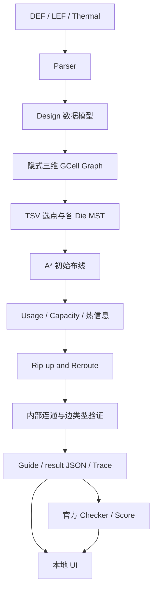

# 3DIC 比赛代码逻辑

本文对应 `EDA/code_3DIC EDA` 当前第一版真实实现。阅读顺序按输入、图、拓扑、搜索、优化、验证与展示展开。
实测状态单独从 `docs/优化结果对比.md` 与 `outputs/reports/测试汇总.md` 查阅，避免把算法说明中的能力推导误当作已通过的用例。

## 第一章：赛题要求

### 1.1 输入与输出

固定命令：

```bash
./router --def input.def --lef input.lef --thermal-report thermal.json --output output.guide
```

DEF 规定实例位置、Net 端子、DBU、DIEAREA、TRACKS 和 GCELLGRID。LEF 规定层、首选方向、Macro 引脚/障碍几何与 Via。热 JSON 给定空间节点和温度。
输出是每个 Net 的 Guide 矩形集合；它是允许布线的区域，不是详细布线中心线。

硬性约束包括全部网络连接、真实端子同层覆盖、合法层和层间连接、范围与格式约束。Die 内网络不能绕到另一 Die；跨 Die 仅 M10/M11 的 TSV。
本地正式说明给出单例 12 小时和 128 GB 的硬性资源上限；默认开发预算为 600 秒，不能把开发预算当作比赛规定。

### 1.2 三种指标必须分清

| 类别 | 来源 | 本工程如何使用 |
|---|---|---|
| 正式规则 | 本地 DOCX、提交 README 和补充 Q&A | 决定合法性与实现边界；冲突记录在资料核查文档 |
| 官方工具实际输出 | 未修改 `EDA/评估程序/score` 或旧 Python 工具 | 存原报告、返回码、工具哈希；报告 fidelity 原样保留 |
| 自主局部估计 | 图边几何长度、近似资源需求与本地 Pearson | 搜索优化和调试；字段名带 `_local`，不称正式得分 |

单用例质量按线长 45%、拥塞 30%、热 25%。最终 S1×(S2+S3)×S4 还涉及公开/隐藏用例名次折算，不能从某次本地报告直接推断最终名次。
较新 ELF 报告仍自述 Guide/MST proxy、mock-DRT；即使它给 PASS，也不代表详细布线 DRC 签核或隐藏用例通过。

## 第二章：整体程序架构



`main.cpp` 处理 CLI、配置、文件保护与调用；`parser.cpp` 把文件转成 `Design`；`router.cpp` 负责图、MST、A*、重布、验证、Guide 和实际路径数据；Python 脚本只负责运行组织和调用官方工具。

## 第三章：数据结构

实际定义位于 `include/model.hpp`、`router.hpp`。下列是核心字段的原型，省略默认初始化。

```cpp
struct Instance { std::string name, macro, orient; double x, y; };
struct Pin { std::string name; double x, y; int layer; };
struct Net { std::string name; std::vector<Pin> pins; bool cross; };
struct Layer { std::string name, type, direction; double width, spacing, pitch; };
struct Rect { double x1, y1, x2, y2; int layer; };
struct Edge { uint64_t a, b; };
struct Resource { int capacity, usage, fixed; double history; };
struct Route {
    std::set<uint64_t> nodes;
    std::set<Edge> edges;
    std::vector<Rect> guides;
    uint64_t tsv;
    bool cross;
};
```

Instance 的 x/y 是 DEF DBU 位置，Macro 字段指向 LEF 库。Pin 存实际访问点的绝对 DBU 坐标与物理层；Net 存全部端子和跨 Die 标志。
Layer 保留 LEF 原始名称与方向。Macro 还存 SIZE、ORIGIN、每个 PIN 的矩形和 OBS。
Tier 不单独建立坐标系统，而由层号确定：1–10 bottom，11–20 top，两侧共享 XY 原点和 DIEAREA，这是本地正式两层堆叠数据的定义。
Graph Node 是格索引与物理层编码；Graph Edge 表示两个相邻节点。普通 Via 与 TSV 都是层间边，但合法关系、使用条件、附加需求和统计分别处理。
Capacity 来自轨道数，Usage 来自已提交路由，Fixed 是矩形 Pin/OBS 的近似固定需求，History 用来降低反复走回拥塞区域的概率。

## 第四章：输入解析逻辑

### 4.1 LEF

词法器按空白、分号、括号和加号拆分，跳过注释并完整保留双引号字符串。UNITS/PROPERTYDEFINITIONS 区块单独跳过，避免把属性声明中的 LAYER 误当成真实工艺层。
Routing 层读取方向、Width、Spacing、Pitch；CUT 层用于识别 TSV。VIA/VIARULE 读取涉及的 Routing 层对，只把层号差一的对加入普通 Via 可达关系。
MACRO 内读取 SIZE、ORIGIN、PIN/PORT 的 RECT 和 OBS。需要访问的端子必须存在于解析结果中。
当前仅支持矩形几何。POLYGON/PATH/ITERATE 等重要几何明确报错，不能以空引脚继续路由。

### 4.2 DEF

逐条读取 VERSION、UNITS、矩形 DIEAREA、TRACKS、GCELLGRID；COMPONENTS/PINS/NETS 按声明记录数校验。
Net 中 `(instance pin)` 对映射至组件与 LEF Macro，`(PIN name)` 映射顶层 IO 端口。不认识的实例/端子、无位置或越界访问点均报错。
空 VIAS/BLOCKAGES 等段落正常处理；这些段落若非空则明确报不支持，避免忽略影响可达性的规则。

### 4.3 单位与方向

若 DEF `UNITS DISTANCE MICRONS 2000`，1 µm 等于 2000 DBU。先在 Macro 局部微米坐标系处理 ORIGIN 和方向，再乘 DBU，最后加实例位置。
例如无非零 ORIGIN 的 N 方向，局部点 `(0.1,0.3)` 与实例 `(1000,2000)` 得到 `(1200,2600)` DBU。

设未旋转 Macro 宽高为 W、H，部分方向为：

| 方向 | 局部坐标变换 |
|---|---|
| N | `(x,y)` |
| S | `(W-x,H-y)` |
| W | `(H-y,x)` |
| E | `(y,W-x)` |
| FN | `(W-x,y)` |
| FS | `(x,H-y)` |
| FW | `(H-y,W-x)` |
| FE | `(y,x)` |

矩形四角都变换后重新取包围盒。顶层 IO 的 placement 是端口原点，局部 RECT 绕原点变换，不能使用 Macro 宽高补偿。
当前每端子取第一个矩形中心作为访问点；多个端口和形状已读取，但尚未用来优化接入。

### 4.4 Thermal JSON

要求 `meta.ambientTemp` 与非空 `nodes`，每节点严格为 `[x,y,z,temp]`，数值必须有限。
先按相同 XY 合并 z 层温度，再用 `die_lower + local_um * dbu` 转为物理坐标，投影到 GCell 并求均值。
空格使用已知前列/前行值填充，最前面的空格再反向补齐。这是公开、确定性的本地规则；不声称与官方二进制逐位相同。

## 第五章：Routing Graph

### 5.1 网格与节点

GCELLGRID 每条 `start DO count STEP pitch` 展开为边界线；两轴各取并集、加入 DIEAREA 两端、裁掉范围之外的线。
坐标内部采用左闭右开，最外端点映射到最后一格，避免边缘 Pin 丢失。

$$id(x,y,l)=(lN_y+y)N_x+x.$$

通过取模/整除可恢复坐标。节点存储中心点用于搜索成本，输出则使用真实 GCell 四条边界。
邻接表不整体物化：扩展时按层方向生成左右或上下节点，再检查合法相邻层。资源使用 `unordered_map` 按需保存，减少完整二十层大图的初始内存。

### 5.2 边与容量

HORIZONTAL 只能左右走，VERTICAL 只能上下走，拐弯通过相邻层 Via。普通 Via 必须出现在 LEF VIA/VIARULE 层对中。
Die 内网络的搜索层范围固定为 `[1,10]` 或 `[11,20]`；A* 不自行生成跨 Die 边。
水平层容量数该格 Y tracks，垂直层容量数 X tracks。容量零的节点有显著惩罚；第一版采用软拥塞约束，允许合法但有溢出的布线。
Pin/OBS 固定占用由转换后的矩形与轨道交集估算；可能重复累计相交矩形，不等于精确障碍布尔并集或官方固定需求。

## 第六章：初始布线算法

### 6.1 MST 与跨 Die

Prim MST 以访问点间曼哈顿距离及层差 Via 成本为拓扑权重，复杂度为单 Net `O(P²)`。
各 MST 边路由后取节点、边并集，共用格不会重复计该 Net 需求。它不是 FLUTE/RSMT，不保证最小 Steiner 总长。

跨 Die Net 的 TSV 候选在端子包围盒内采样（最多约 4096 个格候选，加端子格）；若 M10/M11 端子已经共同落格，优先采用该物理锚点。多个固定共同格目前明确失败，留待更完整的候选消歧。
候选成本包含端子距离、M10/M11 需求压力和冷区惩罚。选好一个 TSV 格后，在 bottom 加 M10 锚点、top 加 M11 锚点，两侧各建 MST，最后连接锚点。
界面层仅保留端子/TSV 接入格，平面移动借助 M9 或 M12，避免生成长条界面交叠。

### 6.2 A* 成本与启发

$$g(e)=w_w\ell(e)/p+w_vI_{via}(e)+w_c\left(\frac{\max(0,U+F+1-C)}{\max(1,C)}\right)^2+w_hH.$$

$$h(v)=w_w(|x_v-x_t|+|y_v-y_t|)/p+w_v|l_v-l_t|.$$

所有附加惩罚非负，层间只有相邻 Via，因此 h 是当前搜索图权重的下界。A* 对固定成本图求解；路径逐 Net 提交后，下一 Net 面对的拥塞成本会改变。
搜索先限制在端子包围盒加 margin 内，无路径时扩大至全图。局部找到的最短路径不保证全图全 Net 总成本最小。

```text
for net in DEF order:
    resolve all terminal GCells
    if cross-die: choose one TSV anchor
    for each occupied die:
        build Prim MST(terminals + optional TSV anchor)
        for each MST connection:
            search preferred-direction graph with A*
            union the real nodes and edges
    add explicit TSV edge when needed
    validate connectivity, pins and layer constraints
    commit unique resource demand
```

搜索使用优先队列、到达成本与父节点表，回溯得到的边才叫“真实搜索路径”。没有用矩形中心随意连线代替。

## 第七章：拥塞优化

$$Overflow_v=\max(0,Usage_v+Fixed_v-Capacity_v).$$

每 Net 每格每层记一次使用量；每个 TSV 在上下界面层另各加一份需求。拆线时按相同规则扣回，核心测试验证可逆性。
一轮先给所有被使用的溢出资源增加历史惩罚，再筛出经过溢出格的 Net，扣除、重搜、重新提交。
只有总 Overflow 严格降低才接受整轮，否则回滚整轮路由。最大迭代数、停滞轮数、A* 扩展量与时间预算限制持续运行。
固定需求自身的溢出可能无法消除，不能为了“零溢出”删除原始障碍或改官方容量。

## 第八章：热感知优化

本赛题希望 TSV 更有针对性地服务热点，而非全部避开热点。本版在合法候选中对低温格增加非负惩罚；温度越高，冷区惩罚越小。
TSV Density 是每个 GCell 的实际跨 Die 边数量，不从普通 Via 或不明确的参考 Guide 中编造。

$$r=\frac{\sum_i(H_i-\bar H)(D_i-\bar D)}{\sqrt{\sum_i(H_i-\bar H)^2\sum_i(D_i-\bar D)^2}},\quad H_i=\max(T_i-T_{ambient},0).$$

当热向量和密度向量正比例归一化时 Pearson 不变，因此本地直接对温升与数量计算；无 TSV 或任一方差为零返回空值，UI 显示 N/A。
DOCX 热得分为 `100*(0.5+0.5*tanh(G_case*r))`。本版不自行设定 G_case 作为正式分数；官方工具报告里的 gain 与得分原样展示。
目前局部候选打分不直接最大化全局 Pearson，固定 TSV 端子也限制可优化空间。没有重新执行热仿真，更不声称实际芯片温度因此下降。

## 第九章：Guide 生成

每个路径节点对应完整 GCell 矩形；沿同层首选方向合并相邻格。比如真实网格 X=[0,1000,2000]、Y=[0,1000]，M1 上的两个相邻路径节点可以输出：

```text
example_net
(
0 0 2000 1000 metal1
)
```

这是格式教学示例，不是某个官方网络的硬编码结果。程序中的坐标实际来自解析后的 GCell 边界。
换层节点在两个相邻层有同格矩形，拥有正面积重叠；跨 Die 的 M10/M11 共同格必须唯一。
内部验证图边方向、Via 关系、全节点连通、端子节点覆盖、Die 限制和边界；全部成功后写临时文件再发布 Guide。未知 Net 不会被生成，失败不会写出新的完整结果。

## 第十章：评估与评分

`evaluate.py` 先确认 Router 完整成功，重新核对输入哈希，再把输入做字节相同的副本放在 `official_latest/inputs/`。运行原始评分器二进制，但工作目录和查找表副本位于自主输出目录，避免评分器自动在原始 DEF 旁写入 `pin_positions.json`、`net_to_die.json`，或在官方工具目录写日志。
`--engine legacy` 则调用旧 score.py，并设置 Linux CPython 3.10 所需路径与禁止字节码写入的环境变量。未改官方代码或库。
PASS 必须同时满足进程成功和原始 `evaluation_report.json` 的 `status=PASS`；找不到报告、超时或异常都不会当成成功。
Router 时间、辅助进程墙钟时间与评分器时间分开。Linux `/usr/bin/time -v` 给峰值 RSS；没有值显示 N/A。
官方报告可能保留 proxy/mock 标识或 synthetic 热源警告，必须保留。sample001 的历史报告不作本次成绩。

## 第十一章：可视化 UI

UI 选择 Python 标准库 HTTP 服务加原生 Canvas，原因是本机无 Streamlit/Plotly，离线方案安装负担更低，也能批量绘制大量格。
服务仅监听 localhost，静态页面无外部请求。`result.json` 提供真实 DIEAREA、实例包围盒、Pin、层、路径边、Guide、资源和温度；不在浏览器中重新求路。
侧栏按数据集/Case/运行/Net/Die/Layer 筛选，双 Die 同一网络同步显示。最多显示 150 个符合条件的网络，选单 Net 可查看完整路由；这是视图限制，不删改结果。
鼠标滚轮缩放、拖动平移、悬停查看矩形或容量、点击矩形选中 Net。原始温度节点超过约 10,000 时抽样并说明，结果热图使用完整投影数据。

Trace 主要事件包括：

```json
{"event":"path_found","net":"...","nodes":[123,124],"seq":10}
```

`topology` 有实际 MST 端子对；`path_found` 有回溯路径；`net_added` 有提交的节点、边、矩形与端子；`net_removed` 从回放状态移除该网络；`iteration_done` 记录接受或回滚。
UI 从空状态按真实事件重建，新增边绿色、拆除边红色；拖动时间轴会重放到目标事件。未记录逐节点 A* 扩展，也不会凭空生成此类动画。
Trace 达到配置大小上限写 `trace_truncated`，提示过程不完整；最终 result 仍可单独查看。超过 4 MiB 的 Trace 由 UI 按选中的单个 Net 加载，服务端逐行过滤并保留原始事件序号，避免整份解码重编码造成内存峰值。
官方参考 Guide 按矩形显示，来源显式标记，没有搜索路径和播放过程，未知指标为 N/A。

## 第十二章：第一版实现情况

| 状态 | 内容 |
|---|---|
| 已实现 | C++17 独立 CLI、真实解析、八方向、两 Die、多 Pin MST、A*、合法普通 Via/TSV、Guide 写出 |
| 已实现 | 近似固定需求、Usage/Capacity/Overflow、历史代价、相关网络重布、无改善回滚、预算限制 |
| 已实现 | 热输入映射、TSV 候选热惩罚、局部 Pearson、真实 Trace、离线双 Die UI、运行与官方评估/打包工具 |
| 部分实现 | 多端口只选首个矩形、Pin/OBS 重叠需求近似、热填充与官方映射可能不同、MST 未做 Steiner 优化 |
| 尚未实现 | 详细布线 DRC、完整 LEF/DEF 标准、非矩形几何、FLUTE 路由拓扑、并行布线、所有大规模用例验证 |

已执行的核心测试包括严格 JSON、八种方向、边界格、多 Pin、方向约束、普通 Via、TSV、拆除占用可逆、Overflow 与不可达诊断。
实际用例、失败修复过程、官方 PASS/FAIL、各项数值以自动生成的测试汇总为准。原始解析失败运行也保留，不能删掉后声称从未失败。

## 第十三章：后续优化方向

1. **访问点和资源模型对齐**：对每端子多矩形/多端口做可达点选择，准确合并 Pin/OBS 占轨并与官方 CSV 逐格对照，减少近似模型导致的绕路。
2. **拓扑与搜索效率**：采用 RSMT/FLUTE 或路径到现有树连接，减少多 Pin 重复边；引入更紧的跨层启发、复用搜索缓存和候选剪枝，先测性能再并行化。
3. **联合 TSV 与拥塞优化**：在保持唯一合法 TSV 的前提下，用全局密度、官方热网格和多 Net 协商调整候选；接受准则应同时考虑线长、官方拥塞与热收益，而非只降低本地 Overflow。

上述均为改进方向，未宣称已经获得额外优化成绩。
