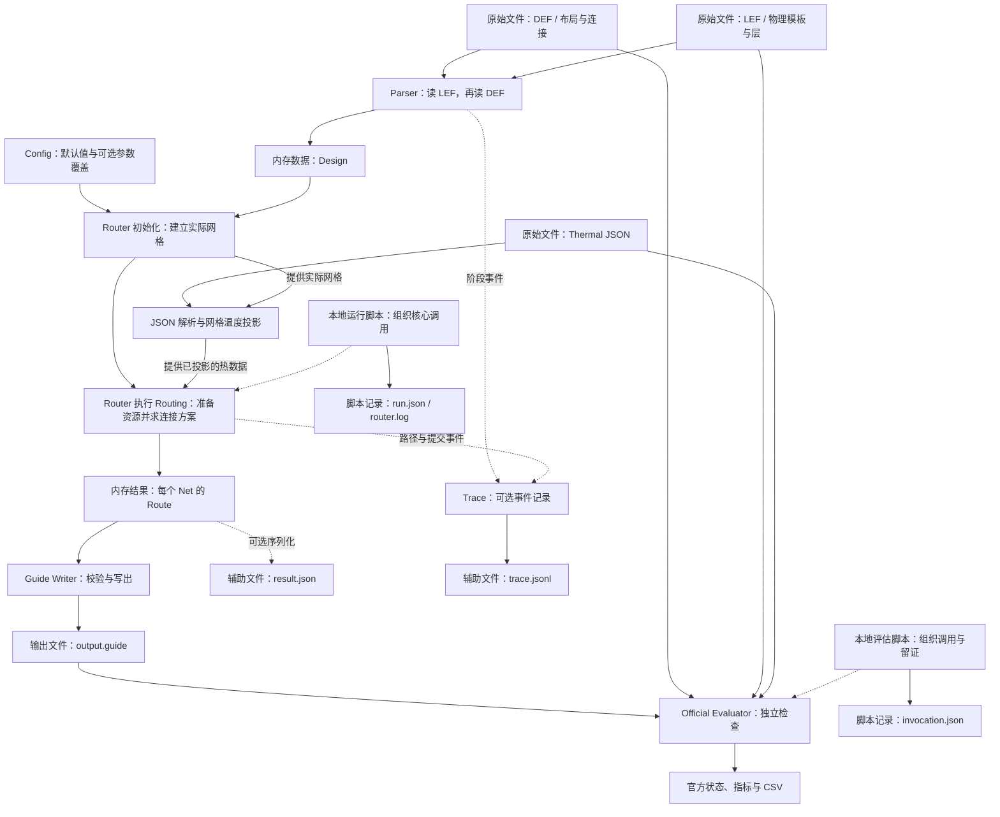
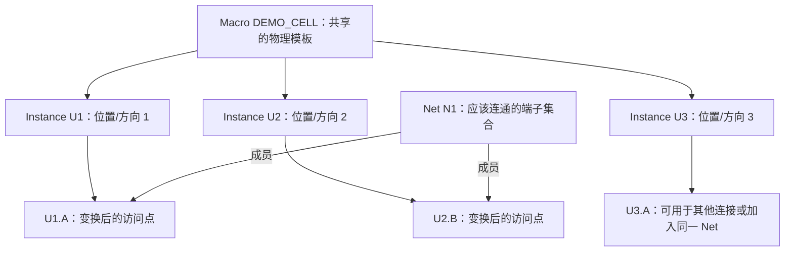
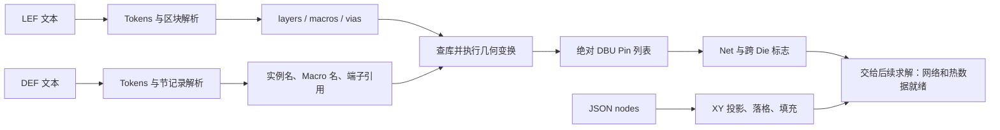
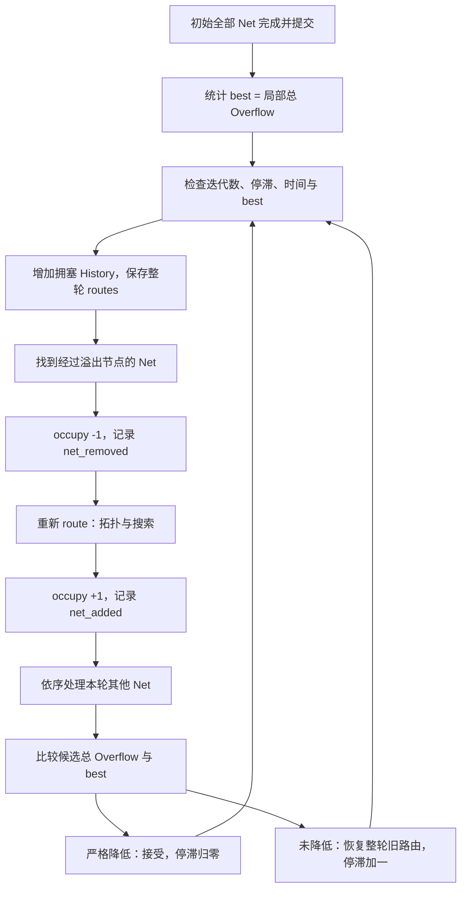
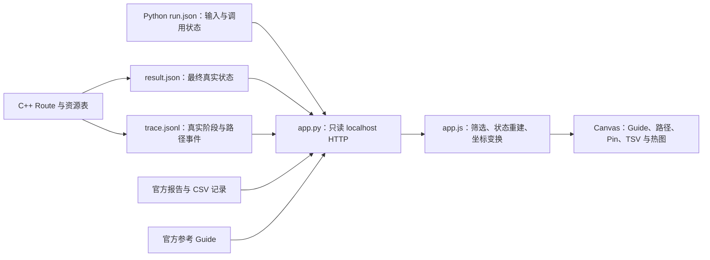

# 3DIC 比赛代码逻辑：从输入输出到布线算法

本文面向已经了解 IC、EDA、Die/Tier、Metal Layer、Via、TSV 和 Global Routing，但尚未熟悉程序对象与 C++ 结构的读者。先回答“程序拿到什么、需要交出什么”，再认识对象、建立数据、阅读执行顺序，**从第五章起才正式展开图、拓扑、路径搜索与优化算法**。

前四章是算法学习的前置知识：第一章不要求读懂 C++；第二章先用例子理解对象，再看字段；第三章追踪原始文件如何变成内存数据；第四章才把已经认识的对象放回真实调用顺序。读代码片段时先看字段名和中文解释，不必先掌握全部容器语法。

编译、运行命令、UI 点击教程、排错和打包统一放在 [比赛代码使用说明](比赛代码使用说明.md)。文件位置总览见 [目录结构](目录结构.md)。本文以下 `src/`、`include/`、`scripts/`、`ui/` 均相对于 `EDA/code_3DIC EDA/`，链接则从本文件所在的项目根目录解析。

## 章节目录

1. [比赛代码的整体输入与输出](#logic-01)
2. [核心名词与数据结构](#logic-02)
3. [输入文件与数据解析](#logic-03)
4. [程序执行流程](#logic-04)
5. [3D Routing Graph](#logic-05)
6. [MST 与网络拓扑](#logic-06)
7. [A* 布线算法](#logic-07)
8. [拥塞优化](#logic-08)
9. [热感知与 TSV 优化](#logic-09)
10. [Guide 输出与合法性检查](#logic-10)
11. [评分原理与版本差异](#logic-11)
12. [UI 的内部逻辑](#logic-12)
13. [第一版实现总结与后续优化](#logic-13)

<a id="logic-01"></a>
## 第一章：比赛代码的整体输入与输出

### 1.1 先用一句话解释程序

**一个 3DIC Global Router 接收芯片布局、物理库/工艺层和温度分布，计算怎样连接各个 Net 的 Pin，最终输出可交给评估器检查的布线 Guide。**

这里先把 **Pin** 理解为单元与外界连接的接口，把 **Net** 理解为“哪些接口应该接在一起”。它们是待解决的连接要求，还不是已经画好的导线。Router 的工作，是在给定位置和可用布线资源中，为这些要求找到实际连接方案。

本程序不会重新设计逻辑功能，也不会重新摆放单元。它使用已有布局，计算连接。它不读取参考 Guide 来代替求解，也不输出已经完成详细布线、可以直接制造的全部金属几何。

### 1.2 程序有哪些输入？

先看三个必需输入的分工，不必立即理解其中每个语法关键词。

| 输入 | 全称 | 存储的信息 | 为什么需要 | 后续用于什么 |
|---|---|---|---|---|
| DEF | Design Exchange Format，设计交换格式 | 设计名称、坐标单位、芯片区域；实例引用的库单元、位置和方向；端口、网络连接、轨道与全局网格 | 知道“谁放在哪里、谁需要连接谁”，并知道布局中的轨道/网格组织 | 建立实例与 Net，确定 Pin 的绝对坐标、GCell 和容量依据 |
| LEF | Library Exchange Format，库交换格式 | 工艺 Routing 层及方向等信息、Macro 尺寸与原点、局部 Pin 矩形、OBS、可识别的层间 Via 关系 | DEF 中的实例通常只引用模板名，不重复写出每个库单元的内部物理信息 | 查模板、算 Pin 几何、建立可用层与换层规则、估计固定占用 |
| Thermal JSON | JSON = JavaScript Object Notation；Thermal 指温度/热报告，并无另一个统一缩写全称 | 环境温度、采样点的局部 XY、z 与温度 | 知道不同位置的给定温度差异，而不是凭空假设热分布 | 在实际网格上生成投影温度图，供 TSV 候选选择和本地统计使用 |

**为什么只有 DEF 不够？**假设 DEF 写着“U1 使用 BUF 模板，放在某坐标”。它还没有完整告诉当前程序 BUF 有多大、A 引脚在模板中的哪个金属层和哪个位置。程序必须到 LEF 中查出这些信息，才能算出 `U1.A` 的真实位置。

**为什么只有 LEF 也不够？**LEF 说明“BUF 这种模板是什么样”，却不说明这个设计用了几个 BUF、各自放在哪儿，更不说明 U1.A 要连接 U2.B 还是另一个端子。

因此，两者通过 **Macro 名称和 Pin 名称**配合：LEF 提供模板，DEF 提供模板的实际使用及连接关系。当前程序先读取 LEF，再读取 DEF，正是因为后者需要查前者的库定义。

温度输入是第三条信息通路。它不会决定哪些 Pin 属于同一个 Net，也不会取代 DEF/LEF；当前代码还会将不同 z 的样本按 XY 合并，不是在这里重新进行三维热仿真。热数据的转换见第三章，怎样参与优化见第九章。

### 1.3 程序需要输出什么？

**Guide 是按 Net 分组的布线引导区域。**当前输出用“矩形坐标 + 金属层名”表达某 Net 经过的区域，给后续检查或布线流程提供输入。

| 概念 | 在这里指什么 | 与其他对象的关系 |
|---|---|---|
| Wire，导线 | 真实制造或详细布线中的金属导体/线段 | 有具体线宽、形状和电气参数；不能把一个 Guide 矩形直接当成一根成品导线 |
| Route，布线结果 | 程序内存中某个 Net 的连接方案 | 保存真实图节点、图边、Guide 矩形以及 TSV 等信息；细节见第二章 |
| Guide，布线引导 | 从 Route 转换得到的区域表达 | 是 Route 的一部分输出表达，不包含全部搜索过程，也不等于完整详细布线 |

一个 Net 可能要拐弯、换层或连接多个 Pin，所以通常需要多个 Guide 矩形。在不同层上保留相关区域，可以表达层间连接的通道；详细的几何与合法性仍要由相应规则检查。矩形多不等于网络多，Guide 相交也不自动说明所有层都导通。

**输出 Guide 后为什么还要评估？**程序内部检查只验证当前模型覆盖的条件。独立评估器再用其输入、规则和统计口径检查输出、给出指标。内部找到路径、写出了文件、官方检查通过，是三个不同结论。

文件还要按“由谁生成”区分：

| 文件/数据 | 谁生成 | 保存什么 | 不能据此直接推断什么 |
|---|---|---|---|
| `route.guide` | C++ Router；文件名由调用方指定，本地脚本采用此名 | 按 Net 分组的层与 Guide 矩形 | 文件存在不自动证明本次运行完整成功或已通过独立评估 |
| `result.json` | C++ Router 的可选调试输出，通过 `--metrics` 指定路径 | 最终接受的路由、真实 Pin/节点/边、网格、热图、资源与本地指标 | 不是官方评分报告；其中初始 `official_status` 不会被评估脚本反写更新 |
| `trace.jsonl` | C++ 的可选 Trace 输出 | 一行一个真实阶段或路径事件，带事件序号 | 不是每次搜索扩展都完整记录；受大小上限约束 |
| `run.json` | 本地运行脚本 | 输入路径与哈希、配置、命令、运行标签、退出码、耗时和状态等 | 不是核心 C++ 必需的输入或输出；直接运行核心不一定有它 |
| `router.log` | 本地运行脚本捕获 C++ 的标准输出和标准错误 | 核心程序的成功摘要或错误信息 | 不是 Guide，也不是官方检查报告 |
| `official_latest/` 中的原始报告与 CSV | 官方评估程序，位置由评估脚本组织 | 官方工具的状态、指标和逐格数据 | 不是由 Router 的本地指标重新命名而来 |
| `invocation.json` | 本地评估脚本 | 评估命令、退出信息、输入核验及调用状态 | 与评估器原报告分属两层记录，应配合阅读 |

`route.guide`、`result.json` 等名称是本地工作流约定，不是 C++ 写死的全部固定文件名。核心的正式目标是指定路径上的 Guide；JSON、Trace 可选，运行清单与日志则由外围脚本组织。编译与运行操作见使用说明，本章只辨认信息边界。

### 1.4 总体输入输出流程图

图中把原始文件、内存对象、内存结果和写出的文件分开。特别注意：DEF/LEF 的解析建立 Design；热 JSON 使用单独的解析与网格投影通路进入 Router，不是把所有温度样本直接放进 Design。



先顺着主线读：**文件 → 解析后的 Design → 求解器 Router → 结果 Route → Guide 文件 → 独立评估结果**。Config 是求解设置，Trace 是过程记录，外围脚本是调用和留证的组织者，它们都不是另一个替代布线路径的输入答案。

这是一张数据关系图：Router 先建立实际网格，热数据才能映射进来，随后再执行求解。第四章再给出包括计时与固定需求建立在内的严格调用顺序。

图中的 Guide Writer 是输出功能的称呼，不是一个独立 C++ 类。当前程序在逐 Net 建立 Route 时就生成矩形，最后的输出阶段再验证并写文件，不能把“生成区域”和“写出文件”误当成完全相同的动作。

### 1.5 用 U1、U2 和 N1 理解全过程

**以下全部名称、坐标与矩形都是教学示意，不是官方用例数据，也不是一份可直接运行的完整输入。**先只考虑同一 Die 的简单连接，不引入跨 Die、热成本或搜索公式。

假设 LEF 定义了一个名为 `DEMO_CELL` 的物理模板：大小为 2 µm × 2 µm、原点为零，A、B 两个 Pin 都在 M1，局部矩形分别为 `(0.1,0.1)–(0.3,0.3)` 和 `(1.7,0.1)–(1.9,0.3)`。程序选择的矩形中心是 A=(0.2,0.2) µm、B=(1.8,0.2) µm。

DEF 规定 1 µm = 2000 DBU，实例 U1、U2 都引用这个模板，方向都是 N；U1 的放置坐标为 `(0,0)` DBU，U2 为 `(8000,4000)` DBU。DEF 的连接表要求：

```text
Net N1
  ├── U1.A：U1 的 A 端子
  └── U2.B：U2 的 B 端子
```

这里不讨论输入/输出端子的功能驱动关系，只演示物理连通需求。实际设计还应具有正确的逻辑和电气连接定义。

| 步骤 | 程序现在知道了什么 | 还没有发生什么 |
|---|---|---|
| 1. 读 LEF | 有 `DEMO_CELL` 模板，知道它的大小、A/B 局部几何和层 | 还没有 U1/U2 的实际位置 |
| 2. 读 DEF 实例 | U1、U2 是模板的两次使用，知道各自位置、方向和单位 | 还没有生成连接路径 |
| 3. 读 DEF 的 NETS | `N1` 要求 U1.A 与 U2.B 连通 | Net 只是要求，不是已经布好的线 |
| 4. 解析 Pin | 把模板局部几何按方向、单位、实例位置转换成绝对坐标 | 还没有选择经过哪些网格 |
| 5. 建立 Design | 保存模板、实例、已解析的网络 Pin、区域与轨道等 | Design 不是一份新芯片文件 |
| 6. Router 求解 | 将真实 Pin 位置对应到实际网格，寻找合法连接 | 本章不提前展开怎样搜索 |
| 7. 得到 Route | 保存 N1 经过哪些格层节点、用了哪些图边 | Route 仍是内存中的结果 |
| 8. 生成并写出 Guide | 把所用格层区域变成矩形，验证后写出 | 并未输出详细布线的完整金属版图 |
| 9. 独立评估 | 检查 Guide 与输入、规则是否相符，并产生指标 | PASS 仍应按具体工具和范围理解 |

在这个无旋转、原点为零的例子中，U1.A 的绝对坐标为 `(400,400)` DBU，U2.B 为 `(11600,4400)` DBU。例如 U2.B 的 X 来自“U2 放置位置 8000 + 局部 1.8 µm 换成 3600 DBU”。第二章解释 DBU，第三章再处理旋转和镜像。

为了理解 Guide，再**假设求解已经得到**某段 M1 水平路径，连续占用了三个相邻格，每格区域为 1000×1000 DBU，Y 范围均为 `[0,1000]`，X 依次为 `[0,1000]`、`[1000,2000]`、`[2000,3000]`。在允许的方向下，这一小段可合并表达为：

```text
N1
(
0 0 3000 1000 metal1
)
```

这只演示“若干格 → 一条矩形记录”的转换，**不是上述 N1 的完整解**，也不覆盖两端 Pin。完整 N1 还需要其余路径、必要换层以及全部端子覆盖。避免把一个格式示例误当成完整可评估结果。

读到这里，只需记住：LEF 给模板、DEF 给位置与连接，Parser 把它们组合成坐标明确的数据，Router 找方案，Route 存方案，Guide 把方案的区域写给后续工具。

<a id="logic-02"></a>
## 第二章：核心名词与数据结构

本章的阅读顺序是“中文直觉 → 关系例子 → 实际字段”。下面出现的源码路径均相对于 `EDA/code_3DIC EDA/`。结构体片段仅调整排版、部分省略默认初始化与方法；保留的成员名和类型均来自当前源码。

### 2.1 核心术语总表

先把这些词分成四类：描述原始设计的对象、描述路由空间的对象、保存求解结果的对象，以及组织程序的对象。它们不全是 C++ 类；表中会明确区分概念和已经存在的类型。

| 英文术语 | 中文名称 | 简单理解 | 在程序中的作用 | 对应源码 |
|---|---|---|---|---|
| Design | 设计数据模型 | 这次设计的内存资料集合 | 汇总库、布局、网络和网格依据 | `include/model.hpp::Design` |
| Macro | 宏/单元物理模板 | 一种单元的物理“样板” | 保存尺寸、局部 Pin 和 OBS | `include/model.hpp::Macro` |
| Instance | 实例 | 某模板在布局中的一次具体使用 | 保存实例名、模板引用、位置和方向 | `include/model.hpp::Instance` |
| Pin | 引脚访问点 | 当前程序选定的连接入口 | 用名称、绝对 XY 和层表示一个端子 | `include/model.hpp::Pin` |
| Terminal | 端子 | 网络需要连接的一个电气接口 | 当前以选定的 `Pin` 表示；没有独立 `Terminal` 结构 | `src/parser.cpp::parse_def` |
| Net | 网络 | “这些端子应该接在一起” | 保存网络名、全部解析端子和跨 Die 标记 | `include/model.hpp::Net` |
| Rect | 矩形 | 某层上的一个几何区域 | 表示库 Pin/OBS、格区域或 Guide；单位随阶段不同 | `include/model.hpp::Rect` |
| Layer | 金属层信息 | 某层叫什么、优先怎样走线 | 保存层名、类型、方向、线宽/间距/节距 | `include/model.hpp::Layer` |
| Track | 布线轨道模式 | 一组按间距排列的候选线位置 | 为指定层的容量计数提供依据 | `include/model.hpp::Track` |
| Grid Cell / GCell | 网格单元 | XY 平面中的一小块区域 | 由 Router 的 `xs/ys` 边界确定；没有独立结构体 | `Router::Router/cell` |
| Node | 图节点 | “某个格、某个层”这一状态 | 用整数 `Id` 编码；没有独立 `Node` 结构体 | `Router::id/decode/pin_node` |
| Edge | 图边 | 两个节点之间的实际连接 | 在 Route 中记录走过的同层边或层间边 | `include/model.hpp::Edge` |
| Resource | 布线资源 | 某格层位置的可用量与占用账本 | 保存容量、使用、固定需求和历史压力 | `include/router.hpp::Resource` |
| Capacity | 容量 | 这个格层能提供多少轨道资源 | `Resource.capacity`，由轨道和格边界计算 | `Router::capacity/resource` |
| Usage | 使用量 | 已提交路由占了多少需求 | `Resource.usage`，提交或拆线时更新 | `Router::occupy` |
| Fixed / Fixed Demand | 固定需求 | 原有 Pin/OBS 的占轨近似 | 与 Usage 一起参与资源压力和溢出 | `Router::build_fixed_demand` |
| History / History Cost | 历史压力/历史代价 | 记住哪些位置过去反复拥挤 | 不直接占轨，后续作为搜索代价依据 | `Router::run/search` |
| Overflow | 资源溢出 | 总需求超过容量的部分 | 按格层统计局部溢出；不是一个独立结构体字段 | `Router::overflow/result_json` |
| Route | 单 Net 布线结果 | 这条网络最终怎样连接 | 保存节点、边、Guide 和 TSV 等 | `include/model.hpp::Route` |
| Router | 布线求解器 | 负责找路、记账和生成结果的对象 | 持有设计、网格、资源以及全部 Route | `include/router.hpp::Router` |
| Config | 求解配置 | 调整搜索/优化偏好与预算的设置 | 保存权重、迭代数、范围及时间等限制 | `include/model.hpp::Config`、`src/main.cpp::main` |
| Parser | 解析器 | 把文件文字读成可查询的数据 | DEF/LEF 使用函数与 `Tokens`，不是单一 `Parser` 类 | `src/parser.cpp::parse_lef/parse_def` |
| DBU | 数据库单位，Database Unit | 布局坐标的计量刻度 | `Design.dbu` 保存每微米有多少 DBU | `parse_def` 的 `UNITS` 分支 |
| Guide | 布线引导区域 | 把 Route 占用区域表达成矩形 | 存于 `Route.guides`，最终写为文本；没有 `Guide` 类 | `Router::make_guides/write_guide` |
| Via | 普通层间连接 | 同一 Die 内的金属层之间换层 | 当前保存可识别的相邻层对，不是具体 Via 版图对象 | `Design.vias`、`Router::search/validate` |
| TSV | 当前模型的跨 Die 连接 | M10 与 M11 同格之间的特定边 | 用跨 Die 标记和锚点生成、验证 | `Router::select_tsv/route/validate` |
| Tier | Die 层级 | 一个节点属于上、下哪一侧 | 当前由物理层号导出，没有 `Tier` 结构体 | `parse_def`、`Router::route/result_json` |
| Trace | 执行事件记录器 | 记下解析、路径、提交和拆除等事件 | 可选地逐行写 JSONL，受大小上限约束 | `include/model.hpp::Trace`、`src/parser.cpp::Trace::event` |
| Json | JSON 值与读写基础设施 | 保存数值、对象、数组等通用数据 | 供配置、热输入、Trace 和结果序列化使用 | `include/json.hpp::Json` |
| OBS / Obstruction | 库单元阻挡几何 | 模板中不宜被随意占用的物理区域 | 当前转换为固定轨道需求近似，不是全面硬障碍模型 | `Macro.obs`、`Router::build_fixed_demand` |

读表中字段之前，只需要认识几个 C++ 容器记号：`std::string` 是文本，`std::vector<T>` 是一串 T，`std::map<K,V>` 是按键查值的字典，`std::set<T>` 是不重复元素的集合，`std::unordered_map` 也是字典但用哈希查找。`对象.字段` 表示取这个对象保存的某项数据，`类型::函数` 表示某类型或模块对应的函数。

例如，`std::vector<Pin> pins` 先读成“保存多个 Pin 的列表”即可；不需要先学习模板编程。后文才解释数据怎样被使用。

### 2.2 Instance、Macro、Pin、Terminal、Net 的关系

**先有模板，再有实例。**延续第一章的教学模板 `DEMO_CELL`：LEF 只需定义一次它的外形、A/B Pin 的局部矩形和 OBS。DEF 可以放置 U1、U2、U3，让它们都引用这一份模板。复用的是物理定义，不是让三个实例占据同一个位置。

真实字段如下：

```cpp
struct Macro {
    double width, height, ox, oy;
    std::map<std::string, std::vector<Rect>> pins;
    std::vector<Rect> obs;
};
struct Instance {
    std::string name, macro, orient;
    double x, y;
};
```

| 字段/关系 | 用第一章例子读它 |
|---|---|
| `Design.macros["DEMO_CELL"]` | 找到那份共享模板；模板自己的名字由字典键保存，`Macro` 中没有独立 `name` 成员 |
| `Macro.width/height` | 模板尺寸，LEF 中按微米表达 |
| `Macro.ox/oy` | 模板 ORIGIN；参与当前几何变换，不是实例放置坐标 |
| `Macro.pins["A"]` | 模板 A 引脚的矩形列表，坐标仍是模板局部坐标 |
| `Macro.obs` | 模板里的阻挡矩形，不是 U1/U2 各自已经变换后的全局矩形 |
| `Instance.name` | `U1` 或 `U2`，区分具体哪一次使用 |
| `Instance.macro` | 文本 `DEMO_CELL`，用于到 `Design.macros` 查模板 |
| `Instance.x/y` | 该实例的 DEF 放置坐标，单位为 DBU |
| `Instance.orient` | 如 N、FS，决定模板几何怎样旋转/镜像后放入布局 |

因此，U1 和 U2 虽可共用模板，`U1.A` 与 `U2.A` 仍是两个不同位置上的端子。它们的绝对坐标由“模板局部几何 + 各自方向 + 单位转换 + 各自位置”得到。

**Pin 为什么有两种层次？**物理库中的一个 Pin 可以有多个矩形、PORT 或其他几何访问选择；当前 `Macro.pins` 确实保存了矩形列表。但解析成某条 Net 的端子时，程序取该 Pin 的**第一个矩形**，变换后用中心建立下面的 `Pin`：

```cpp
struct Pin { std::string name; double x, y; int layer; };
struct Net { std::string name; std::vector<Pin> pins; bool cross; };
```

这里 `Pin.name` 可为 `U1.A`，`x/y` 是绝对 DBU 坐标，`layer` 是整数物理层号。**这个 Pin 是为当前布线选择的访问点，不是完整物理引脚的全部形状。**不能从只有一个坐标的结构，推断程序已经完成多端口访问优化。

**Terminal 为什么叫端子？**它强调“需要被接入网络的电气端点”。Pin 强调接口及其物理访问表达，两者在很多电路描述中会近义使用，具体区分依工具语境而变。当前代码没有另造一个 Terminal 类：一个 Net 的每个连接项经解析后，被表示为一个选定的 `Pin` 访问点。也不是把 MOSFET 的源/漏/栅统一直接当作这里的 Instance Pin；这里工作的对象是已经抽象好的布局单元接口。

还有一种端子来自 DEF 顶层 PINS，而非某个 Instance。其连接项形如 `(PIN io0)`，解析后的名字形如 `PIN.io0`。`parse_def` 用单独的局部表解析这类端口，再把所选访问点加入相应 `Net.pins`。不要把所有 Pin 都强行解释成“某个 Macro 实例的 Pin”。

**Net 是连接要求，不是导线。**若 DEF 中 N1 列出 `U1.A`、`U2.B`，则当前 `Net.name` 为 N1，`Net.pins` 有两个访问点。再加 `U3.A` 就成为三端子网络，仍是同一条 Net，要求三端子形成一个连通整体；不是只取前两个，也不必每对端子都各画一条互不共享的线。



图中的成员箭头只说明关联，不是已布好的导线。这个关系在源码中的查找链是：`Instance.macro` → `Design.macros` → `Macro.pins[Pin名]` → `placed_rect` → `Net.pins`。该链条解释了为什么 LEF 模板与 DEF 实例必须一起使用。

### 2.3 Design 是什么？

**Design 是解析后的内存资料集合。**如果每找一条路径都重新扫描 DEF/LEF 文本并到处查字符串，既难组织，也容易把单位、引用关系弄错。先建立 Design，后续模块就可以直接查询“这个实例用了哪个模板”“这个 Net 的端子在哪儿”“哪些层可用”。

对应 `include/model.hpp::Design`：

```cpp
struct Design {
    std::string version, name;
    double dbu;
    Rect die;
    std::map<int, Layer> layers;
    std::map<std::string, Macro> macros;
    std::map<std::string, Instance> instances;
    std::vector<Net> nets;
    std::vector<Track> tracks;
    std::map<char, std::vector<double>> grid;
    std::set<std::pair<int,int>> vias;
    bool tsv_cut;
};
```

| 实际字段 | 保存什么、来自哪里 | 后续为什么需要 |
|---|---|---|
| `version` | DEF VERSION 的文本 | 标识读到的 DEF 版本；不是本程序的版本号 |
| `name` | DEF DESIGN 的名称 | 标识设计；不必与文件名相同 |
| `dbu` | DEF UNITS 中每微米的 DBU 数 | 将 LEF 微米几何、热采样 XY 与布局坐标统一 |
| `die` | DEF 的矩形 DIEAREA；复用 `Rect` 类型 | 限定布局区域，裁剪实际网格并检查坐标 |
| `layers` | 由整数层号查 `Layer` 的字典，来自 LEF Routing 层 | 查询原层名、方向等，支持搜索、容量及 Guide 输出 |
| `macros` | 由模板名查 `Macro` 的字典，来自 LEF | 解析实例 Pin、变换 OBS、保留未选中的库矩形 |
| `instances` | 由实例名查 `Instance` 的字典，来自 DEF COMPONENTS | 查模板引用、放置位置和方向 |
| `nets` | DEF NETS 解析后的 Net 列表 | 提供真实端子与跨 Die 属性，确定逐 Net 处理对象 |
| `tracks` | DEF TRACKS 模式列表 | 给各格层容量与固定需求计数提供依据 |
| `grid` | DEF GCELLGRID 展开的 X/Y 原始边界线，键为 `'X'` 或 `'Y'` | 供 Router 裁剪、排序去重后建立 `xs/ys`；两者并不完全相同 |
| `vias` | LEF VIA/VIARULE 中提取的相邻 Routing 层号对 | 判断普通换层是否有可识别的 LEF 依据；不是 Via 实例位置表 |
| `tsv_cut` | 是否识别到指定名称的 TSV CUT 层的布尔值 | 跨 Die 求解的必要条件之一；不是 TSV 坐标或数量 |

可以把真实字段关系画成：

```text
Design（内存对象）
 ├── version / name / dbu：标识与单位
 ├── die：布局边界
 ├── layers：层号 → 层信息
 ├── macros：模板名 → 局部几何模板
 ├── instances：实例名 → 模板引用、位置和方向
 ├── nets：每条网络的选定绝对 Pin 访问点
 ├── tracks：轨道模式
 ├── grid：原始 X/Y 网格边界
 └── vias / tsv_cut：换层与 TSV 的识别依据
```

这里没有名为 `DieArea` 的成员，也没有单独的 `Die` 类；示意名称必须对应实际的 `die` 字段。Design 不是“新生成的芯片文件”，不会自动改写 DEF/LEF，也不保存最终路径。

还要分清谁保存后续数据：**热图、资源表和全部 Route 在 Router 中，不在 Design 中。**Design 中的 `nets` 说明应该连什么，Router 的 `routes` 说明最终怎样连，二者按网络顺序对应。

### 2.4 DBU 是什么？

**DBU = Database Unit，数据库单位。**在布局文件中，使用按固定比例刻度表示的坐标，便于精确表达离散制造几何，避免把所有位置都写成很长的小数。它是一种坐标单位，不是网格单元的数量，也不是芯片尺寸。

例如 DEF 中：

```text
UNITS DISTANCE MICRONS 2000 ;
```

表示 **1 µm = 2000 DBU**。这里“每微米有多少 DBU”的换算比例会存入 `Design.dbu`，而不是要求所有设计固定用 2000。

设实际文件的比例为 $D$ DBU/µm：

$$
x_{DBU}=x_{\mu m}D,\qquad x_{\mu m}=\frac{x_{DBU}}{D}.
$$

| 在 D=2000 DBU/µm 的教学设计中 | 换算结果 |
|---|---|
| 2000 DBU | 1 µm |
| 5000 DBU | 2.5 µm |
| 0.25 µm | 500 DBU |

第一章的 U2.B 局部 X=1.8 µm，换成 3600 DBU，再加实例放置 X=8000 DBU，得到绝对 X=11600 DBU。不能把 `8000 + 1.8` 直接相加，因为二者单位不同；如果实际文件的 D 为 1000，同样的局部 X 应转换为 1800 DBU。

**当前结构不会替你自动检查单位标签。**`Rect` 本身没有 `unit` 字段：LEF 模板矩形用微米；DEF 实例坐标、已变换矩形和 Net 中的 Pin 用 DBU；Guide 由布局网格生成，写成整数 DBU。当前 C++ 用 `double` 保存许多坐标，不能误以为“有 DBU 就保证所有中间运算全用整数”。

方向变换和 ORIGIN 会进一步影响 Pin 的位置；本节只建立单位直觉，完整转换在第三章展开。

### 2.5 Grid Cell、Node、Edge 的区别

先在 XY 平面画一个教学用 3×3 网格，X 向右、Y 向上，每块区域就是一个 GCell：

```text
          x=0       x=1       x=2
      +---------+---------+---------+
y=2   |  (0,2)  |  (1,2)  |  (2,2)  |
      +---------+---------+---------+
y=1   |  (0,1)  |  (1,1)  |  (2,1)  |
      +---------+---------+---------+
y=0   |  (0,0)  |  (1,0)  |  (2,0)  |
      +---------+---------+---------+
```

这里的 `(1,1)` 是格索引，不是“坐标为 1 DBU 的一个点”。格本身有面积，由相邻的两条 X 边界和两条 Y 边界围成；Pin 的真实坐标可以落在其中任意位置。

**Node 比 GCell 多一个层的身份。**中心这块格在 M1 上对应一个节点，在 M2 上对应另一个节点。教学中可以写成 `(1,1,M1)`、`(1,1,M2)`：它们 XY 区域相同，金属层不同，因此不是同一个搜索状态。

**Edge 说明怎样连接两个状态。**有这些概念上的可能性，实际仍要检查规则：

| 连接示意 | 表示什么 | 当前程序中的条件 |
|---|---|---|
| `(0,1,M1)` 到 `(1,1,M1)` | 同层相邻格之间移动 | 层的首选方向允许该方向，且位于搜索允许范围 |
| `(1,1,M1)` 到 `(1,1,M2)` | 同一 XY 格的普通 Via 换层 | 层号相邻，并有 LEF 识别到的合法层对 |
| `(1,1,M10)` 到 `(1,1,M11)` | 当前两 Die 模型的 TSV 连接 | 仅跨 Die Net 使用选定锚点，按专门规则处理 |

在本项目中，M1–M10 属于下 Die，M11–M20 属于上 Die。这个映射是当前实现的约定，不是所有三维集成工艺都统一采用的编号。TSV 图边也是当前模型对跨 Die 连接的表达，不是一个完整物理 TSV 实体。

对应源码时必须记住四件事：

- **没有独立的 `GCell` 结构体**：`Router.xs/ys` 保存实际格边界，`cell(Id)` 可以取回矩形。
- **没有独立的 `Node` 结构体**：`Id` 是 `std::uint64_t`，用一个整数编码格索引与物理层；`id/decode` 负责来回转换。
- **没有独立的 `Tier` 结构体**：由物理层号导出上下 Die。
- **有 `Edge` 结构体**：它保存两个节点 Id：`Id a,b`；这些 Id 不是原始 DBU 坐标，也不是内存地址。

第五章再推导实际编码和邻居生成。此处先分清：**GCell 是区域，Node 是某格某层的状态，Edge 是状态之间的连接。**`Route.nodes` 记录经过哪里，`Route.edges` 记录实际上怎样相连；只有节点列表不等于已经证明网络连通。

### 2.6 Resource 是什么？

同一格层的可用轨道有限，多个网络不能无限堆进同一位置。因此程序为格层节点建立资源账本。当前定义位于 `include/router.hpp`：

```cpp
struct Resource {
    int capacity=0, usage=0, fixed=0;
    double history=0;
};
```

| 字段/概念 | 简单理解 | 当前来源或更新方式 |
|---|---|---|
| `capacity` | 总共能提供多少轨道容量 | `capacity(Id)` 根据该格边界、层方向和 DEF Track 模式计数 |
| `usage` | 已提交 Route 的可变需求 | `occupy` 随提交增加、拆除减少；同 Net 节点先去重，TSV 接口还有附加计数 |
| `fixed` | 原有结构的固定占用近似 | `build_fixed_demand` 变换实例模板的 Pin/OBS 并估计占轨 |
| `history` | 过去拥塞留下的代价记忆 | `run` 更新，影响之后搜索偏好；不是多占了几条轨道 |
| Overflow | 当前需求超出容量多少 | 按 `usage + fixed - capacity` 的正部分计算；没有独立 `overflow` 成员 |

先用数字读懂账本，不提前讨论优化策略：

$$
Overflow=\max(0,Usage+Fixed-Capacity).
$$

| Capacity | Usage | Fixed | 当前总需求 | Overflow |
|---|---|---|---|---|
| 3 | 4 | 0 | 4 | 1 |
| 3 | 4 | 2 | 6 | 3 |
| 3 | 1 | 2 | 3 | 0 |

例如容量 3 并不表示路由还能随便使用 3 个单位；若固定需求已占 2，路由再占 4，就超出了 3。History 无论多大，都不直接加到这张占用表中，它的用途是让后续搜索重新考虑选择。

**当前资源绑定到节点 Id，也就是格层位置，而不是每条 Edge 各有一个容量对象。**`Router.resources` 是 `Id → Resource` 的哈希字典，`resource(Id)` 在需要时创建条目并计算容量；不必一开始为所有可能节点分配完整资源表。Edge 与 Resource 的职责不同，不能照搬“每边容量”的其他模型来解释此源码。

固定需求也有边界：当前遍历实例 Macro 的全部 Pin 矩形和 OBS，不单独遍历顶层 IO Pin，重叠形状可能重复累计；它是可解释的近似，不是完整物理阻挡/占轨验证。精确计数、TSV 附加使用量与拆线更新在第五、八章展开。

### 2.7 Route 与 Router 的区别

**Route 是结果，Router 是生成并管理结果的求解器。**第一章中 N1 需要连接两个端子；求解器为它找到方案后，会保存一份 Route。整个设计有许多 Net，就会有相应的多份 Route，而不是每个网络都必须创建一个独立 Router。

```cpp
struct Route {
    std::set<Id> nodes;
    std::set<Edge> edges;
    std::vector<Rect> guides;
    Id tsv=0;
    bool cross=false;
};
```

| 实际字段 | 保存什么 | 怎样理解 |
|---|---|---|
| `Route.nodes` | 这条 Net 占用的节点 Id 集合 | 到过哪些格层位置；集合自动去重 |
| `Route.edges` | 实际连通这些节点的边集合 | 哪些相邻状态之间真的使用了连接；不要只根据矩形中心猜边 |
| `Route.guides` | 由所用节点生成的矩形列表 | 供 Guide 文件输出；不是详细布线金属形状列表 |
| `Route.tsv` | 跨 Die Route 的 M10 侧锚点 Id | 可还原同 XY 的 M11 节点；不是 TSV 数量或物理高度 |
| `Route.cross` | 该 Route 是否跨 Die | 非跨 Die 时不能把默认 `tsv=0` 当成一个有效 TSV；`Net.cross` 是输入端子分析结果，路由会复制其属性 |

当多个 Pin 落到同一个格层节点，它们可在图表示中共享节点；但输入的 Net 仍保留那些 Pin。去重的是资源/图状态，不是把不同电气端子的身份从输入里删掉。

再看 `include/router.hpp::Router` 的关键成员，暂不展开算法方法体：

```cpp
class Router {
public:
    Design& d;
    Config cfg;
    Trace& trace;
    std::vector<double> xs,ys,heat,thermal_count;
    int nx=0,ny=0;
    double ambient=25,unit=1;
    std::unordered_map<Id,Resource> resources;
    std::vector<Route> routes;
    // 还包含轮次、计时与求解/输出方法，见完整头文件。
};
```

`d` 是已解析 Design 的引用，`cfg` 是配置副本，`trace` 引用共享事件记录器；`xs/ys` 是实际网格边界，`nx/ny` 是格数；`heat/thermal_count` 保存投影温度及采样统计，`ambient` 是环境温度，`unit` 是内部长度归一化尺度；`resources` 管占用，`routes` 管每个 Net 的结果。

普通路径边插入时将较小 Id 放在前端，`Edge::operator<` 提供按端点比较的顺序，配合 `std::set<Edge>` 去重。这样同一条实际图边被多段连接共享时，不会在 Route 中重复保存多份；这与保存多个不同端子的 `Net.pins` 是不同层次的去重。

`Router::route(net)` 求一条 Net 的 Route；`Router::run()` 组织全部网络及后续优化；`make_guides/validate/write_guide` 分别负责区域转换、内部检查和文件写出。这些职责在第四章先串成执行顺序，第五章后再解释具体怎样求路。

### 2.8 Config 为什么需要存在？

相同设计可以采用不同的求解偏好和预算。例如，更重视线长还是资源压力，最多优化几轮、允许搜索多大范围，都不应通过改写原始芯片输入来表达。**Config 把“设计是什么”和“这次怎样求解”分开。**

当前 `include/model.hpp::Config` 的实际默认值为：

```cpp
struct Config {
    double wire=1, via=0.5, tsv=4, congestion=4;
    double history=1, thermal=1, time_limit=600;
    int iterations=2, stagnation=2, margin=8;
    std::size_t search_limit=1500000, trace_mb=32;
};
```

| 字段 | 先怎样理解 | 详细原理位置 |
|---|---|---|
| `wire / via` | 同层距离和普通换层的代价设置 | 第六、七章 |
| `tsv / thermal` | TSV 候选比较相关设置；温度并非逐条普通搜索边都加一次 | 第九章 |
| `congestion / history` | 当前拥塞和历史压力的代价设置 | 第七、八章 |
| `iterations / stagnation` | 最多重布几轮、连续无改善几轮后停 | 第八章 |
| `margin / search_limit` | 搜索区域初始余量、单次尝试的扩展预算 | 第七章 |
| `time_limit / trace_mb` | 时间预算（秒）和 Trace 大小上限（MiB） | 第四、十二章 |

`configs/default.json` 列出了与这些默认值一致的字段；`configs/baseline.json` 只给出部分字段，并把拥塞、历史、热系数和重布轮数设为零，其余字段仍继承 C++ 默认值。Config 是内部求解参数，不是官方评分权重，也不是物理库的线宽/材料参数。

核心程序按“默认 Config → 可选 JSON → 直接 CLI 覆盖项”的顺序得到本次配置。怎样操作配置在使用说明中，本章只解释它存在的理由和数据归属。

### 2.9 Rect、Layer、Track、Parser 与 Trace 如何补齐这张图？

这几个辅助对象可帮助你读懂第三、四章，而不必立即进入搜索算法。

| 对象 | 当前字段/实现 | 应建立的直觉 |
|---|---|---|
| `Rect` | `double x1,y1,x2,y2; int layer;` | 两个角加层号；既可用于模板几何，也可用于 Guide，必须看所在阶段的单位 |
| `Layer` | `name,type,direction,width,spacing,pitch` | 保留原层名和工艺信息；`layers` 主要存 Routing 层，CUT 识别另有用途 |
| `Track` | `axis,start,step,count,layer` | 一条语句描述一组重复轨道；轴是轨道位置排列轴，不要直接等同走线方向 |
| DEF/LEF Parser | `Tokens`、`parse_lef`、`parse_def` | 把文字读成对象、核对引用、计算坐标；“解析完成”并不表示布线完成 |
| JSON 读写 | `Json::parse/write` | 通用对象/数组/数值处理；`Json::Parser` 是 JSON 内部实现，不是整个芯片解析器类 |
| `Trace` | `out,bytes,limit,truncated,seq` 和 `event` | 可选写文件、记录事件顺序与大小；不是 Route，也不是官方评估器 |

HORIZONTAL 层的线沿 X 走，计容量时要数穿过该格的 Y 向排列轨道位置；VERTICAL 层反之。这就是为什么 `Track.axis` 与 `Layer.direction` 不能只凭名字一一照抄，实际计数见第五章。

Trace 在开始解析前建立，让解析与路由阶段共用同一个记录器。没有启用输出时，代码仍可调用 `event`，只是不会写事件文件；有文件时也只记录当前实现选择的阶段和路径事件，不等于全部内部操作的录像。

本章最后把名字再串一次：**Parser 建立 Design；Design 保存 Macro、Instance、Net 等原始设计信息；Router 带着 Config，在格层 Node 上查询 Resource 并生成 Route；Route 通过 Guide 写出，Trace 记录部分真实过程。**理解这条关系后，再读第三章的数据转换会容易很多。

<a id="logic-03"></a>
## 第三章：输入文件与数据解析

第二章已经认识了对象。本章只追踪“文件内容怎样填进这些对象”，不求路径，也不计算 MST、A* 或 TSV 候选成本。先看教学片段，再对应真实解析函数。

### 3.1 先看文件怎样描述第二章的对象

继续使用第一章的 `DEMO_CELL`、U1、U2、N1。以下 LEF/DEF 只是用于阅读的**不完整教学片段**：省略了完整工艺层、轨道、网格等必要内容，不能直接拿来作为可运行用例，也不是官方文件摘录。

LEF 的 Macro 片段描述“模板本身是什么样”：

```text
MACRO DEMO_CELL
  ORIGIN 0 0 ;
  SIZE 2 BY 2 ;
  PIN A
    PORT
      LAYER metal1 ;
      RECT 0.1 0.1 0.3 0.3 ;
    END
  END A
  PIN B
    PORT
      LAYER metal1 ;
      RECT 1.7 0.1 1.9 0.3 ;
    END
  END B
END DEMO_CELL
```

读取后，`d.macros["DEMO_CELL"]` 保存宽高 2、原点 0，以及 A/B 各自的局部矩形。此时坐标是微米，还不能把它直接当作 U1.A 或 U2.B 的全局位置。

DEF 的对应片段描述“模板在这次设计中的使用和连接”：

```text
UNITS DISTANCE MICRONS 2000 ;
DIEAREA ( 0 0 ) ( 16000 10000 ) ;
COMPONENTS 2 ;
  - U1 DEMO_CELL + PLACED ( 0 0 ) N ;
  - U2 DEMO_CELL + PLACED ( 8000 4000 ) N ;
END COMPONENTS
NETS 1 ;
  - N1 ( U1 A ) ( U2 B ) ;
END NETS
```

这里的 `COMPONENTS 2` 是记录数量，不是模板种类数；两条记录都引用同一个模板。`( U1 A )` 中的两个名称分别是实例名和该模板中的 Pin 名，不能把 A 误读成网络名，也不能认为出现这个连接项时已经有导线。

| 读到的内容 | 填入的对象/临时信息 | 解析后的含义 |
|---|---|---|
| LEF `SIZE`、`ORIGIN`、`PIN/RECT` | `Macro.width/height/ox/oy/pins` | 建立模板及局部几何 |
| DEF `UNITS`、`DIEAREA` | `Design.dbu/die` | 建立坐标比例和边界 |
| DEF `U1/U2 DEMO_CELL ...` | `Design.instances` | 两个独立实例指向共享模板，各自有位置/方向 |
| DEF `N1 (U1 A) (U2 B)` | `parse_def` 的临时连接项列表 | 暂时记住两个引用，随后统一查找并建立绝对 Pin |
| 引用解析和几何变换完成 | `Design.nets` 中的 N1 | 保存 U1.A=(400,400)、U2.B=(11600,4400) DBU，均为 M1 |

这正是从第一章输入到第二章数据结构的桥梁。完整文件还需要工艺层、TRACKS 与 GCELLGRID 等依据，供后续建立路由空间。文件中的原始网格展开值进入 `Design.grid`，Router 再据此建立实际 `xs/ys`；Parser 不在这里求一条最短路径。

### 3.2 为什么先词法化，再解析引用

代码位置：`src/parser.cpp::Tokens`、`parse_lef`、`parse_def`；JSON 则使用 `include/json.hpp::Json::parse`。

LEF/DEF 的记录可跨多行，一行不必对应一个对象。`Tokens` 按空白、括号、分号、加号分隔，跳过 `#` 注释，保留完整引号字符串；`expect` 约束语法，`record` 收集到分号，`number` 拒绝非法或非有限数字。它是服务当前数据子集的解析器，不是完整 LEF/DEF 标准实现。

“词法化”先理解为把连续文字切成可辨认的词和标点。例如 `( U1 A )` 会成为括号、U1、A、括号几个条目；“引用解析”则是再检查 U1 是否存在、它引用的 Macro 中是否有 A。切开文字并不等于已经找到了合法端子，所以需要两层处理。



### 3.3 LEF 怎样成为库模型

`parse_lef` 读取 Routing 层的 TYPE、DIRECTION、WIDTH、SPACING、PITCH，识别层名中的数字。Routing 层必须位于 1–20，方向必须是 HORIZONTAL 或 VERTICAL。

UNITS 和 PROPERTYDEFINITIONS 区块按其 END 标记跳过，避免把属性声明中的 `LAYER` 当成真实工艺层。LEF 的 DATABASE 数值没有替换 DEF 的 `dbu`：此版以 LEF 几何为微米、DEF UNITS 为最终坐标换算依据。

VIA/VIARULE 内收集 Routing 层号；若恰好涉及两层且层号相差 1，加入 `Design.vias`。CUT 层名 `tsv_layer` 或 `TSV` 会设置 `tsv_cut`。这只证明全局图的层间可达，不等于选定了某种满足全部包围规则的详细 Via。

MACRO 内记录 SIZE、ORIGIN、每个 PIN 的 RECT 数组以及 OBS RECT。非数字金属层名不会凭空映射为有效 Routing 层。关键引脚几何出现 MASK、POLYGON、PATH、ITERATE 等当前不支持形式时明确报错。

输出：可供 DEF 引用的 `macros/layers/vias`，下游不必重新扫描 LEF。

### 3.4 DEF 怎样建立 Instance、Pin 和 Net

`parse_def` 读取 VERSION、DESIGN、UNITS、矩形 DIEAREA、TRACKS、GCELLGRID。COMPONENTS、PINS、NETS 各自按头部声明的条数核对实际记录数。

COMPONENTS 的 `macro` 指向库，`placement()` 从 PLACED/FIXED/COVER 取坐标与方向。NETS 先保留 `(instance,pin)` 对，文件扫描结束后再解析引用，避免把字符串连接项误当成已经有几何位置的 Pin。

- `(u1 A)`：查 `instances[u1]` → 查对应 Macro → 查 `pins[A]` → 取首个矩形 → 变换四角 → 取绝对矩形中心。
- `(PIN io0)`：查 DEF 顶层端口的 RECT/placement，取已建立的第一个访问点。
- 全部连接项都加入 `Net.pins`；发现 bottom 和 top 两类端子时，设置 `Net.cross=true`。

顶层 PINS 和组件 Macro PIN 是两种来源，不能用同一个“实例位置加偏移”公式草率替代。

### 3.5 DBU 与实例方向的数值例子

代码位置：`orient_point`、`placed_rect`、`parse_def` 中的端子解析部分。

设 Macro 为 2 µm × 4 µm、ORIGIN 为零，Pin 矩形为 `(0.1,0.2)-(0.3,0.4)`，中心 `(0.2,0.3)`；实例位于 `(1000,2000)` DBU，DEF 单位为 1000 DBU/µm。

这是另一个专门用于方向变换的例子，不沿用前面 DEMO_CELL 的尺寸与 2000 DBU/µm；它也说明换算比例必须来自当前文件。

- N：绝对中心为 `(1000+200,2000+300)=(1200,2300)` DBU。
- FS：局部中心变为 `(0.2,4-0.3)=(0.2,3.7)`，绝对中心为 `(1200,5700)` DBU。

这组 FS 坐标也在 `tests/test_workflow.py::test_units_orientation_io_thermal_trace` 中检查。若 DBU 错用 2000，坐标会整体偏移；若忽略 FS，Pin 会落在错误一侧。

`placed_rect` 对矩形四角应用 `(x+ox,y+oy)` 和方向变换，再乘 DBU、加实例位置、重新求包围盒。对当前实现，设输入变换点为 `(x,y)`、Macro 宽高为 W/H，八种方向为：

| 方向 | `orient_point` 输出 |
|---|---|
| N | `(x,y)` |
| S | `(W-x,H-y)` |
| W | `(H-y,x)` |
| E | `(y,W-x)` |
| FN | `(W-x,y)` |
| FS | `(x,H-y)` |
| FW | `(H-y,W-x)` |
| FE | `(y,x)` |

顶层 IO 使用零宽高调用该变换，即绕端口原点旋转/镜像，而不是按 Macro 外框补偿。非零 ORIGIN 与复杂库组合尚未经过完整标准一致性验证，应把这里理解为当前函数的行为，不能扩写为支持所有工业库格式。

### 3.6 热数据的实际解析位置

代码位置：`src/router.cpp::Router::load_thermal`。

输入必须有 `meta.ambientTemp`、非空 `nodes`，节点严格为 `[x_um_local,y_um_local,z,temperature]`。先以 XY 为键合并不同 z 节点、求平均，再把局部微米坐标换成布局坐标。

例如教学采样 `[[0.5,0.5,0,40],[0.5,0.5,1,60]]` 有相同 XY、不同 z。当前代码先把它们视为同一投影位置的两个温度样本，得到 50，而不是自动给上下 Die 各建立一张独立热图。原始 JSON 可以还带其他元数据，但本函数只读取其实现所需字段。

坐标换算为：

$$x_{DBU}=x_{die,min}+x_{local,\mu m}\,DBU_{/\mu m},\qquad
y_{DBU}=y_{die,min}+y_{local,\mu m}\,DBU_{/\mu m}.$$

每个 GCell 对落入其中的不同 XY 样本再求均值，`thermal_count` 因而记录该格收到的投影 XY 样本数，不是必然等于原始 z 节点数量。

缺失格按行扫描：有左侧有限值就复制左侧；否则有前一行就复制上方；首行前部可能暂存 NaN。最后反向扫描用后续有效温度补齐前部缺口，反向初值为 ambient。边界外热节点跳过，若全部无法映射则报错。算法是确定性补齐，不是双线性插值，也不保留逐 Die 的独立热场。

### 3.7 错误与支持边界

未知实例/Macro/Pin、缺失 VERSION/UNITS/DIEAREA/NETS、非法层、网格轴或节记录数错误会抛异常。VIAS、BLOCKAGES、SPECIALNETS、REGIONS、GROUPS 目前只接受空节，非空时明确失败。矩形 DIEAREA 之外的多边形边界不是本版支持对象。

一些非关键语句由当前扫描逻辑略过，因此不能宣称“所有未知语法都严格拒绝”。可保证的是上述实际实现的校验点，以及没有把缺失的关键端子伪造成默认坐标。多端口矩形虽然读取到数组中，访问优化仍只选择第一个形状。

<a id="logic-04"></a>
## 第四章：程序执行流程

代码入口：`src/main.cpp::main`。这一层负责组织，不负责选择某条 Net 的几何路径。

读到本章时，`Design d` 不应再是一个陌生变量：它就是第二章的资料集合；`Router router(d,c,trace)` 则是拿着设计、配置和记录器的求解器。这里要理解“先后顺序和数据交接”，具体路径算法留到第五章之后。

### 4.1 参数与配置怎样建立

比赛接口包含 `--def`、`--lef`、`--thermal-report`、`--output` 四个必需参数。其余为可选调试参数：`--metrics`、`--trace`、`--config`、`--time-limit`、`--iterations`、`--trace-limit-mb`。参数以键值对存入 `std::map`，未知键、缺值和重复键都会抛异常。

Windows 分支用 `CommandLineToArgvW` 取 Unicode 命令行，再转 UTF-8；真正读写文件时使用 `std::filesystem::u8path`。这是核心程序支持中文与空格路径的实现机制，不要求 UI 参与路径转换。

配置顺序是：构造 `Config` 默认值 → 从可选 JSON 覆盖已给出的字段 → 用直接 CLI 的时间、迭代和 Trace 大小选项再次覆盖。最后检查正负值、迭代上限等基本条件。未提供的字段保留 C++ 默认值，不能把精简的 baseline JSON 理解成删除了其他字段。

文件路径检查会比较规范化路径：输出不得与输入别名重合，所有输入、输出、配置、Trace、metrics 路径必须相互独立，输出扩展名必须是 `.guide`。文件存在和可读性最终由 `read_file` 的打开结果确认；它并没有在入口完整预扫描所有文件内容。

### 4.2 实际调用顺序

先用中文对照执行阶段，再读代码：

| 顺序 | 调用/动作 | 此时建立或改变什么 |
|---|---|---|
| 1 | 解析参数、建立并检查 Config、检查路径关系 | 确定读哪些文件、写到哪里、采用什么求解设置 |
| 2 | 构造 `Trace`，发出 `parse_started` | 为后续阶段准备共享的可选记录器 |
| 3 | 创建 `Design d`，调用 `parse_lef` | 填入 layers、macros、vias 等库资料 |
| 4 | 调用 `parse_def`，发出 `parse_complete` | 填入布局、单位、轨道、网格和已解析 Net Pin |
| 5 | 构造 `Router router(d,c,trace)` | 建立实际格边界、格数、热数组初始空间和 Route 容器；此时还未完成布线 |
| 6 | 设置计时起点并检查时间，再调用 `load_thermal` | 将给定温度解析、投影到实际网格 |
| 7 | `build_fixed_demand` | 根据实例 Pin/OBS 建立固定需求近似 |
| 8 | `run` | 为各 Net 生成 Route，更新资源，并按配置组织后续重布 |
| 9 | 可选 `result_json` 与 `write_json` | 将当前接受结果写成辅助 JSON，不是官方评分 |
| 10 | `write_guide` | 再验证、写临时文件并发布指定 Guide |
| 11 | 成功摘要、返回 0；退出作用域关闭 Trace | 核心这次调用结束；官方评估不是 main 自动执行的下一条函数 |

下列片段来自 `main`，仅调整排版以便阅读：

```cpp
Trace trace(opt.count("--trace") ? opt["--trace"] : "", c.trace_mb);
trace.event("parse_started");
Design d;
parse_lef(std::filesystem::u8path(opt["--lef"]), d);
parse_def(std::filesystem::u8path(opt["--def"]), d);
trace.event("parse_complete");

Router router(d, c, trace);
router.started = program_started;
router.check_time();
router.load_thermal(std::filesystem::u8path(opt["--thermal-report"]));
router.build_fixed_demand();
router.run();
```

先 LEF、后 DEF 有实际依赖：DEF 的组件名指向 Macro，端子名又指向 Macro 的 PIN，解析 DEF 时必须已经有库定义。热数据虽然也是输入，却在 Router 建立 GCell 后才投影，所以 `load_thermal` 位于 `src/router.cpp`，不是 `parser.cpp`。

`run()` 成功后，若要求 metrics，就先调用 `result_json()` 写出；随后调用 `write_guide()`。最后输出网络数、局部 Overflow、运行计时并返回 0。`Trace` 随作用域退出关闭文件。

### 4.3 失败与时间预算

最外层捕获 `std::exception`，打印 `ERROR: ...` 并返回 1。初始逐 Net 路由还会给异常补上网络名；重布异常会恢复正在处理的那条旧路由并继续向外抛出，不会把预算用尽或不可达当成“优化完成”。

当前 `started` 被设置为进入 `main` 的时刻，内部预算和计时因此包含此前的解析时间。但预算检查位于若干阶段及搜索循环中，并非异步中断每一个解析步骤；metrics 的计时快照也早于最终文件完全写完。辅助脚本记录的墙钟时间还包含进程组织/WSL 开销，两者不能直接混比。

失败时可能已经有 Trace、日志或 metrics，甚至有写出中断留下的 `.tmp`；不能只看某个文件存在就宣称成功。`run_case.py` 同时要求进程返回 0、Guide 存在、result 存在，才标记 `ROUTED`。若直接 CLI 复用了旧输出路径，早期失败也不会自动清除旧文件，这正是本地脚本禁止覆盖运行标签的原因。

### 4.4 从核心结束到独立评估：还有哪些交接？

**核心进程返回，不等于整个本地工作流都由 C++ 完成了。**第一章的辅助文件现在可以放回它们的实际位置：

| 时机 | 负责者 | 交接的数据 |
|---|---|---|
| 核心运行期间 | C++ 的 `Trace::event`、标准输出/错误流 | 可选事件文件，以及供脚本捕获的摘要或错误文本 |
| 核心成功写出结果后 | C++ `main` | Guide 与可选结果 JSON；不负责创建 `run.json` |
| 核心进程结束后 | 本地运行脚本 | 根据退出码、文件完整性等组织运行状态，保存 `run.json`、日志和资源记录 |
| 需要独立评估时 | 本地评估脚本与原始官方工具 | 复核输入、调用工具，分别保留调用元数据与官方原始报告 |
| 浏览已保存结果时 | 本地 UI | 读取已有文件做展示，不替核心生成一条 Route |

因此，`result.metrics.official_status=NOT_EVALUATED` 与稍后 `run.json` 中记录的官方状态可能不同：前者是 C++ 写文件时的快照，后者由外围评估流程更新。不要因两处文字不同就认为路径被重新计算了。

到这里，前置学习链已完成：知道输入输出，知道对象分别保存什么，知道对象怎样从文件建立，也知道实际调用顺序。**从第五章开始，才回答“图怎样构造、拓扑怎样选择、路径怎样找到、拥塞和 TSV 怎样优化”。**

### 4.5 模块与源码阅读地图

| 模块 | 实际位置与关键函数 | 输入、处理和输出 |
|---|---|---|
| 程序组织 | [src/main.cpp](<EDA/code_3DIC EDA/src/main.cpp>)：`main` | 参数、配置、文件路径 → 按顺序调用 → 退出码与完整输出 |
| 数据模型与求解器声明 | [include/model.hpp](<EDA/code_3DIC EDA/include/model.hpp>)、[include/router.hpp](<EDA/code_3DIC EDA/include/router.hpp>) | 定义第二章的真实类型、字段和接口，供解析与求解共同使用 |
| 数据解析 | [src/parser.cpp](<EDA/code_3DIC EDA/src/parser.cpp>)：`Tokens`、`parse_lef`、`parse_def`、`placed_rect` | LEF/DEF → 词法、引用解析、几何转换 → `Design` |
| JSON 基础设施 | [include/json.hpp](<EDA/code_3DIC EDA/include/json.hpp>)：`Json::parse`、`Json::write` | JSON 文本 ↔ 值、数组、对象；供配置、热图和调试输出使用 |
| 图与资源 | [src/router.cpp](<EDA/code_3DIC EDA/src/router.cpp>)：`Router::Router`、`resource`、`capacity` | `Design` → GCell 边界和按需资源表 |
| 拓扑与搜索 | 同上：`select_tsv`、`mst`、`route`、`search` | Net 端子与当前资源 → 各 Die 拓扑 → `Route.nodes/edges` |
| 优化 | 同上：`run`、`occupy`、`overflow` | 全部路由与历史压力 → 重布/回滚 → 保留的路由及轮次记录 |
| 验证与输出 | 同上：`make_guides`、`validate`、`write_guide`、`result_json` | 真实图路径 → 内部验证、合并矩形 → Guide 与可选可视化数据 |
| 本地评估适配 | [scripts/evaluate.py](<EDA/code_3DIC EDA/scripts/evaluate.py>)：`main` | 成功的运行记录 → 隔离输入副本、调用官方程序 → 原始报告和 `invocation.json` |
| 可视化 | [ui/app.py](<EDA/code_3DIC EDA/ui/app.py>)、[ui/static/app.js](<EDA/code_3DIC EDA/ui/static/app.js>) | 已保存文件 → 只读 HTTP → Canvas 与事件状态重建 |

<a id="logic-05"></a>
## 第五章：3D Routing Graph

代码位置：`Router::Router`、`id/decode`、`locate`、`pin_node`、`cell`、`center`、`capacity`、`resource`，以及 `search` 内的 `visit` lambda。

### 5.1 从二维边界线扩展到层

构造函数对每轴收集所有 GCELLGRID 展开值，加入 DIEAREA 两端，只保留内部线，排序去重。`nx=xs.size()-1`、`ny=ys.size()-1`。同一 XY 格在每个已声明物理层拥有一个节点，形成隐式三维格图。

节点编码使用实际物理层号，不减 1：

$$id(x,y,l)=(lN_y+y)N_x+x.$$

源码为：

```cpp
Id id(int x,int y,int l) const { return (Id(l)*ny+y)*nx+x; }
void decode(Id v,int& x,int& y,int& l) const {
    x=int(v%nx); v/=nx;
    y=int(v%ny); l=int(v/ny);
}
```

例如 `nx=4,ny=3,(x,y,l)=(2,1,11)` 编码为 138，解码得到原值。这个例子仅演示公式，不是任何官方 Net 的硬编码。

`locate` 用 `upper_bound` 查区间：内部分界点归右/上格，最外边界归最后一格，边界外坐标拒绝。`cell` 给出 `[xs[x],ys[y],xs[x+1],ys[y+1]]`；`center` 用于几何成本；Pin 本身的真实坐标仍单独保存。

当前把二维格数限制在一千万以内；不预先创建所有层的完整节点/边数组，资源哈希表在访问时才建立。不过热图数组仍覆盖完整二维网格，解析文件也不是流式零内存操作。

### 5.2 Die 与邻居规则

本地正式用例是两 Die 共享同一个 XY DIEAREA：M1–M10 为 bottom，M11–M20 为 top。代码没有任意数量 Tier 的配置化叠层模型。

| 边类型 | 邻居与检查 | 作用 |
|---|---|---|
| 同层水平 | HORIZONTAL 层的 `(x±1,y,l)` | 沿首选方向移动 |
| 同层垂直 | VERTICAL 层的 `(x,y±1,l)` | 沿首选方向移动 |
| 普通 Via | `(x,y,l±1)`，且层对在 `d.vias` 中 | 同 Die 换方向或接入端子层 |
| TSV | `route` 显式插入同格 M10/M11 边 | 连接两个分 Die 子图 |

`search` 的 `lo/hi` 参数限制单侧 Die，不能绕过另一 Die 来解决内部不可达。跨 Die Net 还禁止在 M10/M11 平面移动，界面层只作接入/TSV 格，通常经 M9/M12 完成界面附近的平面连接。

### 5.3 Capacity、Usage、Fixed Demand

水平走线沿 X 延伸，容量来自垂直于线路的 Y tracks；垂直走线容量来自 X tracks。`capacity` 将对应 TRACKS 等差序列落到当前区间并计数，最外边界做特殊包含处理。

`build_fixed_demand` 遍历每个 Instance 的全部 Macro Pin 与 OBS 矩形，先做方向和 DBU 转换，裁到 DIEAREA，再把矩形与各 GCell 的相交部分用于计轨，累加到 `fixed`。同一形状有多个重叠矩形时可能重复累计；这不是完整几何布尔去重。顶层 IO Pin 没有在该函数中作为独立固定形状遍历，也不能声称局部模型包含了所有官方固定需求。

零容量或障碍覆盖节点不被统一删除：当前模型通过压力成本软惩罚，允许有 Overflow 的合法全局 Guide。它没有完成绕开所有 OBS 的详细布线 DRC。此资源模型输出到后续 `occupy`、`overflow` 和 A*，用于一致的局部优化，而不是假装完全复现官方容量计算。

<a id="logic-06"></a>
## 第六章：MST最小生成树 与网络拓扑

代码位置：`Router::route`、`Router::mst`、`Router::select_tsv`。

### 6.1 为什么先决定连接关系

两 Pin Net 通常只需连接一个端点对；P 个端子的 Net 若对所有点两两求路，会产生大量冗余连接。MST 先挑出 P−1 条拓扑边，使端点集合连通，再把每条抽象边交给 A*。

`route` 先把 Pin 映射成节点，按 Die 分组，然后对每组节点排序去重。不同真实端子可能同层同格：它们仍留在 `Net.pins` 供展示/验证，但拓扑中只有一个节点。若整组只剩一个节点，无需执行 A*，单格 Guide 仍覆盖这些访问点。

### 6.2 当前采用 Prim，而不是 Steiner 求解器

MST 边权取节点中心间的曼哈顿距离和层差：

$$w(i,j)=w_w\frac{|x_i-x_j|+|y_i-y_j|}{p}+w_v|l_i-l_j|,$$

其中 `p=unit`。它不包含当前资源压力，实际绕路交给 A* 处理。

`mst` 用数组 `best/parent/seen` 做朴素 Prim：

```text
best[0] = 0，其余为无穷
重复 P 次：
    从未入树端点中选 best 最小的 u
    标记 seen[u]
    若 parent[u] 存在，输出 parent[u] -> u
    用 w(u,v) 更新各未入树端点的 best[v]、parent[v]
```

复杂度为单组 `O(P²)`，不是使用图搜索优先队列的那个堆。输出的二元组是端点数组索引；`route` 再将它们变成真正的起点/终点 Id。Trace 的 `mst_edges` 则保存转换后的节点 Id 对。

### 6.3 跨 Die 必须先放一个共同锚点

若所有端子直接放进一个允许反复跨 Die 的搜索图，路径容易产生多次界面交叠，导致 TSV 候选不唯一。当前将跨 Die 位置选择与单 Die 搜索分开：


`select_tsv` 先找 M10 端子格和 M11 端子格的交集。恰好一个共同格时直接固定；多个共同格时报错，不实现官方“最多两个候选”的复杂消歧；没有固定共同格时才进入候选成本比较。

`route` 给两组端子分别增加该格的 M10/M11 锚点，插入显式层间边，然后各自求 MST 和 A*。候选采样与热成本在第九章展开。

### 6.4 路径合并与 RSMT/FLUTE 的区别

一条 Net 的各个 A* 结果加入同一 `set<Id>` 和 `set<Edge>`，重复占用不会在最终需求中重复计数。但每个端点对仍独立求路，搜索没有主动把“已构造的本 Net 树”设为多源目标，也没有显式搜索新的 Steiner 点。

MST、RSMT 和 FLUTE 的区别因此很具体：当前 MST 只选现有端点之间的树；RSMT 允许新增直角 Steiner 分支点；FLUTE 是可用于构造此类拓扑的工具之一。本版 Router 不链接 FLUTE。官方评分器使用的 FLUTE 表属于评估依赖，不能据此说自主路由已经实现 FLUTE。

<a id="logic-07"></a>
## 第七章：A* 布线算法

代码位置：`src/router.cpp::Router::search`，由 `route` 中的 `connect` lambda 按 MST 端点对调用。

### 7.1 起点、搜索状态与访问控制

起点/终点是去重后拓扑端点的 Id，不是随机矩形中心。搜索状态就是一个 `(grid_x,grid_y,physical_layer)` 节点；路径方向通过该层的首选方向限制。

实际局部结构如下：

```cpp
struct State { double f, g; Id v; bool operator<(const State& o) const; };
struct Info { double g; Id parent; };
std::priority_queue<State> q;
std::unordered_map<Id, Info> dist;
```

`q` 是 Open Set，比较器让较小 f 优先，同 f 时以 Id 决定顺序。`dist[v]` 保存当前最小到达成本与父节点。这里没有永久封闭的 Closed Set：一个节点若找到更好成本，可以再次入队；弹出的旧条目若 `cur.g > dist[v].g + 1e-10` 就跳过。这是实际的重复访问控制，不能额外描述一个源码中不存在的 visited 数组。

### 7.2 g、h、f 与真实边成本

`f(v)=g(v)+h(v)`。对当前节点 u 和候选邻居 v，源码先求 v 的资源压力：

$$O_v^+=\max(0,Usage_v+Fixed_v+1-Capacity_v).$$

其附加惩罚为：

$$P(v)=w_c\left(\frac{O_v^+}{\max(1,Capacity_v)}\right)^2+w_hHistory_v.$$

基础成本为：

$$B(u,v)=
\begin{cases}
w_w\dfrac{|x_u-x_v|+|y_u-y_v|}{p},&l_u=l_v,\\
w_v,&l_u\ne l_v\text{（合法普通 Via）}.
\end{cases}$$

因此：

$$g_{new}(v)=g(u)+B(u,v)+P(v).$$

平面成本使用实际相邻格中心距离，边缘裁剪格不一定与内部格一样宽。`p` 是构造时第一格 X/Y 长度的较小值，用作成本尺度，不是所有层的 LEF pitch。

当前 Net 在构造完成后才统一 `occupy`，因此这些逐段搜索主要看到其他已提交 Net 的 Usage；本 Net 已加入临时 Route 的节点并未逐段提交成新需求，也没有专门的共享树奖励。

**TSV 与热项并不直接出现在这个 A* 边公式里。** TSV 已在 `select_tsv` 中确定，A* 限制在单 Die；`cfg.tsv` 和 `cfg.thermal` 用于候选位置成本。把它们写成“每次普通平面扩展都计算 TSV/温度惩罚”会与当前源码不符。

### 7.3 启发函数为何是下界

目标节点为 t 时：

$$h(v)=w_w\frac{|x_v-x_t|+|y_v-y_t|}{p}+w_v|l_v-l_t|.$$

因为平面移动至少要补齐曼哈顿位移，换层只能逐相邻层执行，且附加惩罚非负，所以此式是当前可搜索图成本的下界。不存在的 Via 会使实际路线更贵或不可达，不会让这一下界变大。

这不意味着整设计全局最优：拓扑已被 MST 固定、Net 按 DEF 顺序提交、TSV 已预选，且搜索可能只在一个局部包围盒中找到可行路径。

### 7.4 实际执行顺序与包围盒扩张

1. 若起终点相同，直接返回单节点路径。
2. 用起终点包围盒加 `margin` 形成 XY 搜索区；层范围由调用方给定。
3. 初始化 `dist[start]={0,start}`、将 start 入堆。
4. 弹出最小 f，先丢弃过期条目，再判断是否到目标。
5. 检查扩展次数；周期性检查时间预算。
6. 生成首选方向平面邻居及上下相邻层，经 `visit` 检查边界、层存在、Die 范围、Via 关系和界面层限制。
7. 计算新成本；仅在更优时替换 `dist` 并入堆。
8. 堆空且还没覆盖全图时，扩大 margin 后重新初始化这次搜索；全图也不可达则抛异常。

`search_limit` 计数在每次包围盒尝试中重新开始。达到扩展上限时直接异常，不会继续自动扩大；只有本次堆耗尽的“无路径”才触发扩大。

### 7.5 路径回溯与结果交接

到达目标后，沿 `dist[v].parent` 从 goal 回到 start，最后反转序列。`route` 把该序列记录为 `path_found.nodes`，把相邻 Id 对放入 Route 边集合。搜索没有记录每一次扩展，因此 Trace 表示真实阶段与找到的路径，而不是完整的 Open Set 动画。

输出是实际相邻节点路径；资源扣费在外层提交时完成，Guide 转换在这条 Net 的全部拓扑连接结束后进行。

<a id="logic-08"></a>
## 第八章：拥塞优化

代码位置：`Router::occupy`、`overflow`、`run`；资源初值来自 `capacity` 和 `build_fixed_demand`。

### 8.1 三类需求如何相加

局部格层需求和溢出定义为：

$$D_v=Usage_v+Fixed_v,\qquad Overflow_v=\max(0,D_v-Capacity_v).$$

`occupy(route,+1)` 对 `route.nodes` 中每个格层增加 1，因为节点集合已经按 Net 去重；跨 Die Route 还在 TSV 的 M10/M11 两节点各额外加 1。拆除用 `sign=-1` 执行相反操作，普通 Via 不在此函数另加一笔 Via 需求。

例如某格 Capacity=3、Fixed=2、已有两个不同 Net 覆盖，则 Usage=2，总需求 4、Overflow=1。相同 Net 的两段路径共享这个格，不会再成为第三份 Net 需求。

`overflow()` 汇总当前资源表全部格层的正溢出，包含只有固定需求造成的溢出。它既不是只看最大溢出，也不是详细路由 DRC 违规条数。

### 8.2 History Cost 与重布选择

每一轮开始，对存在 Usage 且已溢出的资源累加：

$$History_v\leftarrow History_v+
\frac{Usage_v+Fixed_v-Capacity_v}{\max(1,Capacity_v)}.$$

历史代价随后通过 A* 中的 `cfg.history * res.history` 生效，使反复拥塞的位置越来越不受欢迎。仅固定需求而没有路由使用的格不会在此处不断加历史项。

重布不是按 Net 名或固定比例随机挑选：依次检查每条保留 Route，只要它的某个节点当前存在溢出，就进入重布集合。这个判定随前面的 Net 重布而变化。

### 8.3 接受与回滚的真实粒度



伪代码中的判断是 `accepted = now < best`，不是“每条新路径更短就接受”，也不是线长/热/拥塞的多目标 Pareto 选择。整轮未改善时，所有路由恢复为保存的状态；本轮累加的资源 History 没有同时回滚，这是下一轮保留拥塞记忆的当前实现。

若重搜异常，先恢复正在拆除的那条旧路由，再把异常上抛，整个程序失败，不发布新的 Guide。正常无改善时则不是失败：回滚后仍可输出之前合法的路线。

### 8.4 终止与局限

重布最多 `iterations` 轮；连续无改善达到 `stagnation` 停止；局部总 Overflow 为零就不进入后续轮次；各阶段还受时间预算限制。固定 Pin/OBS 需求本身的溢出可能不可消除。

当前近似固定需求与官方计费不同，只降低本地 Overflow 可能牺牲官方线长，甚至不保证官方拥塞同幅度改善。轮次记录保存了候选值、接受标志、保留值和重布 Net 数，应据这些真实数据分析收益。

<a id="logic-09"></a>
## 第九章：热感知与 TSV 优化

代码位置：`Router::load_thermal`、`select_tsv`、`result_json`。本章承接第三章的热投影结果，解释其在优化和评价中的作用。

### 9.1 温度不是重新仿真的结果

输入热节点由赛题方提供，`heat` 是这些输入投影/填充后的二维场。Router 不运行 HotSpot，不根据新线路重新计算温度，不做增量物理热求解。某份官方输入若自带 synthetic 标记，官方报告中的相应警告也应保留。

### 9.2 候选集合与成本

无固定共同锚点时，`select_tsv` 计算全部端子格的 XY 包围盒。候选包括所有端子格，以及按 stride 采样的包围盒网格。stride 由面积相对 4096 的平方根向上取整决定，控制候选规模，但不能把“约 4096”理解成严格的总候选数量上限，因为还会加入端子格、边缘离散数也可能不同。

对候选格 c，当前代码比较：

$$J(c)=w_w\frac{1}{P}\sum_{p\in net}
\frac{|x_p-x_c|+|y_p-y_c|}{unit}
+w_{tsv}+w_c\bigl(O_{10}^{+2}(c)+O_{11}^{+2}(c)\bigr)
+w_T\,Cold(c),$$

其中：

$$O_l^{+2}(c)=\max(0,Usage_l+Fixed_l+2-Capacity_l),$$

$$Cold(c)=
\begin{cases}
\dfrac{T_{max}-T_c}{T_{max}-T_{min}},&T_{max}>T_{min},\\
0,&T_{max}=T_{min}.
\end{cases}$$

`+2` 近似考虑该 Net 覆盖和 TSV 附加需求。这里的拥塞项没有采用 A* 的容量归一化平方形式；不能为了公式整齐把二者写成相同代价函数。

温度越高，Cold 惩罚越低，所以策略鼓励 TSV 服务热点，而不是无条件避热。固定 M10/M11 共同格会直接返回，跳过整个候选比较。当前每个跨 Die Net 强制一个 TSV，`w_tsv` 对同一 Net 的所有候选只是常数；单独调它通常不会改变候选排序或 TSV 总数。

输出为一个 M10 侧锚点 Id，供第六章的分 Die 拓扑使用；普通 A* 扩展不再直接添加温度项。

### 9.3 TSV 密度与 Pearson

`result_json` 遍历最终接受的 Route，每条跨 Die Route 在对应 XY 格密度加 1，得到 `tsv_density`。这是实际显式跨 Die 边的统计，不是普通 Via 数，也不是从外观猜测的 TSV。

用温升 $H_i=\max(T_i-T_{ambient},0)$ 与密度 $D_i$ 计算：

$$r=\frac{\sum_i(H_i-\bar H)(D_i-\bar D)}
{\sqrt{\sum_i(H_i-\bar H)^2\sum_i(D_i-\bar D)^2}}.$$

对非退化向量，分别按总和做正比例归一化不会改变 Pearson，所以本地直接用温升和计数求相关。没有 TSV 或任一方差为零时输出 JSON `null`，UI 显示 N/A；不是自动赋满分或把无数据视为 r=0。

### 9.4 已实现启发式与未实现目标

本版已实现的是局部合法候选中的冷区惩罚，以及事后全局密度相关性统计。它没有直接对全局 Pearson 做梯度/组合优化，没有跨 Net 联合平衡 TSV 密度，没有在普通走线长度和温度之间建立物理反馈。

官方热评分还使用自己的网格、填充口径与 G_case。即使本地 r 较高，也不能由此编造正式 Thermal Score，更不能说芯片温度已下降。正式公式与版本边界见第十一章。

<a id="logic-10"></a>
## 第十章：Guide 输出与合法性检查

代码位置：`Router::make_guides`、`validate`、`write_guide`，以及 `main` 的输出顺序。

### 10.1 从节点集合转成矩形区域

输入是连通的 Route，`make_guides` 把每个已占用节点还原成 GCell 矩形。在 HORIZONTAL 层只向 +X 合并连续同层格，在 VERTICAL 层只向 +Y 合并；不能用跨多个非首选方向格的大矩形包住端子来冒充路径。

跨 Die Route 的 M10/M11 节点不合并成长条，保留单格矩形。这样显式 TSV 格在两层产生正面积重叠，而不会因长条交叠制造许多候选区域。

以教学网格 X=[0,1000,2000]、Y=[0,1000] 为例，两个相邻 M1 水平节点可合并为：

```text
example_net
(
0 0 2000 1000 metal1
)
```

这是数据转换示例，不是官方 Case 的固定答案。实际输出坐标来自解析后的网格，层名来自 `Design.layers[layer].name`。

### 10.2 Via/TSV 与 Pin 覆盖怎样表达

Guide 不单独写 `VIA` 或 `TSV` 语句。普通换层处在相邻两层出现同格矩形，XY 有正面积重叠；TSV 处则特指 M10/M11 同格重叠。真正的图边还保存在可选 result 中，供可视化分清层间关系。

Pin 覆盖的内部验证由 `pin_node` 是否在 Route 节点集合中完成，再由 `cell` 产生覆盖该访问点的矩形。这证明当前所选端子访问点落在同层 Guide 中，不等于覆盖了一个多端口 Pin 的全部形状，也不是对输出文件重新运行官方几何检查。

### 10.3 内部 validate 的顺序与范围

`validate` 检查非空 Route、同层边格距为 1 且方向正确、普通 Via 同 XY/相邻层/LEF 可达、TSV 只能用于跨 Die Route 且是选定锚点。随后按真实边建邻接关系，用栈遍历确认所有占用节点连通，再检查全部 Pin 节点和每个 Guide 的边界、Die 归属。

跨 Die 还统计 M10 节点中有多少个 XY 同时存在 M11 节点，要求恰好一个共同格。这比正式“最多两个候选并可唯一判定”的规则更保守。

内部校验不含完整间距/线宽 DRC、所有 Pin 几何选项或官方参考线长算法。官方 Checker 仍是独立的后续步骤。

### 10.4 文件写出与完整性声明

每条 Net 在 `route` 完成后先 `make_guides/validate`；全部 Net 成功后，`write_guide` 再逐条验证，把网络名、括号、整数 DBU 矩形写入 `<output>.tmp`。关闭成功后才发布为目标 Guide。

若已有目标，当前实现先删除旧目标再 rename 临时文件，并不是所有平台上都具备严格原子替换语义。失败前可能留下临时或先写出的调试数据；旧目标在早期失败时也可能仍存在。本地运行脚本据退出码和配套文件判定，而不是把“目录里看到了 Guide”当作完整成功。

<a id="logic-11"></a>
## 第十一章：评分原理与版本差异

### 11.1 评价层次与来源

本章依据本地实际资料，不把互相冲突的版本合成一个自创规则：

- [旧版 checker.py](<EDA/eda-elite-challenge/eda-elite-challenge2026/evaluator/checker.py>) 与 [score.py](<EDA/eda-elite-challenge/eda-elite-challenge2026/evaluator/score.py>)，以及同目录 `common.py`。
- [较新的正式评分说明 DOCX](<EDA/评估程序/3DIC全局布线评分程序评价标准说明_20291011.docx>)、`EDA/评估程序/score` ELF 的实测报告。
- [赛题问题与解答汇总](EDA/赛题问题与解答汇总.md)，尤其 Q43–Q47、Q50–Q56、Q60、Q69、Q72、Q87、Q89。编号是本地汇总编号。
- 自主 Router 的 `wirelength`、`overflow`、`result_json`。它们是局部估计，不是另一个官方评分器。

完整来源差异记录保留在 [资料核查与规则差异](<EDA/code_3DIC EDA/docs/资料核查与规则差异.md>)。

### 11.2 S1、S2/S3、S4

正式资料给出的总结构为：

$$Score=S_1(S_2+S_3)S_4.$$

S1 是连接、端子同层覆盖、区域、Routing 层与 Guide 格式等硬性合法性。S2/S3 是公开/隐藏用例的优化质量与排名折算，满分分别 30/70；单用例工具通常只给出三项指标得分，不等于直接算完最终排名分。

单用例质量权重为：

$$Q=0.45S_{wire}+0.30S_{congestion}+0.25S_{thermal}.$$

S4 是时间/内存约束。Q87/Q89 选择单 Case 12 小时、128 GB，而非宣讲截图的 2 小时、16 GB；Q87 也指出只看生成后的 Guide 的评分器无法还原 Router 效率。当前辅助工具记录时间与峰值 RSS、设置开发超时，但没有实现 128 GB 的内存强制配额；不能把评分器 PASS 等同为正式平台 S4 已完全验收。

### 11.3 Wirelength 的三种口径

1. 自主 `Router::wirelength` 累加 Route 中同层真实边中心距离，去重后的边只计一次；普通 Via/TSV 不加入此几何长度，另有计数。
2. 旧 `checker.check/build_mst` 在 Guide 矩形连通图上构造 MST；旧 `score.compute_wire_length` 用该关系与 Guide 中心跨度构造 proxy，跨层代价来自其参数。
3. DOCX 描述的是逐层去重覆盖 GCell 的长度，加普通 Via 和跨 Die 成本，参考值使用 FLUTE 的端子 Steiner 结果及层间换算。较新 ELF 的具体内部源码未提供，原始报告仍带 `guide-rectangle Manhattan MST proxy` 等 fidelity 标签，必须保留，不应擅自改成“精确物理线长”。

DOCX 的成本表述可写为：

$$W=\sum_l\sum_{c\in CoveredCells_l}pitch_{GCell,l}
+N_{via}\,via\_ratio\,p_{max}
+I_{cross}\,tsv\_ratio\,p_{max},$$

其中水平层取格宽、垂直层取格高；真实网格非均匀时不能机械当成处处同一个 pitch。此处是说明文档的数学含义，不是声称已反编译 ELF。

### 11.4 拥塞与热评分

DOCX 需求由固定 Pin/OBS、同 Net 去重的 Guide 覆盖、TSV 上下层附加需求组成；正溢出为 $\max(0,demand-capacity)$。其得分形式为：

$$S_{congestion}=100\left[1+\sum_i
\left(0.1\frac{Overflow_i}{Capacity_i}\right)^2\right]^{-1/2}.$$

零容量有需求时不能直接除零，DOCX 仅说明较大惩罚，实际数值看工具。Q60 明确固定占用造成的不可避免溢出也可能扣分。自主固定需求近似、顶层 IO 与重叠去重范围不同，因此 `_local` 不等于官方 `total_overflow`。

DOCX 热分使用第九章的相关性概念，并加用例增益：

$$S_{thermal}=100\left(0.5+0.5\tanh(G_{case}r)\right).$$

G_case 取工具报告或官方给定值，不能编造。局部 r 的温度填充和裁剪网格与工具可能不同。Q69 说明热分围绕 TSV 分布，不能假定普通走线/Via 自动带来正式热分收益。

### 11.5 必须保留的版本冲突

| 项目 | 旧 Python / 较早记录 | DOCX / 后续 Q&A / ELF 观察 | 本工程解释原则 |
|---|---|---|---|
| 端子方向 | 旧 `checker.get_position` 对组件端子只平移，未用 orientation | 自主解析应用八方向；正式物理位置应与布局对应 | 不改官方代码，实际失败单独诊断 |
| 同层连接 | 旧 `_rectangles_connect` 主要用 XY 接触，含角点容差 | Q44–Q46 禁止非首选方向跨格，边接触与角接触不同 | 图只生成首选方向相邻边，不依赖宽松漏洞 |
| Die 内借层 | 旧脚本部分规则依赖名称前缀 | DOCX 要求按端子所属 Die 限制，跨 Die 才能有 TSV | 自主按端子层判断，严格分 Die |
| TSV 候选 | 旧脚本遍历 M10/M11 正面积交叠并累计 | DOCX 最多两个候选且必须唯一可判定 | 自主仅生成一个共同格，不实现双候选消歧 |
| 参考长度 | 旧脚本 Guide 中心 HPWL proxy；Q51 有按 Guide 的答复 | DOCX 写 FLUTE 端子参考；ELF 报告仍保留 proxy 字样 | 不把不同基准默认为同一公式 |
| 线长得分 | 旧 Python `compute_score` 对低于基准给满分 | DOCX 写 `100*min(L,1/L)`；后续 Q53 又说明低于参考不扣分 | 并列记录，最终平台行为仍需以对应工具/公告确认 |
| 拥塞换算 | 旧脚本线性溢出惩罚，调用处把总 Overflow 传入名为 max_overflow 的参数 | DOCX 为容量归一化平方和；ELF 输出详细 CSV | 不从变量名推断实际计费口径 |
| 热得分 | 旧 `compute_score` 为 `(r+1)/2` | DOCX/较新报告为带 G_case 的 tanh | 不混用两版分数 |
| 边界 | 旧 checker 检查完全包含 | DOCX 表述为与 DIEAREA 有交集 | 自主用更严格的完全包含 |
| 热空格 | 旧 `aggregate_temperature` 遇空格报错 | DOCX 允许前行/列填充，Q&A 未完整说明顺序 | 本地确定性规则单列，不宣称逐位一致 |

以上冲突不通过修改原始评分程序解决。历史参考 `evaluation_report.json` 也不是自主算法的当前结果。

### 11.6 评估适配器怎样确认报告有效

`scripts/evaluate.py::main` 读取 `run.json`，要求 `status=ROUTED`，复核输入哈希，再复制字节相同的 DEF/LEF/热 JSON 到本次评估目录。较新工具需要的 POST9/POWV9 表也复制到该工作目录，避免它在官方数据旁生成缓存 JSON 或日志。

它调用原始 ELF，或以 Linux Python 3.10 与原始 `.so` 调用 legacy 脚本；不改评分源码。进程返回 0 且原始报告 `status=PASS` 才写完整调用 PASS；否则保留退出信息、日志和失败原因。latest 还更新运行记录中的 `official_status`，但 C++ `result.metrics.official_status` 的初始值不会被反写更新。

报告中的 proxy/mock-DRT 表示 Guide/风险代理，无法替代详细布线 DRC。分数来自 synthetic 热图的警告也必须保留。具体字段和操作只在使用说明中展开。

<a id="logic-12"></a>
## 第十二章：UI 的内部逻辑

代码位置：`ui/app.py::Handler.do_GET/run_data/guide`，`ui/static/app.js::load/drawPanel/node/applyEvent/seek/scopedTrace`。本章只解释数据如何工作，不提供启动教程。

### 12.1 C++ 到浏览器的数据通路



`result_json` 输出设计边界、DBU、实际网格线、层与 Die 映射、实例包围盒、每 Net 的真实 Pin/节点/边/Guide、资源表、热图、TSV 密度、轮次和局部指标。

`route_json` 的 `guides` 是 `[x1,y1,x2,y2,layer_number]`，`edges` 是两个节点 Id；`resources` 每行是 `[id,capacity,usage,fixed,overflow]`。JS 的 `node` 用同一编码逆变换获得格中心。它画出的真实路径来自这些边，而非任意串联矩形中心。

### 12.2 服务端提供什么

| 接口 | 对应处理 | 输出 |
|---|---|---|
| `/api/catalog` | `catalog()`、`runs()` | 本地可发现 Case 与完整运行标签 |
| `/api/run?id=...` | `selected`、`run_data` | result、run、官方调用记录、日志尾部 |
| `/api/trace?id=...` | 逐行读取 Trace | 原始事件；大文件提示需选择 Net |
| `/api/trace?...&net=...` | 逐行过滤该 Net 及全局事件 | 保留原 seq 的局部过程 |
| `/api/thermal?id=...` | 按运行清单读取原热输入 | 原始节点的受限抽样与总节点数 |
| `/api/reference?case=...` | `guide` 解析参考矩形 | 来源显式标记的 Guide，无内部路径 |

服务只绑定 `127.0.0.1`，没有触发布线/评分的 POST 接口。参考视图用同一 Case 已成功运行的数据提供真实 Pin、实例和网格背景；没有这样的运行时先报缺少元数据，不能凭参考矩形猜出端子。

### 12.3 筛选与绘图

`load` 建立最终 Net 状态；`visibleNets` 根据名称、跨 Die 条件、选择的 Net 筛选，最多绘制 150 条符合条件的网络。`layerVisible` 按物理层和当前 Die 过滤；一个 Net 选择状态同时用于两个 Canvas，实现联动。

`drawPanel` 把 DBU 世界坐标转换到像素，Y 轴反向；缩放、平移改变的是视口，不改输入几何。Guide 用半透明矩形，真实同层边用线，普通 Via 在对应层变化处画小方块，实际 TSV 锚点画圆形/十字标记。

`instances` 最多绘制 12000 个实例；原始温度节点按 `stride=max(1,len(nodes)//10000)` 抽样，因此是“约一万”的目标而非严格上限。原始温度以 XY 投影显示，不按 z 正负猜 Die。当前没有真正的三维物理堆叠视图或专门的 z 筛选控件。

### 12.4 Trace 回放是状态重建

`src/parser.cpp::Trace::event` 为每行加 `event` 与递增 `seq`，不记录每个 A* 扩展，也没有每事件的真实墙钟时间戳。UI 的播放速度是事件推进速度，不是重演当时 CPU 耗时。

| 事件 | 真实来源与回放作用 |
|---|---|
| `parse_started/parse_complete/graph_built/thermal_mapped` | 阶段说明与统计 |
| `net_selected/topology/search_started` | 当前 Net、实际 MST 或端点对 |
| `path_found` | 回溯得到的真实节点序列；当前路径以绿色叠加 |
| `net_added` | 完整 Route 快照，加入 `S.active` |
| `net_removed` | 从 `S.active` 移除，旧边暂以红色显示 |
| `iteration_done` | 候选/保留 Overflow、接受标记及重布数 |
| `routing_complete` | 路由完成阶段，不等于官方评估完成 |
| `trace_truncated` | 超过大小上限停止后续记录，提示过程不完整 |

`seek` 从空 Map 顺序应用事件；向后拖动则清空再重放，向前则接着应用。整轮回滚也有对应移除/加入事件，所以重建状态不应把未接受候选留成最终结果。

超过 4 MiB 的 Trace 默认不整份解码返回，`scopedTrace` 要求选择单 Net，服务端逐行过滤。Trace 达 32 MiB 默认上限后可能缺少后续网络；独立最终 result 仍可显示完整接受结果。只有参考 Guide 时事件为空，界面禁用播放而非伪造动画。

### 12.5 热图、拥塞图与结果对比

热图直接使用 C++ 的 `heat`；TSV 密度来自 `tsv_density`。拥塞视图用 `(usage+fixed)/max(1,capacity)` 着色；多层显示时在每个 XY 格选压力最大的一层作代表，悬停返回该层的容量、使用、固定需求和 Overflow，不是把所有层简单求和。

这些图主要反映本地结果，不能自动当成官方 CSV 的逐格渲染。官方报告通过 `run_data` 单独加载；只有报告但调用元数据不完整时，UI 明示 `REPORT_... / invocation incomplete`。对比表来自两条真实运行，缺字段显示 N/A；不支持捏造一个未运行算法的分数。

<a id="logic-13"></a>
## 第十三章：第一版实现总结与后续优化

### 13.1 已实现、部分实现与未支持

| 状态 | 与实际代码对应的能力 |
|---|---|
| 已实现 | C++17 独立四参数 CLI；当前子集的 DEF/LEF/JSON；八方向、绝对 Pin；两 Die 层映射 |
| 已实现 | 每 Net 多端子去重、分 Die Prim MST、A*、LEF 相邻普通 Via、唯一显式 TSV、Guide 生成与内部图验证 |
| 已实现 | 当前容量与矩形固定需求近似、Net 去重 Usage、历史代价、相关 Net 重布、整轮无改善回滚 |
| 已实现 | 输入热投影、局部 TSV 冷区惩罚、TSV 密度与 Pearson、真实阶段 Trace、最终数据 JSON、只读离线 UI |
| 部分实现 | 只选首个矩形访问点；固定需求存在重复累计且未独立遍历顶层 IO；热场按 XY 合并；预算并非处处即时检查 |
| 部分实现 | 局部搜索框和固定 MST/Net 顺序限制了全局质量；TSV 参数有常数项；接受准则只看局部 Overflow |
| 未支持 | 完整 LEF/DEF 标准、非矩形引脚/边界、非空 DEF VIAS/BLOCKAGES 等节、任意多 Tier 叠层 |
| 未实现 | 自主 FLUTE/RSMT、全局 Pearson 联合优化、详细布线 DRC、RC/时序/噪声分析、并行布线、热重新仿真 |

### 13.2 如何理解已有实测

已有历史运行记录中，toy、较新 sample001、open_3d_case001 得到本地较新官方工具 PASS；case003/case005 未据此宣称通过。参考 [真实测试汇总](<EDA/code_3DIC EDA/outputs/reports/测试汇总.md>) 和 [提交所用优化对比文档](<EDA/code_3DIC EDA/docs/优化结果对比.md>)，不要把本文的能力说明替代一次实际运行。

核心测试覆盖方向、网格边界、多 Pin、普通 Via、TSV、资源拆除可逆、Overflow、不可达，以及解析式 Pearson 和零方差；工作流测试覆盖单位、IO、热映射、错误输入及 Trace 末态一致性。测试内容见 `tests/core_tests.cpp`、`tests/test_workflow.py`。本次文档整理不重新声称进行了一轮算法验收。

### 13.3 后续方向及其理由

1. **访问点与固定需求精确化（未来）**：选择多个 PIN/PORT 的可达接入点，合并重叠 Pin/OBS 占轨、补齐顶层 IO，并与官方逐格 CSV 对照，先减少模型偏差。
2. **MST 到 RSMT/FLUTE 或树到点连接（未来）**：把已构造树作为共享连接目标，减少逐端点对独立搜索导致的冗余，并评估 Steiner 拓扑收益。
3. **A* 性能与预算控制（未来）**：缓存静态容量、减少反复构造哈希与重复搜索，细化预算检查；并行前先处理共享 Usage/History 的一致性。
4. **TSV 与拥塞/热联合优化（未来）**：在合法唯一锚点前提下优化全局密度和位置，用实际官方口径衡量线长、拥塞与热收益，改进仅以本地 Overflow 接受整轮的规则。

这些是改进建议，不是已经实现的成绩。当前第一版最重要的可复现边界是：真实端子与路径、明确失败、完整来源区分，以及保留未经修改的官方评估证据。
