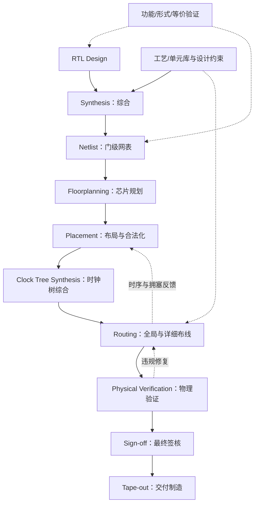
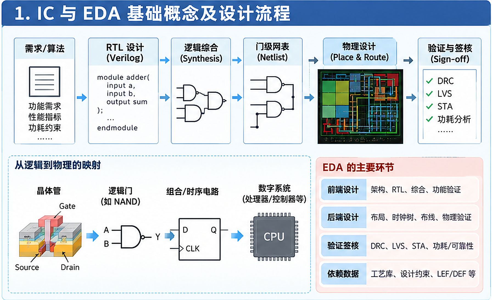
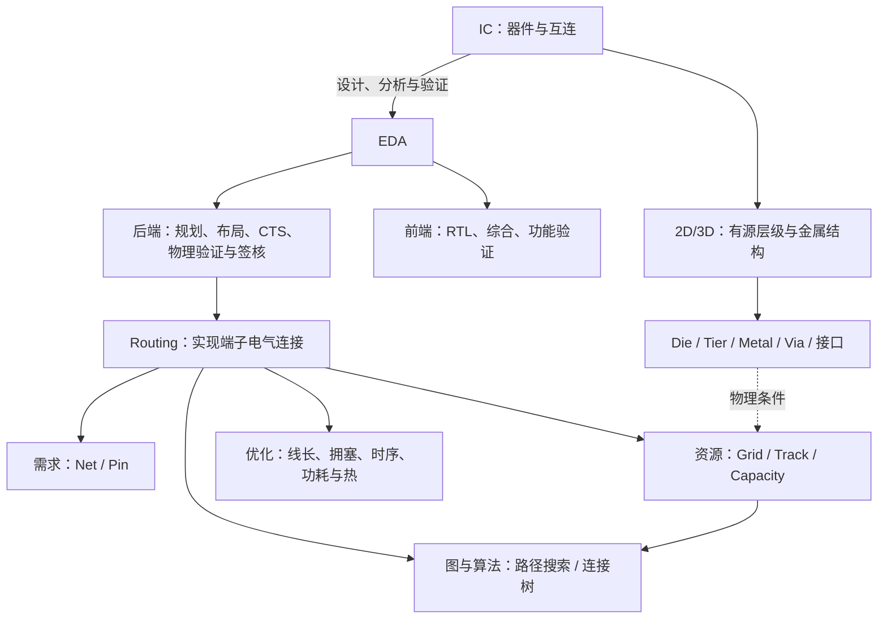

# 集成电路与 EDA 基础理论学习笔记

按“电路与设计流程 → 2D/3D 结构 → 布线资源 → 图模型 → 算法与权衡”学习。本笔记只讲通用理论；坐标、容量等数值为教学示例，层数、尺寸、方向与制造规则依具体工艺确定。

相关文档：[目录导航](目录结构.md) · [比赛代码原理](比赛代码逻辑.md) · [实际使用说明](比赛代码使用说明.md)。

## 目录

- [1 IC 与 EDA 基础](#theory-1)
  - [1.1 IC、晶体管与逻辑门](#theory-1-1)
  - [1.2 数字、模拟与混合信号电路](#theory-1-2)
  - [1.3 ASIC、FPGA、Verilog 与 RTL](#theory-1-3)
  - [1.4 PPA 与互连的影响](#theory-1-4)
  - [1.5 EDA 的分工与验证](#theory-1-5)
  - [1.6 数字芯片设计流程](#theory-1-6)
- [2 2D IC 与 3D IC](#theory-2)
  - [2.1 结构与集成方式](#theory-2-1)
  - [2.2 Die、Tier 与 Metal Layer](#theory-2-2)
  - [2.3 布线方向与层间连接](#theory-2-3)
  - [2.4 原图解读与结构对比](#theory-2-4)
  - [2.5 3D IC 的收益与挑战](#theory-2-5)
  - [2.6 Logic Folding](#theory-2-6)
- [3 芯片布线基础](#theory-3)
  - [3.1 核心术语](#theory-3-1)
  - [3.2 Pin 与 Net：一个多端子例子](#theory-3-2)
  - [3.3 Routing Grid 与容量](#theory-3-3)
  - [3.4 Global Routing、Detailed Routing 与 Guide](#theory-3-4)
  - [3.5 距离与线长](#theory-3-5)
  - [3.6 Congestion 与 Overflow](#theory-3-6)
- [4 2D 与 3D Routing Graph](#theory-4)
  - [4.1 图与节点表示](#theory-4-1)
  - [4.2 不同类型的边](#theory-4-2)
  - [4.3 3D Routing 的额外复杂性](#theory-4-3)
- [5 常用布线算法](#theory-5)
  - [5.1 BFS、Dijkstra 与 A*](#theory-5-1)
  - [5.2 MST、Steiner Tree、RSMT 与 FLUTE](#theory-5-2)
  - [5.3 拆线重布与历史代价](#theory-5-3)
  - [5.4 多目标优化与 Pareto 最优](#theory-5-4)
- [6 理论总结](#theory-6)
  - [6.1 核心知识关系图](#theory-6-1)
  - [6.2 专业术语速记](#theory-6-2)
  - [6.3 容易混淆的概念](#theory-6-3)
  - [6.4 全文总结](#theory-6-4)

<a id="theory-1"></a>
## 1 IC 与 EDA 基础

<a id="theory-1-1"></a>
### 1.1 IC、晶体管与逻辑门

| 术语 | 定义与作用 | 必要说明 |
|---|---|---|
| IC（Integrated Circuit，集成电路） | 在半导体结构上集成器件与互连，实现计算、存储、放大等功能 | “芯片”可指裸片或封装产品；一个封装可含多个 Die |
| Transistor（晶体管） | 控制电流的半导体器件，可用于开关或放大 | 数字电路中的“开关”是近似模型，实际有寄生、漏电和有限速度 |
| MOSFET（Metal-Oxide-Semiconductor Field-Effect Transistor） | 栅电压控制源漏导电状态的场效应晶体管 | CMOS（Complementary Metal-Oxide-Semiconductor）组合使用互补 n/p 型器件 |
| Logic Gate（逻辑门） | 晶体管组合形成基本布尔运算 | NOT：取反；AND：全为 1 才输出 1；OR：至少一个为 1 就输出 1 |
| Combinational / Sequential Logic（组合/时序逻辑） | 前者按当前输入计算，后者还涉及保存的状态 | 组合门可构成加法器；加入触发器等存储元件可构成寄存器、计数器 |

逻辑 0、1 对应规定的电压范围，并非两个精确电压值。金属互连把门的输出接到其他门的输入，还承担时钟和供电；逻辑正确但连线断开、短接或延迟过大，电路仍不能正常工作。

<a id="theory-1-2"></a>
### 1.2 数字、模拟与混合信号电路

| 类型 | 定义与关注点 | 常见用途 |
|---|---|---|
| Digital Circuit，数字电路 | 用离散逻辑状态表示信息，关注功能、状态与时序 | 处理器、控制器、数字运算 |
| Analog Circuit，模拟电路 | 处理连续电压/电流，关注增益、带宽、噪声和失真 | 放大器、传感器前端 |
| Mixed-Signal Circuit，混合信号电路 | 同时包含数字与模拟功能，处理二者交互 | 音频编解码、数据转换、数字校准 |

ADC（Analog-to-Digital Converter，模数转换器）把模拟信号转为数字编码，DAC（Digital-to-Analog Converter，数模转换器）反之。数字信号在物理上仍连续变化，也受噪声、串扰和供电波动影响。

<a id="theory-1-3"></a>
### 1.3 ASIC、FPGA、Verilog 与 RTL

| 比较项 | ASIC：Application-Specific Integrated Circuit，专用集成电路 | FPGA：Field-Programmable Gate Array，现场可编程门阵列 |
|---|---|---|
| 实现方式 | 面向特定应用设计，形成专用门与互连版图 | 映射到已经制造好的可配置逻辑、互连及硬模块 |
| 制造后改变 | 固定门和金属通常不能靠下载配置改变；内部仍可含处理器等可编程部分 | 按器件配置技术选择逻辑与连接；可重配置器件允许更新功能 |
| 产物与应用 | 制造版图；适合专用优化和大批量应用 | Bitstream（配置比特流）；适合原型、升级与灵活加速 |
| 成本与 PPA | 前期投入较高，专用优化空间较大 | 无需为用户逻辑制版，可编程资源通常有额外开销 |

FPGA 配置选择已有资源，不是在硅上重新生成导线。参考：[AMD FPGA 架构](https://docs.amd.com/r/en-US/ug1291-viv/FPGA-Architecture)。

**Verilog HDL（Verilog Hardware Description Language）**用于描述数字电路；**RTL（Register-Transfer Level，寄存器传输级）**描述寄存器、组合逻辑及状态更新。综合把可综合 RTL 映射为门、触发器或 FPGA 资源，再由物理实现确定位置与连接。同一 RTL 在不同库、器件和约束下可得到不同硬件；可仿真也不等于可综合。

<a id="theory-1-4"></a>
### 1.4 PPA 与互连的影响

| 目标 | 观察什么 | 重要边界 |
|---|---|---|
| Power，功耗 | 开关、漏电等功耗，平均/峰值功率 | 受电压、频率、活动率及电容影响 |
| Performance，性能 | 延迟、频率、吞吐率 | 频率高不代表所有应用都更快 |
| Area，面积 | 单元、核心区或 Die 面积 | 3D 中须区分 XY 占地、总硅面积与封装面积 |

常用开关功耗近似为：

$$
P_{switch}\approx\alpha C_{eff}V_{DD}^{2}f.
$$

$C_{eff}$ 为等效开关电容，$V_{DD}$ 为电源电压，$f$ 为参考频率；这里 $\alpha$ 指每周期平均 **0→1 充电事件数**，改用全部跳变数时系数约定不同。该式不包含全部漏电与短路功耗。

互连的电阻、电容使信号传播需要时间。材料、截面及环境近似不变时：

$$
R_{wire}\approx\rho\frac{L}{wt},\qquad C_{wire}\approx c'L,
\qquad t_{50\%}\approx0.69RC.
$$

$L,w,t$ 为线长、宽、厚，$\rho$ 为电阻率，$c'$ 为单位长度电容。最后一式仅适用于简单单 R–C 阶跃模型；均匀无缓冲长线的分布 RC 自身延迟项随 $L^2$ 增长。实际还需考虑驱动、负载、Via 与耦合电容造成的串扰等**寄生效应（Parasitics）**。

长线通常增加电容、能量和延迟；加缓冲可改善延迟，却增加面积与功耗。PPA 必须共同权衡。参考：[MIT 器件、门延迟与功耗讲义](https://ocw.mit.edu/courses/6-012-microelectronic-devices-and-circuits-fall-2009/pages/lecture-notes/)。

<a id="theory-1-5"></a>
### 1.5 EDA 的分工与验证

**EDA（Electronic Design Automation，电子设计自动化）**是设计、实现、分析和验证电路的工具与方法。它用模型和算法处理大规模逻辑与物理约束，支持重复检查和方案比较；结果仍依赖正确的规格、库与约束。

| 分工 | 作用 | 必要说明 |
|---|---|---|
| Front-End Design，前端设计 | 架构、RTL、逻辑综合与功能验证 | 主要表达并验证逻辑意图 |
| Back-End Design，后端设计 | 物理实现、分析和收敛 | 综合的团队分工边界并不完全统一 |
| Physical Design，物理设计 | 规划、布局、时钟与布线 | 通常是数字后端的重要部分 |
| Verification，验证 | 检查功能、等价性、连接或规则 | 贯穿流程，不是只在最后运行一次 |
| Sign-off，签核 | 按认可模型和条件完成最终检查 | 检查范围随工艺、产品与交付协议确定 |

**DRC（Design Rule Check）**检查线宽、间距等设计规则；**LVS（Layout Versus Schematic）**比较版图提取电路与参考电路；**STA（Static Timing Analysis）**分析路径时序。三者不能互相替代，也不能替代功能验证。签核还常检查电源 IR 压降、EM（Electromigration，电迁移）等可靠性问题。

<a id="theory-1-6"></a>
### 1.6 数字芯片设计流程

以下是**数字 ASIC 的简化流程**。真实设计还包含测试逻辑、电源规划、寄生提取等工作，并反复做时序和物理优化。



| 阶段 | 输入 → 主要任务 → 输出 |
|---|---|
| RTL Design | 规格与架构 → 描述并验证寄存器/逻辑行为 → 可综合 RTL 与约束 |
| Synthesis | RTL、库与约束 → 逻辑优化和资源映射 → Netlist；记录实例与端子连接，通常未规定完整物理几何 |
| Floorplanning | 网表、模块及接口要求 → 确定核心区、Macro、通道和供电规划 → 初始物理约束 |
| Placement | 网表与规划 → 安排实例位置/方向并合法化 → 已定位单元和 Pin |
| CTS | 布局与时钟约束 → 构建时钟分发网络 → 更新的缓冲与连接，控制偏斜和延迟 |
| Routing | 布局、连接与规则 → 分配通道并落实线段/Via → 布线几何 |
| Physical Verification | 版图、参考电路与规则 → DRC/LVS 等检查 → 违规或通过报告 |
| Sign-off | 版图、提取寄生与最终模型 → 时序、物理、电源等验收 → 交付数据与报告 |

**Placement 决定放在哪里，Routing 决定怎样连接。**放得近可降低长度下界，但过密或被 Macro 阻挡会增加拥塞，二者需要反馈迭代。Clock Skew（时钟偏斜）是不同端的时钟到达时间差，不等于时钟传播总延迟；CTS 不要求所有线几何等长。Tape-out 是交付制造，还需后续制造、封装与测试。参考：[OpenROAD 物理设计流程](https://openroad.readthedocs.io/en/latest/main/README.html)。



图 1：串联器件、RTL、网表、物理实现与签核；图内代码和流程为教学示意，以正文定义为准。

<a id="theory-2"></a>
## 2 2D IC 与 3D IC

<a id="theory-2-1"></a>
### 2.1 结构与集成方式

| 集成方式 | 定义与作用 | 必要区别 |
|---|---|---|
| 2D IC（Two-Dimensional Integrated Circuit） | 逻辑主要组织在一个器件平面，通过多层金属互连 | **已有厚度、多层金属及 Z 向 Via**；“二维”不等于单金属层 |
| 3D IC（Three-Dimensional Integrated Circuit） | **垂直集成多个有源 Tier**，用层级间连接协同工作 | 可采用多 Die 堆叠，也可顺序形成多个有源层级；多一层普通金属不等于多一个 Tier |
| 2.5D Integration，二维半集成 | 常把多个 Die 并排放在中介层/重布线结构上互连 | 可含 TSV；不能单凭“有 TSV”判断存在有源 Die 堆叠 |

典型 2D 结构由硅衬底、晶体管器件区、局部接触与上方多层互连组成。层间介质用于绝缘，Via 在指定位置建立层间导通；金属层是一层中的许多独立图形，不是整块互相导通的金属板。晶体管本身具有三维形状，也不自动等同于系统级 3D IC。

3D 可在相近 XY 占地内增加功能或缩短部分通信路径，但设计方法取决于实际集成技术。参考：[imec 三维集成路线](https://www.imec-int.com/en/expertise/cmos-advanced/connect/3d-integration)。

<a id="theory-2-2"></a>
### 2.2 Die、Tier 与 Metal Layer

| 术语 | 定义与作用 | 必要说明 |
|---|---|---|
| Die，裸片 | 晶圆切割后的一块半导体实体，通常含电路与互连 | 不等于封装；一个 Die 可有许多金属层 |
| Tier，有源层级/堆叠层 | 三维集成中的有源电路或设计层级 | 简单双 Die 例子中可一一对应，**其他技术中不一定与 Die 一一对应** |
| Metal Layer，金属层 | 制造本地互连金属图形的工艺层 | M1/M2/M3 是互连层编号，不是 Die 编号；不同 Tier 的 M1 是不同物理层 |
| Silicon Substrate / Silicon Layer，硅衬底/硅层 | 承载器件的硅体，或对某硅材料层的描述 | 可能指减薄衬底或薄硅层，不是统一的 Tier 计数单位 |
| Interconnect Layer，互连层 | 与电连接有关的结构层 | 具体范围依语境，不等于有源器件层 |

M1 通常靠近器件，M2/M3 等提供更多布线空间与方向选择；层数、尺寸、用途和命名依工艺确定。**每个 Tier 通常仍需自己的金属层**，因为该 Tier 内的晶体管要连接成门和模块，并接收时钟、电源与信号；跨 Tier 接口不能替代全部局部互连。

可把双 Tier 的包含关系读成：`Tier 1：器件 + M1/M2/M3`、`Tier 2：器件 + M1/M2/M3`，两组之间再有层级间连接。这不规定剖面朝向；Face-to-Face（面对面）与 Face-to-Back（面对背）等装配会改变相对方向，坐标也需变换到统一装配坐标。

<a id="theory-2-3"></a>
### 2.3 布线方向与层间连接

俯视坐标通常以 X 为水平、Y 为竖直，Z 为高度。

| 名称 | 定义与作用 | 是否必然换层 |
|---|---|---|
| Horizontal Routing | 在某层内沿 X 走线 | 否 |
| Vertical Routing | 在某层内沿 Y 走线 | 否 |
| Preferred Routing Direction，首选方向 | 指定某层优先采用的平面方向；相邻层常交替 X/Y | 方向本身不意味着换层 |

**LEF（Library Exchange Format，库交换格式）中的 `DIRECTION VERTICAL` 通常指平面 Y 方向，不等于 Z 向 TSV。**M1 不固定为某个方向；非首选方向是否允许及其限制，要看工艺规则与工具模型。参考：[LEF/DEF 5.8 语言参考原文公开镜像](https://coriolis.lip6.fr/doc/lefdef/lefdefref/lefdefref.pdf)。

| 结构/技术 | 定义与作用 | 必要说明 |
|---|---|---|
| Via，普通层间通孔 | 穿过层间介质，连接同一 Die 内的金属层 | 需满足接触、包围和间距规则；跨多层通常由合法 Via 堆栈实现 |
| TSV（Through-Silicon Via，硅通孔） | 穿过硅体的导电通道，可传信号或供电 | 有寄生、应力和周围保留空间；单根 TSV 不自动完成整套 Die 间接合 |
| Micro-bump，微凸点 | 在接合界面形成电连接 | 可与 TSV 配合使用 |
| Hybrid Bonding，混合键合 | 同时形成界面的介质结合与金属接点电连接 | 负责表面接合，与穿硅是不同任务；可与 TSV 共存 |

完整跨 Die 路径可能包含“局部金属 → 必要的穿硅/访问结构 → 键合接点 → 另一 Die 金属”。**不是所有 3D IC 都必须使用 TSV，也不是用了 Hybrid Bonding 就完全没有 TSV。**具体组合取决于朝向、访问路径与工艺。参考：[imec 混合键合说明](https://www.imec-int.com/en/articles/wafer-wafer-hybrid-bonding-pushing-boundaries-400nm-interconnect-pitch)。

<a id="theory-2-4"></a>
### 2.4 原图解读与结构对比

下图左侧表示一个主要器件平面上的多层互连，右侧表示双 Die/Tier 堆叠及其内部、跨 Die 连接。


图 2：对比单器件平面与多有源 Tier 的互连层次；图示层数与连接结构不代表所有工艺。

- **左侧：**灰色小块和粉色大块分别示意标准单元与 Macro；不同颜色线表示不同金属层，紫色标记是 Via。剖面中的 M1–M4 已有高度差，俯视相交的线若在不同层、没有 Via，就不导通。
- **右侧：**两个俯视区域代表两个 Die/Tier；各有自己的 M1–M4 与普通 Via。橙色粗柱突出跨 Die 路径，实际还需硅体、访问金属、接点及键合等结构配合，不能当成任意贯穿全部层的金属柱。
- **简化边界：**图不按制造比例绘制，省略介质、接触和衬底细节；层数、颜色、方向、Tier/Die 对应及局部括注均属原图语境，不能推广为所有工艺的定义，也不能据此判断实际面对面/面对背结构。

| 比较项目 | 2D IC | 3D IC |
|---|---|---|
| Die/Tier | 本文典型模型为一个主要有源器件平面 | 多个有源 Tier；制造路线不只限于独立裸片堆叠 |
| Metal Layer | 通常已有多层金属 | 各 Tier 通常仍有本地多层互连 |
| Via | 连接不同金属层 | 本地金属层间仍需要 |
| TSV | 传统前面信号布线模型通常不需要 | 某些技术使用，并非普遍必需 |
| 互连路径 | 在一个器件平面的多金属层中组织 | 还需跨 Tier 接口与两侧接入 |
| 散热 | 有热点和热阻限制 | 还可能有层级间热耦合、不同散热距离 |
| 制造复杂度 | 器件与多层互连制造 | 可能另需减薄、对准、键合、穿硅和多 Die 测试 |
| 主要优势 | 工艺与方法成熟 | 提高单位占地功能密度，缩短部分通信、提高接口带宽 |
| 主要挑战 | 长互连、拥塞、时序与功耗 | 再叠加垂直资源、热、电源、应力、良率及成本约束 |

<a id="theory-2-5"></a>
### 2.5 3D IC 的收益与挑战

| 目标 | 可能收益 | 同时需要权衡 |
|---|---|---|
| 集成与异质组合 | 小 XY 占地内容纳更多功能，各模块选适合的工艺 | 总硅面积、封装体积与成本未必下降 |
| 带宽、距离与功耗 | 密集接口和短路径可能降低数据搬运能量 | 接口电路、TSV 寄生、供电与信号完整性仍有成本 |
| 垂直资源 | 增加跨层选择 | 数量、间距、允许区域和两侧接入有限 |
| 制造与测试 | 可分别制造不同功能 Die | 键合、减薄、筛选及多界面良率需要共同考虑 |
| 散热 | 可设计材料与导热路径 | 上下热点耦合，部分 Tier 离散热边界较远 |

**Thermal Coupling（热耦合）**是某区域发热影响其他区域温度。简单稳态集总模型可用 $\Delta T\approx PR_{th}$ 理解温升，P 为功率、$R_{th}$ 为等效热阻（K/W）；真实热场还取决于热源分布、材料、界面、散热边界，瞬态还涉及热容。

TSV 金属可能改变导热路径，也会带来寄生、应力和载流发热。它不是主动制冷器件，数量多或靠近热点不保证降温，需热模型验证。参考：[TSV 三维集成热性能研究](https://imapsjmep.org/article/40020-thermal-performance-of-3d-ic-integration-with-through-silicon-via-tsv)。

<a id="theory-2-6"></a>
### 2.6 Logic Folding

**Logic Folding（逻辑折叠）**是将原本平面分布的逻辑划分并映射到不同 Tier 的思想，不是把成品硅片折弯。让紧密通信的模块在不同 Tier 中靠近，有机会缩短部分路径、增加布局自由度。

划分需兼顾面积、时序、功率密度与接口数量。改变模块所在 Tier，也改变跨层网络、接入路径与资源竞争，所以布局更灵活的同时，布线协调也更复杂；“折叠”不规定唯一粒度、工艺或算法。

<a id="theory-3"></a>
## 3 芯片布线基础

<a id="theory-3-1"></a>
### 3.1 核心术语

先区分**电路连接需求**与**实现连接的物理资源**。普通英文词不是缩写，不另造“全称”。

| 术语 | 定义与作用 | 必要说明 |
|---|---|---|
| Macro / Hard Macro，宏单元/硬宏 | 作为整体处理的预定义物理模块，如存储器 | 物理设计常指较大硬模块；库格式中的 macro 可泛指单元定义 |
| Instance / Cell Instance，实例 | 某库单元或模块的一次具体使用 | 具有独立标识、位置和方向；多个实例可引用同一模板 |
| Standard Cell，标准单元 | 预先设计、表征的可复用逻辑/时序单元 | 常按规则行高组织；不是 GCell |
| Pin / Terminal，引脚/端子 | 单元或模块与网络连接的接口 | Terminal 强调电气端点，Pin 常强调接口/物理访问；一个 Pin 可有多种形状，不只是封装脚 |
| Net / Electrical Net，电气网络 | 应属于同一电气连接关系的端子集合 | 表达“应该连谁”，不表示已经生成导线 |
| Wire / Metal Wire Segment，导线/线段 | 实现连接的物理导体或其中一段 | 一个 Net 可用多段、多层导线和 Via 实现 |
| Routing Layer，布线层 | 用于相应布线任务的金属图形层 | 受方向、线宽、间距等规则约束 |
| Routing Track，布线轨道 | 组织候选导线位置的线状参考 | 轨道间距与障碍限制能放多少线 |
| Grid Cell / Global Routing Cell，GCell | 粗粒度路由模型中的平面区域 | 一个格可包含多条 Track；不是逻辑单元 |
| Capacity，容量 | 明确资源上允许承载的需求上限 | 可按图边、格层等资源定义；应说明单位 |
| Usage，使用需求 | 已分配到该资源的需求 | 宽线、Via 等如何计数依模型，不一定一 Net 占一单位 |
| Congestion / Overflow，拥塞/溢出 | 需求集中程度/超出容量的正部分 | 是资源模型指标，不直接等于物理规则违规数 |


图 3：对照实例、Pin、Net 与网格资源；Macro/Instance 标注和交叉线的连通关系以正文定义为准。

<a id="theory-3-2"></a>
### 3.2 Pin 与 Net：一个多端子例子

```text
Net N1 = { U1.Y, U2.A, U3.B }
```

假设 U1.Y 驱动 U2.A、U3.B：三个端子应形成**一个电气连通整体**，可共享主干和分支，不需要为每对端子单独拉线。两 Pin Net 是两端连接，多 Pin Net 还需决定共享拓扑；特殊网络可含双向或三态端口，不能把“一个 Net 必有且只有一个输出”当成通用规则。

布局先确定 U1/U2/U3 的位置，再由布线选择金属层、线段和 Via 接入这些 Pin。电气连通要求存在符合规则的导电路径；不同 Net 误连是短路。理想逻辑把同一 Net 视为同一节点，真实互连的瞬态电压仍受 RC 与传播延迟影响。

<a id="theory-3-3"></a>
### 3.3 Routing Grid 与容量

**Routing Grid（布线网格）**把连续空间离散为可搜索、可记账的资源。GCell 是区域，Track 是候选线位置；粗网格计算量较小但可能掩盖接入/障碍细节，细网格更精确也更耗计算。

对于水平走线，按垂直于走线方向的通道宽度 $W_{ch}$ 和轨道间距 $p$ 可粗估：

$$
C_{raw}\approx\left\lfloor\frac{W_{ch}}{p}\right\rfloor.
$$

精确容量还受边界偏移、线宽间距、障碍、电源、Pin 与 Via 占位影响。不同模型可能把容量放在图边或格层上，比较 Usage 与 Capacity 前须确认资源对象和单位一致。

<a id="theory-3-4"></a>
### 3.4 Global Routing、Detailed Routing 与 Guide

| 比较 | Global Routing，全局布线 | Detailed Routing，详细布线 |
|---|---|---|
| 任务 | 规划拓扑、通道、层分配和资源需求 | 决定精确轨道、金属几何、Via 和 Pin Access（端子接入） |
| 抽象 | 较粗的区域与容量图 | 细粒度几何及工艺规则 |
| 常见输出 | 粗路径、拥塞信息、Routing Guide | 实际线段/Via 与局部修复结果 |

**Routing Guide（布线引导）**以区域等形式表达某 Net 在哪些层、哪些通道经过，给详细布线提供参考或约束。它没有确定完整线宽、中心线和 Via 版图，**不是最终物理导线或制造掩模**。

分阶段是为了把全芯片资源分配与局部几何实现分开。粗模型无溢出仍可能因 Pin 接入、Via 间距等详细失败；详细结果还需物理验证与签核。参考：[全局布线](https://openroad.readthedocs.io/en/latest/main/src/grt/README.html)、[详细布线](https://openroad.readthedocs.io/en/latest/main/src/drt/README.html)文档。

<a id="theory-3-5"></a>
### 3.5 距离与线长

对平面两点 $A=(x_1,y_1)$、$B=(x_2,y_2)$，欧氏距离是直线距离，曼哈顿距离只累计 X/Y 位移：

$$
d_E(A,B)=\sqrt{(x_2-x_1)^2+(y_2-y_1)^2},\qquad
d_M(A,B)=|x_2-x_1|+|y_2-y_1|.
$$

沿正交折线 $P=(p_0,\ldots,p_k)$ 的长度为：

$$
L(P)=\sum_{i=0}^{k-1}\left(|x_{i+1}-x_i|+|y_{i+1}-y_i|\right).
$$

例如从 (0,0) 到 (3,4)，欧氏距离为 5，曼哈顿距离为 7；绕障碍的实际长度可能更大。正交轨道和首选方向使曼哈顿几何常用于芯片布线，但不是所有工艺都禁止斜线。

**Wirelength（线长）不等于总代价。**多端子网络共享线段时，应按实际线段并集计总长，而非累加全部端子对距离；Via、跨 Tier 接口还可另计数量、延迟或等效成本。平面曼哈顿距离只是相应模型中的下界。

<a id="theory-3-6"></a>
### 3.6 Congestion 与 Overflow

资源有限，来自通道宽度、线宽间距、障碍和既有占用等限制。对资源 $e$，容量为 $C_e$、总需求为 $U_e$，常定义：

$$
O_e=\max(0,U_e-C_e).
$$

例如容量 4、需求 6，溢出为 2。$C_e>0$ 时可用 $U_e/C_e$ 看压力；零容量有需求时不能直接除零，应视为不可用或按明确模型处理。

多个 Net 各自选最短路，可能同时挤入相同通道，所以单网最短不保证全局可行。迭代中暂时超用资源可用于指导重布，但不代表最终金属可以违反规则；模型 Overflow 也不替代精确 DRC。

<a id="theory-4"></a>
## 4 2D 与 3D Routing Graph

<a id="theory-4-1"></a>
### 4.1 图与节点表示

**Graph（图）**记为 $G=(V,E)$，把可用资源与连接抽象为顶点和边，不必完整复制制造结构。

| 概念 | 定义与作用 | 布线中的对应 |
|---|---|---|
| Vertex / Node，顶点/节点 | 一个状态或可访问位置 | 某格、某层，或某个端子访问点 |
| Edge，边 | 两个状态之间允许的连接 | 同层移动、普通 Via 或跨 Die 接口 |
| Weighted Graph，加权图 | 带数值权重的图 | 权重可表示长度、延迟或资源代价 |
| Path / Tree，路径/树 | 相邻边的连接序列/连通无环结构 | 两点路线/多端子共享连接 |

| 场景 | 一种节点表示 | 索引含义 |
|---|---|---|
| 2D IC 的多层路由 | `(x,y,metal_layer)` | 平面网格位置与金属层；2D IC 布线仍可包含换层 |
| 3D IC 路由 | `(x,y,tier,metal_layer)` | 再区分所属 Tier 与该 Tier 内的金属层 |

**四个索引不代表四维物理空间。**Tier、Metal Layer 是离散结构标签，共同对应三维 XYZ 中的位置；也可合并成一个全局层编号。早期全局规划还可能先将多层聚合成纯二维图，再做层分配。

不同 Die 有翻转、旋转、偏移或不同网格时，局部索引相同不保证全局 XY 对齐。Pin 的合法访问点、障碍和接口规则，都要正确映射到图中；图可达性只保证该模型中的可达。

<a id="theory-4-2"></a>
### 4.2 不同类型的边

| 边类型 | 状态变化与物理含义 | 主要限制 |
|---|---|---|
| Same-layer Routing，同层布线边 | Tier/层不变，X/Y 改变，对应金属线 | 方向、轨道、间距、障碍与容量 |
| Intra-die Via，普通 Via 边 | Tier 不变，在合法落点换金属层 | 层对、包围、Via 间距和访问条件 |
| Inter-die Connection，跨 Die 边 | 改变 Tier，按接口定义接入另一侧金属 | 位置、对准、访问层与垂直容量；可含 TSV 或其他接合结构 |


这是连接关系图，接入层和接口结构依工艺决定。一条抽象跨 Die 边可概括局部访问、TSV、焊盘和键合等多段结构，不能只因图上“竖向”就统称 TSV。即使 XY 对齐，换层/跨 Tier 也可能有非零电气与资源成本。几何连通图可无向建模，不必直接沿用逻辑信号的驱动方向。


图 4：区分同层边、Die 内 Via 与跨 Die 接口；图中颜色和连线仅作示意，具体连通以正文为准。

<a id="theory-4-3"></a>
### 4.3 3D Routing 的额外复杂性

| 决策 | 为什么更复杂 |
|---|---|
| 跨 Die 位置与接入层 | 同时影响源侧、目标侧路径和 Via/接口开销 |
| 垂直资源分配 | 接点数量、间距和可用区域有限，多个 Net 会竞争 |
| 局部与跨层拥塞 | 接口本身有容量，不代表两侧金属通道也有容量 |
| 热、电气与制造权衡 | 部分线缩短，仍可能增加接口负载、热点耦合、供电或制造难度 |

因此要比较“源侧合法接入 + 接口 + 目标侧合法接入”，再协调所有网络的共享资源；仅分别求几条最短路不足以解决整体问题。

<a id="theory-5"></a>
## 5 常用布线算法

<a id="theory-5-1"></a>
### 5.1 BFS、Dijkstra 与 A*

最短路径是在**给定图与代价模型**中最小化 $Cost(P)=\sum_{e\in P}w(e)$，不等于全芯片 PPA 最优；本节按固定、非负边代价讨论。

| 算法 | 基本思想与作用 | 适用条件/区别 |
|---|---|---|
| BFS（Breadth-First Search，广度优先搜索） | 用队列按步数逐层扩展 | 所有边等代价时求最少步数；边权不同不保证总代价最小 |
| Dijkstra's Algorithm，迪杰斯特拉算法 | 按当前累计代价最小的状态扩展，通过松弛更新距离与前驱 | 边权非负；可求单源到其他可达点的最短距离 |
| A*（A-star Search，A 星搜索） | 在累计代价上加入到目标的估计，优先探索更有希望的状态 | 适合定向找目标；最优性依赖启发式与状态访问策略 |

A* 的优先级为：

$$
f(n)=g(n)+h(n).
$$

$g(n)$ 是已找到的起点到 n 的最好代价，$h(n)$ 是剩余代价估计。**可采纳性（Admissibility）**要求 h 不高估真实最小剩余代价、目标处为 0；**一致性（Consistency）**要求 $h(u)\le w(u,v)+h(v)$。图搜索若使用不一致启发式，可能需要重新打开状态；仅有可采纳性而禁止必要重开，不能笼统保证最优。

在单位代价正交网格中，曼哈顿距离可作忽略障碍后的下界；有权重时需按最低单位成本缩放，并确保特殊捷径不破坏下界。$h=0$ 时标准 A* 退化为 Dijkstra，放大启发值则可能牺牲最优性。

路径通常由前驱回溯。候选耗尽表示当前图不可达，预算耗尽只表示尚未找到。三者都不自动解决不同 Net 的资源竞争。参考：[MIT 最短路径讲义](https://ocw.mit.edu/courses/6-006-introduction-to-algorithms-spring-2008/pages/lecture-notes/)。

<a id="theory-5-2"></a>
### 5.2 MST、Steiner Tree、RSMT 与 FLUTE

多端子布线还要选择分支与共享结构，不能只把所有端子对距离相加。

| 方法/概念 | 定义与作用 | 关键区别/限制 |
|---|---|---|
| MST（Minimum Spanning Tree，最小生成树） | 在给定加权图上连接全部顶点、无环，使树边权总和最小 | 端子拓扑常以端子对估计距离建图；Prim、Kruskal 是经典求法 |
| Steiner Tree，斯坦纳树 | 允许引入原始端子之外的分支点，以改善整体连接 | 可利用共享主干缩短总长，区别于仅在既定图上选生成树 |
| RSMT（Rectilinear Steiner Minimal Tree，直角斯坦纳最小树） | 用水平/竖直线段构成最短 Steiner 连接树 | 规定几何方向；不自动包括所有障碍、层与容量约束 |
| FLUTE（Fast Lookup Table Estimation） | 用预计算查表快速构造直角 Steiner 树、估计线长；高度数网络采用分解等策略 | degree 指端子数；不是完整拥塞感知或三维详细布线器 |

**MST 最小化树的总权重，最短路径树优化源到各点的距离。**MST 的抽象边展开并合并重叠线段后，物理线长可能改变；不要混用抽象边权和共享几何长度。拓扑确定后，仍需合法路径搜索、层分配与资源协调。参考：[Chu 与 Wong 的 FLUTE 论文](https://ieee-ceda.org/media/flute-fast-lookup-table-based-rectilinear-steiner-minimal-tree-algorithm-vlsi-design)。

<a id="theory-5-3"></a>
### 5.3 拆线重布与历史代价

**Rip-up and Reroute（拆线重布）**通过重新分配部分路线，改善初布顺序和资源竞争造成的冲突。基本流程：

1. 生成初始路由，统计资源与冲突。
2. 选择受拥塞影响或值得调整的网络。
3. 拆除旧路径，并扣除其占用。
4. 用更新后的资源/代价重新找路，加入新路径。
5. 评价并按具体准则接受、回滚或继续迭代。

**History Cost（历史代价）**记住过去反复拥挤的资源，使它们在后续搜索中更“贵”，帮助减少争用或振荡。一种教学更新为：

$$
H_e^{(k+1)}=H_e^{(k)}+\eta O_e^{(k)},\qquad\eta\ge0.
$$

实际方法可归一化、衰减或换用其他规则。迭代可因无冲突、改善不足或预算达到而停止，有限轮数不保证找到可行解或全局最优解。

<a id="theory-5-4"></a>
### 5.4 多目标优化与 Pareto 最优

| 概念 | 定义与作用 | 必要说明 |
|---|---|---|
| Multi-objective Optimization，多目标优化 | 共同权衡线长、拥塞、延迟、功耗、Via/接口及热目标 | 不同目标可能冲突，先明确可行性约束与评价模型 |
| Pareto Optimal，帕累托最优 | 没有另一可行方案在全部目标上不差、且至少一项更好 | 不意味着所有目标各自都最优，仍需工程偏好作选择 |
| Pareto Front，帕累托前沿 | 不被其他可行方案支配的方案集合 | 短线高拥塞与稍长低拥塞的方案可能互不支配 |

一种处理方式是先归一化再加权，例如：

$$
F=\lambda_L\widetilde L+\lambda_O\widetilde O+\lambda_T\widetilde T,
\qquad\lambda_L,\lambda_O,\lambda_T\ge0.
$$

$\widetilde L,\widetilde O,\widetilde T$ 分别是归一化后的线长、拥塞指标和热指标，均按越小越好定义。不同单位不能随意直接相加；权重表达偏好，没有固定通用比例，加权和也未必覆盖离散、非凸问题中的全部 Pareto 解。

也可先要求连通、规则、资源与时序满足硬约束，再优化质量。热目标应由材料、热源和边界支持的模型定义；简单热偏好不等于热仿真，也不自动证明结温下降。

<a id="theory-6"></a>
## 6 理论总结

<a id="theory-6-1"></a>
### 6.1 核心知识关系图



图中的箭头表示知识依赖和工作关系，不是互斥分类；验证与反馈贯穿整个设计过程。

<a id="theory-6-2"></a>
### 6.2 专业术语速记

本表只保留关系提示和索引，不重复前文的完整定义。

| 术语组 | 复习关键词 | 详见 |
|---|---|---|
| IC / Transistor / CMOS / Logic Gate | 器件 → 门 → 组合与时序电路 | [1.1](#theory-1-1) |
| Digital / Analog / Mixed-Signal | 离散状态 / 连续量 / 二者交互 | [1.2](#theory-1-2) |
| ASIC / FPGA / Verilog / RTL | 专用硬件 / 可配置资源 / 描述与综合 | [1.3](#theory-1-3) |
| PPA / RC / Parasitics | 功耗、性能、面积；互连非理想效应 | [1.4](#theory-1-4) |
| EDA / CTS / STA / DRC / LVS / Sign-off | 自动化、时钟、时序、规则、连接一致性与验收 | [1.5–1.6](#theory-1-5) |
| 2D / 3D / 2.5D / Die / Tier / Metal | 有源层级、实体与互连层次 | [2.1–2.2](#theory-2-1) |
| Via / TSV / Micro-bump / Hybrid Bonding | 介质换层 / 穿硅 / 界面接合 | [2.3](#theory-2-3) |
| Logic Folding / Thermal Coupling | 逻辑跨 Tier 分配与热相互影响 | [2.5–2.6](#theory-2-5) |
| Macro / Instance / Pin / Terminal / Net / Wire | 模板、使用、接口、连接需求与导体 | [3.1–3.2](#theory-3-1) |
| GCell / Track / Capacity / Usage / Overflow | 区域、轨道与资源账本 | [3.3](#theory-3-3)、[3.6](#theory-3-6) |
| Global / Detailed Routing / Guide | 粗规划、精确实现与区域引导 | [3.4](#theory-3-4) |
| Wirelength / Manhattan Distance | 共享线段总长与正交距离下界 | [3.5](#theory-3-5) |
| Graph / Node / Edge / Path / Tree | 状态、连接与路线结构 | [4.1–4.2](#theory-4-1) |
| BFS / Dijkstra / A* | 等权搜索 / 非负权搜索 / 启发搜索 | [5.1](#theory-5-1) |
| MST / Steiner / RSMT / FLUTE | 多端子拓扑与共享分支 | [5.2](#theory-5-2) |
| Rip-up and Reroute / History Cost | 释放、重搜与历史资源压力 | [5.3](#theory-5-3) |
| Multi-objective / Pareto Optimal | 约束下的目标权衡与不可支配方案 | [5.4](#theory-5-4) |

<a id="theory-6-3"></a>
### 6.3 容易混淆的概念

| 比较 | 一句话区分 |
|---|---|
| IC / Die / Package | 集成电路概念 / 裸片实体 / 可容纳多个 Die 的封装产品 |
| Die / Tier / Metal Layer | 实体 / 有源层级 / 互连工艺层；三者不是同一计数单位 |
| 2D IC / 3D IC | 主要平面器件组织 / 多个有源 Tier 垂直集成；前者也有多金属层与 Via |
| Vertical Routing / 物理 Z | 平面 Y 向走线 / 高度变化，不能望文生义 |
| Via / TSV / Hybrid Bonding | 介质层间连接 / 穿硅结构 / 界面接合；后两者可以配合 |
| Placement / Routing | 确定实例位置 / 实现端子连接，需相互反馈 |
| Net / Wire | 应连的端子关系 / 实现它的物理导体 |
| GCell / Track / Standard Cell | 空间区域 / 线状候选位置 / 电路单元 |
| Global / Detailed / Guide | 通道资源规划 / 精确几何实现 / 引导区域；Guide 不是成品导线 |
| MST / 最短路径 | 最小化连接树总权重 / 最小化给定起终点路径代价 |
| MST / Steiner Tree | 在既定图上选树 / 允许加入额外分支点 |
| 无 Overflow / 可制造 | 抽象容量满足 / 还需 Pin 接入、几何、电气和工艺条件满足 |
| 热启发式 / 热仿真 | 简化偏好指标 / 依据材料、热源与边界计算热行为 |

<a id="theory-6-4"></a>
### 6.4 全文总结

IC 用器件实现功能、用互连组织系统；EDA 把功能描述逐步变为网表、布局和布线，并通过验证与签核检查。3D IC 增加有源层级，也增加跨层接口与热约束。布线以 Net/Pin 为需求，以网格、轨道和图为资源模型，用路径搜索、连接树及迭代协调求解，并在 PPA、拥塞和热之间权衡。复习时始终确认：**讨论的是哪层抽象、使用什么单位、结论依赖什么条件。**

