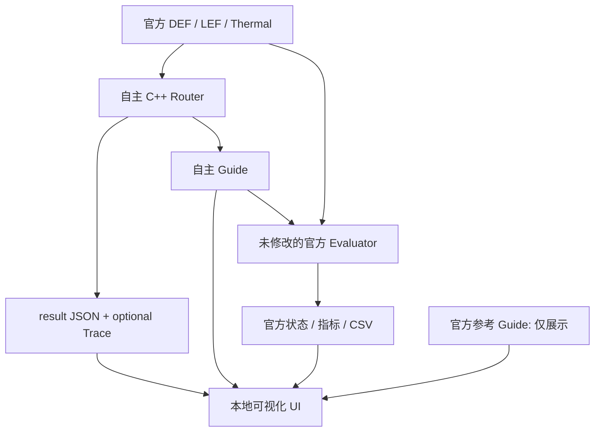

# 3DIC EDA 项目目录结构

## 一、项目介绍

本项目用于 2026 年中国研究生创芯大赛 EDA 精英挑战赛赛题八《面向 3D IC 的多目标全局布线优化》。输入为实际布局 DEF、物理库与规则 LEF、给定热分布 JSON，输出所有需布线网络的 Guide。目标是在满足连接、层归属与格式约束的基础上优化线长、拥塞和热相关性。

项目根目录：`D:\我\大学\program\3DIC EDA`。本机目录为依据；GitHub 仓库 `shenghong1130/3DIC-EDA` 仅作版本管理参考，本次没有 push。
本文件由根目录原 README 改名重写，其他官方子目录原 README 均保留。

## 二、主要目录树

```text
D:\我\大学\program\3DIC EDA
├── .git/                         本地 Git 历史
├── .gitattributes                文本属性
├── .gitignore                    缓存、编译产物、私人配置排除规则
├── 目录结构.md                   本文件：资料位置与流程
├── 比赛代码逻辑.md               算法、数据结构与评估解释
├── 比赛代码使用说明.md           编译、运行、UI、评分与打包操作
├── 2DIC 3DIC compare.png          二维/三维集成对比资料
├── TigerVNC/                     已配置的本机远程桌面工具，保持原状
│   ├── bin/                      Viewer 可执行文件
│   ├── connections/              本机连接配置，不提交到 Git
│   └── logs/                     已有安装/连接验证日志与辅助脚本
└── EDA/
    ├── 赛题问题与解答汇总.md       本地整理的正式问答与待确认项
    ├── submission_example/
    │   ├── src/router.cpp         复制参考 Guide 的接口示例
    │   ├── router.py、router      示例入口/预编译程序
    │   ├── build.sh、run.sh       原始示例构建与运行
    │   └── README.md              官方提交规范
    ├── eda-elite-challenge/
    │   └── eda-elite-challenge2026/
    │       ├── evaluator/         旧 Python 评分代码、扩展与 libfmt
    │       ├── cases/sample001/   旧版 sample001
    │       ├── Dockerfile         原始环境参考
    │       └── README.md          旧工具使用说明
    ├── 评估程序/
    │   ├── score                 较新官方 Linux ELF 评分器
    │   ├── POST9.dat、POWV9.dat   FLUTE 查找表
    │   ├── README.md             调用格式
    │   └── 3DIC全局布线评分程序评价标准说明_20291011.docx
    ├── 公开测试用例/
    │   ├── toy/                  小型 DEF/LEF/热图/参考 Guide
    │   ├── open_3d_case001/       3,152 Net 公开设计
    │   ├── open_3d_case003/       较大公开设计
    │   ├── open_3d_case005/       较大公开设计，热文件名需核对
    │   └── 3DIC全局布线公开用例说明_20260930.docx
    ├── 赛题八公开数据集/
    │   └── 赛题八公开数据集/
    │       ├── cases/sample001/   新版 sample001
    │       ├── Dockerfile
    │       └── README.md
    └── code_3DIC EDA/             自主开发的正式工程
        ├── include/              model.hpp、router.hpp、json.hpp
        ├── src/                  main.cpp、parser.cpp、router.cpp
        ├── configs/              baseline.json、default.json
        ├── scripts/              运行、评估、打包、汇总工具
        ├── tests/                C++ 核心与 Python 集成验证
        ├── ui/                   app.py 与离线 HTML/CSS/JS
        ├── docs/                 五份提交文档及资料核查记录
        ├── outputs/              本次及后续运行的全部产物，Git 排除
        │   ├── runs/<case>/<label>/  Guide、图边、Trace、日志、官方报告
        │   ├── reports/             编译、测试与汇总报告
        │   └── submission_v1.zip    独立提交包
        ├── CMakeLists.txt
        └── build.sh、run.sh
```

`.routing_work/` 是本次开发的本地检查与验证脚本目录，受 Git 排除；可复用的用户工具已经放入新工程 `scripts/`。编译缓存、浏览器验证配置及截图也不属于比赛提交内容。

## 三、各目录的用途与保护规则

| 目录 | 来源、关键文件与用途 | 输入 / 输出 | 原始资料及修改规则 | 比赛流程角色 |
|---|---|---|---|---|
| `EDA/submission_example` | 收集的官方示例；README 明确 ZIP 根目录入口、四个 CLI 参数及五份文档要求 | DEF/LEF/热 JSON → 示例 Guide | 原始资料，只读；其中 C++ 实际复制参考解，不能当作算法 | 学习接口与提交形式 |
| `EDA/eda-elite-challenge` | 官方旧版 Python 工具，checker.py、common.py、score.py、Linux `.so` 与 libfmt | Guide + 原始输入 → JSON、CSV、文字报告 | 只读，不为了通过检查改动代码 | 旧版本对照与差异诊断 |
| `EDA/评估程序` | 较新 ELF、FLUTE 表和 DOCX 标准 | Guide + DEF/LEF/Thermal → evaluation_report、热图、TSV 和 overflow CSV | 官方资料，只读；评分输出另指定到自主工程 outputs | 当前本地主要评估工具 |
| `EDA/公开测试用例` | toy、case001、003、005 以及公开用例说明 | 原始设计提供 Router 输入 | 只读，不改网格、引脚、热图或参考 Guide | 正确性、公开规模与后续性能验证 |
| `EDA/赛题八公开数据集` | 双重同名目录是本机实际结构；有另一份 sample001、历史报告、Dockerfile | 样例输入与官方参考结果 | 只读；历史报告不是自主算法成绩 | 第一版小规模集成验证 |
| `EDA/code_3DIC EDA` | 本次自主实现；核心、工具、测试、UI 和文档 | 原始输入 → 自主 Guide、真实图边/Trace → 官方报告 | 自己的源码可修改；每次结果使用新标签 | 正式参赛开发主体 |
| `TigerVNC` | 已有 Windows 远程桌面工具、连接和日志 | 用户连接配置 → 远程会话/连接日志 | 不重新安装、不改配置、不搬移；可能包含私人连接信息 | 外部服务器访问的既有辅助环境，不是 Router 依赖 |
| 根目录说明与图片 | 既有学习资料及本次中文文档 | 真实工程信息 → 可维护说明 | 自主文档可更新；图片保持原状 | 学习、导航与交接 |

## 四、关键文件类型

| 类型 | 单位/内容 | 读者与用途 |
|---|---|---|
| DEF | DBU；布局、实例、网络、顶层端口、轨道与网格 | Router 解析及官方评估 |
| LEF | 微米；Routing/CUT 层、Via、Macro、Pin、OBS | Router 提取几何和合法相邻层关系 |
| Thermal JSON | 本地微米坐标、z、温度、ambientTemp | TSV 候选选取、原始节点与热图展示 |
| Guide | 整数 DBU 矩形、层名、Net 名 | 官方检查输入；UI 按区域渲染 |
| C++ / HPP | 数据模型、解析、路由、验证与写出 | 独立比赛核心 |
| Python | 本地运行、评分、打包与 HTTP 服务 | 开发调试，不是核心算法依赖 |
| Shell | Linux 构建与固定 CLI 转发 | 评测平台入口 |
| result.json | 引脚、实例、网格、路径边、资源、局部指标 | UI 的自主运行数据来源 |
| trace.jsonl | 真实阶段、MST、找到的路径、提交/拆除事件 | 过程回放，达到上限时明确终止记录 |
| evaluation_report.json / CSV | 官方状态、指标、警告与逐格结果 | 判断本地官方评估是否通过 |
| run.json | 输入哈希、配置、时间、峰值内存及运行状态 | 可复现与结果追踪 |

## 五、文件之间的关系



参考 Guide 没有指向 Router 的箭头。只有 Guide 时 UI 展示矩形，不伪造搜索轨迹；自主 result/Trace 才提供真实图边和过程。
局部估算与官方分数使用不同字段，官方未运行时显示 Not Tested / N/A。

## 六、常用操作

```powershell
Set-Location 'D:\我\大学\program\3DIC EDA\EDA\code_3DIC EDA'
python scripts/run_case.py --list
python scripts/run_case.py --case toy --backend wsl --label myrun01 --trace
python scripts/evaluate.py --case toy --label myrun01 --backend wsl
python ui/app.py
```

访问 `http://127.0.0.1:8501`。左侧选择数据集、Case、运行记录和 Net；选择“双 Die 并排”比较上下层；选择金属层过滤。时间轴、播放/暂停、上一步/下一步展示实际事件；中央标签可切换拥塞、投影热图、原始温度节点与 TSV 密度。具体测试结果见工程 `docs/优化结果对比.md`。

## 七、后续维护

1. 新 Case 保持原始文件独立目录，文件名匹配 `<case>.input.def/.lef` 和 `<case>.thermal.input.json`；如热文件名不一致，先核对来源，不为方便改原始文件。
2. 新算法修改自主 `src/` 与 `include/`，参数写入新配置；保留 baseline。不同版本或参数用新的 `--label`，不要覆盖过去结果。
3. 运行后保存输入哈希、配置、日志、Guide、Trace、官方调用和报告。官方输入变化时不能复用过去 PASS。
4. 只用官方工具的实际报告证明通过，不能把编译成功、内部验证或历史参考报告替代官方状态。
5. 更新规则时先记录来源与冲突，再改自主代码。官方评分器和测试输入保持原样。
6. 提交前重跑构建、测试、独立 ZIP 解压运行和原始资料哈希核验。产物、浏览器缓存、VNC 私人文件不进入 Git；push 需用户另外明确要求。
