# 3DIC EDA 全局布线算法版本迭代说明

本文面向学过编程和基础算法、正在学习芯片布线的读者。先说明一条 Net 怎样从 Pin 变成 Guide，再解释 V1、V2 和 V3 的区别。源码身份、实际实验与规划分别记录；“代码已经实现”不等于“官方评分已经提高”。

本轮规范化与 V3.2 开发基点为 `main / 452d2a1`（`change version3_3`），开始时工作区干净。V3.1 是上轮新架构的可追溯研究基线，V3.2 才是本轮热点多 Net 联合重布。旧表、原 Label 和失败证据按历史含义保留，不能从提交说明或目录名称猜测算法版本。本轮另仅修改《比赛代码使用说明.md》的 5.4 节，其他教学文档不改。

## 目录

1. [3DIC 全局布线任务与基础概念](#version-1)
2. [算法整体演进：V1 → V2 → V3](#version-2)
3. [V1：Prim MST + A* 基础全局布线](#version-3)
4. [V2：高性能 A* 与工程优化](#version-4)
5. [V3：Steiner 与全局协同优化](#version-5)
   - [V3.2：热点多 Net 联合重布](#v3-2)
6. [三个版本的完整布线过程对比](#version-6)
7. [官方评分机制与优化目标](#version-7)
8. [真实实验与发布判定](#version-8)
9. [当前问题与后续研究](#version-9)
10. [构建、运行、验证与回退](#version-10)
- [附录 A：V3 早期探索、失败实验与历史记录](#appendix-a)
- [附录 B：历史函数映射、性能证据和数学公式](#appendix-b)
- [附录 C：历史提交、配置、SHA256 与使用记录](#appendix-c)

<a id="version-1"></a>
## 1. 3DIC 全局布线任务与基础概念

### 1.1 输入、决策与输出

DEF 提供实例放置、Net 的终端连接、DIEAREA、Track 和 GCell 分割；LEF 提供宏单元形状、Pin/OBS 几何、金属层方向与合法 Via；Thermal JSON 提供给定的温度分布。三个版本共用这些输入语义，不在后续章节重复解析器基础。

Router 的决策是：连接拓扑、格点路径、所用金属层、换层位置，以及跨 Die Net 的 TSV 位置。比赛输出是每条 Net 的 **Guide 矩形集合**。`result.json` 和可选 Trace 是本地分析数据，不取代 Guide。

| 概念 | 定义与用途 |
|---|---|
| Net / Pin | Net 是必须互连的一组 Pin；Pin 是带坐标和所属金属层的终端 |
| GCell | Global Routing Cell，将连续平面离散成较粗网格，用于规划资源和路径 |
| Metal Layer | 实际金属布线层；本题使用 M1～M20 |
| Preferred Direction | 层内允许的主要走线方向；本 Router 的同层边严格服从该方向 |
| Via | 同一 XY 格点上相邻金属层的连接，必须有 LEF 中的合法定义 |
| TSV | 本题跨 Die 的 M10/M11 接口连接，与普通 Via 分开处理 |
| Capacity | 某格层的 Track 容量；不是整条 Net 可使用的路径长度 |
| Usage / Fixed Demand | 路由占用与固定 Pin/OBS 需求；需求的统计口径必须说明 |
| Overflow | 总需求超出容量的部分；本地近似与官方统计不能混用 |
| Thermal Map | 外部给定的温度场；Router 不求解布线后的热传导 |
| Guide | 给后续布线的区域引导，不是已经制造完成的精细金属线 |

对格层资源 v，本地模型为：

$$
O_v=\max(0,U_v+F_v-C_v),\qquad O_{local}=\sum_v O_v.
$$

其中 U 是按 Net 去重后的路由需求，F 是固定需求近似，C 是 Track 容量。两个分支共用同一格点，只收该 Net 的一次基本占用；本题模型对 TSV 的 M10/M11 两端还有附加需求。

### 1.2 三个 Pin 的小例子

设同一 Net 的 A、B、C 位于 `(0,0)`、`(10,0)`、`(5,10)`。Router 先决定“谁连接谁”，再找真实合法路径。例如水平线可走某水平层，竖直分支走另一垂直层，转接处增加 Via。最后将访问过的 GCell 沿首选方向合并成 Guide。

这里的坐标只是教学长度单位；实际输入以 DBU 表示，`DBU / dbu_per_micron` 才是 µm。终端坐标和 GCell 中心也不是同一个位置。

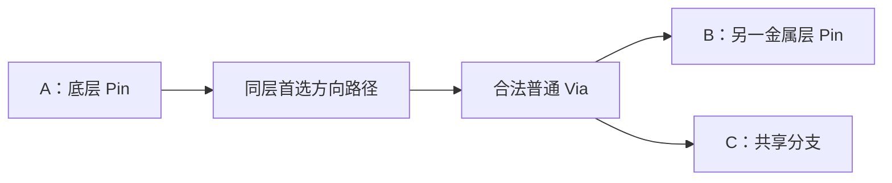

如果 C 在 Top Die，还需通过唯一合法 TSV。不能将所有金属层直接用任意竖线连接：

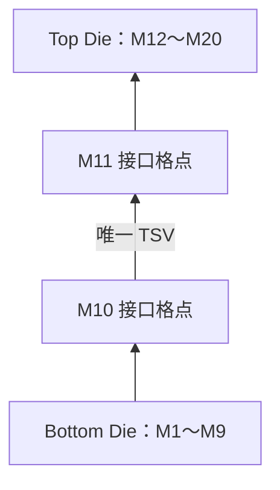

### 1.3 从输入到评分

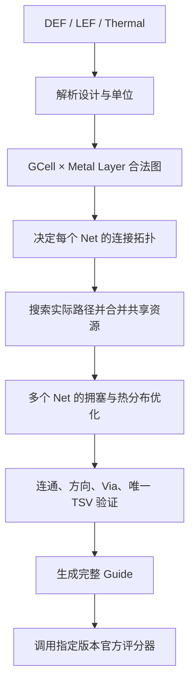

全部 Pin 连通只是可行性条件。很长的绕路、集中使用同一格层、较差的 TSV 分布，都可能让合法结果的评分很低。内部验证、官方 PASS、真实详细布线签核也是不同层次的结论。

<a id="version-2"></a>
## 2. 算法整体演进：V1 → V2 → V3

V1 首先解决“能否完整合法布线”：用 Prim Minimum Spanning Tree 决定终端拓扑，再逐树边运行 A*，加上独立 TSV 选址和拥塞重布。

V2 主要解决“相同决策能否更快、更省内存”：保留拓扑、代价和 Tie-Breaker，减少哈希分配、几何计算、热图扫描和全量 Route 复制。因此 V2 的效率收益不能被描述为 Steiner 拓扑收益。

V3 的正式研究方向是改变质量决策：主动加入 Steiner Point，用真正的目标集合搜索接入已有树，通过动态资源价格协调多个 Net，并在全局 TSV 密度下评估移动。它仍属于 V3，不将未完成部分改名为 V4。

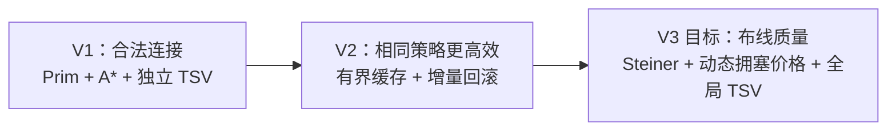

**当前边界**：旧 `build/router_v3_final` 是 V2 主体加占用图清理，SHA256 为 `211fdc3e7b422c032685728a1a4df5d10fd3be406b009e06e0e0e79a928a74bd`，已保留原字节归档到 `outputs/development/router_history/router_v3_final`。它不是 V3.1，不能改名冒充新架构。

| 身份 | 二进制 / 配置 / 规范 Label | 实际含义与状态 |
|---|---|---|
| V1 | `router_v1`；配置按历史实际选择 | Prim MST + A*；保留已验证 SHA256 |
| V2 | `router_v2`；保留 default/default2 历史配置 | 主要策略相同，效率优化；不为统一名字复制一个 V2.1 |
| V3.1 | `router_v3_1` / `v3_1.json` / `v3_1` | Steiner、多目标、单 Net 协商、全局 TSV；独立 Git 重建核对的研究基线，非自动推荐发布 |
| V3.2 | `router_v3_2` / `v3_2.json` / `v3_2` | 本轮热点多 Net 联合重布；发布与评分状态见第 8.6 节，不能仅因文件存在就写 VERIFIED |

V3.1 从 `452d2a1` 的已提交源码独立重建两次，SHA256 均为 `e7f9ae4a6aeda89b940940f6a3dbc097aaedef636cd39fa8f10d04c31bedd62f`，与上轮 guarded Linux 构建及三用例报告一致，才建立数字身份。旧记录实际 Label 仍为 `gen_20261030_guarded_linux_new_v3`：本轮不复制 Guide、不改历史 run.json，也不声称已经存在新的 `case001/v3_1` 正式运行目录。登记保存历史对应关系，新的 `v3_1` 是规范运行名。

V3.1/V3.2 的基础配置字节与原 v3_final.json 相同，SHA256 都是 `9b5988776c80c8dd3f4e1eaea608ad614d571d621e19379d7e177a2372cb58b4`，没有靠调参制造对照。另一个历史目录 `case003_v3_1` 的实际 Router SHA256 是 V1 的 `70ddc978…`，不会凭该 Label 将它记成 V3.1 成绩。

<a id="version-3"></a>
## 3. V1：Prim MST + A* 基础全局布线

### 3.1 搜索图怎样构成

一个节点为 `(x_index,y_index,metal_layer)`。同层相邻 GCell 只沿该层的首选方向连接；同 XY 的相邻层，只有 LEF 允许时才存在普通 Via 边。Bottom 和 Top 不在一次普通搜索中相互穿越，由选定的 TSV 单独接通。

温度样本先按 XY 投影、平均，再映射到 GCell。没有样本的区域按当前代码做确定性填充，因此这是本地热近似，不应直接拿本地 Pearson 代替官方 Thermal Score。

### 3.2 Prim MST 怎样决定多 Pin 连接

输入是同一 Die 的终端格点。顶点是终端，不是全图的每个 GCell；每对终端用中心间曼哈顿长度和层差下界定权。Prim 从一个终端开始，每次加入连接到当前树代价最小的未选终端，直到得到 P−1 条拓扑边。

$$
w(i,j)=w_{wire}\frac{|x_i-x_j|+|y_i-y_j|}{unit}+w_{via}|l_i-l_j|.
$$

x、y 为 GCell 中心的 DBU 坐标，l 是金属层编号；unit 是用于归一化的网格长度，两个 w 分别是配置中的线长和换层权重。这个权重没有计算真实障碍或动态拥塞。

在 A=(0,0)、B=(10,0)、C=(5,10) 的理想二维例子中，AB=10、AC=BC=15。Prim 先选 AB，再选 AC 或 BC，总拓扑长度为 25。它没有把新点 S=(5,0) 加入候选，因此不能主动得到长度为 20 的三分支 Steiner 树。

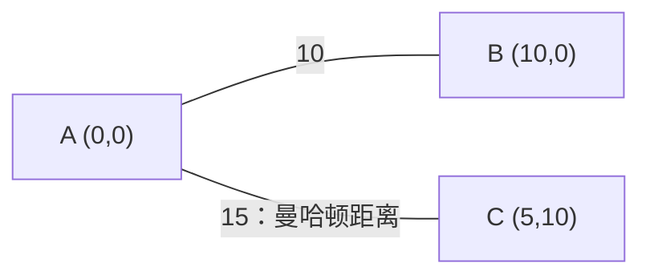

本实现用稠密 Prim：P 次选点，每次扫描至多 P 个点，时间 O(P²)，辅助空间 O(P)。它比构建完整候选边表更省存储，但高 Pin Net 仍可能耗时。MST 只说明“A 应该连接 B”，并没有给出可以制造或合法布线的具体路线。源码定位：`mst()`。

### 3.3 A* 怎样将拓扑边变成路径

Open Set 是等待展开的状态优先队列。g(v) 是从起点到 v 的已知最小累计代价，h(v) 是到目标的非高估下界，f(v)=g(v)+h(v) 决定展开优先级。当前实现没有必须永久封闭的 Closed Set，而是保存最优 g、丢弃过时队列项；发现更优代价时可再次入队。

$$
c(u,v)=b(u,v)+w_c\left(\frac{\max(0,U_v+F_v+1-C_v)}{\max(1,C_v)}\right)^2+w_hH_v.
$$

b 是同层几何长度代价或普通 Via 代价；U、F、C 分别为目标资源的路由需求、固定需求和容量；H 为此前迭代积累的拥塞历史，w_c、w_h 是拥塞和历史权重。各项非负。旧式搜索使用“一次新增占用”的近似；跨 Die 接口的完整计费仍由最终 `occupy()` 处理。

$$
h(v)=w_{wire}\frac{|x_v-x_t|+|y_v-y_t|}{unit}+w_{via}|l_v-l_t|.
$$

t 是固定目标。忽略非负的拥塞与历史项，得到可采纳下界；它不保证本地固定需求模型等同官方模型。搜索先在终端包围盒加 margin 的窗口内进行，失败才扩大窗口。因而“在当前窗口最优”不等于“完整芯片图全局最优”。

例如 A 在水平层、B 位于更高的垂直层：A* 可沿水平层前进，到有合法 Via 的格点换层，再沿垂直层到 B。命中目标后沿 parent 回溯，反转得到路径。找不到路径、超出展开预算或全局时间预算时，明确报错，不生成假路径。源码定位：V1 `search()`，当前兼容实现 `search_impl()`。

### 3.4 一条多 Pin Net 的完整布线

先映射全部 Pin 的格点，按 Die 分类并去重。对每个 Die 的终端建立 Prim MST，依次对树边运行 A*。把搜索结果放入节点和边的集合，合并重复分支；这能共享已经重合的路径，却不等于主动选择了 Steiner 分支点。

之后沿层首选方向合并连续 GCell 生成 Guide。接口层保持独立访问格点，避免把多个 TSV 候选合成长条。内部 `validate()` 检查连通、Pin 覆盖、方向、合法 Via、边界与唯一 TSV，然后才将整条 Net 加入 Usage。函数定位为 `route()`、`make_guides()`、`validate()`、`occupy()`。

### 3.5 跨 Die 与唯一 TSV

跨 Die Net 先选一个 M10/M11 同 XY 的接口锚点，把下端作为 Bottom 树的终端，上端作为 Top 树的终端，再加唯一 TSV 边。跨 Die Net 的 M10/M11 不允许沿接口层横向游走，否则很容易出现多个可判定重叠 TSV。

如果 M10 和 M11 的 Pin 固定了相同 GCell，就必须使用该位置；多处固定重叠存在歧义时拒绝。其余情况在 Pin 位置和 Pin 包围盒内的限量采样点中选择，考虑平均终端距离、接口需求、冷点惩罚。温度较高的区域可能有热收益，但更长的连线和拥塞也会增加代价。

例如把 TSV 从两个 Die 的共同中间点移到很热的角落，可能提高热相关性，却同时增加两侧连线。这解释了为什么独立 `select_tsv()` 不等于全局热最优。

### 3.6 多个 Net 为什么需要重布

先布的 Net 可能占住最短走廊，后来的 Net 在同一资源上叠加需求。例如容量为 2 的格层被三条 Net 使用，即出现 1 单位 Overflow。Rip-up 先拆掉一条 Net 的旧占用，Reroute 在其余 Net 的真实占用下重新寻路，可能改走另一条走廊。

每轮给过载资源增加 History Cost：即使当前暂时空闲，下一条 Net 仍会记住它曾经拥塞。V1 一轮重布完成后，只有**整体本地 Overflow 严格下降**才保留，否则恢复旧 Route。历史惩罚继续保留，不能误认为全部状态都回到上轮。

这仍可能停在局部最优：两条 Net 同时交换走廊才有收益，逐条或整轮的局部规则不一定找到它；本地 Overflow 下降也不保证 Guide 的官方线长提高。

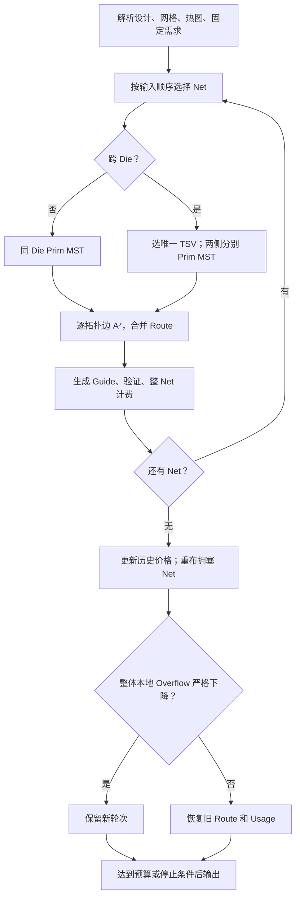

<a id="version-4"></a>
## 4. V2：高性能 A* 与工程优化

### 4.1 策略相同，存储方式不同

V1 每次搜索新建稀疏哈希表，存储 g 和 parent。对于只访问很少状态的大窗口，这种 Sparse Workspace 很合适；对于每次都搜索类似的小区域，哈希和反复分配就成了额外成本。

V2 先计算局部窗口大小：若状态数不超过 8192，使用可复用 Dense 数组；否则回到 Sparse。Dense 通过窗口内坐标直接定位槽位，避免哈希，不为整个芯片的所有层分配数组。

Generation ID 类似“这一轮的有效印章”：新一轮只增加代号，只有带当前代号的槽位才有效，不必清空数组。例如上次槽位 10 的 g=3，代号为 7；本次代号为 8，就把它当成未访问。代号回绕时才真正清标记，防止陈旧路径混入。

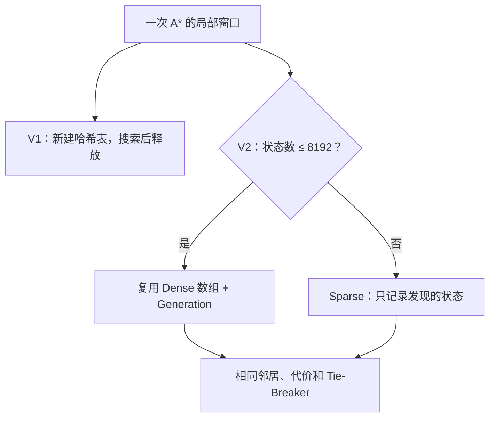

### 4.2 把不变的几何与容量移出内循环

每次 A* 展开都可能访问 GCell 中心、层方向、Via 规则和容量。如果重复构造矩形、查询 map 或扫描 Track，即使每次只多做少量操作，数万次展开也会累积。

V2 预存 X/Y 轴中心、20 层方向与相邻 Via 合法标记。容量只依赖该层的正交轴位置，因此按轴缓存 Track 数；总缓存限制为 8 MiB，超限回到原计算。直接测试接口允许修改公开 Design，相关缓存必须刷新，不能把运行期间的冻结假设泄漏到外部调用。

### 4.3 TSV 加速没有改变 TSV 策略

V1 对每个跨 Die Net 重扫全热图求温度范围。V2 在一次 run 内只计算一次范围，并将候选组织为 vector、排序去重，减少容器与重复扫描开销。候选评分和固定 TSV 规则保持一致，所以速度提升不是“实现了全局 TSV 优化”的证据。

### 4.4 Move 与增量回滚

V1 重布前复制整组 Route。假设有 1000 条 Net，仅 10 条需要重布，复制其余 990 条没有必要。

V2 只在真正修改某条 Net 时，将旧 Route Move 到包含原 Index 的 Backup，再拆除其占用。候选拒绝、无路、超时或异常时，先释放新占用，再 Move 回旧 Route，按整 Net 恢复 Usage 与 TSV 附加需求。恢复过程不依赖当前排序恰好等于原输入顺序，也尽量不进行会再次失败的 Trace 分配。

正常提交后只保留新 Route；回滚不是重新运行一次 A* 来“猜回”旧路径。这个区别对可重复性和内存峰值都很重要。

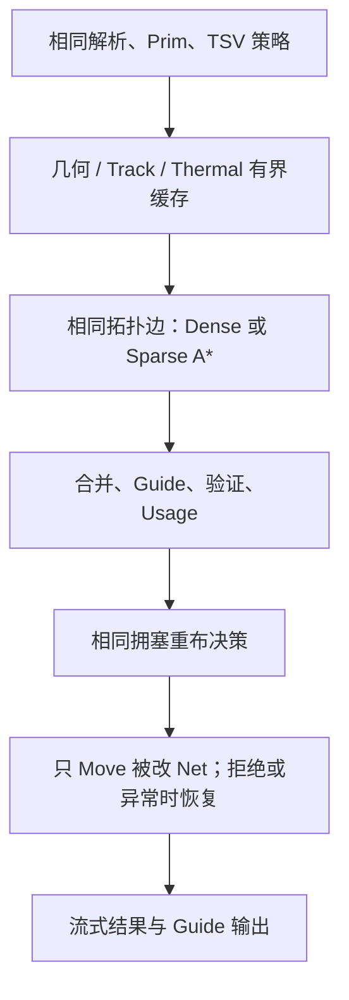

### 4.5 怎么阅读 V2 的性能证据

受控 A* 夹具的展开数保持 53400，routing 中位时间由 0.0949008 s 到 0.0557863 s；TSV 夹具由 0.365051 s 到 0.0708347 s。这说明减少重复工作确实有效，但合成夹具不能外推大型 Case 的倍数。

历史 case001 单次 V1/V2 为 104.262 / 53.1971 s，Guide 与官方指标相同。case003 曾有输出阶段与 WSL 评分诊断问题；后续流式输出成功不等于其官方评分已经成功。case005 的 V2 记录为 179700 Net、约 5919.766 s、约 4.424 GiB 采样峰值，只证明当时预算和参数下完成 Router。线上快速评分 52.66 是另一种实验口径，不与不同参数的本地 case001 分项直接比较。

<a id="version-5"></a>
## 5. V3：Steiner 与全局协同优化

### 5.1 从独立连线，改为逐步生长一棵树

Prim 只允许原 Pin 成为拓扑顶点。它容易求解，但不知道在两个 Pin 之间主动设置共享分支点。V3 先尝试有限的 Hanan Grid 候选：取终端的 X、Y 坐标交叉组合，在合法金属层上试放新的 Steiner Point，再比较加入这个点后的树长。

仍用 A=(0,0)、B=(10,0)、C=(5,10)：终端 MST 可选 AB=10、AC=15，总长 25；加入 S=(5,0) 后，AS=5、SB=5、SC=10，总长 20。

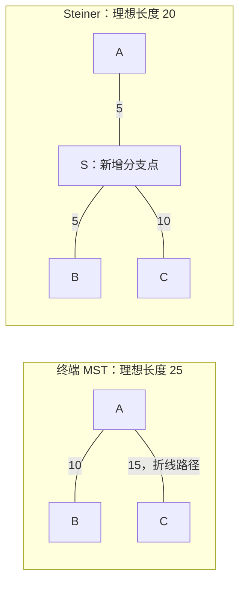

这只是二维无障碍模型；真实路径要满足层方向和 Via，不能承诺减少 20%。独立测试夹具在合法层图中得到实际 Route 25000→20000 DBU，证明新方法确实能产生不同的共享路径；它不是官方成绩。另一测试中，Guide 估计从 47000 降至 41000，但拥塞代价上升，生产保护条件拒绝了替换。容量充足的对应夹具则必须保留新的真实分支点。

实现采用近似方法，没有引入 FLUTE，也不宣称求得精确 RSMT。对每个 Tier，基准是带线长与层差权重的终端 MST；每次尝试一个新点，只有树长严格缩短、该点度数至少为 3 才加入，最多加入两个。后续插入使旧候选降为叶节点时会清理它。

Hanan 候选只允许终端所在主层或最近的相反方向合法层。随后在真实三维图中逐分支寻路，验证普通 Via、Tier 隔离、全部 Pin 连通和唯一 TSV。**拓扑点不是任意层间连通的许可证。** 最终 Route 记录实际映射且仍保留的 `steiner_topology_nodes`；候选数量和最终保留数量分别统计。

为防止高 Pin Net 爆炸，单 Net 最多 16 个 Pin、96 个候选、两个新增点，软预算 0.5 秒。超过限制、搜索不可达或局部预算不足时，回退原终端 MST；全局 Router 超时仍向外报告，不能伪装成成功。对应 `steiner_topology()`、`route_steiner()` 和 `route()`。

### 5.2 怎样接入已有树：精确目标集合下界

V2 对每条 MST 边独立点到点搜索，已经走过的分支不能自然成为任意接入点。新流程维护**已经连通的树节点集合 T**，让下一终端搜索到其中任意节点；尚未连接的 Pin 不能提前放入 T，否则搜索可能在不完整的树上结束。

启发值采用目标节点的精确加权 L1 最近距离：

$$
h(v)=\min_{t\in T}\left[w\frac{|x_v-x_t|+|y_v-y_t|}{u}+c_{via}|l_v-l_t|\right].
$$

x、y 是物理 DBU 坐标，u 是每 µm 的 DBU 数，l 是金属层号，w 和 c 是配置中的基本线长、Via 权重。忽略障碍、方向限制和非负拥塞代价后得到距离下界，所以不会高估当前图中的剩余费用。

例如 T={(0,0),(10,10)}，查询点 (0,10) 位于整个集合的包围盒内。旧包围盒下界为 0，精确最近点距离却是 10。新实现用带子树边界的 KD Tree 剪枝求精确最近距离，避免把大片空白区域当成已有布线。

每找到一条真实路径，就把它合入树并按 Net 去重。接入终点已由本 Net 的已连通树占用，不重复加它的资源惩罚，移动和 Via 基础费用仍然保留。只有两个不同终端时直接保留点到点 A* 的方向与 Tie-Breaker，不构造无意义的 Steiner 候选。

这是**单源到多目标**搜索，不是已经实现了双向多源多目标算法。目标集合最多 65536 节点，每次新搜索最多展开 50000 节点，仍受总时间和原搜索窗口约束；KD 查询最坏仍可能遍历很多目标。`search_multi()`、`L1TargetIndex` 与 `search_impl()` 实现此过程。独立 Dijkstra 在非均匀小图、不同价格阶段逐起点核对实际路径代价，不拿新 A* 自己当 Oracle。

### 5.3 拥塞价格：惩罚新增需求，而不是只看旧总量

旧代价对单格使用归一化过载平方，但固定需求统计误差会让不可改变的基线主导搜索。新候选模型单独投影真实 Pin/OBS 到 Track，合并重叠区间；原有 `Resource.fixed`、占用统计与 `overflow_local` 不变。校准证据及残差见[第 7 章](#version-7)。

设 C 为容量、U 为当前路由占用、F 为投影固定需求、d 为这次新增需求，定义：

$$
\phi_v(U)=\left(\frac{\max(0,U+F-C)}{\max(1,C)}\right)^2,
$$
$$
c_{price}(v,d)=c_{cong}\left[p_k\{\phi_v(U+d)-\phi_v(U)\}+0.05\min\left(1,\frac{U+F+d}{\max(1,C)}\right)^4\right]+c_{hist}H_v.
$$

p_k=1+k 是第 k 轮的当前拥塞价格倍率，H 是历轮归一化过载累积。固定需求、Usage 均非负，因此新增代价非负；A* 仍用基本距离作可采纳下界。普通格 d=1；本地 TSV 接口按现有附加计费模型取 d=2。容量零用 1 作数值分母只是候选代理，不是声称掌握了官方特殊规则。

例如同样新增 1 单位需求，容量 5 且已满的格比容量 50 且已满的格产生更大归一化代价。多轮拥塞反复出现时，History 让它持续变贵，Router 才有理由探索其他路径。

早期阶段 B 将这种价格直接用于初始布线，case001 虽缩短线长，却使官方 Overflow 从 8337 增到 9306。最终候选因此保留稳定初始成本，只在协商重布和全局 TSV 试探中启用新价格。价格模型由 `v3_fixed()`、`v3_penalty()`、`v3_marginal()` 实现；固定需求缓存最多 200000 项，达到上限后继续计算，不截断需求或路径。

### 5.4 Negotiated Congestion：拆除、重新定价、尝试与回退

初始全部 Net 布完后，资源竞争才完全可见。每轮先根据当前占用增加 History，再按**能够移走的过载贡献**排列候选 Net；必经 Pin 和不能在该阶段移动的 TSV 不作为可消除的热点收益。

对选中的 Net，先 Move 保存旧 Route，释放它的占用，在其余 Net 保持不变的资源图上重新寻路。完成后生成新 Guide，并比较线长与归一化拥塞增量。接受时更新占用；拒绝、不可达或预算耗尽时恢复旧 Route。失败候选冷却一轮，避免反复支付相同搜索成本。

例如一条 Net 绕过两行再穿越拥塞格，拆除后发现直达通道可用。新测试要求重布产生旧 Route 以外的新节点、降低 Guide 代价、恢复正确 Usage；只删除原路径的一部分不算通过。

当前采用保守的联合保护：Guide 估计线长不增加，归一化拥塞潜能在 F 与 F+1 两种需求近似下均不增加，且至少一项严格改善。F+1 来自已观察到的残差，是经验风险保护，**不是全设计误差界的证明**。初始多 Pin Steiner 候选也和相同资源状态下的原拓扑参考方案作这一比较。

每轮最多 128 次试探、20 秒、100000 个备份节点；软预算停止当前轮并恢复当前试探，已接受改善保留。异常则恢复整轮已改 Route 与 Usage。History 有意作为搜索记忆保留。无接受时提前结束，最大轮数仍为共享配置的 `iterations`。

这是具有动态 Present/History 价格的有界全局重布，不是把旧 `reroute_pass()` 重命名。它也不是保证全局最优的完整 PathFinder 求解器：逐 Net 的非退化限制可能阻止需要暂时变差的联合交换。对应 `negotiated_round()`；新测试覆盖成功替换、TSV 附加 Usage、失败提交、软预算和整轮异常回滚。

### 5.5 Global TSV：比较联合密度，再真实重布两侧

逐 Net 选冷点或热点都不能直接优化全局相关性。例如两个 TSV 都挤到同一个高温格，密度方差会改变；把其中一个移到另一高温格，可能得到更好的整体 Pearson。必须评价**所有 TSV 的联合密度**，不是只看目标格温度。

令 h_i 为格 i 的非负温升、d_i 为 TSV 数量、N 为全部热网格数。维护五个和即可评价 Pearson：

$$
r=\frac{\sum h_i d_i-\sum h_i\sum d_i/N}{\sqrt{(\sum h_i^2-(\sum h_i)^2/N)(\sum d_i^2-(\sum d_i)^2/N)}}.
$$

从 a 移一个 TSV 到 b 时，温度总和与 TSV 总数不变，只需更新：

$$
\Delta\sum d_i^2=2(d_b-d_a)+2,\qquad \Delta\sum h_i d_i=h_b-h_a.
$$

`DensityCorrelation` 用这些充分统计量按常数时间比较移动，再由全量 Pearson Oracle 校验。分母为零的退化分布按实现约定处理，不把它当作测得的热改善。

热图必须采用官方使用的完整原始 GCell 轴，含 Die 外尾部格。仅用旧 UI 的裁剪热图会把 toy 的 41×41 误缩成 23×23，也会在 case001 改变填充顺序。新热投影独立从真实 Thermal 输入构建：先同行插补，再纵向填补，保留原 UI/本地热统计语义。三用例逐格对照官方热 CSV 后，最大误差分别约 4.45e−9、7.11e−15、3.55e−15；生产运行不读取官方输出热图。

全局阶段先识别固定接口：同 Net 的 M10、M11 Pin 必须落在同一 GCell 时，该 TSV 不移动。其他 Net 生成 Pin、中位点和原位置附近的有限候选，用联合相关性的边际收益排序；每次实际接受后重算其他候选收益。

每个候选都要释放旧 Route、强制新 TSV、**在 Bottom 和 Top 两侧重新布线**，再验证唯一 TSV、Guide 和占用。只接受相关性严格提高且线长、两种拥塞近似均不退步的方案；拒绝即恢复，整阶段异常回滚。不能只改 TSV 坐标。

本阶段最多 32 次真实重布、16 次移动、20 秒、100000 个备份节点；每 Net 最多检查两个已排序位置，超过 64 Pin 跳过移动。热图最多 1000000 格、2000000 样本，超限保留逐 Net TSV，明确记录原因。候选数和这些限制控制额外工作，不限制最终输出 Net/Pin/Guide。

阶段 C 的 case001 实际接受 10 次移动，官方 Thermal Score 从阶段 B 的 51.636915 提高到 53.270988；sample001 的三个 TSV 都固定，不能移动。该结果证明全局阶段曾产生真实收益，不代表整体已优于 V2。最终修正版和完整权衡见[第 8 章](#version-8)。

### 5.6 完整运行顺序与实现状态

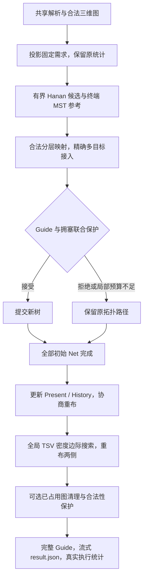

四项新模块已实现并分别做小图测试和三用例官方调用。尚未实现精确 RSMT、双向多源搜索、全局联合 Net/TSV 交换或有证明的官方固定需求模型。最终发布状态单独判断，不把候选源代码等同于已有正式二进制。

源码定位：`src/router.cpp` 的 `route/search_impl/run/load_thermal` 接入新流程；`include/router_v3_impl.hpp` 实现拓扑、目标集合、价格、协商与 TSV；`include/v3_algorithms.hpp` 提供精确 L1 索引和增量 Pearson。仍通过原有三个生产翻译单元构建，不新增库依赖。

`result.json.v3_algorithm` 记录真实候选数、搜索次数/展开数、每轮接受拒绝数、TSV 移动数及回退原因。`steiner_points_proposed` 是重复试探总量，不能说成最终独立分支数；最终保留数量看 `final_mapped_steiner_topology_nodes`。没有实际执行的多目标/协商/TSV 阶段不能统一标为成功，固定 TSV、预算和 MST 回退均有独立计数。

<a id="v3-2"></a>
### 5.7 V3.2：Hotspot-Based Multi-Net Negotiated Rerouting

#### 为什么 V3.1 的逐 Net 协商容易停滞

上轮 case001 第一轮只尝试 122 条 Net、接受 29 条，第二轮 9 次全部拒绝。旧条件要求每条候选同时不增加线长和两种拥塞潜能。若 A 必须先绕路，B 才能占用释放的短通道，单独检查 A 就会拒绝它；只调大拥塞权重不能消除这个事务边界。

V3.2 将决策单位改成一组互相竞争的 Net。它保留初始 Steiner、多目标搜索、后续全局 TSV 和 Guide 清理，主要替换中间的协商阶段。组内允许单条 Net 暂时变差，只有整组全部重新连通并满足全局质量保护后才提交。

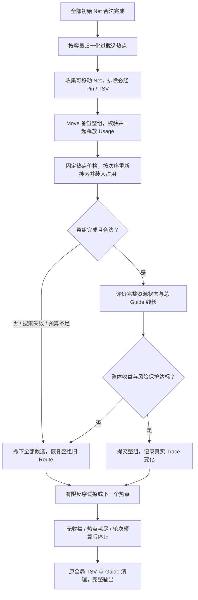

#### 热点怎样确定，哪些 Net 可以参与

仍用校准的固定投影 F、当前 Usage U 与容量 C，按容量归一化潜能排序：

$$
P_v(U)=\left(\frac{\max(0,U+F-C)}{\max(1,C)}\right)^2,\qquad B_v=P_v(U)-P_v(0).
$$

B 表示路由需求在已有固定基线上增加的潜能，避免只按原始 Overflow 排序。相同 Overflow 下，低容量资源通常更值得优先协调。它是本地代理，F 的残差不会因为使用这个公式而消失。

实现用大小不超过 2048 的堆保存热点，扫描 Route 一次，为每个热点最多保留 16 个可移动 Net 索引。Net 的必经 Pin 与实际 TSV 两端排除在可移动集合之外；不能因为一条 Net 经过热点，就认定它有替代路径。没有合法替代路径时，整组试探会拒绝并恢复。

每组选 2～8 条 Net，优先较长的现有 Route；第一次失败时最多尝试反向顺序。已试组去重，每条 Net 每轮最多参与两组。这是两个有限次序的搜索，不是完整 Beam Search 或无界排列枚举。每轮重新建立热点，上一轮新路线产生的资源竞争才会进入下一轮索引。

#### 联合拆线与统一价格怎样工作

先汇总整组在各格层的真实需求，校验 Usage 足够扣除，包括共享 GCell 按 Net 分别计费、TSV 两端的额外单位。然后 Move 保存完整 Route、Nodes、Edges、Guides、TSV 和 Steiner 元数据，一起释放占用。

组内重新布线时，先完成的候选会装入真实 Usage，后续 Net 因而看到前者的选择。除现有 Present/History 代价外，保留拆线前热点的稀缺价格：

$$
t_v=\frac{w p}{u}(1+k)\min\left(4,\frac{O_v}{\max(1,C_v)}\right).
$$

w 为线长权重，p 为名义格间距，u 为 DBU/µm，k 为协商轮次，O 为本轮完整资源状态的过载。这个非负价格在一轮内冻结，避免整组拆除后热点暂时变空，所有 Net 又立即挤回同一位置。History 在轮间继续累积，实际 Usage 在组内逐 Net 更新；A* 的基本距离下界保持可采纳。

V3.2 还收紧搜索需求含义：动态价格只在真实强制 TSV 的 M10/M11 端点额外计单位，其他接口 Pin 不自动当成 TSV。原 `occupy()`、Capacity、Pin/OBS 固定统计以及 V1/V2/V3.1 行为不因此改写。

原 `route()` 的逐 Net 联合保护只在事务内部暂时让开，初始布线和事务外的 TSV 试探继续保留保护。每条跨 Die Net 强制使用自己的旧 TSV，组内不移动任何 TSV，热相关性的增量因此为零。

价格覆盖也有边界：高 Pin 数或局部预算触发的旧拓扑回退仍保留旧搜索费用，不能声称每条组内 Net 都采用了新价格。回退由实际计数记录，这是后续需要改进的覆盖范围，不以策略名称掩盖。

#### 怎样评价整个资源状态

不能把多个 Net 各自的边际代价简单相加：平方过载是非线性的，共享同一格层时会漏掉竞争项。V3.2 在整组占用装入后，重新扫描**全部已物化资源**，计算全局潜能、F+1 不确定性潜能、原始校准 Overflow 和热点数，再与整组开始前比较。Guide 线长则用去掉旧组、加入新组后的全设计总量。

Router 不能从原始 Pin HPWL 精确恢复外部评分器的 Wirelength 参考量，因此没有冒充官方 Q。组选择采用明确标记的相对线长代理：

$$
W_{rel}=100\frac{L_{start}}{L},\qquad C_{proxy}=\frac{100}{\sqrt{1+0.01\sum_v P_v(U)}},\qquad
\Delta Q_{proxy}=0.45\Delta W_{rel}+0.30\Delta C_{proxy}.
$$

L_start 是本轮开始的全设计 Guide 估计线长，L 是当前候选总量。热项不变，不需要伪造一个热分数。这种相对归一化不等同于官方 Wire Score，所以最终收益仍由唯一一次真实评分判断。

接受条件是：全局潜能严格下降，F+1 潜能及校准原始 Overflow 不增加，代理加权收益为正，总线长不超过本轮开始的 1.0025 倍。允许的是**整组内部的损失与收益交换**，也允许受控的小幅总线长取舍，不再要求每条 Net 各自改善。两轮预算下线长上界可能累积到约 1.005 倍，不能把 0.25% 当作整个程序绝对界；后续 TSV/Guide 阶段仍有各自保护。

#### 为什么回滚能够覆盖部分成功

原路线先完整保存，新路线必须先合法并物化全部资源条目，才安装 Usage，避免内存分配异常发生在加占用的一半。失败时按相反顺序撤下已装入的新路线、恢复所有旧路线，回滚不重新寻路，也不需要重新分配旧资源。Trace 的 `net_removed/net_added` 只在整组成功后发出；`hotspot_net_trial` 明确表示试探，不伪装成已提交布线。

搜索不可达、展开超限和局部预算会拒绝整组；全局超时、内存异常、Trace 错误恢复当前组后继续向外报错。此前已提交的其他组保持合法，不把硬错误伪装成官方 FAIL 或成功完成。热点统计来自 `v3_algorithm.hotspot_batches`，候选质量全部标为 `official_metrics:false`。

核心事务夹具让一条 Net 绕远，却使整组 Guide 从 **31000→25000 DBU**、全局潜能下降。独立按最终各 Route 重算共享 Usage，而不是拿生产的 `occupy()` 当 Oracle；另覆盖反序、重复 Net、部分成功后搜索超限、软预算、全局超时、内存/Trace 异常、固定 TSV 的双单位恢复，以及真实 Steiner/Via 元数据恢复。这个夹具证明联合决策与旧逐 Net 接受不同，不是公开 Case 的成绩。

#### 复杂度和停止条件

每轮最多 64 个不同组、每组两个次序、每组 2 秒、整轮重布 20 秒；每组最多备份 20000 个节点，索引扫描最多 2000000 个 Route 节点，热点和 owner 还有上述硬上限。没有组被接受就提前终止，最大轮数仍取共享配置的 iterations=2，不新增调参 JSON。

构建热点约 O(R log 2048)，扫描 Route 约 O(N_route_nodes)，每次质量检查 O(R)，R 是已物化资源数；主要成本仍是组内 A*。这些限额控制新增工作，不截断最终 Net/Pin/Guide。大用例超过索引预算时记录原因并保留已有合法方案，本轮未自动验证 case003/005。

实现位于 `hotspot_round()`、`reroute_group()`、`batch_quality()`，由 `Router::run()` 在 `GR_V3_FINAL + GR_V3_2` 构建下实际调用；不是给原 `negotiated_round()` 换名。真实 case001 结果见[第 8.6 节](#v3-2-results)。

本轮开发按 Steiner 路径闭环、拥塞校准、协商价格、全局 TSV 的顺序推进。阶段实现、测试和负结果完成后在此更新；目标图中的节点不自动表示已经实现。

<a id="version-6"></a>
## 6. 三个版本的完整布线过程对比

从同一组输入出发，V1 决定“先连接哪两个终端”，V2 加速同样的决定；新 V3 候选额外决定“是否新增分支点、接入已有树的哪里、哪些 Net 应重新让出资源、哪个 TSV 移动能改善联合分布”。三者最终都必须输出全部合法 Guide。

| 维度 | V1 | V2 | 本轮新 V3 候选 |
|---|---|---|---|
| 连接拓扑 | 终端 Prim MST | 相同拓扑 | 有界 Hanan 插点；超限或质量不佳回退 MST |
| 路径搜索 | 点到点 A* | 同代价的 Dense/Sparse A* | 双终端保留旧搜索；多终端精确目标集合接入 |
| 多 Net 竞争 | 本地 Overflow、History、Reroute | 相同策略，增量备份回滚 | V3.1 逐 Net 协商；V3.2 按热点组联合拆线和接受 |
| TSV | 单 Net 的长度/热偏好选址 | 同策略，复用计算 | 联合密度 Pearson 边际搜索，真实重布两侧 |
| 质量保护 | 内部连通与合法性 | 保持旧决策 | Guide 线长、近似拥塞、热收益联合条件；仍须官方核验 |
| 主要收益 | 完整可行结果 | 运行效率与较低复制成本 | 已证明部分策略能改变真实路径和热分数，综合收益尚需发布门槛判断 |
| 可使用状态 | 已验证归档 | 稳定基准 | 源码候选；正式入口是否升级见第 8、10 章 |

第 3.6、4.4 节及第 5.6 节分别给出三个完整流程图。下面并列压缩，便于讲解输入到输出的区别：

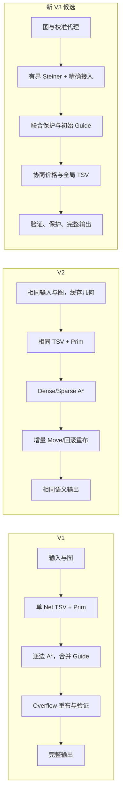

旧 Final 的占用子图清理仍可复用，但它不能重新寻找子图外的路径或移动 TSV。新候选中的重布和 TSV 测试要求产生真实的新路径，正是与旧 Final 的结构区别。

<a id="version-7"></a>
## 7. 官方评分机制与优化目标

当前 latest 历史报告说明 Wirelength 是 Guide 矩形 Manhattan MST proxy，Congestion 是 Guide demand / merged DEF track capacity，DRC 仅为 mock-DRT 风险；Thermal 来自外部场。不能把 Guide proxy 的 PASS 当作详细布线签核。

报告列出单用例权重 `wirelength=0.45, congestion=0.30, thermal_tsv=0.25`。仅对同一评分器、同一输入的真实分项，可计算辅助质量：

$$
Q_{aux}=0.45 S_{wire}+0.30 S_{congestion}+0.25 S_{thermal}.
$$

S 是本地官方报告中的各项 Score，Q 是辅助比较，不是线上总分字段。当前报告没有独立总分时，官方总分继续记 N/A。较新规则的归一化拥塞定义与旧版最大 Overflow 代理不一定相同，不能只看原始 Overflow 的绝对减量。

### 7.1 将评分说明与实测报告对应

本地《3DIC全局布线评分程序评价标准说明_20291011.docx》给出 S1/S4 合法性与效率门槛、公开/隐藏排名折算，以及单用例的三项质量权重。文件名中的日期只作为资料身份，不推断其实际发布日期。本轮沿用现有 latest 二进制，SHA256 为 `4104d0b2869ef7376d716ce9c33b56668e659575ab84615f5c0a5f282e108a8a`，没有切换评分器。

对容量非零的溢出格层，说明中的公式为：

$$
S_C=\frac{100}{\sqrt{1+\sum_v (0.1 O_v/C_v)^2}}.
$$

O 是官方该格层 Overflow，C 是官方 Capacity。它惩罚的是容量归一化过载，不只是原始 Overflow 总量。同样新增 1 单位 Overflow，容量 5 的格比容量 50 的格更昂贵。容量零的特殊惩罚没有在本轮样本中覆盖，不自行猜成官方的确定常数。

直接读取六份历史官方 CSV 重算后，toy、sample001、case001 的 Congestion Score 分别复现为 91.903663、73.384785、78.037198，浮点误差约 1e−13。CSV 只列拥塞行；这一验证不能证明未报告的非拥塞格的固定需求已经对齐。

### 7.2 Guide 线长：从不准确代理到可验证重建

旧的矩形中心 MST 估计在 case001 低估约 39%，不能可靠保护官方线长。根据说明及现有完整 Route/Guide，改用下面的候选质量模型：

$$
L_G=\sum_{v\in R} p_{direction}(v)+3p\,N_{via,guide}+6p\,N_{TSV}.
$$

R 是同 Net 去重的被 Guide 覆盖格层；水平层累加格宽，垂直层累加格高，均为 DBU。p 取第一个 X、Y 格间距的较大值作为本设计名义间距，不是扫描全部非均匀格后的最大宽度。`N_via,guide` 按下层 Guide 是否与上一相邻层的某个 Guide 真正重叠计一次，M10/M11 单独按 TSV 处理。这里的 3、6 来自当前说明与工具口径，不是把 Router 搜索用的 `via=1, tsv=4` 配置偷偷改掉。

独立重建六份历史结果：toy 29296600、sample001 6452400、case001 V2 840537000、旧 Final 839721000 DBU，与各自官方值一致；前两个 Case 的 V2/Final 分别重复核对。详见[校准数据](./EDA/code_3DIC%20EDA/outputs/reports/v3_generation/20261030_research/quality_calibration.json)。这验证了当前生成 Guide 和这些规则化网格上的适用性；任意外来 Guide、复杂非均匀格、未来评分器仍需独立验证。

### 7.3 固定需求仍有不确定性

旧 case005 的本地 Overflow=7865225，其中固定基线=7069248、路由增量=795977。Pin/OBS 重叠累计占很大比例，不能把该数字直接当官方拥塞。

既有只读校准将放置后的真实 Pin/OBS 沿 Track 正交方向投影、合并重叠区间，再数真实 Track。case001 历史拥塞行的需求 MAE 从约 46.49 降到 1.00，但大多数行仍有 +1 残差。这是近似模型，不是证明官方少算或多算了一个 Pin；不能据此把所有固定需求减去某个常数。

《评分程序更新说明_20261027》还指出多层 Pin 几何的层归属曾有修复，TSV 按物理占用在 M10/M11 计费。该说明不足以让本项目的简单“两单位 TSV”变成精确的 5 µm 轨道覆盖模型。本轮生产统计继续保留原 `fixed/usage/overflow_local`，候选价格和质量判断另标为近似；实测官方报告才是发布依据。

本地另有 `score-0.5.0官方对齐版.zip`，其 README 自称校准后的本地观察模型，并非官方源码或官方发布版。本轮没有把该名称当成版本真实性证明，也没有修改或切换到它。

<a id="version-8"></a>
## 8. 真实实验与发布判定

### 8.1 同参数、同评分器的控制组

实验保存在 `outputs/reports/v3_generation/`，均使用未改动的 `configs/v3_final.json`，配置 SHA256=`9b5988776c80c8dd3f4e1eaea608ad614d571d621e19379d7e177a2372cb58b4`。CLI 为每次 Router/评分设 180 秒预算，三组共有参数与输入完全相同；不是拿历史 default.json 与 default2.json 混比。

阶段 A 重新运行并评分 V2、旧 Final 和新拓扑；阶段 B/C 及最终修正版复用经配置、输入、二进制、后端和评分器哈希核对的 V2/旧 Final 控制组，只重新运行各自新候选。每个候选都有独立源码快照、构建命令、Guide SHA256、真实评分报告和 Label，不覆盖历史。阶段 A/B/C 是当时源码快照，后续已修正部分决策，不能通过现在的 stage 编译开关宣称字节级复现过去源码。

上一轮架构研究共完成 18 次 Linux Router 和 18 次 latest 评分：控制组 6 次、四个候选快照各 3 次，全部 ROUTED/returncode=0、评分 PASS。toy 与 sample001 的真实 Trace 重放均与最终 Route 一致；case001 未开启 Trace，不能补造过程。本轮 V3.2 的唯一运行单独记录在第 8.6 节，不把旧成绩当作它的成绩。

下面列最终修正版与 V2 的官方指标。旧 Final 在 toy/sample001 与 V2 相同，case001 数据在下一表。线长单位 DBU，Q 是第 7 章的辅助权重和，**不是线上总分**。

| Case / 版本 | 官方线长 | 官方 Overflow | Wire Score | Congestion Score | Thermal Score | Q_aux |
|---|---:|---:|---:|---:|---:|---:|
| toy / V2 | 29296600 | 256 | 56.675263 | 91.903663 | 47.178546 | 64.869604 |
| toy / 新 V3 修正版 | 26589500 | 286 | 62.445420 | 89.386368 | 47.178546 | 66.710986 |
| sample001 / V2 | 6452400 | 453 | 89.551717 | 73.384785 | 51.093892 | 75.087181 |
| sample001 / 新 V3 修正版 | 6452400 | 453 | 89.551717 | 73.384785 | 51.093892 | 75.087181 |
| case001 / V2 | 840537000 | 8337 | 64.920631 | 78.037198 | 51.630648 | 65.533105 |
| case001 / 新 V3 修正版 | 830673000 | 8348 | 65.691544 | 78.065728 | 53.270988 | 66.298660 |

case001 修正版线长比 V2 下降约 1.174%，三个分项均提高，Q_aux 增加约 0.765555。原始 Overflow 却增加 11；这和 Congestion Score 小幅改善不矛盾，因为评分衡量的是容量归一化平方过载。toy 线长改善但拥塞退步；sample001 恢复为与基准相同。因此不能简单写成“全部指标更好”。

### 8.2 独立阶段与失败证据

| case001 快照 | 官方线长 | 官方 Overflow | Wire Score | Congestion Score | Thermal Score | Q_aux |
|---|---:|---:|---:|---:|---:|---:|
| V2 控制 | 840537000 | 8337 | 64.920631 | 78.037198 | 51.630648 | 65.533105 |
| 旧 Final 控制 | 839721000 | 8337 | 64.983718 | 78.037198 | 51.630648 | 65.561494 |
| 阶段 A：Steiner / 多目标 | 839259000 | 8435 | 65.019490 | 77.672262 | 51.630648 | 65.468111 |
| 阶段 B：新增价格与协商 | 812994000 | 9306 | 67.120043 | 74.731449 | 51.636915 | 65.532683 |
| 阶段 C：完整热网格与全局 TSV | 812673000 | 9305 | 67.146555 | 74.739798 | 53.270988 | 65.955636 |
| 修正版：稳定初始成本 + 联合保护 | 830673000 | 8348 | 65.691544 | 78.065728 | 53.270988 | 66.298660 |

阶段 A 虽在线长上微降，却令 case001 拥塞变差、Q 下降；toy 线长也从 29296600 增至 29382200。后来恢复两终端搜索方向，避免将普通点到点路径反转所造成的 Tie-Breaker 变化。这些负结果保留，不把理想 Steiner 例子当成普遍收益。

阶段 B/C 的 toy 线长为 25219900、Overflow=309，sample001 线长为 6577800、Overflow=453。sample 的线长退步、case001 的拥塞退步说明初始全局价格不适合直接替换稳定成本。阶段 C 相对 B 的热改善则来自真实的 10 次 TSV 移动，而不是改报告中的温度值。

最终修正版限制新价格的启用阶段，并让多 Pin 新拓扑和旧参考共同接受 Guide/拥塞保护，sample001 的线长退步被消除，case001 拥塞分数恢复并略高于基准。旧固定计数、Capacity、占用、Overflow 统计公式均未为改善评分而更改。

阶段报告：[A](./EDA/code_3DIC%20EDA/outputs/reports/v3_generation/20261030_stage_a_linux/results.json)、[B](./EDA/code_3DIC%20EDA/outputs/reports/v3_generation/20261030_stage_b_linux/results.json)、[C](./EDA/code_3DIC%20EDA/outputs/reports/v3_generation/20261030_stage_c_linux/results.json)、[修正版](./EDA/code_3DIC%20EDA/outputs/reports/v3_generation/20261030_guarded_linux/results.json)。汇总及发布判断见[comparison_summary.json](./EDA/code_3DIC%20EDA/outputs/reports/v3_generation/20261030_research/comparison_summary.json)。这些是本地实验产物，未跟踪文件不会自动出现在 GitHub。

### 8.3 真实执行了哪些模块

修正版 case001 共 3152 个 Net、657 个 TSV；最终保留 **217 条带映射 Steiner 拓扑点的 Route、261 个映射点**。累计提出 806 个点、712 次带点拓扑，包含被拒绝及重复重布的试探，不能把这两个数当最终独立分支数量。

独立读取最终真实边统计：261 个映射点中，73 个最终度数为 3，分布在 71 条 Net；154 个为度 2 经过点，34 个为度 1 叶节点。拓扑点在三维映射与共享后不一定仍是物理分叉，不能把 261 全部叫作新增真实分支。下一步应在受控预算内消除非终端残留叶，而不是用提案数量掩盖映射后的冗余。

精确多目标搜索实际执行 4476 次、展开 141664 次；两终端直接搜索 2200 次。协商第一轮 122 次试探、接受 29、拒绝 93，第二轮 9 次均拒绝，未继续无收益轮次。全局 TSV 试探 32 次、接受 10 次、拒绝 22 次，估计相关性 0.0028029786→0.0056070975，与官方最终相关性对齐。

MST 回退计数 1025 次：高 Pin 回退 327、联合质量保护拒绝 698；这是过程计数，不是 1025 条不同 Net。没有可改善 Hanan 点时也记录原因。sample001 的 3 个 TSV 全部固定，移动次数为 0；toy 试探 3 次均拒绝，不宣称它获得了全局 TSV 收益。

修正版 Guide 网格线长估计为 830673000，与本次官方值相同；其他两个修正版及阶段 B/C 也核对了估计与实际。拥塞仍是近似，单 Net 保护无法推导“全体最终原始 Overflow 一定不增加”。结果记录保留 `official_metrics:false`，官方指标来自独立报告。

### 8.4 时间、内存与测试范围

下表时间来自各 `result.json.metrics.runtime_seconds`，RSS 来自 Linux Supervisor 的 child wait4/getrusage，MiB=2^20 字节。Windows/WSL 启动和外层 Python 管理时间另存 run.json，不混入 C++ 用时。

| Case / 版本 | C++ 秒 | 子进程峰值 RSS（MiB） |
|---|---:|---:|
| toy / V2 | 0.3805 | 12.906 |
| toy / 修正版 | 0.4530 | 12.770 |
| sample001 / V2 | 0.5276 | 12.820 |
| sample001 / 修正版 | 0.6218 | 12.984 |
| case001 / V2 | 39.8502 | 125.512 |
| case001 / 旧 Final | 44.0275 | 125.711 |
| case001 / 阶段 A | 35.1850 | 125.105 |
| case001 / 阶段 B | 21.9481 | 124.785 |
| case001 / 阶段 C | 31.9408 | 125.043 |
| case001 / 修正版 | 22.6628 | 125.641 |

case001 本轮修正版约快 43.1%，RSS 基本持平且略增；两个小 Case 的时间反而增加。这是单次、同环境观察，不是重复统计基准，更不是大型 Case 性能保证。较少重布与搜索次数也会影响时间，不能全部归功于 KD 索引。

C++ 原核心测试连同新小图 Oracle、Steiner、协商、全局 TSV 和异常回滚测试运行通过；44 个 Python 兼容测试全部通过，覆盖工作流、版本识别、Final 入口与门槛、UI 索引和拥塞分析，见[acceptance.json](./EDA/code_3DIC%20EDA/outputs/reports/v3_generation/20261030_research/acceptance.json)及对应日志。Final 默认宏构建与评分修正版的二进制 SHA256 一致，证明默认生产编译路径确实进入被验证的新架构。失败记录包括 MinGW 中文输出路径链接失败、原生监控空 PID 的工具错误，以及被拥塞保护拒绝的测试假设；修正后重测，不将它们写成官方 FAIL。

完整热网格校准的正确结果在 [thermal_full_grid_calibration.json](./EDA/code_3DIC%20EDA/outputs/reports/v3_generation/20261030_research/thermal_full_grid_calibration.json)。更早 `thermal_calibration.json` 使用裁剪网格，已标为被替代的探索，不能引用其错位比较来证明热模型精确。

### 8.5 上一轮发布决定：保留旧 Final

上一轮没有放宽既有门槛。四个候选均未通过：最终修正版仍有 toy 拥塞退步，case001 原始 Overflow 也比 V2/旧 Final 高。即使 case001 的三个评分分项与 Q_aux 都提高，仍不足以声称满足当时发布约束。

因此上一轮**未覆盖 `build/router_v3_final`，未登记新正式 V3**。旧入口 SHA256 为 `211fdc3e7b422c032685728a1a4df5d10fd3be406b009e06e0e0e79a928a74bd`；新候选 SHA256=`e7f9ae4a6aeda89b940940f6a3dbc097aaedef636cd39fa8f10d04c31bedd62f`，当时只作为可追溯临时构建，临时二进制已清理。本轮基于已提交 `452d2a1` 独立重建并确认同一哈希后，才将后者登记为 V3.1 研究基线；前者保持原字节归档。

旧同参数 V2 / Final 的 case001 历史结果为 840537000 / 839721000 DBU，Overflow 均为 8337；这是旧 Final 的证据，不是本轮新架构成绩。全部历史表和失败记录保留在附录 A。

<a id="v3-2-results"></a>
### 8.6 V3.2：唯一正式命名的 case001 验证

本轮只产生 `outputs/runs/open_3d_case001/v3_2/` 一份新 case001 记录，在原目录内执行一次 latest 评分。V2 与 V3.1 复用已有同参数、同输入、同评估器的真实报告，未重跑控制组；case003/005 均未运行。toy/sample001 使用真实输入在临时目录验证完整 Net、Guide 和 Trace，临时输出已清理，没有增加正式 Run 目录或伪造官方成绩。

| case001 指标 | V2 历史控制 | V3.1 历史研究基线 | 本轮 V3.2 |
|---|---:|---:|---:|
| Router / latest 状态 | ROUTED / PASS | ROUTED / PASS | ROUTED / PASS |
| 官方 Wirelength（DBU） | 840537000 | 830673000 | 830802000 |
| 官方 Overflow | 8337 | 8348 | 8362 |
| 官方拥塞格层数 | 6085 | 6112 | 6113 |
| Wirelength Score | 64.920631 | 65.691544 | 65.681344 |
| Congestion Score | 78.037198 | 78.065728 | 78.023473 |
| Thermal Score | 51.630648 | 53.270988 | 53.270988 |
| Q_aux，非线上总分 | 65.533105 | 66.298660 | 66.281394 |
| C++ Runtime（秒） | 39.850175 | 22.662761 | 56.761939 |
| child wait4 峰值 RSS（MiB） | 125.511719 | 125.640625 | 125.773438 |

**结论：V3.2 没有改善官方拥塞，保留为未发布结果，不替代 V3.1/V2。** 相对 V3.1，Overflow 增加 14，Congestion Score 降低 0.042255，Wirelength 增加 129000 DBU，Wire Score 降低 0.010200；热收益保留。Q_aux 降低 0.017266，运行时间增加约 34.10 秒，内存增加约 0.133 MiB。没有达到拥塞提升 2～3 分的研究目标，不能用局部代理变好掩盖实际退步。

#### 哪些联合操作实际发生

第一轮 17 组、接受 8 组、拒绝 9 组；第二轮 10 组均拒绝后停止。合计 27 组尝试、46 个次序试探、40 条不同 Net 参与、18 条不同 Net 被接受移动，真实组规模为 2～4 条。微型夹具证明能够接受单 Net 变长，但本次公开用例实际接受组的 `individually_longer_nets` 合计为 0，不能声称已经在 case001 展现这种取舍收益。

第一轮局部代理的归一化潜能 17.511111→17.391111，校准 Overflow 2294→2283，热点数 1679→1675，总 Guide 估计线长减少 51000 DBU；第二轮没有改善。后续全局 TSV 实际移动 10 次，保持了 Thermal Score。这里的 2283 是投影模型结果，不是官方 8362，也不是原始 `overflow_local=585645`。三种口径明确分开。

#### 同一份最终结果为何出现代理改善、官方退步

本轮评分后，使用临时只读程序重建 Pin/OBS 投影，并按相同 `(col,row,layer)` 对齐最终资源与**本次**官方 `overflow_gcells.csv`。没有再次调用 Router.run/A* 或评分器，临时程序与 CSV 已清理，汇总在 [model_diagnostic.json](./EDA/code_3DIC%20EDA/outputs/reports/v3_2/model_diagnostic.json)。

6113 个官方拥塞格层全部能对齐，Capacity 不一致行数为 0。官方 Demand 减去投影 Demand：6089 行为 +1、22 行为 0、2 行为 −1；原固定模型需求 MAE 约 46.2478，投影后约 0.9964。投影虽大幅缩小数值误差，**一个单位仍足以把接近满载的格从“不拥塞”变成“拥塞”**。

最终投影热点 1675 个，其中 1667 个为官方热点，漏掉 **4446 个**官方热点，另有 8 个误报。F+1 作为只读对照时覆盖全部 6113 个官方热点，但也产生 43 个误报，不能因此不加证明地把全部固定需求统一加 1。

官方拥塞全部集中于 M1/M11：M1 的 Overflow=4133、热点=3001，投影漏掉 2146 个；M11 的 Overflow=4229、热点=3112，投影漏掉 2300 个。V3.2 的 F+1 只参与候选接受保护，没有主导热点索引，所以组选择仍漏掉大量真实竞争点。该证据支持“排序与校准不足是重要限制”，不证明仅改成 F+1 就一定提升成绩。

#### 运行时间退步的已知证据

进度日志显示 V3.2 两轮热点阶段分别约 19.5053、15.6640 秒，V3.1 原逐 Net 协商两轮约 2.8180、0.4641 秒。全资源质量扫描及额外组内搜索增加了工作量；此外确认了监控接入缺陷：热点阶段未调用 `progress.net()`，而 `pass()` 不重置 fine-detail 选择，初始最后一条 Net 留下的详细输出因此持续启用。phase_completed 事件数从 141 增至 4071，新增文件 flush 开销确实存在，但本轮没有隔离测量其耗时比例。

这个发现也属于未发布原因。为保持“本轮 V3.2 二进制—源码—唯一评分”不可变，没有在评分后偷偷改代码、重编覆盖或再次运行 case001。后续需要先校准候选热点覆盖，并修复组内进度上下文、降低重复全资源扫描，再对明确的新修订进行授权验证，不能把本结果重命名成新成绩。

#### 构建、测试与身份

V3.2 Git 基点为 `452d2a1d2d47754f09fa7f4ae32a833591a3dba2`，算法修改尚未提交。Router SHA256 为 `65df8d64ca7de8a57e42c2318baf65ed68143ffe560d6642ff0d5f27020b40fe`；Config SHA256 为 `9b5988776c80c8dd3f4e1eaea608ad614d571d621e19379d7e177a2372cb58b4`；Guide SHA256 为 `4f8c635a82a0f5c470389f92bdaaf209438e18edea6b0bfdedb6ca5c57d07fc3`。评估器保持 `4104d0b2869ef7376d716ce9c33b56668e659575ab84615f5c0a5f282e108a8a`。

核心 C++17 Oracle/Steiner/TSV/联合事务测试通过；Linux Python 收集 81 项测试，其中 80 项通过，1 项 Windows→WSL opt-in 用例在 Linux 按平台跳过，随后在 Windows 显式启用该隔离 Mock 用例并通过。Mock 成功不计作官方成绩。临时构建的 V3.2 入口通过实际 generation/策略字段检查，toy/sample001 各 203 条 Net 完整输出、Trace 重放一致。`source_sha256` 与本次已评分二进制的构建快照一致，不能将基点 HEAD 当成新算法已经提交的证明。

详细报告为 [results.json](./EDA/code_3DIC%20EDA/outputs/reports/v3_2/results.json)、[build.json](./EDA/code_3DIC%20EDA/outputs/reports/v3_2/build.json)、[hotspot_analysis.json](./EDA/code_3DIC%20EDA/outputs/reports/v3_2/hotspot_analysis.json)。这些结果保留，但登记状态仍为 CANDIDATE/NOT_RELEASED，没有冒充 VERIFIED 或在线成绩，也没有新增第二个 case001 Label。

<a id="version-9"></a>
## 9. 当前问题与后续研究

最主要的问题仍是**候选代理与官方质量之间的差距**。投影固定需求在已有拥塞行接近官方，但没有覆盖非拥塞格、零容量格、任意 Pin 层归属和精确 TSV 物理覆盖。应扩大只读校准样本，不能以调低固定数值代替研究。

其次是拓扑与资源的耦合。理想 Steiner 树缩短，不代表分层 Via、Guide 和全局竞争同时改善；初始每 Net 的保护也不能保证后续所有 Net 的总分非退化。需要保留相同资源状态下的参考，并研究有界的多 Net 联合交换，不能仅放松线长条件。

V3.1 的保守接受规则会错过“先绕远一点，再让另一个 Net 大幅受益”的解。V3.2 已实现有界热点组事务来探索这种交换，但只有两个次序与有限组规模，仍没有全局最优或收敛证明。

V3.1 搜索对跨 Die 的接口层访问沿用保守的两单位计价约定；V3.2 的动态价格已改成只对实际 TSV 端点附加单位。两版最终占用均只在实际 TSV 两端附加需求。精确 TSV 物理覆盖仍需校准，当前价格不能当作精确的官方逐格需求模型。

高 Pin Net 仍大量回退终端 MST，Hanan 只做两个插点、两个层选择，搜索和 TSV 移动也受预算限制。这保证试验可控，但限制质量收益。KD 精确下界避免包围盒空洞，不保证每次搜索更快；构建树索引和生成原拓扑参考都会增加工作。

case003/005 未运行新布线和新评分，不能由 case001 外推吞吐、峰值内存或稳定性。完整热图最多 1000000 格；更大设计可能保留逐 Net TSV。WSL 曾出现启动错误、历史大规模评分存在异常退出，算法 PASS 不意味着环境问题已消失。

本轮的历史负结果、构建失败、保护测试失败均保留；未经实测的线上总分、隐藏用例收益、详细布线 DRC、128GB 环境稳定性不写成结论。

<a id="version-10"></a>
## 10. 构建、运行、验证与回退

### 10.1 数字版本和不可变身份

日常 `build/` 保留 `router_v1`、`router_v2`、`router_v3_1`、`router_v3_2` 及登记/构建 JSON；`configs/` 根目录仅有 `v1.json`、`v2.json`、`v3_1.json`、`v3_2.json` 与 `archive/`。旧 default/default2/v3_final 等配置原字节移入 archive，不改变历史参数语义。

版本识别只看实际 SHA256 和构建证据。V3.1 已通过已提交源码独立重建，V3.2 的未提交源码使用 CANDIDATE 构建回执；临时构建、文档或 UI 修改不增加版本号。同一哈希出现多个版本会报歧义，不自动选最新。V1/V2 的原登记项完整保留。

正式数字版本运行要求 Router、Config、Label 一致，Config 哈希也需与回执一致。需要不同参数的对照时必须显式 `--comparison`，run.json 标为 COMPARISON，不能冒充版本成绩。省略 `--router` 的兼容默认行为不变，可能仍选中根目录 V1，因此新命令全部显式指定。

脚本启动前输出版本、构建状态、二进制和配置 SHA256、Case、Label、结果目录与实际 CLI 时间预算，并提前写入 run.json；失败也能追溯身份。UNKNOWN 不变成 V3.2，数字文件名和哈希身份不符时拒绝正式运行。

### 10.2 本轮清理及历史追溯

先完成盘点和 dry-run，再将 22 个历史二进制及旧 Final 的构建元数据移至 `outputs/development/router_history/`；6 个重复文件在确认相同哈希的原字节已有保留位置后删除。归档包含不可确定能否独立重建的 Core/Profile，不能因为它们不是正式 Router 就丢掉来源证据。

`docs/router_artifacts.json` 逐项保存原路径、新位置、角色和 SHA256。运行脚本的 `resolve_router()` 只按这份明确映射解析旧路径，并重新核验哈希，不能越出工程目录，也不能随意用同名新二进制代替。历史 Markdown、构建报告里的旧路径保留为当时身份；直接在 Shell 中执行旧二进制时应使用映射里的实际归档路径，不能把报告中的历史命令当成当前目录结构。

版本登记、历史 benchmark 的 reuse/compare、parameter_tuning 的新计划与冻结文件核对也接入同一映射；旧冻结计划仍须满足源码指纹，不改写历史报告来绕过检查。调参命令明确标为 `--comparison`，不会冒充数字版本正式成绩。新的 Benchmark/Core/Profile 编译在自有临时目录完成并清理，不再持续向 build 根目录堆积。归档路径、临时编译位置和候选别名拒绝均做轻量检查；parameter_tuning 的 28 项兼容测试中 27 项通过、1 项可选集成按默认条件跳过，没有执行真实调参批次。

后续配置与历史目录整理以 42 个 case001 目录为起点：12 个调参实验完整保留，30 个非调参目录中选择 3 份数字版本代表结果，另保留 2 份不可替代的原始证据。25 份重复研究目录先提取真实指标并解除报告依赖，再由明确清单删除。不能再以“报告引用”为理由永久保留完整重复目录；真实删除结果以 [case001_cleanup.json](./EDA/code_3DIC%20EDA/outputs/reports/case001_cleanup.json) 为准。

| 版本 | Config 来源（参数、文件字节不变） | 保留的 case001 原 Label |
|---|---|---|
| V1 | `v1.json` ← 历史 `default.json` | 无非调参代表；不补造，V1 调参结果全部保留 |
| V2 | `v2.json` ← 历史 `default2.json` | `gen_20261030_stage_a_linux_v2` |
| V3.1 | 原 `v3_1.json` | `gen_20261030_guarded_linux_new_v3` |
| V3.2 | 原 `v3_2.json`，仍未发布 | `v3_2` |

V2 / V3.1 / V3.2 的上述配置字节相同，SHA256 为 `9b5988776c80c8dd3f4e1eaea608ad614d571d621e19379d7e177a2372cb58b4`；V1 配置为 `f4c192ef20102193f02b5d39eb15be3fadc7183cedaf1a65035c55dcc0f743e5`。旧 `baseline` 是零拥塞/热成本对照，`case005_debug` 提高搜索上限但保留 via=0.5、thermal=1，均不能冒充上述正式配置。五个旧别名全部原样归档，查找映射在 [config_aliases.json](./EDA/code_3DIC%20EDA/docs/config_aliases.json)。旧实验的配置值、CLI 时间覆盖和原 Label 不改写为新配置运行。

两个例外为 `v3_20261029_230856_release_v3`（旧发布版 SHA211f 的原始 PASS/Guide，不能冒充 V3.1）和 `v3_20261029_113225_net_order`（唯一评分超时原始证据，仍是 NOT_EVALUATED）。提交 ZIP、Manifest、case003/005 历史记录保持不变。

全部历史实验的实际参数、Router/Config/Guide 身份、评分器哈希、原始核验状态、官方分项、运行时间与内存已提取到 [case001_history.json](./EDA/code_3DIC%20EDA/outputs/reports/case001_history.json)。这是历史摘要，不是仍能打开的原始运行文件。报告中的 `history://case001/<原Label>/…` 是退役证据标识，不能作为文件路径读取。旧研究负结果及本章评分表继续保留；需要原始资源细节才能复现的校准属于历史研究，不是普通构建或回归测试前置条件。

`research_v3.py --history-only`、`compare_router_v3.py --history-only`、`summarize.py --history-only` 均只读摘要；旧 `validate_v3_final.py` 仅保留历史读取和纯数据质量门槛，不再重建旧 Final 或重跑消融。缺失旧目录绝不自动触发 Router。

维护预览：`python scripts/cleanup_outputs.py --case001-prune --dry-run`；实际应用需显式增加 `--apply`。普通 `--apply` 仍保护整个 runs。专用清单校验 SHA256、大小、mtime、成员集合、活动进程、文件占用和路径引用；新出现或无法核实的目录保留。预览不创建文件，应用只写一份最终审计。

### 10.3 构建和验证顺序

V3.1 的生产宏是 `GR_V3_FINAL`；V3.2 是 `GR_V3_FINAL + GR_V3_2`，CMake 的新版本目标为 `router_v3_2`。内部 JSON 不新增算法开关。未登记新版本前，必须保留构建命令、源码逐文件哈希、配置哈希、编译器和独立测试证据，不能只手填 VERIFIED。

`scripts/validate_router_version.py --version v3_2` 先在临时目录编译核心和生产入口，执行小图 Oracle、事务回滚、Python 流程/诊断/UI 索引测试，再直接对真实 toy/sample001 输入运行临时 Guide 与 Trace 并核对完整性。全部通过后只生成一个 `build/router_v3_2`，保留一份源码快照和构建回执，临时二进制和小用例文件清理。目标已存在则停止，不覆盖。

只有显式 `--run-case001` 才允许该工具接着执行一次 case001，固定 Label=v3_2，Router/评分预算各 600 秒。专用 `case001_attempt.json` 用独占创建作为一次性凭据；失败、冲突、WSL 错误或超时均保留，不产生 retry/stage/new Label。历史 compare/research 批量工具已停止自动扫描 case001；旧 Final 发布入口停用，避免重新生成另一套正式命名。

本轮这条验证流程已经使用过，不能再次执行来覆盖结果。今后源码再变更，需要明确处理新的算法修订身份和测试授权，而不是复用同一不可变版本冒充旧成绩。

### 10.4 日常运行和回退

下面是 PowerShell 的同版本小用例示例，目标 Label 必须未占用；全部六个 Case 的命令见《比赛代码使用说明.md》5.4：

```powershell
Set-Location -LiteralPath 'D:\我\大学\program\3DIC EDA\EDA\code_3DIC EDA'
python scripts/run_case.py --case toy --backend wsl --router build/router_v3_2 --config configs/v3_2.json --label v3_2 --time-limit 600 --trace
python scripts/evaluate.py --case toy --label v3_2 --backend wsl --engine latest --timeout 600
```

评分只读取同 Case/Label 的已有 Guide，不另建 Router 版本；先确认 ROUTED 和退出码 0。已有评分目录不自动覆盖，复评分须明确授权并保留历史。UNKNOWN、TIMEOUT、NOT_EVALUATED 不能写成官方 PASS/FAIL。

回退研究基线时使用 `router_v3_1 + v3_1.json + v3_1`，或显式选择稳定的 `build/router_v2` 和真实历史配置。登记工具支持数字版本及对应生产宏，但仍要求提交源码后的独立 Git 重建和哈希核验；本轮不自动 commit、push、merge，不改默认 Router，不运行 case003/005。

<a id="appendix-a"></a>
## 附录 A：V3 早期探索、失败实验与历史记录

以下保留任务前原稿的数据、函数映射和结论；其中“当前”指当时的实验状态，不代表本轮新架构已验证。历史命令仅供复现。

### A.1 5. V3：布线质量与搜索策略优化

#### 5.1 设计目标与实际状态

本节在实现前先记录目标，以下已按真实代码与实验更新。所有新开关默认 0；V2 对照必须使用不含新键的配置。仅改变 Net index 处理顺序，始终保持 `routes[i] ↔ d.nets[i]`。

| 策略 | 实际实现 | 验证状态 |
|---|---|---|
| Net Ordering | 只排序 Index：模式 1 按原始 Pin HPWL 降序；模式 2 按跨 Die、Pin 数、HPWL 降序，最终以原 Index 升序打平 | 两种排序通过 C++ 测试；模式 2 完成三个公开 Case 布线，case001 评分超时 |
| Tree-Aware A* | 待连接终端连向当前同 Die 已连通树；确定性包围盒下界选择下一 Terminal | 独立 Dijkstra、Dense/Sparse、合法性测试通过；三个 Case 均实际官方 PASS |
| 拥塞重布优先级 | 按拆除 Net 可降低的本地 Overflow、严重度等排序；任意 Index 顺序恢复 | 非升序多 Net 拒绝/异常恢复通过；三个 Case 均实际官方 PASS |
| TSV 新策略 | `select_tsv()` 原样复用 V2 | 未实现新候选/热优化；没有 TSV 策略消融，不宣称 Thermal 改善 |

新配置从未改动的 `default.json` 复制全部共有参数，仅增加三个整数模式：

| 配置 | `net_order_mode` | `tree_route_mode` | `reroute_priority_mode` |
|---|---:|---:|---:|
| `v3_legacy.json` | 0 | 0 | 0 |
| `v3_net_order.json` | 2 | 0 | 0 |
| `v3_tree_aware.json` | 0 | 1 | 0 |
| `v3_congestion.json` | 0 | 0 | 1 |
| `v3_combined.json` | 2 | 1 | 1 |

合法范围分别为 0–2、0–1、0–1；分数、负数、越界值被拒绝。`default2.json` 仍是不同的原参数配置，不属于本次公平比较。Combined 不是新的全局默认。

#### 5.2 多目标搜索思想

对当前树 T，使用其空间包围盒 B(T) 和层范围构造保守下界：

$$
h(v,T)=\frac{w_{wire}}{unit}\,[d(x_v,[x_{min},x_{max}])+d(y_v,[y_{min},y_{max}])]
+w_{via}\,d(l_v,[l_{min},l_{max}]).
$$

区间距离为区间外到最近端点的距离，区间内为 0。T 是包围盒的子集；动态拥塞/历史代价非负，所以该值不高估目标树的剩余路径成本。目标查询使用哈希集合，不能在每次展开时遍历整棵树。窗口外仍沿用逐步扩大策略；局部窗口求得的最优路径不保证是完整图的全局最优。

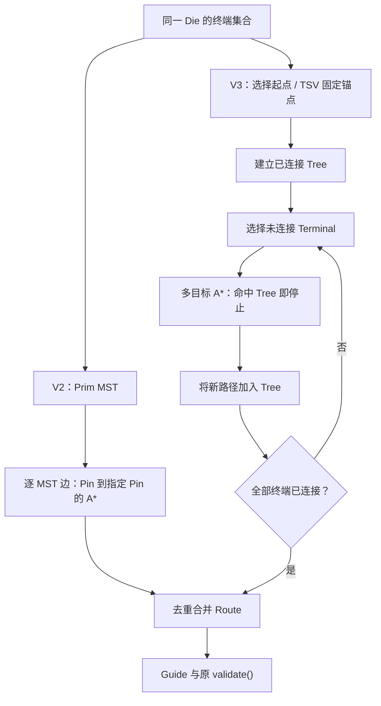

这是增量 Steiner-Aware 近似，并非实现全局最优 Steiner Tree。Bottom/Top 分别生长，只通过选定 TSV 相连。

#### 5.3 Tree Growth、开销与函数差异

Die 内普通 Net 以最小 Node ID 终端为种子；跨 Die Net 的两侧分别以选定 TSV 的 M10/M11 节点为种子。每次从尚未连接的终端中选择包围盒下界最小者，平局按 Node ID；命中树后，将路径并入树。路径自然经过的其他终端会被跳过。

`Route.nodes` 在原逻辑中预先放入全部 Pin，故 **不能将它直接用作已连通树的目标集合**。V3 使用单独的 `TreeTarget`，只保存已连接节点，并增量更新 bbox。目标查询期望 O(1)，每次展开不扫描树。调度预处理 O(总 Pin + N log N)，保存 O(N) Index/Key；单 Net 终端选择 O(P²)，目标集合 O(T)，Dense Workspace 仍最多 8192 状态。额外树集合仅存当前 Net，不为全部 Net 或完整图分配副本。

| 函数 / 文件 | 相对 V2 的实际变化 |
|---|---|
| `Config` / `model.hpp`、`main.cpp` | 增加并严格校验三个数字模式；四参数 CLI 和原参数默认值不变 |
| `Router::run()` | `initial_order()` 返回 Index 顺序；按处理位置记录进度，按原 Index 保存 Route |
| `Router::route()` | 模式 0 保留原 Prim + A*；模式 1 按 Die 维护 `TreeTarget`，树种子、目标与真实路径写入 Trace |
| `Router::search()` | 保留原公共接口；经共享 `search_impl()` 执行固定 Goal 搜索 |
| `search_to_tree()` / `search_impl()` / `add_target()` | 新增多目标查询、bbox 下界、增量目标集合；复用旧窗口、Dense/Sparse、Generation、代价、邻居顺序及预算机制 |
| `Router::mst()` | 未修改算法，Legacy 继续调用；Tree 模式不生成假的 MST |
| `Router::reroute_pass()` | 可选 `reroute_order()`；拒绝分支按同一调度顺序匹配 Backup，异常分支仍逆序恢复 |
| `Router::select_tsv()`、`validate()` | 算法与检查原样复用，不降低唯一 TSV、层范围、Via 或连通要求 |
| `result_json()`、Trace 与 UI | 新模式下增加可选 `algorithm` 对象；Tree topology 明示 `strategy=tree_aware`、种子及空 `mst_edges`，UI 不再将其描述为 MST 边；原 Pin/Route/Guide 字段不删除 |

#### 5.4 拥塞排序与回滚保证

设 `q(n,v)` 为该 Net 的节点需求：普通节点为 1，跨 Die 的两个 TSV 接口节点为 2。主优先级采用当前模型下拆除此 Net 可减少的局部 Overflow：

$$
m_n=\sum_{v\in R_n}\min\{\max(0,U_v+F_v-C_v),q(n,v)\}.
$$

降序 Tie-Breaker 依次为过载/容量严重度之和、拥塞节点数、跨 Die 标志，最后原 Net Index 升序。每轮仅预计算一次优先级；真正轮到 Net 时仍检查当前是否拥塞。接受条件仍为 **整体本地 Overflow 严格下降**，不以局部改善替代全局判断。

拒绝或异常后，Route、Guide、TSV 和节点 Usage 恢复；新增但未使用的资源条目可保留为 usage=0。History 仍按 V2 累积，不回滚历史惩罚。集合去重后每个完整 Net 只 `occupy()` 一次，分支共享不重复计费。

#### 5.5 正确性与受控 Profile

原有 C++ 核心检查及 `tree_aware_tests.hpp` 均通过，覆盖二/三/多 Pin、重复 GCell、已在树上的终端、非均匀格、合法/缺失 Via、Preferred Direction、唯一/固定 TSV、不可达、空目标、跨 Die 非法目标、Search Limit、Timeout、Generation 复用/回绕、Dense/Sparse、有序身份及非升序重布拒绝/异常回滚。多目标成本与小图独立 Dijkstra 的最小目标成本一致；Oracle 使用完整窗口，不把局部窗口路径误称全图最优。

Python 工作流 8 项通过，新增整数模式拒绝测试、Tree Trace 语义及完整输出检查。真实 toy/sample001 的 12 份 Trace 均完整回放至最终图边。三个真实 Case 的 V3-Legacy Guide SHA256 和剔除计时后的完整 JSON 均与已登记 V2 一致。

受控 300-Net、每 Net 五 Pin、96×96 网格，三个交替顺序重复的中位值如下。它比较同一 Profile 二进制的 Legacy/Tree/Combined，**不是官方成绩**。未隔离 CPU，部分时段共享主机；短时数值不能当作稳定加速比例。

| 模式 | Routing 中位 s | RSS 中位 MiB | 搜索次数 | 展开数 | 本地线长 DBU |
|---|---:|---:|---:|---:|---:|
| V3-Legacy | 0.122302 | 6.863 | 1200 | 53,100 | 1,080,000 |
| Tree-Aware | 0.409444 | 7.641 | 1200 | 194,400 | 1,110,000 |
| Combined | 0.286883 | 7.734 | 1200 | 194,400 | 1,110,000 |

该夹具没有改善：包围盒目标下界较松，搜索展开增多，线长也增加。保留全部重复和这项负结果，见 `controlled_benchmarks.json`；首次 harness 混合编码解析失败后复用了已完整写出的原始测量，没有将其删除或伪装为 Router 失败。

#### 5.6 V3 Congestion Optimization：先分解真实拥塞

本轮在 `v3-tree-aware` 的 `56f3d5b` 基点增量开发，保留上一轮 V3 功能、配置、候选和全部实验。未重新运行 case005：流式读取 `case005_v2_1/result.json`（611028871 bytes、179700 Net），逐资源核对既存指标。对每个格层 v 定义：

$$
O_v=\max(0,F_v+U_v-C_v),\quad B_v=\max(0,F_v-C_v),\quad I_v=O_v-B_v.
$$

| 指标 | 已有 case005 实测 |
|---|---:|
| Total Local Overflow，\(\sum O_v\) | 7,865,225 |
| Fixed-Demand Baseline Overflow，\(\sum B_v\) | 7,069,248 |
| Routing-Induced Incremental Overflow，\(\sum I_v\) | 795,977 |
| Hotspot GCell Count（按格层，不合并 XY） | 522,755 |
| 固定需求已超容量的格层数 | 453,750 |
| 零容量且有需求的格层数 / 需求总量 | 0 / 0 |
| 已输出资源格层 / Usage 总量 | 6,065,032 / 10,183,502 |

固定基线约占 89.88%，路由增量约占 10.12%；不能声称全部 Overflow 均可由重布消除，也不能将不可改变的固定基线计作布线优化收益。

| Metal Layer | Total | Fixed baseline | Routing incremental |
|---|---:|---:|---:|
| M1 | 3,897,899 | 3,498,689 | 399,210 |
| M11 | 3,857,712 | 3,490,361 | 367,351 |
| 其余已使用层合计 | 109,614 | 80,198 | 29,416 |

M1/M11 合计约占 98.61%。最大热点之一为 M11、GCell `(763,861)`，DBU 区域 `[2289000,2583000,2292000,2586000]`：Capacity=15、Fixed=99、Usage=4，Overflow=88，其中固定基线=84。完整分层和前 30 个热点见[真实分解报告](./EDA/code_3DIC%20EDA/outputs/reports/v3_algorithm/congestion_20261029_201139/case005_decomposition.json)。

`capacity()` 按首选方向的正交 Track 轴统计，缓存仍与原计数一致；`build_fixed_demand()` 对每个实例的全部 Pin/OBS 矩形分别累加占轨近似，重叠形状可能重复累计。合成重叠测试已证明这种行为，但旧结果没有 Pin/OBS 来源标签，无法从其固定总量分离各自贡献或真实重复量。因此本轮**没有修改 Capacity 或 Pin/OBS 规则**，没有把模型偏差直接认定为解析错误。

`occupy()` 按每 Net 的唯一 Node 集合计一次，再为跨 Die Net 的 M10/M11 各加一，故接口各合计两单位。179700 Net 的节点数加 `2 × 39542` 恰等于全部资源 Usage=10183502，符合当前模型。旧 A* 搜索仍用一单位代理，新代价模式在接口访问时使用两单位；这不改变 Guide 或 TSV 计费规则。

本地以实际图 Node 的 F+U 计算；官方报告标明 `GRT guide demand / merged DEF track capacity`，按最终 Guide 计算代理指标。固定需求处理、Track 合并、Guide 覆盖及边界口径不能假定逐项相同；闭源 latest 的内部固定需求实现未被证实，不能靠报告猜测并改规则。case001 的 8289 与 case005 本地 7865225 更不能跨用例直接比较。

同一 V2 case001 进一步核对：本地 584899=固定基线 569009+路由增量 15890，官方为 8289。M11 格 `(110,218)` 的本地 Capacity=15、Fixed=152、Usage=1、Overflow=138，而完整官方 CSV 对应 Capacity=15、Demand=17、Overflow=2；另一个 M1 格 `(35,247)` 本地 Fixed=139、Usage=0、Overflow=124，官方 Demand=16、Overflow=1。容量在这些样本中一致，差异主要体现在有效需求，不能直接把固定需求累加近似当作官方目标。正式说明 3.2 确实要求 Pin/OBS 实际占轨、同 Net Guide 去重及 TSV 附加需求，但如何投影、合并与处理边界仍需逐项校准。对齐证据见[同格层报告](./EDA/code_3DIC%20EDA/outputs/reports/v3_algorithm/congestion_20261029_201139/model_alignment_examples.json)；这些样本不构成新的固定需求公式。

#### 5.7 新增 A* 拥塞代价模式

设 D=U+F、C'=max(1,C)、H 为非负历史值，新占用 q 通常为 1，跨 Die 接口为 2，定义：

$$
\Delta O=\max(0,D+q-C)-\max(0,D-C),\quad
\rho=\min(1,\max(0,(D+q)/C')),\quad o=\max(0,D+q-C)/C'.
$$

| `congestion_cost_mode` | 非几何惩罚，w 为 `congestion`，h 为 `history` |
|---|---|
| 0：Legacy | 原样保留 \(w[\max(0,D+1-C)/C']^2+hH\)，接口仍使用旧的一单位搜索代理 |
| 1：Incremental | \(w\Delta O+hH\)，只对新增溢出收费，不把固定基线再次当作新增量 |
| 2：Hybrid | \(w(0.25\Delta O+0.05\rho^4+o^2)+hH\)，混合轻度利用率、增量与严重过载惩罚 |

例如 C=100、D=100、w=4、H=0 时，新增一单位的惩罚分别是 0.0004、4、1.2004，明确解决 Legacy 对高容量资源轻微越界惩罚很弱的问题。所有项非负，Wire/Via 几何下界仍可采纳；非均匀小图上固定目标和 Tree 多目标均与独立 Dijkstra 比较。

新增函数 `Router::congestion_penalty()` 被共享 `search_impl()` 调用；不改邻居合法性、Prim、TSV 候选、解析或官方评分器。多个分支合并前的搜索仍是节点需求代理，最终占用继续按完整 Net 去重。

#### 5.8 有预算、有线长保护的重布策略

`reroute_policy_mode=0` 保留原行为；模式 1 调用 `guarded_reroute_pass()`：

- 沿用实际可拆除溢出贡献排序，但排序和候选判断排除该 Net 必经的 Pin 节点，避免仅为无法绕开的端点反复搜索。
- 每次 Move 备份当前 Route，计算拆除减少量和新 Route 插入增加量，要求**全局本地 Overflow 净下降**才接受。两者按唯一节点和 TSV 两单位计算，包含交集抵消，不用单个热点下降冒充全局下降。
- 新 Route 本地线长不得超过旧 Route 的 1.005 倍；总线长不得超过首次进入该策略时基准的 1.005 倍。该保护约束重布阶段的图边线长，**不保证初始新代价相对 V2 或官方 Guide 线长也在 0.5% 内**，仍须官方消融验证。
- 每轮最多尝试 512 Net、搜索阶段软预算 20 s；A* 也检查软截止时间。预算结束时恢复当前未完成候选，保留已通过联合条件的修改；全局 Router 超时和非预期异常恢复整轮并向上传播。
- 无收益、搜索上限或无路径的候选恢复后，下一轮冷却一次；不提高原 `search_limit`。History 保持原累积语义。

新增 `iterations[].reroute_diagnostics` 记录尝试/接受/拒绝/跳过数量及停止原因；`congestion_strategy` 记录实际代价、策略和预算。旧字段保留，新模式全关时不增加这些输出。

#### 5.9 本轮独立配置与可复现实验

以下文件复制同一 `default.json` 基础参数，不改旧配置，第一轮 Net Ordering / Tree-Aware 均为 0：

| 配置 | Cost | Guarded reroute | Priority |
|---|---:|---:|---:|
| `v3_congestion_legacy.json` | 0 | 0 | 0 |
| `v3_cost_incremental.json` | 1 | 0 | 0 |
| `v3_cost_hybrid.json` | 2 | 0 | 0 |
| `v3_reroute_guarded.json` | 0 | 1 | 1 |
| `v3_congestion_candidate.json` | 2 | 1 | 1 |

新增整数模式、`reroute_max_nets`（正整数）、`reroute_pass_seconds`（正有限数）、`reroute_wire_growth`（0–0.1）均被校验。后者默认 0.005，不作为新的全局默认策略。旧 V2 不接受这些新键。

`scripts/compare_router_v3.py --suite congestion` 使用已登记 V2、候选 Legacy、Incremental、Hybrid、Guarded、Congestion Combined 六组；首轮工具默认 `tree`，本轮已改为 `final`，历史消融须显式传 `--suite tree/congestion/congestion_scoped`。工具拒绝 case003/005，并禁止在拥塞消融配置中开启 Net Ordering/Tree。实际成绩见本章后续记录；未评分不标记有效。

第一轮出现初始新代价使官方线长退化的证据后，新增保守开关 `congestion_scope_mode`：0 表示初始/重布均使用所选代价；1 表示**初始布线严格用 Legacy，进入重布时才启用新代价**。状态以 RAII 在正常返回、预算和异常后恢复，不泄漏到后续初始布线或直接搜索。新配置 `v3_congestion_reroute_only.json` 在混合代价+受控重布上仅增加 scope=1，独立使用第二个候选。`--suite congestion_scoped` 只比较 V2、最终源码 Legacy、Scoped 三组，不覆盖第一轮候选及结果。


### A.2 7. 各版本运行与官方评分结果

历史 V1/V2：toy、sample001、case001 的同配置比较均有真实 latest PASS，分项与 Guide 相同，见第二阶段 `small_cases.json`、`case001_comparison.json`。

早期 Run Label `v2` / `v3` 不是正式算法版本号；应按 Router SHA256 判定。case003 的异常评分、case005 的 ROUTED 记录不能改写成官方 PASS。

#### 7.1 本次实验协议与可追溯身份

实验 ID `20261029_113225`：已登记 V2 Baseline → V3-Legacy → Net Ordering → Tree-Aware → Congestion → Combined。每项为独立消融，箭头表示实验顺序，不表示后一个模式必然叠加前者；只有 Combined 开启三项。

- 同一份 `default.json` 共有参数、相同原始输入；每项 Router 预算 180 s、latest 评分预算 120 s。toy/sample001 开 Trace，case001 关闭 Trace。每 Case/模式仅测一次。
- Label 为 `v3_20261029_113225_<模式>`，Case 再由所属目录区分。18 次 Router 全部 ROUTED；17 次官方 PASS，case001 的 Net Ordering 评分达到预算而未完成。
- V3 生产候选 `build/router_v3_candidate`，SHA256 为 `47a285c048124b5a6987f2b90171ff1c20fbe12b218b7405cc8aa4669977821a`，运行登记为 UNKNOWN，不能冒充已注册 V3。构建基点 `5b59ab2`，实际工作区源码哈希在构建清单和每份 run.json。
- C++ 时间来自 `result.metrics.runtime_seconds`，包含解析和当时已执行的输出阶段，不是纯 A*；完整 helper 时间另存记录。RSS 为 Linux Supervisor 等待子进程得到的 getrusage 高水位，可能包含 exec 前继承的启动内存；GNU time 整条命令树峰值与周期采样也独立保留。
- 原始证据：[对照 JSON](./EDA/code_3DIC%20EDA/outputs/reports/v3_algorithm/20261029_113225/comparisons/results.json)、[CSV](./EDA/code_3DIC%20EDA/outputs/reports/v3_algorithm/20261029_113225/comparisons/results.csv)、[构建清单](./EDA/code_3DIC%20EDA/outputs/reports/v3_algorithm/20261029_113225/candidate.json)、[受控 Profile](./EDA/code_3DIC%20EDA/outputs/reports/v3_algorithm/20261029_113225/controlled_benchmarks.json)。这些 outputs 是本机 Git 忽略产物，远端不一定包含；本页保留可直接阅读的实测摘要。

#### 7.2 case001 主对照：3152 Net

| Mode | Router / Official | C++ s | RSS MiB | Official Wirelength DBU | Official Overflow |
|---|---|---|---|---|---|
| v2 | ROUTED / PASS | 59.472 | 125.992 | 843819000 | 8289 |
| legacy | ROUTED / PASS | 62.981 | 125.801 | 843819000 | 8289 |
| net_order | ROUTED / NOT_EVALUATED | 86.275 | 126.559 | N/A | N/A |
| tree_aware | ROUTED / PASS | 64.361 | 118.816 | 854565000 | 8237 |
| congestion | ROUTED / PASS | 54.046 | 125.844 | 843828000 | 8289 |
| combined | ROUTED / PASS | 41.074 | 117.184 | 854523000 | 8238 |

V3-Legacy 与 V2 的 Guide/规范化 JSON 完全一致。Net Ordering 已完成 Router，但评分器约 120.4 s 时被监督进程按 `time_budget` 发送 SIGTERM，真实返回码 -15，未生成官方报告：这是 **评分调用 TIMEOUT / NOT_EVALUATED**，不是官方 FAIL，更不能填入猜测成绩。本轮保留该记录，未自动提高预算重评。

| Mode | Wirelength score | Congestion score | Thermal score | Official total |
|---|---|---|---|---|
| v2 | 64.668125 | 78.170604 | 51.349311 | N/A |
| legacy | 64.668125 | 78.170604 | 51.349311 | N/A |
| net_order | N/A | N/A | N/A | N/A |
| tree_aware | 63.854935 | 78.317504 | 51.349311 | N/A |
| congestion | 64.667435 | 78.170604 | 51.349311 | N/A |
| combined | 63.858073 | 78.316436 | 51.349311 | N/A |

所有实际完成报告的 TSV 均为 657，官方 Pearson 均为 0.002310234269；没有新的 TSV 热优化收益。本地 Pearson 为约 0.127166，与官方口径不同。本地 Overflow：V2/Legacy/Net Ordering/Congestion 为 584899，Tree/Combined 为 584777；不能用这 122 的下降替代官方 Overflow 或分数。

#### 7.3 toy / sample001 全部消融

| Case | Mode | Official | C++ s | RSS MiB | Wirelength DBU | Overflow | W / C / T scores |
|---|---|---|---|---|---|---|---|
| toy | v2 | PASS | 0.728 | 12.770 | 30965800 | 244 | 53.6202 / 92.7342 / 47.1785 |
| toy | legacy | PASS | 0.654 | 12.793 | 30965800 | 244 | 53.6202 / 92.7342 / 47.1785 |
| toy | net_order | PASS | 0.453 | 12.859 | 31479400 | 236 | 52.7454 / 93.0514 / 47.1785 |
| toy | tree_aware | PASS | 0.719 | 12.859 | 30826700 | 244 | 53.8622 / 92.6457 / 47.1785 |
| toy | congestion | PASS | 0.538 | 12.832 | 30944400 | 244 | 53.6573 / 92.6429 / 47.1785 |
| toy | combined | PASS | 0.388 | 12.926 | 31286800 | 238 | 53.0701 / 92.8118 / 47.1785 |
| sample001 | v2 | PASS | 0.517 | 12.766 | 6452400 | 453 | 89.5517 / 73.3848 / 51.0939 |
| sample001 | legacy | PASS | 0.777 | 12.980 | 6452400 | 453 | 89.5517 / 73.3848 / 51.0939 |
| sample001 | net_order | PASS | 0.853 | 12.941 | 6452400 | 453 | 89.5517 / 73.3848 / 51.0939 |
| sample001 | tree_aware | PASS | 0.716 | 12.633 | 6452400 | 453 | 89.5517 / 73.3848 / 51.0939 |
| sample001 | congestion | PASS | 0.930 | 12.781 | 6452400 | 453 | 89.5517 / 73.3848 / 51.0939 |
| sample001 | combined | PASS | 0.784 | 12.887 | 6452400 | 453 | 89.5517 / 73.3848 / 51.0939 |

toy 的官方 Pearson 各模式均为 -0.002628377442；sample001 均为 0.001094066710。所有官方总分字段均缺失，统一为 N/A，未将实验加权值当作官方总分。短用例的时间/RSS 差异受启动与系统负载影响，不用这些单次小数值宣称稳定加速。

#### 7.4 是否取代 V2

**目前不建议全面取代 V2。** Combined 在 case001 的本次单次测量时间和内存较低、拥塞略有改善，但官方线长 843819000 → 854523000 DBU，Wirelength 分 64.668125 → 63.858073；Thermal 无变化。Tree-Aware 单独模式还更慢，受控夹具也出现线长和展开数退化。Net Ordering 在 toy 改善 Overflow 却使线长变差，case001 还发生评分预算超时。

所以保留这些可独立开关的研究结果，默认继续 Legacy。case003/005 未运行 V3，不能保证其时间、内存或官方合法性。历史 `case005_v2_1` 的 V2 ROUTED 179700 Net、5919.766 s、采样峰值 4749651968 bytes（约 4.424 GiB）只作历史稳定性证据，不是本次消融或官方 PASS。

#### 7.5 最终回归与保护检查

| 检查 | 实际结果与范围 |
|---|---|
| Linux C++17 生产构建、原核心及新增 Tree-Aware 测试 | 编译成功；最终 `core_tests_final` 通过。包含独立 Dijkstra、非均匀网格、合法 Via、唯一 TSV、Dense/Sparse、Generation、搜索预算及重布接受/拒绝/异常状态检查 |
| V3-Legacy 等价性 | toy、sample001、case001 的 Guide SHA256 和规范化 JSON SHA256 均与 V2 相同；JSON 仅排除观测字段 `metrics.runtime_seconds` |
| WSL Python 3.10 全测试 | 73 项：63 通过、1 项平台条件跳过、9 项错误。错误均来自原清理工具调用 Python 3.10 没有的 `Path.is_junction()`，完整失败日志保留，未修改无关工具 |
| Windows Python 3.13 补测 | 上述清理工具 9 项全部通过；parameter_tuning 的预算、唯一 Label/中文空格路径、评分失败、冻结基线 4 项兼容性测试通过，使用 Mock，不是官方成绩 |
| UI 与 Trace | 新增元数据兼容测试、JavaScript 语法及拓扑文案检查通过；临时 UI 服务器实际加载三种 Combined 结果，返回真实的 203 / 203 / 3152 Net、20 层及完整 Pin/Node/Edge/Guide。小用例 Trace 重放与最终边集合一致；未进行全面浏览器交互回归 |
| 文件保护 | 初始登记的 29 个关键文件 SHA256 无变化；722 个原有运行文件的大小/修改时间无变化。候选二进制与记录的当前生产源码哈希一致；`select_tsv()`、`validate()` 保持原实现 |
| 运行范围与清理 | 仅新增本轮独立 Label；没有运行 case003/005，没有覆盖旧 Guide/报告，没有 commit/push。临时测试目录与临时 UI 缓存/服务器已清理；本轮正式实验记录、构建身份和失败日志保留 |

复核原始记录：[核心测试](./EDA/code_3DIC%20EDA/outputs/reports/v3_algorithm/20261029_113225/core_final.json)、[WSL 全测试日志](./EDA/code_3DIC%20EDA/outputs/reports/v3_algorithm/20261029_113225/python_all.log)、[Windows 兼容性](./EDA/code_3DIC%20EDA/outputs/reports/v3_algorithm/20261029_113225/windows_compatibility.json)、[UI API](./EDA/code_3DIC%20EDA/outputs/reports/v3_algorithm/20261029_113225/ui_api.json)、[保护与等价性](./EDA/code_3DIC%20EDA/outputs/reports/v3_algorithm/20261029_113225/verification.json)。

#### 7.6 V3 拥塞优化第一轮：独立消融

实验 `congestion_20261029_201139`：六模式 × toy/sample001/case001，18 次 Router 和 latest 评分均实际 PASS。基础参数均来自同一 `default.json`；Net Ordering=0、Tree-Aware=0；Router/评分预算各 180 s。候选为 `build/router_v3_congestion_candidate_20261029`，SHA256 `4173d77702d1fb51316ece49ffb46e30285a33cd23315b583b65b96ec0476fac`；该候选对应加入 scope 开关前的源码清单，不能用后续工作区哈希冒充它的构建来源。各配置、Guide SHA256、完整官方报告与所有迭代诊断见[本轮 JSON](./EDA/code_3DIC%20EDA/outputs/reports/v3_algorithm/congestion_20261029_201139/comparisons/results.json)和[CSV](./EDA/code_3DIC%20EDA/outputs/reports/v3_algorithm/congestion_20261029_201139/comparisons/results.csv)。

case001:

| Mode | Official | Wirelength DBU | Overflow | W score | C score | C++ s | RSS MiB |
|---|---|---:|---:|---:|---:|---:|---:|
| v2 | PASS | 843819000 | 8289 | 64.668125 | 78.170604 | 49.051 | 125.867 |
| legacy | PASS | 843819000 | 8289 | 64.668125 | 78.170604 | 50.423 | 125.996 |
| incremental | PASS | 856920000 | 8114 | 63.679448 | 78.617043 | 26.386 | 124.848 |
| hybrid | PASS | 857055000 | 8151 | 63.669417 | 78.536184 | 77.929 | 126.844 |
| guarded | PASS | 842208000 | 8305 | 64.791824 | 78.130299 | 29.535 | 108.969 |
| congestion_combined | PASS | 856263000 | 8155 | 63.728308 | 78.523270 | 33.195 | 106.961 |

toy / sample001:

| Case | Mode | Official | Wirelength DBU | Overflow | W / C / T scores | C++ s | RSS MiB |
|---|---|---|---:|---:|---|---:|---:|
| toy | v2 | PASS | 30965800 | 244 | 53.6202 / 92.7342 / 47.1785 | 0.512 | 12.770 |
| toy | legacy | PASS | 30965800 | 244 | 53.6202 / 92.7342 / 47.1785 | 0.394 | 12.695 |
| toy | incremental | PASS | 33929700 | 222 | 48.9363 / 93.1934 / 47.1785 | 0.422 | 12.789 |
| toy | hybrid | PASS | 33180700 | 221 | 50.0409 / 93.4793 / 47.1785 | 0.546 | 12.863 |
| toy | guarded | PASS | 30206100 | 248 | 54.9688 / 92.0306 / 47.1785 | 0.325 | 12.676 |
| toy | congestion_combined | PASS | 32667100 | 224 | 50.8277 / 93.2814 / 47.1785 | 0.324 | 12.777 |
| sample001 | v2 | PASS | 6452400 | 453 | 89.5517 / 73.3848 / 51.0939 | 0.516 | 12.785 |
| sample001 | legacy | PASS | 6452400 | 453 | 89.5517 / 73.3848 / 51.0939 | 0.571 | 12.875 |
| sample001 | incremental | PASS | 6543600 | 453 | 88.3036 / 73.3848 / 51.0939 | 0.454 | 12.926 |
| sample001 | hybrid | PASS | 6765900 | 453 | 85.4023 / 73.3848 / 51.0939 | 0.583 | 12.637 |
| sample001 | guarded | PASS | 6452400 | 453 | 89.5517 / 73.3848 / 51.0939 | 0.365 | 12.859 |
| sample001 | congestion_combined | PASS | 6765900 | 453 | 85.4023 / 73.3848 / 51.0939 | 0.411 | 12.945 |

case001 的已完成报告 Thermal Score 均为 51.349311；toy 为 47.178546，sample001 为 51.093892。总分字段均缺失，保持 N/A；不将局部 Overflow、分项加权或线上历史 52.66 当作本轮官方总分。

Legacy 在三个 Case 的 Guide 与去掉计时的规范化 JSON 均与 V2 相同。增量/混合代价在 case001 降低官方 Overflow，但官方线长分别增加约 1.55%/1.57%；组合的 Overflow=8155、线长增加约 1.47%，不符合“避免明显线长退步”的目标。仅新重布让线长略降，却使 Overflow 从 8289 升至 8305，再次说明本地改善不保证官方改善。

新重布在 sample001 从两轮 400 次尝试降为 2 次，官方指标保持不变；toy 官方 Overflow 反而从 244 升至 248。case001 新重布尝试 512+135 次，接受 154+40 次，第一轮触及 Net 预算；对应 C++ 29.535 s、峰值 108.969 MiB，而本轮 V2 为 49.051 s、125.867 MiB。这是单次共享主机测量，支持减少无效工作和备份开销，不能保证大型 Case 的稳定加速。

第一轮结论：保留可关闭的研究策略及全部负结果，不提升为默认；进一步用 Scoped 实验检验是否能同时限制线长退化。

#### 7.7 Scoped 保守对照与测试范围

第二轮 `congestion_20261029_201139_scope` 独立比较 V2、最终源码 Legacy、Scoped（仅重布启用 Hybrid）。候选为 `build/router_v3_congestion_scoped_20261029`，SHA256 `83ec6d3455f559774243895a6d7991a3b4b0af3d8187c8f18e15985d29b46893`；构建命令与全部生产源码哈希见[构建清单](./EDA/code_3DIC%20EDA/outputs/reports/v3_algorithm/congestion_20261029_201139_scope/candidate_build.json)。它仍是 UNKNOWN 候选，不替换或覆盖第一轮及原 V1/V2/V3 二进制。

| Case | Mode | Official | Wirelength DBU | Overflow | W / C / T scores | C++ s | RSS MiB |
|---|---|---|---:|---:|---|---:|---:|
| toy | v2 | PASS | 30965800 | 244 | 53.620204 / 92.734155 / 47.178546 | 0.421 | 12.914 |
| toy | legacy | PASS | 30965800 | 244 | 53.620204 / 92.734155 / 47.178546 | 0.400 | 12.754 |
| toy | scoped | PASS | 32774100 | 226 | 50.661727 / 93.081908 / 47.178546 | 0.412 | 13.023 |
| sample001 | v2 | PASS | 6452400 | 453 | 89.551717 / 73.384785 / 51.093892 | 0.505 | 12.566 |
| sample001 | legacy | PASS | 6452400 | 453 | 89.551717 / 73.384785 / 51.093892 | 0.694 | 12.688 |
| sample001 | scoped | PASS | 6543600 | 453 | 88.303610 / 73.384785 / 51.093892 | 0.466 | 12.820 |
| open_3d_case001 | v2 | PASS | 843819000 | 8289 | 64.668125 / 78.170604 / 51.349311 | 48.518 | 125.953 |
| open_3d_case001 | legacy | PASS | 843819000 | 8289 | 64.668125 / 78.170604 / 51.349311 | 52.530 | 125.930 |
| open_3d_case001 | scoped | PASS | 849252000 | 8187 | 64.254417 / 78.445918 / 51.355633 | 36.375 | 111.465 |

第二轮 9 次 Router 和官方评分全部 PASS，V3-Legacy 再次在三个 Case 的 Guide / 规范化 JSON 上与 V2 相同。完整配置、Guide SHA256 和官方原报告见[Scoped JSON](./EDA/code_3DIC%20EDA/outputs/reports/v3_algorithm/congestion_20261029_201139_scope/comparisons/results.json)及[CSV](./EDA/code_3DIC%20EDA/outputs/reports/v3_algorithm/congestion_20261029_201139_scope/comparisons/results.csv)。

case001 的 Scoped 相对同轮 V2：官方 Overflow 8289→8187（减少 102，约 1.23%），官方线长 843819000→849252000 DBU（增加约 0.644%）；Wirelength Score 64.668125→64.254417，Congestion Score 78.170604→78.445918。C++ 48.518→36.375 s，RSS 125.953→111.465 MiB，仍是单次共享环境数据。其 Thermal Score 51.349311→51.355633 为极小变化；沿用旧 TSV 选址函数的重布改变了资源状态和最终 TSV 分布，不能宣称实现了新的热优化算法。

Scoped 的本地图边线长反而由 436611000 降到 435834000 DBU，但官方 Guide 线长上升；toy 上 Scoped 官方线长上升约 5.84%，sample001 上升约 1.41% 且拥塞无改善。这直接说明仅约束图边长度不能保证官方线长质量。Scoped 比第一轮强代价的线长退化更小，是继续研究的折中候选，**仍没有证据支持普遍替换 V2或声称官方总分提高**。本轮所有总分保持 N/A。

建议保留 Legacy 作为稳定对照、Guarded 作为减少无效重布/备份的性能开关、Scoped 作为质量折中研究开关；Incremental/Hybrid 全阶段及 Combined 的负结果也保留用于消融，均不默认启用。下一步需要基于实际 Guide/官方指标的质量保护，而非继续单纯提高拥塞权重。

本轮新增 C++ 拥塞测试检查 Legacy 数值、增量/Hybrid 公式、零容量、固定基线、TSV 两单位、History，以及固定目标/多目标与独立 Dijkstra 的一致性；重叠 Pin/OBS 合成检查只诊断原累加行为，不改变规则。受控重布测试覆盖非升序、TSV、线长拒绝、冷却、Net 预算、无路径/搜索上限、已替换后的异常/全局超时，以及 A* 内部软截止与状态恢复。原有核心和 Tree-Aware 测试保留并通过。

最终 Python 工作流 9 项、流式分析 3 项、UI Store 10 项通过；UI 测试确认新策略元数据不丢失原 Pin/Node/Edge/Guide。真实小用例 Trace 均重放核对最终路径，不制造缺失的过程。没有重跑 case003/005 或改变官方程序、原输入、旧配置、旧 Guide/报告，没有自动 commit/push。

所有公开 Case 的时间、RSS 都是单次测量；保留 getrusage 峰值来源、实际配置、预算及 Guide SHA256。新策略在 case003/005 上的时间、内存和官方合法性仍未验证，不能从小用例或本地 Overflow 推断其收益。

结束核验：61 个受保护文件 SHA256 未变，1304 个原有运行文件的大小/修改时间未变；容量、固定需求、资源占用、Overflow、TSV 选址和合法性检查函数保持原实现。两轮均保留与构建清单逐文件哈希一致的 `candidate_sources.zip`，最终候选与当前生产源码匹配，详见[最终核验](./EDA/code_3DIC%20EDA/outputs/reports/v3_algorithm/congestion_20261029_201139/final_verification.json)。这些归档仅作构建来源记录，不是另建 Router 工程。

最后消除一处不改变语义的缩进警告后，临时独立重编译为零编译警告，产物与已经完成第二轮 9 次实验的候选逐字节一致，因此无需重复评分；当前源码另存 `final_sources.zip`，证明见[最终重编译记录](./EDA/code_3DIC%20EDA/outputs/reports/v3_algorithm/congestion_20261029_201139_scope/format_rebuild.json)。临时编译目录已清理，测试候选和历史清单均未覆盖。


<a id="version-13"></a>
### A.3 13. V3 Final：固定入口与 Guide 质量保护

#### 13.1 唯一配置与版本边界

本轮基点为 `410a512`，不自动提交或推送。统一配置 [v3_final.json](./EDA/code_3DIC%20EDA/configs/archive/v3_final.json) 与原 `default2.json` 的共有参数完全一致：wire=1、via=1、tsv=4、congestion=4、history=1、thermal=3、iterations=2、stagnation=2、margin=8、search_limit=5000000、time_limit=600、trace_mb=32。没有算法模式键。实际运行预算可用 `--time-limit` 覆盖。

选择它的依据是 V2 已用这组基础参数完成 case005，而不是它已被证明全局最优。旧 default.json 的 via=0.5、thermal=1、search_limit=1500000，不能将其 8289 Overflow 直接拿来当本轮同条件基线。本轮重新用同一 `v3_final.json` 测量 V2 和 Final。

历史配置不存在全面最优者：Incremental 在旧同参数 case001 消融中将 Overflow 降到 8114，但线长增至 856920000；Guarded 线长降到 842208000，但 Overflow 升至 8305；Scoped 为 849252000 / 8187，同样有取舍。Tree/Ordering/Combined 也没有证明能普遍提高全部分项。选择 default2 是统一稳定起点，而非把开关组合当成多个成熟版本；45 条既有对照的只读汇总见[历史审查](./EDA/code_3DIC%20EDA/outputs/reports/v3_final/20261029_230856/historical_review.json)。

11 份旧 V3 配置逐字节保留于 `configs/archive/`；default/default2、baseline、case005_debug 保留原位。旧候选二进制仍被历史运行引用，因此保留原路径，作为历史构建产物，不是日常入口。配置归档和引用审查见[清单](./EDA/code_3DIC%20EDA/outputs/reports/v3_final/20261029_230856/config_archive.json)。

#### 13.2 固定执行策略与真实算法改动

`GR_V3_FINAL` 正式构建目标在源码中固定策略，配置中不能启用旧消融开关；研究构建继续支持归档模式。实际策略以 `result.json.v3_final.strategy` 和 `optimization` 标识，不能靠文件名或默认模式 0 冒充 Final。

最终验证的保守实现保留 V2 高效 A*、Prim MST、唯一 TSV、合法性验证及两轮增量回滚重布；之后新增一次有预算的 **Guide-Aware Subset Pruning**：

1. 为每个 Net 的已占用格点补齐合法的首选方向相邻边和 LEF Via；跨 Die 仅允许原 TSV。若该诱导图无环，直接跳过，不运行 A*。
2. 在诱导图上做确定性 Kruskal，再剥离不含 Pin/TSV 的叶枝。原路径本身即使是树，也可能因未使用的合法邻接而存在删减空间。
3. 候选 Node 必须是原 Route 的严格子集，边只连接这些原有格点，TSV 坐标不变；重新生成 Guide 并通过原 `validate()`。
4. 要求 Guide 数量不增加、Guide-contact MST 估计不增加；未知估计直接跳过。成功后才 Move 替换并更新 Usage，异常恢复本阶段全部修改。
5. 最多尝试 512 个含诱导环网络、软预算 20 s；单 Net 最多 100000 节点，全部撤销备份合计也最多 100000 节点，Guide 估计最多 1024 矩形。超过界限保留完整原 Route，绝不截断输出。

因此这不是改参数或仅复制旧二进制：它实际移除冗余几何和资源需求。主函数为 `Router::prune_routes()`、`guide_wirelength()`；`make_guides()`、Pin/Via/方向/唯一 TSV 等合法性规则不放松。Trace 真实记录替换后的 Net 和 `guide_subset_pruned`，不是伪造新的 A* 过程。

Tree-Aware、Net Ordering、强增量/Hybrid 代价和 Scoped 均未纳入固定生产策略，因为历史官方结果存在分项退步。第一轮尝试的“校准模型引导重布”同样未通过发布门槛，详见 13.5。

#### 13.3 为什么图边线长不足以保护 Guide 质量

`Router::wirelength()` 只求同层图边几何长度；换层、Guide 分段、矩形中心、合并拓扑及接口附加成本可能使官方 Guide-MST 代理变化。它下降不代表官方 Wirelength 下降。

新增 Guide-contact MST 估计以合法首选方向接触和跨层正面积重叠构造邻接，用矩形中心距离选择 MST，同层边按矩形跨度计价，跨 Die 附加项以当前报告的 6 DBU 作近似。实现 O(G²) 时间、O(G) 存储，有矩形数上限；不是闭源评分器的完整复刻。

已有 case001 V2→Scoped 对照：图边长度下降，但官方线长 843819000→849252000；新估计 509721942→510602442，方向正确，绝对值仍明显偏低。toy 估计 6735668、官方 30965800；sample001 估计 1259718、官方 6452400。不能将估计值当作官方指标，也不能以这些少量样本宣称普遍预测准确。完整校准见[报告](./EDA/code_3DIC%20EDA/outputs/reports/v3_final/20261029_230856/model_calibration.json)。

最终同参数 V2→Final 的只读复核：估计 509466942→509403942，官方 840537000→839721000，改善方向一致，但预测减量只有 63000 DBU，实际减量 816000 DBU；绝对值仍低估约 39.4%。该估计只作候选保护条件，发布必须依赖真实官方结果，详见[最终额外检查](./EDA/code_3DIC%20EDA/outputs/reports/v3_final/20261029_230856_release/final_extra_checks.json)。

#### 13.4 固定需求与官方统计校准

原始 `Resource.fixed`、capacity、usage、Overflow 公式不改。另建立可选的物理投影合并估计：按层和沿线 GCell 条带，将变换后的真实 Pin/OBS 在 Track 正交方向投影为区间，排序合并，再按闭边界 Track 交集计数；不针对 Case 硬编码，也不把 Fixed 设零。输入区间最多 2000000，超限明确回退原模型，释放临时区间。

case001 官方 CSV 中 6072 个拥塞格层，原累计需求的平均绝对误差为 46.4868，合并估计为 0.9964；6048 项仍相差 +1，只有 22 项精确匹配。toy 与 sample001 的合并误差分别约 1.0111、0.9474。该比较只覆盖报告中的拥塞行，不代表全网格统计或未知边界规则已经对齐。

该模型只由只读校准工具和测试使用，Final 正常布线不构建这批区间，也不为每个 Resource 增加缓存字段。首轮失败原型的模型引导代价已从生产分支移除；原始 `Resource` 布局、A* 代价和重布接受规则保持 V2 基线。最终删线阶段通过 Node 子集和 TSV 不变，保证任何固定基线下的逐节点路由需求均不增加；仍需官方评分确认 Guide 投影和线长结果。

#### 13.5 同参数实测、发布判定与局限

首轮原型全部合法，但不发布：同参数 toy 的官方线长 29296600→26589500，Overflow 却由 256→289；case001 线长 840537000→835518000，Overflow 8337→8372。sample001 不变。它证明近似模型更接近官方统计，并不自动意味着引导重布就会提高官方拥塞。失败记录保留在[首轮结果](./EDA/code_3DIC%20EDA/outputs/reports/v3_final/20261029_230856/comparisons/results.json)与[拒绝决定](./EDA/code_3DIC%20EDA/outputs/reports/v3_final/20261029_230856/release_decision.json)。

第二轮仅在原有边中删环，三个用例的 Guide SHA256 均与 V2 一致，没有实际收益，同样未通过发布门槛；因此最终改为检查已占用格点的合法诱导图，而不是继续提高惩罚系数或增加参数配置。

最终复核实验 `20261029_230856_release`：V2 与 Final 均使用同一份 `v3_final.json`，Router/评分预算各 180 s，评分器 latest 的 SHA256 为 `4104d0b2869ef7376d716ce9c33b56668e659575ab84615f5c0a5f282e108a8a`。六次实际调用全部 ROUTED、官方 PASS。

| Case | Router | 官方 Wirelength DBU | 官方 Overflow | Wirelength Score | Congestion Score | Thermal Score |
|---|---|---:|---:|---:|---:|---:|
| toy | V2 / Final 相同 | 29296600 | 256 | 56.675263 | 91.903663 | 47.178546 |
| sample001 | V2 / Final 相同 | 6452400 | 453 | 89.551717 | 73.384785 | 51.093892 |
| case001 | V2 | 840537000 | 8337 | 64.920631 | 78.037198 | 51.630648 |
| case001 | Final | **839721000** | **8337** | **64.983718** | **78.037198** | **51.630648** |

case001 实际检查 114 个诱导环网络，接受 57 个，删除 113 个占用节点；撤销备份合计 14457 节点，低于 100000 上限。官方线长减少 816000 DBU（约 0.0971%），Wirelength Score 增加约 0.063087；**官方拥塞和热分数没有改善**。toy/sample001 的完整 Guide SHA256 与 V2 相同。没有官方总分字段，不由分项推测线上 52.66 会提高多少。

| Case | Router C++ 时间：V2 → Final（s） | 子进程峰值 RSS：V2 → Final（MiB） |
|---|---:|---:|
| toy | 0.4414 → 0.3943 | 12.914 → 12.977 |
| sample001 | 0.4428 → 0.4964 | 12.902 → 12.809 |
| case001 | 44.7029 → 47.0749 | 125.609 → 125.449 |

时间取 `result.metrics.runtime_seconds`，包含解析等 Router 阶段，不含 Windows/WSL 辅助启动；RSS 取 Supervisor 的 wait4/getrusage。case001 本轮约慢 5.3%，内存接近；不同轮次波动明显，不能据此宣称提速或显著节省内存。移除运行时校准区间后，上一轮约 145 MiB 的额外峰值已消除。

完整逐运行数据、原始官方报告、Guide/输入/配置哈希见[最终 JSON](./EDA/code_3DIC%20EDA/outputs/reports/v3_final/20261029_230856_release/comparisons/results.json)、[CSV](./EDA/code_3DIC%20EDA/outputs/reports/v3_final/20261029_230856_release/comparisons/results.csv)。通过[发布判定](./EDA/code_3DIC%20EDA/outputs/reports/v3_final/20261029_230856_release/release_decision.json)后生成唯一 `build/router_v3_final`，SHA256 为 `211fdc3e7b422c032685728a1a4df5d10fd3be406b009e06e0e0e79a928a74bd`；构建标志、源文件哈希、固定配置哈希与归档见同目录 `validated_build.json / validated_sources.zip`。这是当前工作区的本地验证发布，尚未注册为已提交的 V3。

C++ 核心测试及 43 项 Linux Python 检查通过，涵盖原算法 Oracle/回滚、配置归档、Final 策略选择、版本注册保护、UI 数据存储和拥塞分析。另在 Windows 运行版本/配置相关检查；Linux ELF 集成测试在 WSL 执行，不将 Windows 跳过项当成通过。额外 TSV 清理测试核对接口锚点不变、双端附加需求准确、无重复计费。

结束核验：69 个受保护文件内容哈希保持一致，11 个归档配置逐字节不变；2267 个既存运行文件的大小和修改时间不变。原 capacity/fixed/resource/occupy/Overflow、A*、TSV 选址、Guide 合并和验证、旧重布函数与任务前源码一致。Final 二进制、当前生产源码和来源归档哈希匹配；本轮临时编译/校准程序已清理，只保留唯一新 Final 与实验报告，见[保护核验](./EDA/code_3DIC%20EDA/outputs/reports/v3_final/20261029_230856_release/verification.json)。

结论仅限这三个公开用例：Final 有小幅真实线长收益，没有拥塞收益，不能证明值得替换现有线上 V2。case003/005 本轮未布线、未评分，保留 V2 回退入口。下一步应优先查明 Guide-MST 估计的绝对误差与 Pin/OBS/Guide 边界的需求差异，再设计能减少真实热点且保护 Guide 质量的局部替换；不以降低本地固定需求数字代替官方优化。

#### 13.6 构建、验证、运行及登记

只使用固定配置进行日常运行（PowerShell，标签每次换新）：

```powershell
Set-Location -LiteralPath 'D:\我\大学\program\3DIC EDA\EDA\code_3DIC EDA'
$label = 'v3_final_' + (Get-Date -Format 'yyyyMMdd_HHmmss')
python scripts/run_case.py --case toy --backend wsl --router build/router_v3_final --config configs/v3_final.json --label $label --time-limit 180 --trace
if ($LASTEXITCODE -eq 0) {
    python scripts/evaluate.py --case toy --label $label --backend wsl --engine latest --timeout 180
}
```

`scripts/validate_v3_final.py --experiment <新ID> --apply` 在临时目录编译研究/Final/核心测试，运行小测试及 toy/sample001/case001 的 V2/Final 同配置对照；要求全部官方 PASS、线长/拥塞/热分项无退步且 case001 有严格改善，才以独占发布方式生成 `build/router_v3_final`。失败也保留报告、自动清理临时编译文件，不产生永久候选。已有 Final 不直接覆盖，先保留当前发布并审查新报告。CMake 提供独立 `router_v3_final` 目标；旧 `build.sh` 仍用于历史研究构建，不用于替代发布验证。

正式版本登记仍需用户保存源码提交后执行独立重建与 SHA256 校验：

```powershell
$sourceCommit = git rev-parse HEAD
python scripts/manage_router_versions.py --register v3 --final-entry --source build/router_v3_final --git-commit $sourceCommit --description 'V3 Final：固定配置与 Guide 子集裁剪'
```

不能在未保存当前源码的旧 HEAD 上登记；校验不匹配时工具会拒绝。登记前运行版本显示 UNKNOWN 是正确行为，`result.json` 的 Final 策略标识与正式版本登记是两个概念。V1/V2 文件及登记不改。


<a id="appendix-b"></a>
## 附录 B：历史函数映射、性能证据和数学公式

以下保留任务前原稿的数据、函数映射和结论；其中“当前”指当时的实验状态，不代表本轮新架构已验证。历史命令仅供复现。

### B.1 3. V1：基础全局布线算法

以下内容已对照 V1 Git 源码，不能将 V2 缓存或后来的 UI 架构追溯成 V1 算法。

| 功能及原理 | 实现文件 / 函数 | 作用、局限及后续关系 |
|---|---|---|
| DEF / LEF 解析：将文本转为 Design、宏、放置与终端 | `src/parser.cpp`：`parse_lef()`、`parse_def()`、`placed_rect()` | 支持八种方位变换及矩形 Pin/OBS；拒绝未支持的几何和非空 DEF 扩展段。V2/V3 继续复用语义 |
| Thermal 投影：按 XY 合并样本，再映射 GCell | `Router::load_thermal()` | DBU/µm 转换后平均，空洞确定性填充；这是给定热场，未重算布线后的温度 |
| 图与容量：GCell × 金属层，Track 决定节点容量 | `Router()`、`capacity()`、`build_fixed_demand()` | 平面边服从 Preferred Direction；Pin/OBS 贡献 fixed。容量与官方统计口径仍有偏差 |
| 多 Pin 终端拓扑：稠密 Prim MST | `Router::mst()` | 时间 O(P²)、辅助存储 O(P)；按几何与 Via 下界构造终端树，不是最优 Steiner Tree |
| 实际路径：逐 MST 边 A* | `Router::search()`、`route()` | 包围盒逐步扩张，哈希存储搜索状态；不同边可重合，但后续边目标仍是指定终端 |
| Via 与双 Die | `route()`、`search()`、`validate()` | 普通 Via 需 LEF 合法；Bottom M1–M10、Top M11–M20；跨 Die 增加唯一 M10/M11 TSV 边 |
| TSV 热感知候选 | `Router::select_tsv()` | Pin 位置与限量采样格点；综合距离、接口压力、冷点惩罚。保留固定 TSV 约束，不是全局热最优 |
| 动态拥塞成本与历史成本 | `search()`、`run()` | 新增需求的过载平方项与非负历史项；本地代价不等于官方分数 |
| 初始布线与 Rip-up and Reroute | `Router::run()` | 原始 Net 顺序；对拥塞 Net 重布，仅整体 Overflow 严格下降时接受；V1 使用完整 Route 备份 |
| Guide 与内部合法性 | `make_guides()`、`validate()`、`write_guide()` | 沿层方向合并区域，接口层保持独立；检查连通、Pin、方向、Via、唯一 TSV。不等于官方完整合法性 |
| 本地工作流 | `main.cpp`、`scripts/run_case.py`、`evaluate.py`、`ui/` | 四参数 CLI、可选 JSON/Trace、运行与评分、2D/3D 与大数据索引在 V1 提交时已存在；后续版本登记、评分监督等属于工程更新 |

搜索边成本为：

$$
c(u,v)=c_{\mathrm{wire/via}}(u,v)
 +w_c\left(\frac{\max(0,U_v+F_v+1-C_v)}{\max(1,C_v)}\right)^2+w_h H_v.
$$

共享节点/边以集合去重。`occupy()` 按 Net 的节点集合计费，跨 Die 的两个接口节点另有 TSV 额外需求；不能把每条搜索分支分别叠加收费。


### B.2 4. V2：算法性能与工程效率优化

证据来源：V1/V2 Git Diff 与 `outputs/reports/algorithm_optimization/optimization_summary.md`。V2 的目标是等价输出，未改变 Prim、TSV 打分公式、搜索邻居顺序和 A* Tie-Breaker。

| 项目 | V1 → V2 | 开销变化与实现位置 | 实测证据 |
|---|---|---|---|
| A* Workspace | 每次新建 sparse map → 小窗口 Dense + 大窗口 Sparse | `search()`；Dense 最多 8192 状态，Generation 复用，溢出时清标记；不分配全图数组 | 受控 astar 展开数均 53,400，routing 中位时间 0.0949008 → 0.0557863 s |
| 几何与规则访问 | 反复取 cell/Layer/Via → 轴中心和固定规则缓存 | 构造函数、`refresh_layers()`；中心 O(1)，避免临时 Rect 和重复 map 查找；直接 API 修改仍刷新 | 不单独归因百分比，与 A* 组合测试 |
| Thermal/TSV | 每个跨 Die Net 全热图 min/max 扫描、候选 set → 单次统计及排序去重 vector | `refresh_heat_stats()`、`select_tsv()`；热图扫描由每 Net O(G) 变为 run 内一次 O(G) | 受控 TSV routing 中位时间 0.365051 → 0.0708347 s |
| Capacity | 每个新资源扫描 Track → 按轴容量表 | `refresh_capacities()`、`capacity()`；缓存总计最多 8 MiB，超限回退 | 原半开 Track 区间计数保持一致 |
| 临时对象 | 非 Trace 路径仍构造 JSON → 仅需要 Trace 时构造 | `route()`、`run()` | 无 Trace 时减少 JSON 分配，仍完整写出最终结果 |
| 重布与回滚 | 全 routes 副本 → 只 Move 真正修改的 Route | `reroute_pass()`；备份存储与改动量相关，异常恢复已修改项 | 受控 reroute RSS 中位值 10,235,900 → 7,880,700 bytes；routing 0.171891 → 0.0509827 s |
| 验证与 Profile | 新增独立 Dijkstra、小图、受控基准与计数 | `tests/algorithm_tests.hpp`、`router_benchmark.cpp`；`GR_PROFILE` 仅统计构建开启 | 旧报告保留完整范围、AB/BA 顺序与失败阶段，生产构建不含 Profile |

这些是历史受控合成基准，不能外推大型 Case 的加速倍数。真实 case001 当时各跑一次：V1 C++ elapsed 104.262 s，V2 53.1971 s，官方指标与 Guide 相同；进程树峰值约 129.117 / 126.008 MiB。toy 的短时结果也曾略慢，因此不能声称所有场景都提升。


### B.3 6. V1 / V2 / V3 核心算法对比

| 项目 | V1 | V2 | V3 实际实现 |
|---|---|---|---|
| 搜索 | Sparse A* | 有界 Dense/Sparse A* | 可选 Tree-Aware A*，保留旧搜索 |
| 多 Pin | Prim MST 逐边连接 | 相同 | 已有树增量连接 |
| Net 顺序 | 输入顺序 | 相同 | 可配置且可复现 |
| TSV | 热感知候选 | 相同公式，缓存优化 | 复用 V2；复杂策略尚未实现 |
| 重布 | 全量备份、整体 Overflow 判断 | 增量备份回滚 | 候选优先级与任意顺序安全恢复 |
| 版本状态 | 已登记 | 已登记 | 候选，不自动替代 V2 |


<a id="appendix-c"></a>
## 附录 C：历史提交、配置、SHA256 与使用记录

本轮新的追溯入口为 `outputs/reports/v3_generation/20261030_guarded_linux/build.json` 与 `sources.zip`：保存 `main / c8fa3f7` 基点、未提交生产源码逐文件哈希、编译命令与候选身份；这是可恢复研究快照，不是新注册提交。V1/V2、旧 Final、原配置和登记文件均按原哈希保留；下列 C.1～C.7 继续保留历史阶段的原叙述，其中“当前”“V4”“工作分支”均指当时，不替代正文的当前边界。

以下保留任务前原稿的数据、函数映射和结论；其中“当前”指当时的实验状态，不代表本轮新架构已验证。历史命令仅供复现。

### C.1 1. 项目简介与算法总体目标

正式工程为 `EDA/code_3DIC EDA/`。DEF 给出放置、连接及 Track/GCell；LEF 给出宏、Pin、层方向及 Via；Thermal JSON 提供给定温度场。Router 生成每个 Net 的 Guide，并可输出真实图边、Trace、进度和资源日志。

优化目标是在合法连通、唯一 TSV 和层约束下兼顾 Wirelength、Congestion、Thermal、Runtime 与 Peak RSS。内部 `validate()`、本地 Overflow、官方评分 PASS、详细布线签核是不同层次的结论。官方工具仍是 Guide / mock-DRT proxy，不代表真实详细布线或隐藏用例保证。


### C.2 2. 算法版本总览

| 版本 | 主要目标 | 源码与构建身份 | 状态 |
|---|---|---|---|
| V1 | 建立独立可运行的全局布线器 | `024d648dae3fe9051e336b8928502de09bf0654b`；`build/router_v1` | 已登记；有实际官方 PASS 记录 |
| V2 | 保持算法输出，降低重复计算与复制 | `a0f8e717ebbeca32ef999c8caf398fec46ba41c2`；`build/router_v2` | 已登记；有同参数比较 |
| V3 | 固定 Final 策略，保留历史研究模式 | 首轮 `56f3d5b`，本轮基点 `410a512` | 唯一日常入口 `router_v3_final + v3_final.json`；本地验证通过，尚未正式登记，见第 13 章 |


V1 SHA256：`70ddc978c6f427ef79d6601e0a3bf099108e945cbbac249b2c2aa234d3c00423`。

V2 SHA256：`6440fcf3211e616534d9192bbc7ceabec99956fc41f1b43e002d2ffa06c0b30f`。


### C.3 8. 各版本编译、运行及回退方法

日常 V3 入口统一为 `build/router_v3_final + configs/v3_final.json`，发布和同参数结果见[第 13 章](#version-13)。以下旧候选命令仅供历史研究复现；旧 `v3_*.json` 已原样归档至 `configs/archive/`，不再作为正式配置。Python `run_case.py` 兼容旧配置路径并解析至归档，历史 run.json 不改写。

使用 PowerShell 管理、WSL Ubuntu 编译与执行。V3 候选另存 `build/router_v3_candidate`，目标存在时必须换新文件名；不能调用会覆盖根目录 `router` 的 `build.sh` 来做版本比较。

正式 V1/V2 使用 `--router build/router_v1` / `--router build/router_v2`。V3 使用候选文件及专用配置；在保存源码提交并独立重建确认 SHA256 前，运行时显示 UNKNOWN 是正确行为，不得手改登记冒充正式 V3。

进入正式代码目录后，在 PowerShell 编译到**另一个不存在的文件**：

```powershell
Set-Location -LiteralPath 'D:\我\大学\program\3DIC EDA\EDA\code_3DIC EDA'
wsl -d Ubuntu -- bash -lc "cd '/mnt/d/我/大学/program/3DIC EDA/EDA/code_3DIC EDA' && test ! -e build/router_v3_candidate_next && g++ -std=c++17 -O3 -DNDEBUG -Wall -Wextra -I include src/main.cpp src/parser.cpp src/router.cpp -o build/router_v3_candidate_next"
$LASTEXITCODE
```

退出码 0 表示该次编译完成；目标已存在时拒绝，换新文件名。下面使用本轮已经生成的候选，标签每次换新：

```powershell
$label = 'v3_tree_' + (Get-Date -Format 'yyyyMMdd_HHmmss')
python scripts/run_case.py --case toy --backend wsl --router build/router_v3_candidate --config configs/archive/v3_tree_aware.json --label $label --time-limit 180 --trace
if ($LASTEXITCODE -eq 0) {
    python scripts/evaluate.py --case toy --label $label --backend wsl --engine latest --timeout 120
}
# 关闭新策略、验证 V3 源码 Legacy 行为：--config configs/archive/v3_legacy.json
# 回退已登记 V2：必须同时换回它认识的原配置，并使用新 Label。
$back = 'v2_back_' + (Get-Date -Format 'yyyyMMdd_HHmmss')
python scripts/run_case.py --case toy --backend wsl --router build/router_v2 --config configs/default.json --label $back --time-limit 180
```

根目录 `router` 仍是 V1：省略 `--router` 不会自动选择 V3，也没有偷偷替换默认二进制。评分必须使用实际相同的 Case/Label；已有评分目录不覆盖。

复现实验工具只接受 toy、sample001、case001，显式设置预算并使用新实验 ID：

```powershell
python scripts/compare_router_v3.py --suite tree --candidate build/router_v3_candidate --experiment v3_study02 --case toy --case sample001 --case open_3d_case001 --router-budget 180 --evaluation-budget 120
```

该工具检查所有共有配置一致及候选哈希，先小 Case 后 case001；失败与超时写入独立记录，Legacy 不等价或基础设施异常时中止，不接受 case003/005。原 `benchmark_router.py` 的三种默认夹具及 `report_router_benchmark.py` 继续保留，受控新夹具通过 `tests/router_benchmark.cpp` 的 `tree_legacy/tree_aware/tree_combined` 模式运行，原始命令在 Profile 报告。

旧 parameter_tuning 批次冻结源码/环境，V3 改源码后不能复用旧指纹或自动重写旧报告；新增实验应使用新的 Experiment ID。当前候选仍未注册，用户提交源码后才用原版本管理工具独立重建与登记，不通过重命名/复制或手填 SHA 伪造正式版本。

拥塞研究的单次运行与三组保守复现实验（PowerShell；每次换新 Label / Experiment，不代表推荐替换 V2）：

```powershell
$label = 'v3_congestion_' + (Get-Date -Format 'yyyyMMdd_HHmmss')
python scripts/run_case.py --case toy --backend wsl --router build/router_v3_congestion_scoped_20261029 --config configs/archive/v3_congestion_reroute_only.json --label $label --time-limit 180 --trace
if ($LASTEXITCODE -eq 0) {
    python scripts/evaluate.py --case toy --label $label --backend wsl --engine latest --timeout 180
}
python scripts/compare_router_v3.py --suite congestion_scoped --candidate build/router_v3_congestion_scoped_20261029 --experiment congestion_study02 --router-budget 180 --evaluation-budget 180
```

已有结果的只读拥塞分解无需启动 Router，输出目标须不存在：

```powershell
python scripts/analyze_congestion.py --result outputs/runs/open_3d_case005/case005_v2_1/result.json --output outputs/reports/case005_congestion_new.json --top 30
```


### C.4 9. 版本开发时间线与 Git 对应关系

| 提交 / 阶段 | 实际含义 |
|---|---|
| `024d648` | V1 基础 Router 与第一阶段工作流 |
| `a0f8e71` | V2 C++ 性能优化 |
| `3456a88` | 第二阶段配置/结果更新，C++ 与 V2 一致 |
| `54761f2` | 后续工程与文档更新 |
| `5b59ab2` | 版本管理及评分监督等工程更新；V3 开发基点 |
| `56f3d5b` | 首轮 V3 源码已由用户保存，并在 Push 修复后推送；本轮拥塞优化基点 |
| `410a512` | 已保存上一轮拥塞优化源码；本轮 V3 Final 的基点 |
| `v3-tree-aware` 工作分支 | 本轮 Final 修改尚未提交；没有自动 commit/push，也未伪造正式版本登记 |


### C.5 10. 当前存在的问题

局部资源模型与官方评分口径不同；Tree Growth 的顺序和局部窗口不保证最优；TSV 的单 Net 热代价无法充分代表全局密度相关性。大型 WSL 异常及评分缺失报告需保留原始诊断，不将 UNKNOWN 强行归为 OOM。

Tree bbox 内部的启发值可能为零，包含远离实际树的空白区域，导致更多展开；终端选择仍为 O(P²)。目前只完成受控夹具重复测量，公开 Case 为单次消融，不足以保证稳定加速或大型用例内存上界。WSL Python 3.10 的旧清理测试平台问题也仍存在，不能把 Windows 补测通过写成全平台全测试通过。


<a id="version-11"></a>
### C.6 11. 下一版本优化方向

本轮拥塞实验之后，首要任务是校准真实同格层有效需求：例如本地 Fixed=152、Usage=1 与官方 Demand=17 的差异。先用原几何、Track 投影及官方逐格 CSV 建立可复现 Oracle，再研究固定形状合并；在证据不足时保留旧计数，不通过调低 Fixed 来伪造优化。

V4 优先改进 Tree 目标的空间查询与终端选择：在保持可采纳下界和有界内存的前提下，减少 bbox 内无效展开，并以高 Pin、非均匀网格和 Dijkstra Oracle 验证。此次受控夹具展开数由 53100 增至 194400，线长也退化，应先解决这个问题。

其次校准本地拥塞/Guide 与官方指标的差异，引入明确的多目标质量退化保护，再以重复、交错顺序实验判断速度和 Wirelength 的取舍。TSV 全局热密度优化应建立独立消融与官方证据，不能仅优化单 Net 冷点代价。case003/005 需用户另行授权完整实验。


<a id="version-12"></a>
### C.7 12. 文档更新规则

每版保留源码提交、二进制及配置 SHA256、输入身份、独立 Run Label、预算、报告来源和失败记录。将“已实现 / 已测试 / 官方 PASS / 未测试 / 计划”分开写。官方总分无明确字段时写 N/A；本地线长和 Overflow 不冒充官方指标。后续 V4/V5 可新增版本章节，并同步本表、比较表和时间线，不能覆盖旧原始结果。
