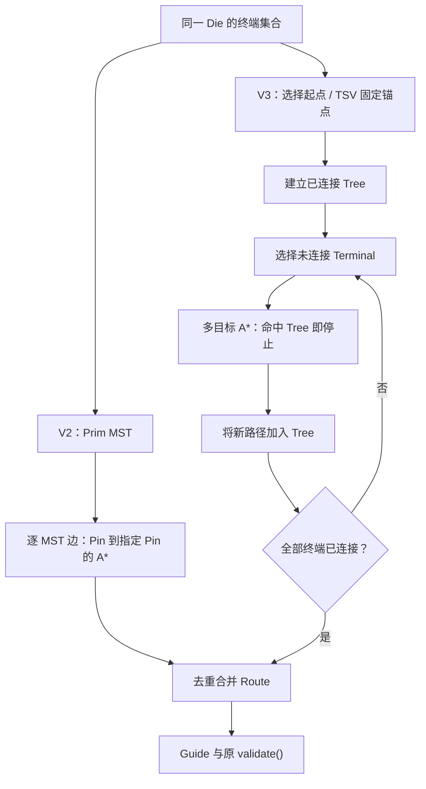

# 算法版本迭代说明

本文维护同一 Router 工程的 V1、V2、V3 演进。版本由源码提交、实际二进制 SHA256、配置和运行记录共同确定，不能用 Run 的 Label 或较新的 Git HEAD 代替版本证据。

相关文档：[比赛代码逻辑](./比赛代码逻辑.md) · [比赛代码使用说明](./比赛代码使用说明.md) · [目录结构](./目录结构.md) · [Router 版本管理](./EDA/code_3DIC%20EDA/docs/Router版本管理.md)。

## 目录

1. [项目简介与算法总体目标](#version-1)
2. [算法版本总览](#version-2)
3. [V1：基础全局布线算法](#version-3)
4. [V2：算法性能与工程效率优化](#version-4)
5. [V3：布线质量与搜索策略优化](#version-5)
6. [V1 / V2 / V3 核心算法对比](#version-6)
7. [各版本运行与官方评分结果](#version-7)
8. [各版本编译、运行及回退方法](#version-8)
9. [版本开发时间线与 Git 对应关系](#version-9)
10. [当前存在的问题](#version-10)
11. [下一版本优化方向](#version-11)
12. [文档更新规则](#version-12)
13. [V3 Final：固定入口与 Guide 质量保护](#version-13)

<a id="version-1"></a>
## 1. 项目简介与算法总体目标

正式工程为 `EDA/code_3DIC EDA/`。DEF 给出放置、连接及 Track/GCell；LEF 给出宏、Pin、层方向及 Via；Thermal JSON 提供给定温度场。Router 生成每个 Net 的 Guide，并可输出真实图边、Trace、进度和资源日志。

优化目标是在合法连通、唯一 TSV 和层约束下兼顾 Wirelength、Congestion、Thermal、Runtime 与 Peak RSS。内部 `validate()`、本地 Overflow、官方评分 PASS、详细布线签核是不同层次的结论。官方工具仍是 Guide / mock-DRT proxy，不代表真实详细布线或隐藏用例保证。

<a id="version-2"></a>
## 2. 算法版本总览

| 版本 | 主要目标 | 源码与构建身份 | 状态 |
|---|---|---|---|
| V1 | 建立独立可运行的全局布线器 | `024d648dae3fe9051e336b8928502de09bf0654b`；`build/router_v1` | 已登记；有实际官方 PASS 记录 |
| V2 | 保持算法输出，降低重复计算与复制 | `a0f8e717ebbeca32ef999c8caf398fec46ba41c2`；`build/router_v2` | 已登记；有同参数比较 |
| V3 | 固定 Final 策略，保留历史研究模式 | 首轮 `56f3d5b`，本轮基点 `410a512` | 唯一日常入口 `router_v3_final + v3_final.json`；本地验证通过，尚未正式登记，见第 13 章 |


V1 SHA256：`70ddc978c6f427ef79d6601e0a3bf099108e945cbbac249b2c2aa234d3c00423`。

V2 SHA256：`6440fcf3211e616534d9192bbc7ceabec99956fc41f1b43e002d2ffa06c0b30f`。

<a id="version-3"></a>
## 3. V1：基础全局布线算法

以下内容已对照 V1 Git 源码，不能将 V2 缓存或后来的 UI 架构追溯成 V1 算法。

| 功能及原理 | 实现文件 / 函数 | 作用、局限及后续关系 |
|---|---|---|
| DEF / LEF 解析：将文本转为 Design、宏、放置与终端 | `src/parser.cpp`：`parse_lef()`、`parse_def()`、`placed_rect()` | 支持八种方位变换及矩形 Pin/OBS；拒绝未支持的几何和非空 DEF 扩展段。V2/V3 继续复用语义 |
| Thermal 投影：按 XY 合并样本，再映射 GCell | `Router::load_thermal()` | DBU/µm 转换后平均，空洞确定性填充；这是给定热场，未重算布线后的温度 |
| 图与容量：GCell × 金属层，Track 决定节点容量 | `Router()`、`capacity()`、`build_fixed_demand()` | 平面边服从 Preferred Direction；Pin/OBS 贡献 fixed。容量与官方统计口径仍有偏差 |
| 多 Pin 终端拓扑：稠密 Prim MST | `Router::mst()` | 时间 O(P²)、辅助存储 O(P)；按几何与 Via 下界构造终端树，不是最优 Steiner Tree |
| 实际路径：逐 MST 边 A* | `Router::search()`、`route()` | 包围盒逐步扩张，哈希存储搜索状态；不同边可重合，但后续边目标仍是指定终端 |
| Via 与双 Die | `route()`、`search()`、`validate()` | 普通 Via 需 LEF 合法；Bottom M1–M10、Top M11–M20；跨 Die 增加唯一 M10/M11 TSV 边 |
| TSV 热感知候选 | `Router::select_tsv()` | Pin 位置与限量采样格点；综合距离、接口压力、冷点惩罚。保留固定 TSV 约束，不是全局热最优 |
| 动态拥塞成本与历史成本 | `search()`、`run()` | 新增需求的过载平方项与非负历史项；本地代价不等于官方分数 |
| 初始布线与 Rip-up and Reroute | `Router::run()` | 原始 Net 顺序；对拥塞 Net 重布，仅整体 Overflow 严格下降时接受；V1 使用完整 Route 备份 |
| Guide 与内部合法性 | `make_guides()`、`validate()`、`write_guide()` | 沿层方向合并区域，接口层保持独立；检查连通、Pin、方向、Via、唯一 TSV。不等于官方完整合法性 |
| 本地工作流 | `main.cpp`、`scripts/run_case.py`、`evaluate.py`、`ui/` | 四参数 CLI、可选 JSON/Trace、运行与评分、2D/3D 与大数据索引在 V1 提交时已存在；后续版本登记、评分监督等属于工程更新 |

搜索边成本为：

\[
c(u,v)=c_{\mathrm{wire/via}}(u,v)
 +w_c\left(\frac{\max(0,U_v+F_v+1-C_v)}{\max(1,C_v)}\right)^2+w_h H_v.
\]

共享节点/边以集合去重。`occupy()` 按 Net 的节点集合计费，跨 Die 的两个接口节点另有 TSV 额外需求；不能把每条搜索分支分别叠加收费。

<a id="version-4"></a>
## 4. V2：算法性能与工程效率优化

证据来源：V1/V2 Git Diff 与 `outputs/reports/algorithm_optimization/optimization_summary.md`。V2 的目标是等价输出，未改变 Prim、TSV 打分公式、搜索邻居顺序和 A* Tie-Breaker。

| 项目 | V1 → V2 | 开销变化与实现位置 | 实测证据 |
|---|---|---|---|
| A* Workspace | 每次新建 sparse map → 小窗口 Dense + 大窗口 Sparse | `search()`；Dense 最多 8192 状态，Generation 复用，溢出时清标记；不分配全图数组 | 受控 astar 展开数均 53,400，routing 中位时间 0.0949008 → 0.0557863 s |
| 几何与规则访问 | 反复取 cell/Layer/Via → 轴中心和固定规则缓存 | 构造函数、`refresh_layers()`；中心 O(1)，避免临时 Rect 和重复 map 查找；直接 API 修改仍刷新 | 不单独归因百分比，与 A* 组合测试 |
| Thermal/TSV | 每个跨 Die Net 全热图 min/max 扫描、候选 set → 单次统计及排序去重 vector | `refresh_heat_stats()`、`select_tsv()`；热图扫描由每 Net O(G) 变为 run 内一次 O(G) | 受控 TSV routing 中位时间 0.365051 → 0.0708347 s |
| Capacity | 每个新资源扫描 Track → 按轴容量表 | `refresh_capacities()`、`capacity()`；缓存总计最多 8 MiB，超限回退 | 原半开 Track 区间计数保持一致 |
| 临时对象 | 非 Trace 路径仍构造 JSON → 仅需要 Trace 时构造 | `route()`、`run()` | 无 Trace 时减少 JSON 分配，仍完整写出最终结果 |
| 重布与回滚 | 全 routes 副本 → 只 Move 真正修改的 Route | `reroute_pass()`；备份存储与改动量相关，异常恢复已修改项 | 受控 reroute RSS 中位值 10,235,900 → 7,880,700 bytes；routing 0.171891 → 0.0509827 s |
| 验证与 Profile | 新增独立 Dijkstra、小图、受控基准与计数 | `tests/algorithm_tests.hpp`、`router_benchmark.cpp`；`GR_PROFILE` 仅统计构建开启 | 旧报告保留完整范围、AB/BA 顺序与失败阶段，生产构建不含 Profile |

这些是历史受控合成基准，不能外推大型 Case 的加速倍数。真实 case001 当时各跑一次：V1 C++ elapsed 104.262 s，V2 53.1971 s，官方指标与 Guide 相同；进程树峰值约 129.117 / 126.008 MiB。toy 的短时结果也曾略慢，因此不能声称所有场景都提升。

<a id="version-5"></a>
## 5. V3：布线质量与搜索策略优化

### 5.1 设计目标与实际状态

本节在实现前先记录目标，以下已按真实代码与实验更新。所有新开关默认 0；V2 对照必须使用不含新键的配置。仅改变 Net index 处理顺序，始终保持 `routes[i] ↔ d.nets[i]`。

| 策略 | 实际实现 | 验证状态 |
|---|---|---|
| Net Ordering | 只排序 Index：模式 1 按原始 Pin HPWL 降序；模式 2 按跨 Die、Pin 数、HPWL 降序，最终以原 Index 升序打平 | 两种排序通过 C++ 测试；模式 2 完成三个公开 Case 布线，case001 评分超时 |
| Tree-Aware A* | 待连接终端连向当前同 Die 已连通树；确定性包围盒下界选择下一 Terminal | 独立 Dijkstra、Dense/Sparse、合法性测试通过；三个 Case 均实际官方 PASS |
| 拥塞重布优先级 | 按拆除 Net 可降低的本地 Overflow、严重度等排序；任意 Index 顺序恢复 | 非升序多 Net 拒绝/异常恢复通过；三个 Case 均实际官方 PASS |
| TSV 新策略 | `select_tsv()` 原样复用 V2 | 未实现新候选/热优化；没有 TSV 策略消融，不宣称 Thermal 改善 |

新配置从未改动的 `default.json` 复制全部共有参数，仅增加三个整数模式：

| 配置 | `net_order_mode` | `tree_route_mode` | `reroute_priority_mode` |
|---|---:|---:|---:|
| `v3_legacy.json` | 0 | 0 | 0 |
| `v3_net_order.json` | 2 | 0 | 0 |
| `v3_tree_aware.json` | 0 | 1 | 0 |
| `v3_congestion.json` | 0 | 0 | 1 |
| `v3_combined.json` | 2 | 1 | 1 |

合法范围分别为 0–2、0–1、0–1；分数、负数、越界值被拒绝。`default2.json` 仍是不同的原参数配置，不属于本次公平比较。Combined 不是新的全局默认。

### 5.2 多目标搜索思想

对当前树 T，使用其空间包围盒 B(T) 和层范围构造保守下界：

\[
h(v,T)=\frac{w_{wire}}{unit}\,[d(x_v,[x_{min},x_{max}])+d(y_v,[y_{min},y_{max}])]
+w_{via}\,d(l_v,[l_{min},l_{max}]).
\]

区间距离为区间外到最近端点的距离，区间内为 0。T 是包围盒的子集；动态拥塞/历史代价非负，所以该值不高估目标树的剩余路径成本。目标查询使用哈希集合，不能在每次展开时遍历整棵树。窗口外仍沿用逐步扩大策略；局部窗口求得的最优路径不保证是完整图的全局最优。



这是增量 Steiner-Aware 近似，并非实现全局最优 Steiner Tree。Bottom/Top 分别生长，只通过选定 TSV 相连。

### 5.3 Tree Growth、开销与函数差异

Die 内普通 Net 以最小 Node ID 终端为种子；跨 Die Net 的两侧分别以选定 TSV 的 M10/M11 节点为种子。每次从尚未连接的终端中选择包围盒下界最小者，平局按 Node ID；命中树后，将路径并入树。路径自然经过的其他终端会被跳过。

`Route.nodes` 在原逻辑中预先放入全部 Pin，故 **不能将它直接用作已连通树的目标集合**。V3 使用单独的 `TreeTarget`，只保存已连接节点，并增量更新 bbox。目标查询期望 O(1)，每次展开不扫描树。调度预处理 O(总 Pin + N log N)，保存 O(N) Index/Key；单 Net 终端选择 O(P²)，目标集合 O(T)，Dense Workspace 仍最多 8192 状态。额外树集合仅存当前 Net，不为全部 Net 或完整图分配副本。

| 函数 / 文件 | 相对 V2 的实际变化 |
|---|---|
| `Config` / `model.hpp`、`main.cpp` | 增加并严格校验三个数字模式；四参数 CLI 和原参数默认值不变 |
| `Router::run()` | `initial_order()` 返回 Index 顺序；按处理位置记录进度，按原 Index 保存 Route |
| `Router::route()` | 模式 0 保留原 Prim + A*；模式 1 按 Die 维护 `TreeTarget`，树种子、目标与真实路径写入 Trace |
| `Router::search()` | 保留原公共接口；经共享 `search_impl()` 执行固定 Goal 搜索 |
| `search_to_tree()` / `search_impl()` / `add_target()` | 新增多目标查询、bbox 下界、增量目标集合；复用旧窗口、Dense/Sparse、Generation、代价、邻居顺序及预算机制 |
| `Router::mst()` | 未修改算法，Legacy 继续调用；Tree 模式不生成假的 MST |
| `Router::reroute_pass()` | 可选 `reroute_order()`；拒绝分支按同一调度顺序匹配 Backup，异常分支仍逆序恢复 |
| `Router::select_tsv()`、`validate()` | 算法与检查原样复用，不降低唯一 TSV、层范围、Via 或连通要求 |
| `result_json()`、Trace 与 UI | 新模式下增加可选 `algorithm` 对象；Tree topology 明示 `strategy=tree_aware`、种子及空 `mst_edges`，UI 不再将其描述为 MST 边；原 Pin/Route/Guide 字段不删除 |

### 5.4 拥塞排序与回滚保证

设 `q(n,v)` 为该 Net 的节点需求：普通节点为 1，跨 Die 的两个 TSV 接口节点为 2。主优先级采用当前模型下拆除此 Net 可减少的局部 Overflow：

\[
m_n=\sum_{v\in R_n}\min\{\max(0,U_v+F_v-C_v),q(n,v)\}.
\]

降序 Tie-Breaker 依次为过载/容量严重度之和、拥塞节点数、跨 Die 标志，最后原 Net Index 升序。每轮仅预计算一次优先级；真正轮到 Net 时仍检查当前是否拥塞。接受条件仍为 **整体本地 Overflow 严格下降**，不以局部改善替代全局判断。

拒绝或异常后，Route、Guide、TSV 和节点 Usage 恢复；新增但未使用的资源条目可保留为 usage=0。History 仍按 V2 累积，不回滚历史惩罚。集合去重后每个完整 Net 只 `occupy()` 一次，分支共享不重复计费。

### 5.5 正确性与受控 Profile

原有 C++ 核心检查及 `tree_aware_tests.hpp` 均通过，覆盖二/三/多 Pin、重复 GCell、已在树上的终端、非均匀格、合法/缺失 Via、Preferred Direction、唯一/固定 TSV、不可达、空目标、跨 Die 非法目标、Search Limit、Timeout、Generation 复用/回绕、Dense/Sparse、有序身份及非升序重布拒绝/异常回滚。多目标成本与小图独立 Dijkstra 的最小目标成本一致；Oracle 使用完整窗口，不把局部窗口路径误称全图最优。

Python 工作流 8 项通过，新增整数模式拒绝测试、Tree Trace 语义及完整输出检查。真实 toy/sample001 的 12 份 Trace 均完整回放至最终图边。三个真实 Case 的 V3-Legacy Guide SHA256 和剔除计时后的完整 JSON 均与已登记 V2 一致。

受控 300-Net、每 Net 五 Pin、96×96 网格，三个交替顺序重复的中位值如下。它比较同一 Profile 二进制的 Legacy/Tree/Combined，**不是官方成绩**。未隔离 CPU，部分时段共享主机；短时数值不能当作稳定加速比例。

| 模式 | Routing 中位 s | RSS 中位 MiB | 搜索次数 | 展开数 | 本地线长 DBU |
|---|---:|---:|---:|---:|---:|
| V3-Legacy | 0.122302 | 6.863 | 1200 | 53,100 | 1,080,000 |
| Tree-Aware | 0.409444 | 7.641 | 1200 | 194,400 | 1,110,000 |
| Combined | 0.286883 | 7.734 | 1200 | 194,400 | 1,110,000 |

该夹具没有改善：包围盒目标下界较松，搜索展开增多，线长也增加。保留全部重复和这项负结果，见 `controlled_benchmarks.json`；首次 harness 混合编码解析失败后复用了已完整写出的原始测量，没有将其删除或伪装为 Router 失败。

### 5.6 V3 Congestion Optimization：先分解真实拥塞

本轮在 `v3-tree-aware` 的 `56f3d5b` 基点增量开发，保留上一轮 V3 功能、配置、候选和全部实验。未重新运行 case005：流式读取 `case005_v2_1/result.json`（611028871 bytes、179700 Net），逐资源核对既存指标。对每个格层 v 定义：

\[
O_v=\max(0,F_v+U_v-C_v),\quad B_v=\max(0,F_v-C_v),\quad I_v=O_v-B_v.
\]

| 指标 | 已有 case005 实测 |
|---|---:|
| Total Local Overflow，\(\sum O_v\) | 7,865,225 |
| Fixed-Demand Baseline Overflow，\(\sum B_v\) | 7,069,248 |
| Routing-Induced Incremental Overflow，\(\sum I_v\) | 795,977 |
| Hotspot GCell Count（按格层，不合并 XY） | 522,755 |
| 固定需求已超容量的格层数 | 453,750 |
| 零容量且有需求的格层数 / 需求总量 | 0 / 0 |
| 已输出资源格层 / Usage 总量 | 6,065,032 / 10,183,502 |

固定基线约占 89.88%，路由增量约占 10.12%；不能声称全部 Overflow 均可由重布消除，也不能将不可改变的固定基线计作布线优化收益。

| Metal Layer | Total | Fixed baseline | Routing incremental |
|---|---:|---:|---:|
| M1 | 3,897,899 | 3,498,689 | 399,210 |
| M11 | 3,857,712 | 3,490,361 | 367,351 |
| 其余已使用层合计 | 109,614 | 80,198 | 29,416 |

M1/M11 合计约占 98.61%。最大热点之一为 M11、GCell `(763,861)`，DBU 区域 `[2289000,2583000,2292000,2586000]`：Capacity=15、Fixed=99、Usage=4，Overflow=88，其中固定基线=84。完整分层和前 30 个热点见[真实分解报告](./EDA/code_3DIC%20EDA/outputs/reports/v3_algorithm/congestion_20261029_201139/case005_decomposition.json)。

`capacity()` 按首选方向的正交 Track 轴统计，缓存仍与原计数一致；`build_fixed_demand()` 对每个实例的全部 Pin/OBS 矩形分别累加占轨近似，重叠形状可能重复累计。合成重叠测试已证明这种行为，但旧结果没有 Pin/OBS 来源标签，无法从其固定总量分离各自贡献或真实重复量。因此本轮**没有修改 Capacity 或 Pin/OBS 规则**，没有把模型偏差直接认定为解析错误。

`occupy()` 按每 Net 的唯一 Node 集合计一次，再为跨 Die Net 的 M10/M11 各加一，故接口各合计两单位。179700 Net 的节点数加 `2 × 39542` 恰等于全部资源 Usage=10183502，符合当前模型。旧 A* 搜索仍用一单位代理，新代价模式在接口访问时使用两单位；这不改变 Guide 或 TSV 计费规则。

本地以实际图 Node 的 F+U 计算；官方报告标明 `GRT guide demand / merged DEF track capacity`，按最终 Guide 计算代理指标。固定需求处理、Track 合并、Guide 覆盖及边界口径不能假定逐项相同；闭源 latest 的内部固定需求实现未被证实，不能靠报告猜测并改规则。case001 的 8289 与 case005 本地 7865225 更不能跨用例直接比较。

同一 V2 case001 进一步核对：本地 584899=固定基线 569009+路由增量 15890，官方为 8289。M11 格 `(110,218)` 的本地 Capacity=15、Fixed=152、Usage=1、Overflow=138，而完整官方 CSV 对应 Capacity=15、Demand=17、Overflow=2；另一个 M1 格 `(35,247)` 本地 Fixed=139、Usage=0、Overflow=124，官方 Demand=16、Overflow=1。容量在这些样本中一致，差异主要体现在有效需求，不能直接把固定需求累加近似当作官方目标。正式说明 3.2 确实要求 Pin/OBS 实际占轨、同 Net Guide 去重及 TSV 附加需求，但如何投影、合并与处理边界仍需逐项校准。对齐证据见[同格层报告](./EDA/code_3DIC%20EDA/outputs/reports/v3_algorithm/congestion_20261029_201139/model_alignment_examples.json)；这些样本不构成新的固定需求公式。

### 5.7 新增 A* 拥塞代价模式

设 D=U+F、C'=max(1,C)、H 为非负历史值，新占用 q 通常为 1，跨 Die 接口为 2，定义：

\[
\Delta O=\max(0,D+q-C)-\max(0,D-C),\quad
\rho=\min(1,\max(0,(D+q)/C')),\quad o=\max(0,D+q-C)/C'.
\]

| `congestion_cost_mode` | 非几何惩罚，w 为 `congestion`，h 为 `history` |
|---|---|
| 0：Legacy | 原样保留 \(w[\max(0,D+1-C)/C']^2+hH\)，接口仍使用旧的一单位搜索代理 |
| 1：Incremental | \(w\Delta O+hH\)，只对新增溢出收费，不把固定基线再次当作新增量 |
| 2：Hybrid | \(w(0.25\Delta O+0.05\rho^4+o^2)+hH\)，混合轻度利用率、增量与严重过载惩罚 |

例如 C=100、D=100、w=4、H=0 时，新增一单位的惩罚分别是 0.0004、4、1.2004，明确解决 Legacy 对高容量资源轻微越界惩罚很弱的问题。所有项非负，Wire/Via 几何下界仍可采纳；非均匀小图上固定目标和 Tree 多目标均与独立 Dijkstra 比较。

新增函数 `Router::congestion_penalty()` 被共享 `search_impl()` 调用；不改邻居合法性、Prim、TSV 候选、解析或官方评分器。多个分支合并前的搜索仍是节点需求代理，最终占用继续按完整 Net 去重。

### 5.8 有预算、有线长保护的重布策略

`reroute_policy_mode=0` 保留原行为；模式 1 调用 `guarded_reroute_pass()`：

- 沿用实际可拆除溢出贡献排序，但排序和候选判断排除该 Net 必经的 Pin 节点，避免仅为无法绕开的端点反复搜索。
- 每次 Move 备份当前 Route，计算拆除减少量和新 Route 插入增加量，要求**全局本地 Overflow 净下降**才接受。两者按唯一节点和 TSV 两单位计算，包含交集抵消，不用单个热点下降冒充全局下降。
- 新 Route 本地线长不得超过旧 Route 的 1.005 倍；总线长不得超过首次进入该策略时基准的 1.005 倍。该保护约束重布阶段的图边线长，**不保证初始新代价相对 V2 或官方 Guide 线长也在 0.5% 内**，仍须官方消融验证。
- 每轮最多尝试 512 Net、搜索阶段软预算 20 s；A* 也检查软截止时间。预算结束时恢复当前未完成候选，保留已通过联合条件的修改；全局 Router 超时和非预期异常恢复整轮并向上传播。
- 无收益、搜索上限或无路径的候选恢复后，下一轮冷却一次；不提高原 `search_limit`。History 保持原累积语义。

新增 `iterations[].reroute_diagnostics` 记录尝试/接受/拒绝/跳过数量及停止原因；`congestion_strategy` 记录实际代价、策略和预算。旧字段保留，新模式全关时不增加这些输出。

### 5.9 本轮独立配置与可复现实验

以下文件复制同一 `default.json` 基础参数，不改旧配置，第一轮 Net Ordering / Tree-Aware 均为 0：

| 配置 | Cost | Guarded reroute | Priority |
|---|---:|---:|---:|
| `v3_congestion_legacy.json` | 0 | 0 | 0 |
| `v3_cost_incremental.json` | 1 | 0 | 0 |
| `v3_cost_hybrid.json` | 2 | 0 | 0 |
| `v3_reroute_guarded.json` | 0 | 1 | 1 |
| `v3_congestion_candidate.json` | 2 | 1 | 1 |

新增整数模式、`reroute_max_nets`（正整数）、`reroute_pass_seconds`（正有限数）、`reroute_wire_growth`（0–0.1）均被校验。后者默认 0.005，不作为新的全局默认策略。旧 V2 不接受这些新键。

`scripts/compare_router_v3.py --suite congestion` 使用已登记 V2、候选 Legacy、Incremental、Hybrid、Guarded、Congestion Combined 六组；首轮工具默认 `tree`，本轮已改为 `final`，历史消融须显式传 `--suite tree/congestion/congestion_scoped`。工具拒绝 case003/005，并禁止在拥塞消融配置中开启 Net Ordering/Tree。实际成绩见本章后续记录；未评分不标记有效。

第一轮出现初始新代价使官方线长退化的证据后，新增保守开关 `congestion_scope_mode`：0 表示初始/重布均使用所选代价；1 表示**初始布线严格用 Legacy，进入重布时才启用新代价**。状态以 RAII 在正常返回、预算和异常后恢复，不泄漏到后续初始布线或直接搜索。新配置 `v3_congestion_reroute_only.json` 在混合代价+受控重布上仅增加 scope=1，独立使用第二个候选。`--suite congestion_scoped` 只比较 V2、最终源码 Legacy、Scoped 三组，不覆盖第一轮候选及结果。

<a id="version-6"></a>
## 6. V1 / V2 / V3 核心算法对比

| 项目 | V1 | V2 | V3 实际实现 |
|---|---|---|---|
| 搜索 | Sparse A* | 有界 Dense/Sparse A* | 可选 Tree-Aware A*，保留旧搜索 |
| 多 Pin | Prim MST 逐边连接 | 相同 | 已有树增量连接 |
| Net 顺序 | 输入顺序 | 相同 | 可配置且可复现 |
| TSV | 热感知候选 | 相同公式，缓存优化 | 复用 V2；复杂策略尚未实现 |
| 重布 | 全量备份、整体 Overflow 判断 | 增量备份回滚 | 候选优先级与任意顺序安全恢复 |
| 版本状态 | 已登记 | 已登记 | 候选，不自动替代 V2 |

<a id="version-7"></a>
## 7. 各版本运行与官方评分结果

历史 V1/V2：toy、sample001、case001 的同配置比较均有真实 latest PASS，分项与 Guide 相同，见第二阶段 `small_cases.json`、`case001_comparison.json`。

早期 Run Label `v2` / `v3` 不是正式算法版本号；应按 Router SHA256 判定。case003 的异常评分、case005 的 ROUTED 记录不能改写成官方 PASS。

### 7.1 本次实验协议与可追溯身份

实验 ID `20261029_113225`：已登记 V2 Baseline → V3-Legacy → Net Ordering → Tree-Aware → Congestion → Combined。每项为独立消融，箭头表示实验顺序，不表示后一个模式必然叠加前者；只有 Combined 开启三项。

- 同一份 `default.json` 共有参数、相同原始输入；每项 Router 预算 180 s、latest 评分预算 120 s。toy/sample001 开 Trace，case001 关闭 Trace。每 Case/模式仅测一次。
- Label 为 `v3_20261029_113225_<模式>`，Case 再由所属目录区分。18 次 Router 全部 ROUTED；17 次官方 PASS，case001 的 Net Ordering 评分达到预算而未完成。
- V3 生产候选 `build/router_v3_candidate`，SHA256 为 `47a285c048124b5a6987f2b90171ff1c20fbe12b218b7405cc8aa4669977821a`，运行登记为 UNKNOWN，不能冒充已注册 V3。构建基点 `5b59ab2`，实际工作区源码哈希在构建清单和每份 run.json。
- C++ 时间来自 `result.metrics.runtime_seconds`，包含解析和当时已执行的输出阶段，不是纯 A*；完整 helper 时间另存记录。RSS 为 Linux Supervisor 等待子进程得到的 getrusage 高水位，可能包含 exec 前继承的启动内存；GNU time 整条命令树峰值与周期采样也独立保留。
- 原始证据：[对照 JSON](./EDA/code_3DIC%20EDA/outputs/reports/v3_algorithm/20261029_113225/comparisons/results.json)、[CSV](./EDA/code_3DIC%20EDA/outputs/reports/v3_algorithm/20261029_113225/comparisons/results.csv)、[构建清单](./EDA/code_3DIC%20EDA/outputs/reports/v3_algorithm/20261029_113225/candidate.json)、[受控 Profile](./EDA/code_3DIC%20EDA/outputs/reports/v3_algorithm/20261029_113225/controlled_benchmarks.json)。这些 outputs 是本机 Git 忽略产物，远端不一定包含；本页保留可直接阅读的实测摘要。

### 7.2 case001 主对照：3152 Net

| Mode | Router / Official | C++ s | RSS MiB | Official Wirelength DBU | Official Overflow |
|---|---|---|---|---|---|
| v2 | ROUTED / PASS | 59.472 | 125.992 | 843819000 | 8289 |
| legacy | ROUTED / PASS | 62.981 | 125.801 | 843819000 | 8289 |
| net_order | ROUTED / NOT_EVALUATED | 86.275 | 126.559 | N/A | N/A |
| tree_aware | ROUTED / PASS | 64.361 | 118.816 | 854565000 | 8237 |
| congestion | ROUTED / PASS | 54.046 | 125.844 | 843828000 | 8289 |
| combined | ROUTED / PASS | 41.074 | 117.184 | 854523000 | 8238 |

V3-Legacy 与 V2 的 Guide/规范化 JSON 完全一致。Net Ordering 已完成 Router，但评分器约 120.4 s 时被监督进程按 `time_budget` 发送 SIGTERM，真实返回码 -15，未生成官方报告：这是 **评分调用 TIMEOUT / NOT_EVALUATED**，不是官方 FAIL，更不能填入猜测成绩。本轮保留该记录，未自动提高预算重评。

| Mode | Wirelength score | Congestion score | Thermal score | Official total |
|---|---|---|---|---|
| v2 | 64.668125 | 78.170604 | 51.349311 | N/A |
| legacy | 64.668125 | 78.170604 | 51.349311 | N/A |
| net_order | N/A | N/A | N/A | N/A |
| tree_aware | 63.854935 | 78.317504 | 51.349311 | N/A |
| congestion | 64.667435 | 78.170604 | 51.349311 | N/A |
| combined | 63.858073 | 78.316436 | 51.349311 | N/A |

所有实际完成报告的 TSV 均为 657，官方 Pearson 均为 0.002310234269；没有新的 TSV 热优化收益。本地 Pearson 为约 0.127166，与官方口径不同。本地 Overflow：V2/Legacy/Net Ordering/Congestion 为 584899，Tree/Combined 为 584777；不能用这 122 的下降替代官方 Overflow 或分数。

### 7.3 toy / sample001 全部消融

| Case | Mode | Official | C++ s | RSS MiB | Wirelength DBU | Overflow | W / C / T scores |
|---|---|---|---|---|---|---|---|
| toy | v2 | PASS | 0.728 | 12.770 | 30965800 | 244 | 53.6202 / 92.7342 / 47.1785 |
| toy | legacy | PASS | 0.654 | 12.793 | 30965800 | 244 | 53.6202 / 92.7342 / 47.1785 |
| toy | net_order | PASS | 0.453 | 12.859 | 31479400 | 236 | 52.7454 / 93.0514 / 47.1785 |
| toy | tree_aware | PASS | 0.719 | 12.859 | 30826700 | 244 | 53.8622 / 92.6457 / 47.1785 |
| toy | congestion | PASS | 0.538 | 12.832 | 30944400 | 244 | 53.6573 / 92.6429 / 47.1785 |
| toy | combined | PASS | 0.388 | 12.926 | 31286800 | 238 | 53.0701 / 92.8118 / 47.1785 |
| sample001 | v2 | PASS | 0.517 | 12.766 | 6452400 | 453 | 89.5517 / 73.3848 / 51.0939 |
| sample001 | legacy | PASS | 0.777 | 12.980 | 6452400 | 453 | 89.5517 / 73.3848 / 51.0939 |
| sample001 | net_order | PASS | 0.853 | 12.941 | 6452400 | 453 | 89.5517 / 73.3848 / 51.0939 |
| sample001 | tree_aware | PASS | 0.716 | 12.633 | 6452400 | 453 | 89.5517 / 73.3848 / 51.0939 |
| sample001 | congestion | PASS | 0.930 | 12.781 | 6452400 | 453 | 89.5517 / 73.3848 / 51.0939 |
| sample001 | combined | PASS | 0.784 | 12.887 | 6452400 | 453 | 89.5517 / 73.3848 / 51.0939 |

toy 的官方 Pearson 各模式均为 -0.002628377442；sample001 均为 0.001094066710。所有官方总分字段均缺失，统一为 N/A，未将实验加权值当作官方总分。短用例的时间/RSS 差异受启动与系统负载影响，不用这些单次小数值宣称稳定加速。

### 7.4 是否取代 V2

**目前不建议全面取代 V2。** Combined 在 case001 的本次单次测量时间和内存较低、拥塞略有改善，但官方线长 843819000 → 854523000 DBU，Wirelength 分 64.668125 → 63.858073；Thermal 无变化。Tree-Aware 单独模式还更慢，受控夹具也出现线长和展开数退化。Net Ordering 在 toy 改善 Overflow 却使线长变差，case001 还发生评分预算超时。

所以保留这些可独立开关的研究结果，默认继续 Legacy。case003/005 未运行 V3，不能保证其时间、内存或官方合法性。历史 `case005_v2_1` 的 V2 ROUTED 179700 Net、5919.766 s、采样峰值 4749651968 bytes（约 4.424 GiB）只作历史稳定性证据，不是本次消融或官方 PASS。

### 7.5 最终回归与保护检查

| 检查 | 实际结果与范围 |
|---|---|
| Linux C++17 生产构建、原核心及新增 Tree-Aware 测试 | 编译成功；最终 `core_tests_final` 通过。包含独立 Dijkstra、非均匀网格、合法 Via、唯一 TSV、Dense/Sparse、Generation、搜索预算及重布接受/拒绝/异常状态检查 |
| V3-Legacy 等价性 | toy、sample001、case001 的 Guide SHA256 和规范化 JSON SHA256 均与 V2 相同；JSON 仅排除观测字段 `metrics.runtime_seconds` |
| WSL Python 3.10 全测试 | 73 项：63 通过、1 项平台条件跳过、9 项错误。错误均来自原清理工具调用 Python 3.10 没有的 `Path.is_junction()`，完整失败日志保留，未修改无关工具 |
| Windows Python 3.13 补测 | 上述清理工具 9 项全部通过；parameter_tuning 的预算、唯一 Label/中文空格路径、评分失败、冻结基线 4 项兼容性测试通过，使用 Mock，不是官方成绩 |
| UI 与 Trace | 新增元数据兼容测试、JavaScript 语法及拓扑文案检查通过；临时 UI 服务器实际加载三种 Combined 结果，返回真实的 203 / 203 / 3152 Net、20 层及完整 Pin/Node/Edge/Guide。小用例 Trace 重放与最终边集合一致；未进行全面浏览器交互回归 |
| 文件保护 | 初始登记的 29 个关键文件 SHA256 无变化；722 个原有运行文件的大小/修改时间无变化。候选二进制与记录的当前生产源码哈希一致；`select_tsv()`、`validate()` 保持原实现 |
| 运行范围与清理 | 仅新增本轮独立 Label；没有运行 case003/005，没有覆盖旧 Guide/报告，没有 commit/push。临时测试目录与临时 UI 缓存/服务器已清理；本轮正式实验记录、构建身份和失败日志保留 |

复核原始记录：[核心测试](./EDA/code_3DIC%20EDA/outputs/reports/v3_algorithm/20261029_113225/core_final.json)、[WSL 全测试日志](./EDA/code_3DIC%20EDA/outputs/reports/v3_algorithm/20261029_113225/python_all.log)、[Windows 兼容性](./EDA/code_3DIC%20EDA/outputs/reports/v3_algorithm/20261029_113225/windows_compatibility.json)、[UI API](./EDA/code_3DIC%20EDA/outputs/reports/v3_algorithm/20261029_113225/ui_api.json)、[保护与等价性](./EDA/code_3DIC%20EDA/outputs/reports/v3_algorithm/20261029_113225/verification.json)。

### 7.6 V3 拥塞优化第一轮：独立消融

实验 `congestion_20261029_201139`：六模式 × toy/sample001/case001，18 次 Router 和 latest 评分均实际 PASS。基础参数均来自同一 `default.json`；Net Ordering=0、Tree-Aware=0；Router/评分预算各 180 s。候选为 `build/router_v3_congestion_candidate_20261029`，SHA256 `4173d77702d1fb51316ece49ffb46e30285a33cd23315b583b65b96ec0476fac`；该候选对应加入 scope 开关前的源码清单，不能用后续工作区哈希冒充它的构建来源。各配置、Guide SHA256、完整官方报告与所有迭代诊断见[本轮 JSON](./EDA/code_3DIC%20EDA/outputs/reports/v3_algorithm/congestion_20261029_201139/comparisons/results.json)和[CSV](./EDA/code_3DIC%20EDA/outputs/reports/v3_algorithm/congestion_20261029_201139/comparisons/results.csv)。

case001:

| Mode | Official | Wirelength DBU | Overflow | W score | C score | C++ s | RSS MiB |
|---|---|---:|---:|---:|---:|---:|---:|
| v2 | PASS | 843819000 | 8289 | 64.668125 | 78.170604 | 49.051 | 125.867 |
| legacy | PASS | 843819000 | 8289 | 64.668125 | 78.170604 | 50.423 | 125.996 |
| incremental | PASS | 856920000 | 8114 | 63.679448 | 78.617043 | 26.386 | 124.848 |
| hybrid | PASS | 857055000 | 8151 | 63.669417 | 78.536184 | 77.929 | 126.844 |
| guarded | PASS | 842208000 | 8305 | 64.791824 | 78.130299 | 29.535 | 108.969 |
| congestion_combined | PASS | 856263000 | 8155 | 63.728308 | 78.523270 | 33.195 | 106.961 |

toy / sample001:

| Case | Mode | Official | Wirelength DBU | Overflow | W / C / T scores | C++ s | RSS MiB |
|---|---|---|---:|---:|---|---:|---:|
| toy | v2 | PASS | 30965800 | 244 | 53.6202 / 92.7342 / 47.1785 | 0.512 | 12.770 |
| toy | legacy | PASS | 30965800 | 244 | 53.6202 / 92.7342 / 47.1785 | 0.394 | 12.695 |
| toy | incremental | PASS | 33929700 | 222 | 48.9363 / 93.1934 / 47.1785 | 0.422 | 12.789 |
| toy | hybrid | PASS | 33180700 | 221 | 50.0409 / 93.4793 / 47.1785 | 0.546 | 12.863 |
| toy | guarded | PASS | 30206100 | 248 | 54.9688 / 92.0306 / 47.1785 | 0.325 | 12.676 |
| toy | congestion_combined | PASS | 32667100 | 224 | 50.8277 / 93.2814 / 47.1785 | 0.324 | 12.777 |
| sample001 | v2 | PASS | 6452400 | 453 | 89.5517 / 73.3848 / 51.0939 | 0.516 | 12.785 |
| sample001 | legacy | PASS | 6452400 | 453 | 89.5517 / 73.3848 / 51.0939 | 0.571 | 12.875 |
| sample001 | incremental | PASS | 6543600 | 453 | 88.3036 / 73.3848 / 51.0939 | 0.454 | 12.926 |
| sample001 | hybrid | PASS | 6765900 | 453 | 85.4023 / 73.3848 / 51.0939 | 0.583 | 12.637 |
| sample001 | guarded | PASS | 6452400 | 453 | 89.5517 / 73.3848 / 51.0939 | 0.365 | 12.859 |
| sample001 | congestion_combined | PASS | 6765900 | 453 | 85.4023 / 73.3848 / 51.0939 | 0.411 | 12.945 |

case001 的已完成报告 Thermal Score 均为 51.349311；toy 为 47.178546，sample001 为 51.093892。总分字段均缺失，保持 N/A；不将局部 Overflow、分项加权或线上历史 52.66 当作本轮官方总分。

Legacy 在三个 Case 的 Guide 与去掉计时的规范化 JSON 均与 V2 相同。增量/混合代价在 case001 降低官方 Overflow，但官方线长分别增加约 1.55%/1.57%；组合的 Overflow=8155、线长增加约 1.47%，不符合“避免明显线长退步”的目标。仅新重布让线长略降，却使 Overflow 从 8289 升至 8305，再次说明本地改善不保证官方改善。

新重布在 sample001 从两轮 400 次尝试降为 2 次，官方指标保持不变；toy 官方 Overflow 反而从 244 升至 248。case001 新重布尝试 512+135 次，接受 154+40 次，第一轮触及 Net 预算；对应 C++ 29.535 s、峰值 108.969 MiB，而本轮 V2 为 49.051 s、125.867 MiB。这是单次共享主机测量，支持减少无效工作和备份开销，不能保证大型 Case 的稳定加速。

第一轮结论：保留可关闭的研究策略及全部负结果，不提升为默认；进一步用 Scoped 实验检验是否能同时限制线长退化。

### 7.7 Scoped 保守对照与测试范围

第二轮 `congestion_20261029_201139_scope` 独立比较 V2、最终源码 Legacy、Scoped（仅重布启用 Hybrid）。候选为 `build/router_v3_congestion_scoped_20261029`，SHA256 `83ec6d3455f559774243895a6d7991a3b4b0af3d8187c8f18e15985d29b46893`；构建命令与全部生产源码哈希见[构建清单](./EDA/code_3DIC%20EDA/outputs/reports/v3_algorithm/congestion_20261029_201139_scope/candidate_build.json)。它仍是 UNKNOWN 候选，不替换或覆盖第一轮及原 V1/V2/V3 二进制。

| Case | Mode | Official | Wirelength DBU | Overflow | W / C / T scores | C++ s | RSS MiB |
|---|---|---|---:|---:|---|---:|---:|
| toy | v2 | PASS | 30965800 | 244 | 53.620204 / 92.734155 / 47.178546 | 0.421 | 12.914 |
| toy | legacy | PASS | 30965800 | 244 | 53.620204 / 92.734155 / 47.178546 | 0.400 | 12.754 |
| toy | scoped | PASS | 32774100 | 226 | 50.661727 / 93.081908 / 47.178546 | 0.412 | 13.023 |
| sample001 | v2 | PASS | 6452400 | 453 | 89.551717 / 73.384785 / 51.093892 | 0.505 | 12.566 |
| sample001 | legacy | PASS | 6452400 | 453 | 89.551717 / 73.384785 / 51.093892 | 0.694 | 12.688 |
| sample001 | scoped | PASS | 6543600 | 453 | 88.303610 / 73.384785 / 51.093892 | 0.466 | 12.820 |
| open_3d_case001 | v2 | PASS | 843819000 | 8289 | 64.668125 / 78.170604 / 51.349311 | 48.518 | 125.953 |
| open_3d_case001 | legacy | PASS | 843819000 | 8289 | 64.668125 / 78.170604 / 51.349311 | 52.530 | 125.930 |
| open_3d_case001 | scoped | PASS | 849252000 | 8187 | 64.254417 / 78.445918 / 51.355633 | 36.375 | 111.465 |

第二轮 9 次 Router 和官方评分全部 PASS，V3-Legacy 再次在三个 Case 的 Guide / 规范化 JSON 上与 V2 相同。完整配置、Guide SHA256 和官方原报告见[Scoped JSON](./EDA/code_3DIC%20EDA/outputs/reports/v3_algorithm/congestion_20261029_201139_scope/comparisons/results.json)及[CSV](./EDA/code_3DIC%20EDA/outputs/reports/v3_algorithm/congestion_20261029_201139_scope/comparisons/results.csv)。

case001 的 Scoped 相对同轮 V2：官方 Overflow 8289→8187（减少 102，约 1.23%），官方线长 843819000→849252000 DBU（增加约 0.644%）；Wirelength Score 64.668125→64.254417，Congestion Score 78.170604→78.445918。C++ 48.518→36.375 s，RSS 125.953→111.465 MiB，仍是单次共享环境数据。其 Thermal Score 51.349311→51.355633 为极小变化；沿用旧 TSV 选址函数的重布改变了资源状态和最终 TSV 分布，不能宣称实现了新的热优化算法。

Scoped 的本地图边线长反而由 436611000 降到 435834000 DBU，但官方 Guide 线长上升；toy 上 Scoped 官方线长上升约 5.84%，sample001 上升约 1.41% 且拥塞无改善。这直接说明仅约束图边长度不能保证官方线长质量。Scoped 比第一轮强代价的线长退化更小，是继续研究的折中候选，**仍没有证据支持普遍替换 V2或声称官方总分提高**。本轮所有总分保持 N/A。

建议保留 Legacy 作为稳定对照、Guarded 作为减少无效重布/备份的性能开关、Scoped 作为质量折中研究开关；Incremental/Hybrid 全阶段及 Combined 的负结果也保留用于消融，均不默认启用。下一步需要基于实际 Guide/官方指标的质量保护，而非继续单纯提高拥塞权重。

本轮新增 C++ 拥塞测试检查 Legacy 数值、增量/Hybrid 公式、零容量、固定基线、TSV 两单位、History，以及固定目标/多目标与独立 Dijkstra 的一致性；重叠 Pin/OBS 合成检查只诊断原累加行为，不改变规则。受控重布测试覆盖非升序、TSV、线长拒绝、冷却、Net 预算、无路径/搜索上限、已替换后的异常/全局超时，以及 A* 内部软截止与状态恢复。原有核心和 Tree-Aware 测试保留并通过。

最终 Python 工作流 9 项、流式分析 3 项、UI Store 10 项通过；UI 测试确认新策略元数据不丢失原 Pin/Node/Edge/Guide。真实小用例 Trace 均重放核对最终路径，不制造缺失的过程。没有重跑 case003/005 或改变官方程序、原输入、旧配置、旧 Guide/报告，没有自动 commit/push。

所有公开 Case 的时间、RSS 都是单次测量；保留 getrusage 峰值来源、实际配置、预算及 Guide SHA256。新策略在 case003/005 上的时间、内存和官方合法性仍未验证，不能从小用例或本地 Overflow 推断其收益。

结束核验：61 个受保护文件 SHA256 未变，1304 个原有运行文件的大小/修改时间未变；容量、固定需求、资源占用、Overflow、TSV 选址和合法性检查函数保持原实现。两轮均保留与构建清单逐文件哈希一致的 `candidate_sources.zip`，最终候选与当前生产源码匹配，详见[最终核验](./EDA/code_3DIC%20EDA/outputs/reports/v3_algorithm/congestion_20261029_201139/final_verification.json)。这些归档仅作构建来源记录，不是另建 Router 工程。

最后消除一处不改变语义的缩进警告后，临时独立重编译为零编译警告，产物与已经完成第二轮 9 次实验的候选逐字节一致，因此无需重复评分；当前源码另存 `final_sources.zip`，证明见[最终重编译记录](./EDA/code_3DIC%20EDA/outputs/reports/v3_algorithm/congestion_20261029_201139_scope/format_rebuild.json)。临时编译目录已清理，测试候选和历史清单均未覆盖。

<a id="version-8"></a>
## 8. 各版本编译、运行及回退方法

日常 V3 入口统一为 `build/router_v3_final + configs/v3_final.json`，发布和同参数结果见[第 13 章](#version-13)。以下旧候选命令仅供历史研究复现；旧 `v3_*.json` 已原样归档至 `configs/archive/`，不再作为正式配置。Python `run_case.py` 兼容旧配置路径并解析至归档，历史 run.json 不改写。

使用 PowerShell 管理、WSL Ubuntu 编译与执行。V3 候选另存 `build/router_v3_candidate`，目标存在时必须换新文件名；不能调用会覆盖根目录 `router` 的 `build.sh` 来做版本比较。

正式 V1/V2 使用 `--router build/router_v1` / `--router build/router_v2`。V3 使用候选文件及专用配置；在保存源码提交并独立重建确认 SHA256 前，运行时显示 UNKNOWN 是正确行为，不得手改登记冒充正式 V3。

进入正式代码目录后，在 PowerShell 编译到**另一个不存在的文件**：

```powershell
Set-Location -LiteralPath 'D:\我\大学\program\3DIC EDA\EDA\code_3DIC EDA'
wsl -d Ubuntu -- bash -lc "cd '/mnt/d/我/大学/program/3DIC EDA/EDA/code_3DIC EDA' && test ! -e build/router_v3_candidate_next && g++ -std=c++17 -O3 -DNDEBUG -Wall -Wextra -I include src/main.cpp src/parser.cpp src/router.cpp -o build/router_v3_candidate_next"
$LASTEXITCODE
```

退出码 0 表示该次编译完成；目标已存在时拒绝，换新文件名。下面使用本轮已经生成的候选，标签每次换新：

```powershell
$label = 'v3_tree_' + (Get-Date -Format 'yyyyMMdd_HHmmss')
python scripts/run_case.py --case toy --backend wsl --router build/router_v3_candidate --config configs/archive/v3_tree_aware.json --label $label --time-limit 180 --trace
if ($LASTEXITCODE -eq 0) {
    python scripts/evaluate.py --case toy --label $label --backend wsl --engine latest --timeout 120
}
# 关闭新策略、验证 V3 源码 Legacy 行为：--config configs/archive/v3_legacy.json
# 回退已登记 V2：必须同时换回它认识的原配置，并使用新 Label。
$back = 'v2_back_' + (Get-Date -Format 'yyyyMMdd_HHmmss')
python scripts/run_case.py --case toy --backend wsl --router build/router_v2 --config configs/default.json --label $back --time-limit 180
```

根目录 `router` 仍是 V1：省略 `--router` 不会自动选择 V3，也没有偷偷替换默认二进制。评分必须使用实际相同的 Case/Label；已有评分目录不覆盖。

复现实验工具只接受 toy、sample001、case001，显式设置预算并使用新实验 ID：

```powershell
python scripts/compare_router_v3.py --suite tree --candidate build/router_v3_candidate --experiment v3_study02 --case toy --case sample001 --case open_3d_case001 --router-budget 180 --evaluation-budget 120
```

该工具检查所有共有配置一致及候选哈希，先小 Case 后 case001；失败与超时写入独立记录，Legacy 不等价或基础设施异常时中止，不接受 case003/005。原 `benchmark_router.py` 的三种默认夹具及 `report_router_benchmark.py` 继续保留，受控新夹具通过 `tests/router_benchmark.cpp` 的 `tree_legacy/tree_aware/tree_combined` 模式运行，原始命令在 Profile 报告。

旧 parameter_tuning 批次冻结源码/环境，V3 改源码后不能复用旧指纹或自动重写旧报告；新增实验应使用新的 Experiment ID。当前候选仍未注册，用户提交源码后才用原版本管理工具独立重建与登记，不通过重命名/复制或手填 SHA 伪造正式版本。

拥塞研究的单次运行与三组保守复现实验（PowerShell；每次换新 Label / Experiment，不代表推荐替换 V2）：

```powershell
$label = 'v3_congestion_' + (Get-Date -Format 'yyyyMMdd_HHmmss')
python scripts/run_case.py --case toy --backend wsl --router build/router_v3_congestion_scoped_20261029 --config configs/archive/v3_congestion_reroute_only.json --label $label --time-limit 180 --trace
if ($LASTEXITCODE -eq 0) {
    python scripts/evaluate.py --case toy --label $label --backend wsl --engine latest --timeout 180
}
python scripts/compare_router_v3.py --suite congestion_scoped --candidate build/router_v3_congestion_scoped_20261029 --experiment congestion_study02 --router-budget 180 --evaluation-budget 180
```

已有结果的只读拥塞分解无需启动 Router，输出目标须不存在：

```powershell
python scripts/analyze_congestion.py --result outputs/runs/open_3d_case005/case005_v2_1/result.json --output outputs/reports/case005_congestion_new.json --top 30
```

<a id="version-9"></a>
## 9. 版本开发时间线与 Git 对应关系

| 提交 / 阶段 | 实际含义 |
|---|---|
| `024d648` | V1 基础 Router 与第一阶段工作流 |
| `a0f8e71` | V2 C++ 性能优化 |
| `3456a88` | 第二阶段配置/结果更新，C++ 与 V2 一致 |
| `54761f2` | 后续工程与文档更新 |
| `5b59ab2` | 版本管理及评分监督等工程更新；V3 开发基点 |
| `56f3d5b` | 首轮 V3 源码已由用户保存，并在 Push 修复后推送；本轮拥塞优化基点 |
| `410a512` | 已保存上一轮拥塞优化源码；本轮 V3 Final 的基点 |
| `v3-tree-aware` 工作分支 | 本轮 Final 修改尚未提交；没有自动 commit/push，也未伪造正式版本登记 |

<a id="version-10"></a>
## 10. 当前存在的问题

局部资源模型与官方评分口径不同；Tree Growth 的顺序和局部窗口不保证最优；TSV 的单 Net 热代价无法充分代表全局密度相关性。大型 WSL 异常及评分缺失报告需保留原始诊断，不将 UNKNOWN 强行归为 OOM。

Tree bbox 内部的启发值可能为零，包含远离实际树的空白区域，导致更多展开；终端选择仍为 O(P²)。目前只完成受控夹具重复测量，公开 Case 为单次消融，不足以保证稳定加速或大型用例内存上界。WSL Python 3.10 的旧清理测试平台问题也仍存在，不能把 Windows 补测通过写成全平台全测试通过。

<a id="version-11"></a>
## 11. 下一版本优化方向

本轮拥塞实验之后，首要任务是校准真实同格层有效需求：例如本地 Fixed=152、Usage=1 与官方 Demand=17 的差异。先用原几何、Track 投影及官方逐格 CSV 建立可复现 Oracle，再研究固定形状合并；在证据不足时保留旧计数，不通过调低 Fixed 来伪造优化。

V4 优先改进 Tree 目标的空间查询与终端选择：在保持可采纳下界和有界内存的前提下，减少 bbox 内无效展开，并以高 Pin、非均匀网格和 Dijkstra Oracle 验证。此次受控夹具展开数由 53100 增至 194400，线长也退化，应先解决这个问题。

其次校准本地拥塞/Guide 与官方指标的差异，引入明确的多目标质量退化保护，再以重复、交错顺序实验判断速度和 Wirelength 的取舍。TSV 全局热密度优化应建立独立消融与官方证据，不能仅优化单 Net 冷点代价。case003/005 需用户另行授权完整实验。

<a id="version-12"></a>
## 12. 文档更新规则

每版保留源码提交、二进制及配置 SHA256、输入身份、独立 Run Label、预算、报告来源和失败记录。将“已实现 / 已测试 / 官方 PASS / 未测试 / 计划”分开写。官方总分无明确字段时写 N/A；本地线长和 Overflow 不冒充官方指标。后续 V4/V5 可新增版本章节，并同步本表、比较表和时间线，不能覆盖旧原始结果。

<a id="version-13"></a>
## 13. V3 Final：固定入口与 Guide 质量保护

### 13.1 唯一配置与版本边界

本轮基点为 `410a512`，不自动提交或推送。统一配置 [v3_final.json](./EDA/code_3DIC%20EDA/configs/v3_final.json) 与原 `default2.json` 的共有参数完全一致：wire=1、via=1、tsv=4、congestion=4、history=1、thermal=3、iterations=2、stagnation=2、margin=8、search_limit=5000000、time_limit=600、trace_mb=32。没有算法模式键。实际运行预算可用 `--time-limit` 覆盖。

选择它的依据是 V2 已用这组基础参数完成 case005，而不是它已被证明全局最优。旧 default.json 的 via=0.5、thermal=1、search_limit=1500000，不能将其 8289 Overflow 直接拿来当本轮同条件基线。本轮重新用同一 `v3_final.json` 测量 V2 和 Final。

历史配置不存在全面最优者：Incremental 在旧同参数 case001 消融中将 Overflow 降到 8114，但线长增至 856920000；Guarded 线长降到 842208000，但 Overflow 升至 8305；Scoped 为 849252000 / 8187，同样有取舍。Tree/Ordering/Combined 也没有证明能普遍提高全部分项。选择 default2 是统一稳定起点，而非把开关组合当成多个成熟版本；45 条既有对照的只读汇总见[历史审查](./EDA/code_3DIC%20EDA/outputs/reports/v3_final/20261029_230856/historical_review.json)。

11 份旧 V3 配置逐字节保留于 `configs/archive/`；default/default2、baseline、case005_debug 保留原位。旧候选二进制仍被历史运行引用，因此保留原路径，作为历史构建产物，不是日常入口。配置归档和引用审查见[清单](./EDA/code_3DIC%20EDA/outputs/reports/v3_final/20261029_230856/config_archive.json)。

### 13.2 固定执行策略与真实算法改动

`GR_V3_FINAL` 正式构建目标在源码中固定策略，配置中不能启用旧消融开关；研究构建继续支持归档模式。实际策略以 `result.json.v3_final.strategy` 和 `optimization` 标识，不能靠文件名或默认模式 0 冒充 Final。

最终验证的保守实现保留 V2 高效 A*、Prim MST、唯一 TSV、合法性验证及两轮增量回滚重布；之后新增一次有预算的 **Guide-Aware Subset Pruning**：

1. 为每个 Net 的已占用格点补齐合法的首选方向相邻边和 LEF Via；跨 Die 仅允许原 TSV。若该诱导图无环，直接跳过，不运行 A*。
2. 在诱导图上做确定性 Kruskal，再剥离不含 Pin/TSV 的叶枝。原路径本身即使是树，也可能因未使用的合法邻接而存在删减空间。
3. 候选 Node 必须是原 Route 的严格子集，边只连接这些原有格点，TSV 坐标不变；重新生成 Guide 并通过原 `validate()`。
4. 要求 Guide 数量不增加、Guide-contact MST 估计不增加；未知估计直接跳过。成功后才 Move 替换并更新 Usage，异常恢复本阶段全部修改。
5. 最多尝试 512 个含诱导环网络、软预算 20 s；单 Net 最多 100000 节点，全部撤销备份合计也最多 100000 节点，Guide 估计最多 1024 矩形。超过界限保留完整原 Route，绝不截断输出。

因此这不是改参数或仅复制旧二进制：它实际移除冗余几何和资源需求。主函数为 `Router::prune_routes()`、`guide_wirelength()`；`make_guides()`、Pin/Via/方向/唯一 TSV 等合法性规则不放松。Trace 真实记录替换后的 Net 和 `guide_subset_pruned`，不是伪造新的 A* 过程。

Tree-Aware、Net Ordering、强增量/Hybrid 代价和 Scoped 均未纳入固定生产策略，因为历史官方结果存在分项退步。第一轮尝试的“校准模型引导重布”同样未通过发布门槛，详见 13.5。

### 13.3 为什么图边线长不足以保护 Guide 质量

`Router::wirelength()` 只求同层图边几何长度；换层、Guide 分段、矩形中心、合并拓扑及接口附加成本可能使官方 Guide-MST 代理变化。它下降不代表官方 Wirelength 下降。

新增 Guide-contact MST 估计以合法首选方向接触和跨层正面积重叠构造邻接，用矩形中心距离选择 MST，同层边按矩形跨度计价，跨 Die 附加项以当前报告的 6 DBU 作近似。实现 O(G²) 时间、O(G) 存储，有矩形数上限；不是闭源评分器的完整复刻。

已有 case001 V2→Scoped 对照：图边长度下降，但官方线长 843819000→849252000；新估计 509721942→510602442，方向正确，绝对值仍明显偏低。toy 估计 6735668、官方 30965800；sample001 估计 1259718、官方 6452400。不能将估计值当作官方指标，也不能以这些少量样本宣称普遍预测准确。完整校准见[报告](./EDA/code_3DIC%20EDA/outputs/reports/v3_final/20261029_230856/model_calibration.json)。

最终同参数 V2→Final 的只读复核：估计 509466942→509403942，官方 840537000→839721000，改善方向一致，但预测减量只有 63000 DBU，实际减量 816000 DBU；绝对值仍低估约 39.4%。该估计只作候选保护条件，发布必须依赖真实官方结果，详见[最终额外检查](./EDA/code_3DIC%20EDA/outputs/reports/v3_final/20261029_230856_release/final_extra_checks.json)。

### 13.4 固定需求与官方统计校准

原始 `Resource.fixed`、capacity、usage、Overflow 公式不改。另建立可选的物理投影合并估计：按层和沿线 GCell 条带，将变换后的真实 Pin/OBS 在 Track 正交方向投影为区间，排序合并，再按闭边界 Track 交集计数；不针对 Case 硬编码，也不把 Fixed 设零。输入区间最多 2000000，超限明确回退原模型，释放临时区间。

case001 官方 CSV 中 6072 个拥塞格层，原累计需求的平均绝对误差为 46.4868，合并估计为 0.9964；6048 项仍相差 +1，只有 22 项精确匹配。toy 与 sample001 的合并误差分别约 1.0111、0.9474。该比较只覆盖报告中的拥塞行，不代表全网格统计或未知边界规则已经对齐。

该模型只由只读校准工具和测试使用，Final 正常布线不构建这批区间，也不为每个 Resource 增加缓存字段。首轮失败原型的模型引导代价已从生产分支移除；原始 `Resource` 布局、A* 代价和重布接受规则保持 V2 基线。最终删线阶段通过 Node 子集和 TSV 不变，保证任何固定基线下的逐节点路由需求均不增加；仍需官方评分确认 Guide 投影和线长结果。

### 13.5 同参数实测、发布判定与局限

首轮原型全部合法，但不发布：同参数 toy 的官方线长 29296600→26589500，Overflow 却由 256→289；case001 线长 840537000→835518000，Overflow 8337→8372。sample001 不变。它证明近似模型更接近官方统计，并不自动意味着引导重布就会提高官方拥塞。失败记录保留在[首轮结果](./EDA/code_3DIC%20EDA/outputs/reports/v3_final/20261029_230856/comparisons/results.json)与[拒绝决定](./EDA/code_3DIC%20EDA/outputs/reports/v3_final/20261029_230856/release_decision.json)。

第二轮仅在原有边中删环，三个用例的 Guide SHA256 均与 V2 一致，没有实际收益，同样未通过发布门槛；因此最终改为检查已占用格点的合法诱导图，而不是继续提高惩罚系数或增加参数配置。

最终复核实验 `20261029_230856_release`：V2 与 Final 均使用同一份 `v3_final.json`，Router/评分预算各 180 s，评分器 latest 的 SHA256 为 `4104d0b2869ef7376d716ce9c33b56668e659575ab84615f5c0a5f282e108a8a`。六次实际调用全部 ROUTED、官方 PASS。

| Case | Router | 官方 Wirelength DBU | 官方 Overflow | Wirelength Score | Congestion Score | Thermal Score |
|---|---|---:|---:|---:|---:|---:|
| toy | V2 / Final 相同 | 29296600 | 256 | 56.675263 | 91.903663 | 47.178546 |
| sample001 | V2 / Final 相同 | 6452400 | 453 | 89.551717 | 73.384785 | 51.093892 |
| case001 | V2 | 840537000 | 8337 | 64.920631 | 78.037198 | 51.630648 |
| case001 | Final | **839721000** | **8337** | **64.983718** | **78.037198** | **51.630648** |

case001 实际检查 114 个诱导环网络，接受 57 个，删除 113 个占用节点；撤销备份合计 14457 节点，低于 100000 上限。官方线长减少 816000 DBU（约 0.0971%），Wirelength Score 增加约 0.063087；**官方拥塞和热分数没有改善**。toy/sample001 的完整 Guide SHA256 与 V2 相同。没有官方总分字段，不由分项推测线上 52.66 会提高多少。

| Case | Router C++ 时间：V2 → Final（s） | 子进程峰值 RSS：V2 → Final（MiB） |
|---|---:|---:|
| toy | 0.4414 → 0.3943 | 12.914 → 12.977 |
| sample001 | 0.4428 → 0.4964 | 12.902 → 12.809 |
| case001 | 44.7029 → 47.0749 | 125.609 → 125.449 |

时间取 `result.metrics.runtime_seconds`，包含解析等 Router 阶段，不含 Windows/WSL 辅助启动；RSS 取 Supervisor 的 wait4/getrusage。case001 本轮约慢 5.3%，内存接近；不同轮次波动明显，不能据此宣称提速或显著节省内存。移除运行时校准区间后，上一轮约 145 MiB 的额外峰值已消除。

完整逐运行数据、原始官方报告、Guide/输入/配置哈希见[最终 JSON](./EDA/code_3DIC%20EDA/outputs/reports/v3_final/20261029_230856_release/comparisons/results.json)、[CSV](./EDA/code_3DIC%20EDA/outputs/reports/v3_final/20261029_230856_release/comparisons/results.csv)。通过[发布判定](./EDA/code_3DIC%20EDA/outputs/reports/v3_final/20261029_230856_release/release_decision.json)后生成唯一 `build/router_v3_final`，SHA256 为 `211fdc3e7b422c032685728a1a4df5d10fd3be406b009e06e0e0e79a928a74bd`；构建标志、源文件哈希、固定配置哈希与归档见同目录 `validated_build.json / validated_sources.zip`。这是当前工作区的本地验证发布，尚未注册为已提交的 V3。

C++ 核心测试及 43 项 Linux Python 检查通过，涵盖原算法 Oracle/回滚、配置归档、Final 策略选择、版本注册保护、UI 数据存储和拥塞分析。另在 Windows 运行版本/配置相关检查；Linux ELF 集成测试在 WSL 执行，不将 Windows 跳过项当成通过。额外 TSV 清理测试核对接口锚点不变、双端附加需求准确、无重复计费。

结束核验：69 个受保护文件内容哈希保持一致，11 个归档配置逐字节不变；2267 个既存运行文件的大小和修改时间不变。原 capacity/fixed/resource/occupy/Overflow、A*、TSV 选址、Guide 合并和验证、旧重布函数与任务前源码一致。Final 二进制、当前生产源码和来源归档哈希匹配；本轮临时编译/校准程序已清理，只保留唯一新 Final 与实验报告，见[保护核验](./EDA/code_3DIC%20EDA/outputs/reports/v3_final/20261029_230856_release/verification.json)。

结论仅限这三个公开用例：Final 有小幅真实线长收益，没有拥塞收益，不能证明值得替换现有线上 V2。case003/005 本轮未布线、未评分，保留 V2 回退入口。下一步应优先查明 Guide-MST 估计的绝对误差与 Pin/OBS/Guide 边界的需求差异，再设计能减少真实热点且保护 Guide 质量的局部替换；不以降低本地固定需求数字代替官方优化。

### 13.6 构建、验证、运行及登记

只使用固定配置进行日常运行（PowerShell，标签每次换新）：

```powershell
Set-Location -LiteralPath 'D:\我\大学\program\3DIC EDA\EDA\code_3DIC EDA'
$label = 'v3_final_' + (Get-Date -Format 'yyyyMMdd_HHmmss')
python scripts/run_case.py --case toy --backend wsl --router build/router_v3_final --config configs/v3_final.json --label $label --time-limit 180 --trace
if ($LASTEXITCODE -eq 0) {
    python scripts/evaluate.py --case toy --label $label --backend wsl --engine latest --timeout 180
}
```

`scripts/validate_v3_final.py --experiment <新ID> --apply` 在临时目录编译研究/Final/核心测试，运行小测试及 toy/sample001/case001 的 V2/Final 同配置对照；要求全部官方 PASS、线长/拥塞/热分项无退步且 case001 有严格改善，才以独占发布方式生成 `build/router_v3_final`。失败也保留报告、自动清理临时编译文件，不产生永久候选。已有 Final 不直接覆盖，先保留当前发布并审查新报告。CMake 提供独立 `router_v3_final` 目标；旧 `build.sh` 仍用于历史研究构建，不用于替代发布验证。

正式版本登记仍需用户保存源码提交后执行独立重建与 SHA256 校验：

```powershell
$sourceCommit = git rev-parse HEAD
python scripts/manage_router_versions.py --register v3 --final-entry --source build/router_v3_final --git-commit $sourceCommit --description 'V3 Final：固定配置与 Guide 子集裁剪'
```

不能在未保存当前源码的旧 HEAD 上登记；校验不匹配时工具会拒绝。登记前运行版本显示 UNKNOWN 是正确行为，`result.json` 的 Final 策略标识与正式版本登记是两个概念。V1/V2 文件及登记不改。
