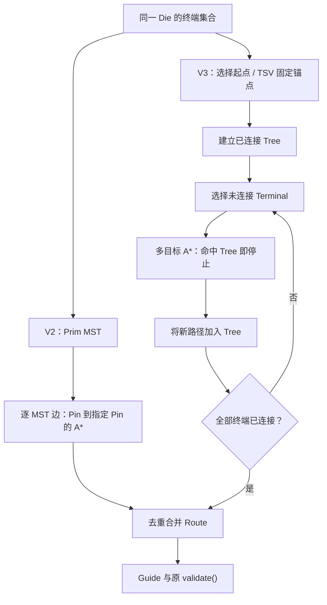

# 算法版本迭代说明

本文维护同一 Router 工程的 V1、V2、V3 演进。版本由源码提交、实际二进制 SHA256、配置和运行记录共同确定，不能用 Run 的 Label 或较新的 Git HEAD 代替版本证据。

相关文档：[比赛代码逻辑](./比赛代码逻辑.md) · [比赛代码使用说明](./比赛代码使用说明.md) · [目录结构](./目录结构.md) · [Router 版本管理](./EDA/code_3DIC%20EDA/docs/Router版本管理.md)。

## 目录

1. [项目简介与算法总体目标](#version-1)
2. [算法版本总览](#version-2)
3. [V1：基础全局布线算法](#version-3)
4. [V2：算法性能与工程效率优化](#version-4)
5. [V3：布线质量与搜索策略优化](#version-5)
6. [V1 / V2 / V3 核心算法对比](#version-6)
7. [各版本运行与官方评分结果](#version-7)
8. [各版本编译、运行及回退方法](#version-8)
9. [版本开发时间线与 Git 对应关系](#version-9)
10. [当前存在的问题](#version-10)
11. [下一版本优化方向](#version-11)
12. [文档更新规则](#version-12)

<a id="version-1"></a>
## 1. 项目简介与算法总体目标

正式工程为 `EDA/code_3DIC EDA/`。DEF 给出放置、连接及 Track/GCell；LEF 给出宏、Pin、层方向及 Via；Thermal JSON 提供给定温度场。Router 生成每个 Net 的 Guide，并可输出真实图边、Trace、进度和资源日志。

优化目标是在合法连通、唯一 TSV 和层约束下兼顾 Wirelength、Congestion、Thermal、Runtime 与 Peak RSS。内部 `validate()`、本地 Overflow、官方评分 PASS、详细布线签核是不同层次的结论。官方工具仍是 Guide / mock-DRT proxy，不代表真实详细布线或隐藏用例保证。

<a id="version-2"></a>
## 2. 算法版本总览

| 版本 | 主要目标 | 源码与构建身份 | 状态 |
|---|---|---|---|
| V1 | 建立独立可运行的全局布线器 | `024d648dae3fe9051e336b8928502de09bf0654b`；`build/router_v1` | 已登记；有实际官方 PASS 记录 |
| V2 | 保持算法输出，降低重复计算与复制 | `a0f8e717ebbeca32ef999c8caf398fec46ba41c2`；`build/router_v2` | 已登记；有同参数比较 |
| V3 | 可配置 Net Ordering、Tree-Aware A* 与拥塞重布排序 | 从 `5b59ab2b2a7609406c8ae0f9e092faa5cf91c073` 增量开发 | 已实现并编译候选；17 次官方 PASS、1 次评分超时；未正式登记 |


V1 SHA256：`70ddc978c6f427ef79d6601e0a3bf099108e945cbbac249b2c2aa234d3c00423`。

V2 SHA256：`6440fcf3211e616534d9192bbc7ceabec99956fc41f1b43e002d2ffa06c0b30f`。

<a id="version-3"></a>
## 3. V1：基础全局布线算法

以下内容已对照 V1 Git 源码，不能将 V2 缓存或后来的 UI 架构追溯成 V1 算法。

| 功能及原理 | 实现文件 / 函数 | 作用、局限及后续关系 |
|---|---|---|
| DEF / LEF 解析：将文本转为 Design、宏、放置与终端 | `src/parser.cpp`：`parse_lef()`、`parse_def()`、`placed_rect()` | 支持八种方位变换及矩形 Pin/OBS；拒绝未支持的几何和非空 DEF 扩展段。V2/V3 继续复用语义 |
| Thermal 投影：按 XY 合并样本，再映射 GCell | `Router::load_thermal()` | DBU/µm 转换后平均，空洞确定性填充；这是给定热场，未重算布线后的温度 |
| 图与容量：GCell × 金属层，Track 决定节点容量 | `Router()`、`capacity()`、`build_fixed_demand()` | 平面边服从 Preferred Direction；Pin/OBS 贡献 fixed。容量与官方统计口径仍有偏差 |
| 多 Pin 终端拓扑：稠密 Prim MST | `Router::mst()` | 时间 O(P²)、辅助存储 O(P)；按几何与 Via 下界构造终端树，不是最优 Steiner Tree |
| 实际路径：逐 MST 边 A* | `Router::search()`、`route()` | 包围盒逐步扩张，哈希存储搜索状态；不同边可重合，但后续边目标仍是指定终端 |
| Via 与双 Die | `route()`、`search()`、`validate()` | 普通 Via 需 LEF 合法；Bottom M1–M10、Top M11–M20；跨 Die 增加唯一 M10/M11 TSV 边 |
| TSV 热感知候选 | `Router::select_tsv()` | Pin 位置与限量采样格点；综合距离、接口压力、冷点惩罚。保留固定 TSV 约束，不是全局热最优 |
| 动态拥塞成本与历史成本 | `search()`、`run()` | 新增需求的过载平方项与非负历史项；本地代价不等于官方分数 |
| 初始布线与 Rip-up and Reroute | `Router::run()` | 原始 Net 顺序；对拥塞 Net 重布，仅整体 Overflow 严格下降时接受；V1 使用完整 Route 备份 |
| Guide 与内部合法性 | `make_guides()`、`validate()`、`write_guide()` | 沿层方向合并区域，接口层保持独立；检查连通、Pin、方向、Via、唯一 TSV。不等于官方完整合法性 |
| 本地工作流 | `main.cpp`、`scripts/run_case.py`、`evaluate.py`、`ui/` | 四参数 CLI、可选 JSON/Trace、运行与评分、2D/3D 与大数据索引在 V1 提交时已存在；后续版本登记、评分监督等属于工程更新 |

搜索边成本为：

\[
c(u,v)=c_{\mathrm{wire/via}}(u,v)
 +w_c\left(\frac{\max(0,U_v+F_v+1-C_v)}{\max(1,C_v)}\right)^2+w_h H_v.
\]

共享节点/边以集合去重。`occupy()` 按 Net 的节点集合计费，跨 Die 的两个接口节点另有 TSV 额外需求；不能把每条搜索分支分别叠加收费。

<a id="version-4"></a>
## 4. V2：算法性能与工程效率优化

证据来源：V1/V2 Git Diff 与 `outputs/reports/algorithm_optimization/optimization_summary.md`。V2 的目标是等价输出，未改变 Prim、TSV 打分公式、搜索邻居顺序和 A* Tie-Breaker。

| 项目 | V1 → V2 | 开销变化与实现位置 | 实测证据 |
|---|---|---|---|
| A* Workspace | 每次新建 sparse map → 小窗口 Dense + 大窗口 Sparse | `search()`；Dense 最多 8192 状态，Generation 复用，溢出时清标记；不分配全图数组 | 受控 astar 展开数均 53,400，routing 中位时间 0.0949008 → 0.0557863 s |
| 几何与规则访问 | 反复取 cell/Layer/Via → 轴中心和固定规则缓存 | 构造函数、`refresh_layers()`；中心 O(1)，避免临时 Rect 和重复 map 查找；直接 API 修改仍刷新 | 不单独归因百分比，与 A* 组合测试 |
| Thermal/TSV | 每个跨 Die Net 全热图 min/max 扫描、候选 set → 单次统计及排序去重 vector | `refresh_heat_stats()`、`select_tsv()`；热图扫描由每 Net O(G) 变为 run 内一次 O(G) | 受控 TSV routing 中位时间 0.365051 → 0.0708347 s |
| Capacity | 每个新资源扫描 Track → 按轴容量表 | `refresh_capacities()`、`capacity()`；缓存总计最多 8 MiB，超限回退 | 原半开 Track 区间计数保持一致 |
| 临时对象 | 非 Trace 路径仍构造 JSON → 仅需要 Trace 时构造 | `route()`、`run()` | 无 Trace 时减少 JSON 分配，仍完整写出最终结果 |
| 重布与回滚 | 全 routes 副本 → 只 Move 真正修改的 Route | `reroute_pass()`；备份存储与改动量相关，异常恢复已修改项 | 受控 reroute RSS 中位值 10,235,900 → 7,880,700 bytes；routing 0.171891 → 0.0509827 s |
| 验证与 Profile | 新增独立 Dijkstra、小图、受控基准与计数 | `tests/algorithm_tests.hpp`、`router_benchmark.cpp`；`GR_PROFILE` 仅统计构建开启 | 旧报告保留完整范围、AB/BA 顺序与失败阶段，生产构建不含 Profile |

这些是历史受控合成基准，不能外推大型 Case 的加速倍数。真实 case001 当时各跑一次：V1 C++ elapsed 104.262 s，V2 53.1971 s，官方指标与 Guide 相同；进程树峰值约 129.117 / 126.008 MiB。toy 的短时结果也曾略慢，因此不能声称所有场景都提升。

<a id="version-5"></a>
## 5. V3：布线质量与搜索策略优化

### 5.1 设计目标与实际状态

本节在实现前先记录目标，以下已按真实代码与实验更新。所有新开关默认 0；V2 对照必须使用不含新键的配置。仅改变 Net index 处理顺序，始终保持 `routes[i] ↔ d.nets[i]`。

| 策略 | 实际实现 | 验证状态 |
|---|---|---|
| Net Ordering | 只排序 Index：模式 1 按原始 Pin HPWL 降序；模式 2 按跨 Die、Pin 数、HPWL 降序，最终以原 Index 升序打平 | 两种排序通过 C++ 测试；模式 2 完成三个公开 Case 布线，case001 评分超时 |
| Tree-Aware A* | 待连接终端连向当前同 Die 已连通树；确定性包围盒下界选择下一 Terminal | 独立 Dijkstra、Dense/Sparse、合法性测试通过；三个 Case 均实际官方 PASS |
| 拥塞重布优先级 | 按拆除 Net 可降低的本地 Overflow、严重度等排序；任意 Index 顺序恢复 | 非升序多 Net 拒绝/异常恢复通过；三个 Case 均实际官方 PASS |
| TSV 新策略 | `select_tsv()` 原样复用 V2 | 未实现新候选/热优化；没有 TSV 策略消融，不宣称 Thermal 改善 |

新配置从未改动的 `default.json` 复制全部共有参数，仅增加三个整数模式：

| 配置 | `net_order_mode` | `tree_route_mode` | `reroute_priority_mode` |
|---|---:|---:|---:|
| `v3_legacy.json` | 0 | 0 | 0 |
| `v3_net_order.json` | 2 | 0 | 0 |
| `v3_tree_aware.json` | 0 | 1 | 0 |
| `v3_congestion.json` | 0 | 0 | 1 |
| `v3_combined.json` | 2 | 1 | 1 |

合法范围分别为 0–2、0–1、0–1；分数、负数、越界值被拒绝。`default2.json` 仍是不同的原参数配置，不属于本次公平比较。Combined 不是新的全局默认。

### 5.2 多目标搜索思想

对当前树 T，使用其空间包围盒 B(T) 和层范围构造保守下界：

\[
h(v,T)=\frac{w_{wire}}{unit}\,[d(x_v,[x_{min},x_{max}])+d(y_v,[y_{min},y_{max}])]
+w_{via}\,d(l_v,[l_{min},l_{max}]).
\]

区间距离为区间外到最近端点的距离，区间内为 0。T 是包围盒的子集；动态拥塞/历史代价非负，所以该值不高估目标树的剩余路径成本。目标查询使用哈希集合，不能在每次展开时遍历整棵树。窗口外仍沿用逐步扩大策略；局部窗口求得的最优路径不保证是完整图的全局最优。



这是增量 Steiner-Aware 近似，并非实现全局最优 Steiner Tree。Bottom/Top 分别生长，只通过选定 TSV 相连。

### 5.3 Tree Growth、开销与函数差异

Die 内普通 Net 以最小 Node ID 终端为种子；跨 Die Net 的两侧分别以选定 TSV 的 M10/M11 节点为种子。每次从尚未连接的终端中选择包围盒下界最小者，平局按 Node ID；命中树后，将路径并入树。路径自然经过的其他终端会被跳过。

`Route.nodes` 在原逻辑中预先放入全部 Pin，故 **不能将它直接用作已连通树的目标集合**。V3 使用单独的 `TreeTarget`，只保存已连接节点，并增量更新 bbox。目标查询期望 O(1)，每次展开不扫描树。调度预处理 O(总 Pin + N log N)，保存 O(N) Index/Key；单 Net 终端选择 O(P²)，目标集合 O(T)，Dense Workspace 仍最多 8192 状态。额外树集合仅存当前 Net，不为全部 Net 或完整图分配副本。

| 函数 / 文件 | 相对 V2 的实际变化 |
|---|---|
| `Config` / `model.hpp`、`main.cpp` | 增加并严格校验三个数字模式；四参数 CLI 和原参数默认值不变 |
| `Router::run()` | `initial_order()` 返回 Index 顺序；按处理位置记录进度，按原 Index 保存 Route |
| `Router::route()` | 模式 0 保留原 Prim + A*；模式 1 按 Die 维护 `TreeTarget`，树种子、目标与真实路径写入 Trace |
| `Router::search()` | 保留原公共接口；经共享 `search_impl()` 执行固定 Goal 搜索 |
| `search_to_tree()` / `search_impl()` / `add_target()` | 新增多目标查询、bbox 下界、增量目标集合；复用旧窗口、Dense/Sparse、Generation、代价、邻居顺序及预算机制 |
| `Router::mst()` | 未修改算法，Legacy 继续调用；Tree 模式不生成假的 MST |
| `Router::reroute_pass()` | 可选 `reroute_order()`；拒绝分支按同一调度顺序匹配 Backup，异常分支仍逆序恢复 |
| `Router::select_tsv()`、`validate()` | 算法与检查原样复用，不降低唯一 TSV、层范围、Via 或连通要求 |
| `result_json()`、Trace 与 UI | 新模式下增加可选 `algorithm` 对象；Tree topology 明示 `strategy=tree_aware`、种子及空 `mst_edges`，UI 不再将其描述为 MST 边；原 Pin/Route/Guide 字段不删除 |

### 5.4 拥塞排序与回滚保证

设 `q(n,v)` 为该 Net 的节点需求：普通节点为 1，跨 Die 的两个 TSV 接口节点为 2。主优先级采用当前模型下拆除此 Net 可减少的局部 Overflow：

\[
m_n=\sum_{v\in R_n}\min\{\max(0,U_v+F_v-C_v),q(n,v)\}.
\]

降序 Tie-Breaker 依次为过载/容量严重度之和、拥塞节点数、跨 Die 标志，最后原 Net Index 升序。每轮仅预计算一次优先级；真正轮到 Net 时仍检查当前是否拥塞。接受条件仍为 **整体本地 Overflow 严格下降**，不以局部改善替代全局判断。

拒绝或异常后，Route、Guide、TSV 和节点 Usage 恢复；新增但未使用的资源条目可保留为 usage=0。History 仍按 V2 累积，不回滚历史惩罚。集合去重后每个完整 Net 只 `occupy()` 一次，分支共享不重复计费。

### 5.5 正确性与受控 Profile

原有 C++ 核心检查及 `tree_aware_tests.hpp` 均通过，覆盖二/三/多 Pin、重复 GCell、已在树上的终端、非均匀格、合法/缺失 Via、Preferred Direction、唯一/固定 TSV、不可达、空目标、跨 Die 非法目标、Search Limit、Timeout、Generation 复用/回绕、Dense/Sparse、有序身份及非升序重布拒绝/异常回滚。多目标成本与小图独立 Dijkstra 的最小目标成本一致；Oracle 使用完整窗口，不把局部窗口路径误称全图最优。

Python 工作流 8 项通过，新增整数模式拒绝测试、Tree Trace 语义及完整输出检查。真实 toy/sample001 的 12 份 Trace 均完整回放至最终图边。三个真实 Case 的 V3-Legacy Guide SHA256 和剔除计时后的完整 JSON 均与已登记 V2 一致。

受控 300-Net、每 Net 五 Pin、96×96 网格，三个交替顺序重复的中位值如下。它比较同一 Profile 二进制的 Legacy/Tree/Combined，**不是官方成绩**。未隔离 CPU，部分时段共享主机；短时数值不能当作稳定加速比例。

| 模式 | Routing 中位 s | RSS 中位 MiB | 搜索次数 | 展开数 | 本地线长 DBU |
|---|---:|---:|---:|---:|---:|
| V3-Legacy | 0.122302 | 6.863 | 1200 | 53,100 | 1,080,000 |
| Tree-Aware | 0.409444 | 7.641 | 1200 | 194,400 | 1,110,000 |
| Combined | 0.286883 | 7.734 | 1200 | 194,400 | 1,110,000 |

该夹具没有改善：包围盒目标下界较松，搜索展开增多，线长也增加。保留全部重复和这项负结果，见 `controlled_benchmarks.json`；首次 harness 混合编码解析失败后复用了已完整写出的原始测量，没有将其删除或伪装为 Router 失败。

<a id="version-6"></a>
## 6. V1 / V2 / V3 核心算法对比

| 项目 | V1 | V2 | V3 实际实现 |
|---|---|---|---|
| 搜索 | Sparse A* | 有界 Dense/Sparse A* | 可选 Tree-Aware A*，保留旧搜索 |
| 多 Pin | Prim MST 逐边连接 | 相同 | 已有树增量连接 |
| Net 顺序 | 输入顺序 | 相同 | 可配置且可复现 |
| TSV | 热感知候选 | 相同公式，缓存优化 | 复用 V2；复杂策略尚未实现 |
| 重布 | 全量备份、整体 Overflow 判断 | 增量备份回滚 | 候选优先级与任意顺序安全恢复 |
| 版本状态 | 已登记 | 已登记 | 候选，不自动替代 V2 |

<a id="version-7"></a>
## 7. 各版本运行与官方评分结果

历史 V1/V2：toy、sample001、case001 的同配置比较均有真实 latest PASS，分项与 Guide 相同，见第二阶段 `small_cases.json`、`case001_comparison.json`。

早期 Run Label `v2` / `v3` 不是正式算法版本号；应按 Router SHA256 判定。case003 的异常评分、case005 的 ROUTED 记录不能改写成官方 PASS。

### 7.1 本次实验协议与可追溯身份

实验 ID `20261029_113225`：已登记 V2 Baseline → V3-Legacy → Net Ordering → Tree-Aware → Congestion → Combined。每项为独立消融，箭头表示实验顺序，不表示后一个模式必然叠加前者；只有 Combined 开启三项。

- 同一份 `default.json` 共有参数、相同原始输入；每项 Router 预算 180 s、latest 评分预算 120 s。toy/sample001 开 Trace，case001 关闭 Trace。每 Case/模式仅测一次。
- Label 为 `v3_20261029_113225_<模式>`，Case 再由所属目录区分。18 次 Router 全部 ROUTED；17 次官方 PASS，case001 的 Net Ordering 评分达到预算而未完成。
- V3 生产候选 `build/router_v3_candidate`，SHA256 为 `47a285c048124b5a6987f2b90171ff1c20fbe12b218b7405cc8aa4669977821a`，运行登记为 UNKNOWN，不能冒充已注册 V3。构建基点 `5b59ab2`，实际工作区源码哈希在构建清单和每份 run.json。
- C++ 时间来自 `result.metrics.runtime_seconds`，包含解析和当时已执行的输出阶段，不是纯 A*；完整 helper 时间另存记录。RSS 为 Linux Supervisor 等待子进程得到的 getrusage 高水位，可能包含 exec 前继承的启动内存；GNU time 整条命令树峰值与周期采样也独立保留。
- 原始证据：[对照 JSON](./EDA/code_3DIC%20EDA/outputs/reports/v3_algorithm/20261029_113225/comparisons/results.json)、[CSV](./EDA/code_3DIC%20EDA/outputs/reports/v3_algorithm/20261029_113225/comparisons/results.csv)、[构建清单](./EDA/code_3DIC%20EDA/outputs/reports/v3_algorithm/20261029_113225/candidate.json)、[受控 Profile](./EDA/code_3DIC%20EDA/outputs/reports/v3_algorithm/20261029_113225/controlled_benchmarks.json)。这些 outputs 是本机 Git 忽略产物，远端不一定包含；本页保留可直接阅读的实测摘要。

### 7.2 case001 主对照：3152 Net

| Mode | Router / Official | C++ s | RSS MiB | Official Wirelength DBU | Official Overflow |
|---|---|---|---|---|---|
| v2 | ROUTED / PASS | 59.472 | 125.992 | 843819000 | 8289 |
| legacy | ROUTED / PASS | 62.981 | 125.801 | 843819000 | 8289 |
| net_order | ROUTED / NOT_EVALUATED | 86.275 | 126.559 | N/A | N/A |
| tree_aware | ROUTED / PASS | 64.361 | 118.816 | 854565000 | 8237 |
| congestion | ROUTED / PASS | 54.046 | 125.844 | 843828000 | 8289 |
| combined | ROUTED / PASS | 41.074 | 117.184 | 854523000 | 8238 |

V3-Legacy 与 V2 的 Guide/规范化 JSON 完全一致。Net Ordering 已完成 Router，但评分器约 120.4 s 时被监督进程按 `time_budget` 发送 SIGTERM，真实返回码 -15，未生成官方报告：这是 **评分调用 TIMEOUT / NOT_EVALUATED**，不是官方 FAIL，更不能填入猜测成绩。本轮保留该记录，未自动提高预算重评。

| Mode | Wirelength score | Congestion score | Thermal score | Official total |
|---|---|---|---|---|
| v2 | 64.668125 | 78.170604 | 51.349311 | N/A |
| legacy | 64.668125 | 78.170604 | 51.349311 | N/A |
| net_order | N/A | N/A | N/A | N/A |
| tree_aware | 63.854935 | 78.317504 | 51.349311 | N/A |
| congestion | 64.667435 | 78.170604 | 51.349311 | N/A |
| combined | 63.858073 | 78.316436 | 51.349311 | N/A |

所有实际完成报告的 TSV 均为 657，官方 Pearson 均为 0.002310234269；没有新的 TSV 热优化收益。本地 Pearson 为约 0.127166，与官方口径不同。本地 Overflow：V2/Legacy/Net Ordering/Congestion 为 584899，Tree/Combined 为 584777；不能用这 122 的下降替代官方 Overflow 或分数。

### 7.3 toy / sample001 全部消融

| Case | Mode | Official | C++ s | RSS MiB | Wirelength DBU | Overflow | W / C / T scores |
|---|---|---|---|---|---|---|---|
| toy | v2 | PASS | 0.728 | 12.770 | 30965800 | 244 | 53.6202 / 92.7342 / 47.1785 |
| toy | legacy | PASS | 0.654 | 12.793 | 30965800 | 244 | 53.6202 / 92.7342 / 47.1785 |
| toy | net_order | PASS | 0.453 | 12.859 | 31479400 | 236 | 52.7454 / 93.0514 / 47.1785 |
| toy | tree_aware | PASS | 0.719 | 12.859 | 30826700 | 244 | 53.8622 / 92.6457 / 47.1785 |
| toy | congestion | PASS | 0.538 | 12.832 | 30944400 | 244 | 53.6573 / 92.6429 / 47.1785 |
| toy | combined | PASS | 0.388 | 12.926 | 31286800 | 238 | 53.0701 / 92.8118 / 47.1785 |
| sample001 | v2 | PASS | 0.517 | 12.766 | 6452400 | 453 | 89.5517 / 73.3848 / 51.0939 |
| sample001 | legacy | PASS | 0.777 | 12.980 | 6452400 | 453 | 89.5517 / 73.3848 / 51.0939 |
| sample001 | net_order | PASS | 0.853 | 12.941 | 6452400 | 453 | 89.5517 / 73.3848 / 51.0939 |
| sample001 | tree_aware | PASS | 0.716 | 12.633 | 6452400 | 453 | 89.5517 / 73.3848 / 51.0939 |
| sample001 | congestion | PASS | 0.930 | 12.781 | 6452400 | 453 | 89.5517 / 73.3848 / 51.0939 |
| sample001 | combined | PASS | 0.784 | 12.887 | 6452400 | 453 | 89.5517 / 73.3848 / 51.0939 |

toy 的官方 Pearson 各模式均为 -0.002628377442；sample001 均为 0.001094066710。所有官方总分字段均缺失，统一为 N/A，未将实验加权值当作官方总分。短用例的时间/RSS 差异受启动与系统负载影响，不用这些单次小数值宣称稳定加速。

### 7.4 是否取代 V2

**目前不建议全面取代 V2。** Combined 在 case001 的本次单次测量时间和内存较低、拥塞略有改善，但官方线长 843819000 → 854523000 DBU，Wirelength 分 64.668125 → 63.858073；Thermal 无变化。Tree-Aware 单独模式还更慢，受控夹具也出现线长和展开数退化。Net Ordering 在 toy 改善 Overflow 却使线长变差，case001 还发生评分预算超时。

所以保留这些可独立开关的研究结果，默认继续 Legacy。case003/005 未运行 V3，不能保证其时间、内存或官方合法性。历史 `case005_v2_1` 的 V2 ROUTED 179700 Net、5919.766 s、采样峰值 4749651968 bytes（约 4.424 GiB）只作历史稳定性证据，不是本次消融或官方 PASS。

### 7.5 最终回归与保护检查

| 检查 | 实际结果与范围 |
|---|---|
| Linux C++17 生产构建、原核心及新增 Tree-Aware 测试 | 编译成功；最终 `core_tests_final` 通过。包含独立 Dijkstra、非均匀网格、合法 Via、唯一 TSV、Dense/Sparse、Generation、搜索预算及重布接受/拒绝/异常状态检查 |
| V3-Legacy 等价性 | toy、sample001、case001 的 Guide SHA256 和规范化 JSON SHA256 均与 V2 相同；JSON 仅排除观测字段 `metrics.runtime_seconds` |
| WSL Python 3.10 全测试 | 73 项：63 通过、1 项平台条件跳过、9 项错误。错误均来自原清理工具调用 Python 3.10 没有的 `Path.is_junction()`，完整失败日志保留，未修改无关工具 |
| Windows Python 3.13 补测 | 上述清理工具 9 项全部通过；parameter_tuning 的预算、唯一 Label/中文空格路径、评分失败、冻结基线 4 项兼容性测试通过，使用 Mock，不是官方成绩 |
| UI 与 Trace | 新增元数据兼容测试、JavaScript 语法及拓扑文案检查通过；临时 UI 服务器实际加载三种 Combined 结果，返回真实的 203 / 203 / 3152 Net、20 层及完整 Pin/Node/Edge/Guide。小用例 Trace 重放与最终边集合一致；未进行全面浏览器交互回归 |
| 文件保护 | 初始登记的 29 个关键文件 SHA256 无变化；722 个原有运行文件的大小/修改时间无变化。候选二进制与记录的当前生产源码哈希一致；`select_tsv()`、`validate()` 保持原实现 |
| 运行范围与清理 | 仅新增本轮独立 Label；没有运行 case003/005，没有覆盖旧 Guide/报告，没有 commit/push。临时测试目录与临时 UI 缓存/服务器已清理；本轮正式实验记录、构建身份和失败日志保留 |

复核原始记录：[核心测试](./EDA/code_3DIC%20EDA/outputs/reports/v3_algorithm/20261029_113225/core_final.json)、[WSL 全测试日志](./EDA/code_3DIC%20EDA/outputs/reports/v3_algorithm/20261029_113225/python_all.log)、[Windows 兼容性](./EDA/code_3DIC%20EDA/outputs/reports/v3_algorithm/20261029_113225/windows_compatibility.json)、[UI API](./EDA/code_3DIC%20EDA/outputs/reports/v3_algorithm/20261029_113225/ui_api.json)、[保护与等价性](./EDA/code_3DIC%20EDA/outputs/reports/v3_algorithm/20261029_113225/verification.json)。

<a id="version-8"></a>
## 8. 各版本编译、运行及回退方法

使用 PowerShell 管理、WSL Ubuntu 编译与执行。V3 候选另存 `build/router_v3_candidate`，目标存在时必须换新文件名；不能调用会覆盖根目录 `router` 的 `build.sh` 来做版本比较。

正式 V1/V2 使用 `--router build/router_v1` / `--router build/router_v2`。V3 使用候选文件及专用配置；在保存源码提交并独立重建确认 SHA256 前，运行时显示 UNKNOWN 是正确行为，不得手改登记冒充正式 V3。

进入正式代码目录后，在 PowerShell 编译到**另一个不存在的文件**：

```powershell
Set-Location -LiteralPath 'D:\我\大学\program\3DIC EDA\EDA\code_3DIC EDA'
wsl -d Ubuntu -- bash -lc "cd '/mnt/d/我/大学/program/3DIC EDA/EDA/code_3DIC EDA' && test ! -e build/router_v3_candidate_next && g++ -std=c++17 -O3 -DNDEBUG -Wall -Wextra -I include src/main.cpp src/parser.cpp src/router.cpp -o build/router_v3_candidate_next"
$LASTEXITCODE
```

退出码 0 表示该次编译完成；目标已存在时拒绝，换新文件名。下面使用本轮已经生成的候选，标签每次换新：

```powershell
$label = 'v3_tree_' + (Get-Date -Format 'yyyyMMdd_HHmmss')
python scripts/run_case.py --case toy --backend wsl --router build/router_v3_candidate --config configs/v3_tree_aware.json --label $label --time-limit 180 --trace
if ($LASTEXITCODE -eq 0) {
    python scripts/evaluate.py --case toy --label $label --backend wsl --engine latest --timeout 120
}
# 关闭新策略、验证 V3 源码 Legacy 行为：--config configs/v3_legacy.json
# 回退已登记 V2：必须同时换回它认识的原配置，并使用新 Label。
$back = 'v2_back_' + (Get-Date -Format 'yyyyMMdd_HHmmss')
python scripts/run_case.py --case toy --backend wsl --router build/router_v2 --config configs/default.json --label $back --time-limit 180
```

根目录 `router` 仍是 V1：省略 `--router` 不会自动选择 V3，也没有偷偷替换默认二进制。评分必须使用实际相同的 Case/Label；已有评分目录不覆盖。

复现实验工具只接受 toy、sample001、case001，显式设置预算并使用新实验 ID：

```powershell
python scripts/compare_router_v3.py --candidate build/router_v3_candidate --experiment v3_study02 --case toy --case sample001 --case open_3d_case001 --router-budget 180 --evaluation-budget 120
```

该工具检查所有共有配置一致及候选哈希，先小 Case 后 case001；失败与超时写入独立记录，Legacy 不等价或基础设施异常时中止，不接受 case003/005。原 `benchmark_router.py` 的三种默认夹具及 `report_router_benchmark.py` 继续保留，受控新夹具通过 `tests/router_benchmark.cpp` 的 `tree_legacy/tree_aware/tree_combined` 模式运行，原始命令在 Profile 报告。

旧 parameter_tuning 批次冻结源码/环境，V3 改源码后不能复用旧指纹或自动重写旧报告；新增实验应使用新的 Experiment ID。当前候选仍未注册，用户提交源码后才用原版本管理工具独立重建与登记，不通过重命名/复制或手填 SHA 伪造正式版本。

<a id="version-9"></a>
## 9. 版本开发时间线与 Git 对应关系

| 提交 / 阶段 | 实际含义 |
|---|---|
| `024d648` | V1 基础 Router 与第一阶段工作流 |
| `a0f8e71` | V2 C++ 性能优化 |
| `3456a88` | 第二阶段配置/结果更新，C++ 与 V2 一致 |
| `54761f2` | 后续工程与文档更新 |
| `5b59ab2` | 版本管理及评分监督等工程更新；V3 开发基点 |
| `v3-tree-aware` 工作分支 | 本轮增量开发；尚无 V3 源码提交，禁止自动 commit/push |

<a id="version-10"></a>
## 10. 当前存在的问题

局部资源模型与官方评分口径不同；Tree Growth 的顺序和局部窗口不保证最优；TSV 的单 Net 热代价无法充分代表全局密度相关性。大型 WSL 异常及评分缺失报告需保留原始诊断，不将 UNKNOWN 强行归为 OOM。

Tree bbox 内部的启发值可能为零，包含远离实际树的空白区域，导致更多展开；终端选择仍为 O(P²)。目前只完成受控夹具重复测量，公开 Case 为单次消融，不足以保证稳定加速或大型用例内存上界。WSL Python 3.10 的旧清理测试平台问题也仍存在，不能把 Windows 补测通过写成全平台全测试通过。

<a id="version-11"></a>
## 11. 下一版本优化方向

V4 优先改进 Tree 目标的空间查询与终端选择：在保持可采纳下界和有界内存的前提下，减少 bbox 内无效展开，并以高 Pin、非均匀网格和 Dijkstra Oracle 验证。此次受控夹具展开数由 53100 增至 194400，线长也退化，应先解决这个问题。

其次校准本地拥塞/Guide 与官方指标的差异，引入明确的多目标质量退化保护，再以重复、交错顺序实验判断速度和 Wirelength 的取舍。TSV 全局热密度优化应建立独立消融与官方证据，不能仅优化单 Net 冷点代价。case003/005 需用户另行授权完整实验。

<a id="version-12"></a>
## 12. 文档更新规则

每版保留源码提交、二进制及配置 SHA256、输入身份、独立 Run Label、预算、报告来源和失败记录。将“已实现 / 已测试 / 官方 PASS / 未测试 / 计划”分开写。官方总分无明确字段时写 N/A；本地线长和 Overflow 不冒充官方指标。后续 V4/V5 可新增版本章节，并同步本表、比较表和时间线，不能覆盖旧原始结果。
